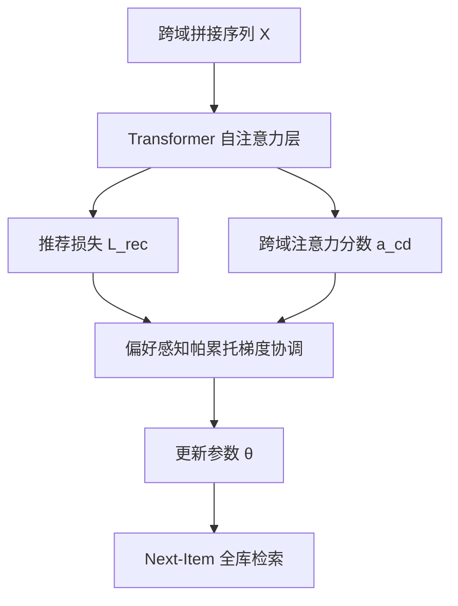

# Revisiting Self-attention for Cross-domain Sequential Recommendation (重访跨域序列推荐中的自注意力)

- **会议/期刊**: KDD 2025
- **作者与机构**: Clark Mingxuan Ju, Leonardo Neves, Bhuvesh Kumar, Liam Collins, Tong Zhao, Yuwei Qiu, Qing Dou, Sohail Nizam, Sen Yang, Neil Shah, Neil Shah 等（Snap Inc.）
- **推荐链路定位**: 召回（Next-Item Retrieval）
- **研究方向**: 跨域与多场景推荐 / 序列推荐
- **论文原文**: [https://arxiv.org/abs/2505.21811v1](https://arxiv.org/abs/2505.21811v1)
- **开源代码**: [https://github.com/snap-research/AutoCDSR](https://github.com/snap-research/AutoCDSR)

## TL;DR (1分钟核心速览)

跨域序列推荐（CDSR）现有工作靠堆叠域感知模块来抑制负迁移，却忽视了 Transformer 自带的注意力本身就是跨域知识融合/过滤的天然工具。本文提出 AutoCDSR：把跨域学习建模为「推荐损失 + 跨域注意力分数最小化」的双目标问题，用偏好感知的帕累托最优梯度协调自动调节跨域注意力，并给出引入 IB token 的增强版 AutoCDSR+。作为即插即用模块，在 Amazon-Review、KuaiRand-1K 与工业内部数据上，使 SASRec/BERT4Rec 的 Recall@10 平均提升 9.8%/16.0%，NDCG@10 提升 12.0%/16.7%，且训练开销仅增加约 9%，比 SOTA 快约 4 倍。

## Background & Motivation (背景与核心矛盾)

- **主流范式**: CDSR 普遍以自注意力 Transformer（SASRec/BERT4Rec）为骨干，通过额外域感知模块（π-net 门控、C2DSR 跨域图、MAN 解耦块、SyNCRec 协同学习）显式注入域信息。
- **前人局限**: ① 这些额外模块带来高昂计算与部署成本，与工业界轻量序列模型存在鸿沟；② 它们绕开了骨干中本就强大的自注意力，未回答「注意力本身能否自动完成知识迁移」。
- **核心洞察 (Key Insight)**: 作者用 BERT4Rec 做对照实验（表 1）：跨域序列训练整体变差（19.3%→17.6%），但其正确集合的并集远大于单域（24.7% vs 19.3%），说明注意力**有时**能学到互补知识、**有时**被噪声误导。进一步用跨域注意力分数 $a_{cd}$ 量化（图 2）：负迁移样本恰恰是跨域注意力被过度放大的样本。
- **本文切入点**: 既然 $a_{cd}$ 是知识迁移的良好代理，就直接优化它——只在跨域信息真正有益于推荐时才允许注意力跨域，否则抑制。

## Method (核心方法设计)

### 1. 整体框架 (Overall Architecture)

输入为用户跨域拼接序列 $X$，经标准 Transformer 编码；在每一层自注意力中，除常规推荐损失外，额外提取跨域注意力分数$a_{cd}$ 作为辅助目标。训练时把两目标视为多任务优化，用偏好感知的帕累托最优梯度下降动态求解任务权重，使模型收敛到「偏向推荐任务」的帕累托子区域；推理时与原始模型完全一致，无额外解码开销。AutoCDSR+ 则在同一框架下插入 IB token 作为受控信息瓶颈。

### 2. 关键设计拆解 (Key Designs)

1. **跨域注意力量化与双目标建模**：痛点是把跨域行为无差别拼接会让注意力被无关域稀释。作者定义 $a_{cd}=\sum_{i,j}\mathrm{softmax}(A)_{i,j}\cdot\mathbb{I}(d(x_i)\neq d(x_j))$，将训练目标写为$\mathcal{L}=\alpha_1\mathcal{L}_{rec}+\alpha_2 a_{cd}$。直觉是：$a_{cd}$越大表示跨域通信越强，而负迁移样本正是$a_{cd}$ 异常偏高的样本，因此最小化它等价于给跨域通信加一道「按需开关」。

2. **偏好感知帕累托最优协调（核心创新）**：固定权重 $\alpha$无法适配序列级差异（图 4 显示不存在对所有域都最优的单一权重）。作者将问题写成$\min_\theta(\mathcal{L}_{rec},\mathcal{L}_{cd\text{-}attn})$，先用多梯度下降求无偏好帕累托解，再在帕累托前沿上定义$K+1$个偏好向量$p_k=(\cos\frac{k\pi}{2K},\sin\frac{k\pi}{2K})$，选取$p_1$偏向推荐任务；对当前损失向量识别活跃约束集$\mathcal{S}=\{p_k\mid(p_k^\top L-p_1^\top L)\ge 0\}$，用 Frank-Wolfe 迭代求解$\min_\beta\|\sum_{p_k\in\mathcal{S}}\beta_k\nabla_\theta(p_k^\top L-p_1^\top L)\|_F$。物理直觉：只有当提升跨域注意力能换来推荐损失下降时，才允许跨域通信，否则自动加大推荐任务权重。

3. **AutoCDSR+ 与训练/推理开销**：在每域序列前注入 $T$个 IB token，跨域通信仅发生在不同域的 IB token 之间，跨域分数改为$a_{cd}=\sum_{d}\sum_{i=T}^{M_d}\sum_{j=1}^{T}A^d_{i,j}$，再以$\mathrm{Combine}(\cdot)$（逐元素求和）混合各域 IB 表示。该设计把知识迁移限制在少量专用 token 上，避免信息稀释。训练负采样沿用原模型（全库 softmax 交叉熵），帕累托求解迭代 100 次且排除 embedding 参数以省开销；推理与基线完全同构。

## Experimental Setup & Evaluation Protocol (实验设置与评估协议)

- **数据集与预处理**:

| 数据集 | #Users | #Items | #Interactions | 稀疏度/密度 | 特征/场景说明 |
| :--- | :---: | :---: | :---: | :---: | :--- |
| Amazon-Review | 多域用户 | Book/Clothing/Video/Toy/Sports 五域 | 沿用 SyNCRec 设置 | 稀疏 | 电商评论，5 域跨域 |
| KuaiRand-1K | 快手用户 | 短视频 | 公开基准 | 稀疏 | 以 music type 作域指示 |
| Internal | 社交平台用户 | 多 in-app 界面 | 大规模工业 | 稠密 | 以 in-app surface 作域 |

- **数据划分与防穿越 (Splitting Strategy)**: 沿用前作 SyNCRec 的划分设置（序列式留出，Next-Item 预测），未额外引入时间穿越。
- **排名评测协议 (Ranking Protocol)**: 采用 Recall@5/10/20 与 NDCG@5/10/20，属全库候选打分（Next-Item Retrieval），所有实验重复 5 次取均值。
- **对比基线与超参设置**: 基线含域无关序列模型（GRU4Rec、SASRec、BERT4Rec）与域感知模型（SyNCRec、C2DSR、CGRec）；AutoCDSR 作为插件挂载于 SASRec$_{cd}$/BERT4Rec$_{cd}$；帕累托迭代 100 次，偏好向量取$p_1$。

## Key Experimental Results (实验关键数据)

### 1. 主实验对比 (Main Results)

Amazon-Review（Book 域，Recall@10 / NDCG@10）：

| 方法 | Recall@10 | NDCG@10 | 说明 |
| :--- | :---: | :---: | :--- |
| SASRec（单域） | 0.355 | 0.218 | 域无关基线 |
| BERT4Rec（单域） | 0.296 | 0.172 | 域无关基线 |
| SyNCRec | **0.433** | **0.280** | 域感知 SOTA |
| C2DSR | 0.420 | 0.271 | 跨域图 |
| CGRec | 0.352 | 0.218 | 跨域图 |
| SASRec$_{cd}$ | 0.348 | 0.203 | 直接拼接，负迁移 |
| +AutoCDSR | 0.423 | 0.277 | **+21.6% / +36.6%** |
| +AutoCDSR+ | **0.436** | 0.274 | **+25.2% / +35.2%** |
| BERT4Rec$_{cd}$ | 0.313 | 0.181 | 直接拼接 |
| +AutoCDSR | 0.415 | 0.246 | **+32.5% / +35.9%** |
| +AutoCDSR+ | 0.395 | **0.267** | +26.2% / +47.6% |

KuaiRand-1K（Type A，NDCG@10 / Recall@20）：SASRec$_{cd}$0.022/0.093 → +AutoCDSR 0.028/0.106（+27.2%/+13.9%）；BERT4Rec$_{cd}$0.027/0.134 → +AutoCDSR 0.031/0.173（+14.7%/+29.1%），+AutoCDSR+ 达 0.033/0.139。工业 Internal 上 AutoCDSR+ 对 BERT4Rec$_{cd}$ 的 Recall@20 提升 8.0%。

### 2. 消融实验 (Ablation Study)

| 配置 | KuaiRand-1K Type A Recall@20 | 相对变化 |
| :--- | :---: | :---: |
| BERT4Rec$_{cd}$（无插件） | 0.134 | — |
| + 固定权重注意力正则（最优） | 约 0.14–0.15 | 域间最优值不一致 |
| + AutoCDSR | 0.173 | +29.1% |
| + AutoCDSR+ | 0.139 | +3.7% |
| 10% 域标签污染 + AutoCDSR | 0.152 | 鲁棒 |
| 50% 域标签污染 + AutoCDSR | 0.151 | 鲁棒 |
| 50% 域标签污染 + AutoCDSR+ | 0.141 | 明显下降 |

计算开销（KuaiRand-1K，iter/s，越高越好）：BERT4Rec 10.27 → +AutoCDSR 9.31（+9.34% 开销）→ +AutoCDSR+ 8.22（+19.96%）；SyNCRec 仅 2.41（+75.53% 开销）。

### 3. 关键实验发现 (Key Findings)

1. **负迁移被精准压制**：部署 AutoCDSR 后（图 3），「单域对、跨域错」的负迁移样本跨域注意力下降 17%，而「单域错、跨域对」的有益样本仅下降 3%，证明模型学会了选择性保留而非一刀切抑制。
2. **固定权重不可行**：图 4 显示不同域的最优正则权重差异显著，且图 5 中 AutoCDSR 在 50% 污染率下自动把任务权重从 0.1 降到 0，验证了动态帕累托协调的必要性。
3. **轻量即插即用**：AutoCDSR 仅带来约 9% 训练开销，却让朴素 Transformer 追平甚至超越 SyNCRec 等 SOTA，且比 SOTA 快约 4 倍，工业部署价值明确。

## Highlights & Limitations (亮点、对比与审稿批判)

- **与代表作对比 (vs. Prior Work)**: SyNCRec/MAN 靠额外域感知块与辅助监督，C2DSR/CGRec 靠跨域图结构；本文不新增任何模块，仅改造已有自注意力的优化目标，参数量与推理图完全不变，这是本质差异。
- **可迁移亮点**: ① 用「跨域注意力分数」作为知识迁移的可解释代理指标，可迁移到多场景/多任务注意力诊断；② 偏好感知帕累托梯度协调可复用到任何「主任务 + 正则辅助任务」的推荐训练中，替代手工调权。
- **审稿级局限批判**: ① AutoCDSR+ 依赖域标签准确性，50% 污染下 Recall@20 从 0.153 降至 0.141，鲁棒性弱于 AutoCDSR；② 帕累托求解需每步多次梯度计算与 100 次 Frank-Wolfe 迭代，虽排除 embedding 参数，但在超长序列/超大模型上的扩展性未充分验证；③ 评测以学术全库排序为主，缺少线上 A/B 的长期留存指标。

## Rating (四维评分)

- **方法创新性 (Novelty)**: ⭐⭐⭐⭐ （从「加模块」转向「优化已有注意力」，帕累托多目标视角新颖且有注意力分布实证支撑）
- **评估协议与实验扎实度 (Protocol & Experiments)**: ⭐⭐⭐⭐ （三数据集含工业数据、5 次重复、消融与鲁棒性齐全，但缺线上 A/B 与显著性检验细节）
- **写作与数学规范度 (Clarity & Rigor)**: ⭐⭐⭐⭐ （双目标建模与 Frank-Wolfe 推导清晰，偏好向量与活跃约束定义严谨）
- **工业落地与复现价值 (Industrial & Practical Value)**: ⭐⭐⭐⭐⭐ （代码开源、即插即用、仅约 9% 训练开销且比 SOTA 快 4 倍，落地价值极高）

