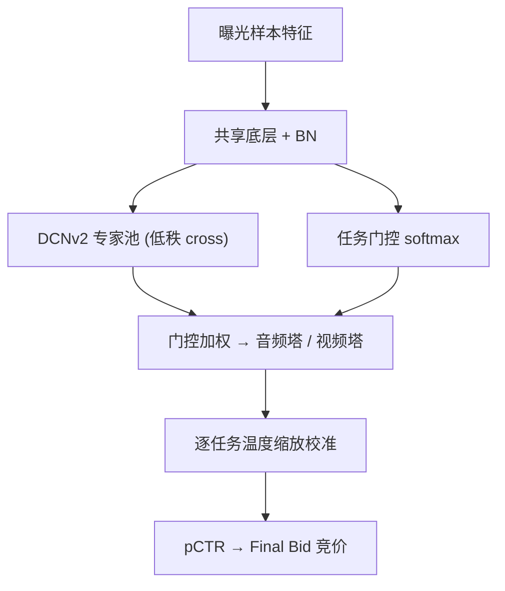

# An Audio-centric Multi-task Learning Framework for Streaming Ads Targeting on Spotify (面向 Spotify 流媒体广告投放的音频主导多任务学习框架)

- **会议/期刊**: KDD 2025 (Applied Data Science Track)
- **作者与机构**: Shivam Verma, Vivian Chen, Darren Mei（Spotify Inc.）
- **推荐链路定位**: 精排（Ad Ranker 的 pCTR 预估）
- **研究方向**: CTR/CVR 预估与特征交叉 / 多任务学习与列表级重排
- **论文原文**: [https://arxiv.org/abs/2506.18735v1](https://arxiv.org/abs/2506.18735v1)
- **开源代码**: 暂未开源

## TL;DR (1分钟核心速览)

Spotify 是音频主导平台，超 70% 收听发生在用户失焦（后台/息屏）状态，音频曝光量压倒性主导，导致传统单任务/单模态模型在视频、播客等稀缺广告位上严重欠拟合与失准。本文提出 CAMoE：按**模态（音频 vs 视频）而非广告位**做任务分组，用**自适应损失掩码**阻断跨模态标签回传，并在每个 MoE 专家内嵌 **DCNv2** 捕捉模态内高阶特征交叉。离线 AUC-PR 相对 Wide&Deep 基线在 Stream Video 提升 20.73%、Stream Audio 提升 24.10%；线上 100% 全量后音频 CTR +14.5%、eCPC −4.8%。

## Background & Motivation (背景与核心矛盾)

- **主流范式**: 工业广告 CTR 预估普遍采用 Wide&Deep / DCN 单任务模型，或 MMoE 式多任务共享底层；多模态场景则倾向"一个模型吃所有广告位"。
- **前人局限**: ① 单任务单模态模型对 Podcast Video、Embedded Music 等低频位数据稀疏、运维成本随广告位线性膨胀；② 多模态单任务模型被音频曝光量主导，视频位预测被"带偏"，排序尚可但**概率校准严重失真**（拍卖计费场景致命）。
- **核心洞察 (Key Insight)**: 真正决定用户点击行为的是**模态与焦点状态**（音频=失焦、视频=聚焦，聚焦曝光 CTR 约为失焦的 10 倍），而非广告位本身或内容类型（音乐/播客）；因此任务应按模态切分，且跨模态标签不应互相回传。
- **本文切入点**: 用"模态感知任务分组 + 自适应损失掩码 + DCN 专家"三件套，在 1-task / 2-task / 7-task 的粒度谱上找到近帕累托最优点。

## Method (核心方法设计)

### 1. 整体框架 (Overall Architecture)

输入为广告曝光样本的稠密/稀疏特征，经带 BatchNorm 的共享底层 featurization 后送入若干专家；每个专家是 ReLU 激活的 **DCNv2 低秩交叉块**（3 组并行 deep+cross）。任务门控对底层 embedding 做 softmax 后与专家输出逐元素相乘，送入音频塔/视频塔，各自输出 logit 并经**逐任务温度缩放**校准后得 pCTR。训练时用自适应损失掩码保证音频塔只吃音频/展示位标签、视频塔只吃视频位标签；推理时按广告位模态路由到对应塔。

### 2. 关键设计拆解 (Key Designs)

1. **模态感知任务分组（2-task 而非 1/7-task）**：痛点是把所有位塞进一个头会迫使模型学"折中表征"，校准崩坏；而每位一个头（7-task）又让低频位过拟合、复杂度爆炸。本文按音频（含 Stream Audio、Podcast、两个 Leavebehind 展示位）与视频（Stream Video、Embedded Music、Podcast Video）切两个头，既保留模态内共享（音频位之间行为同质），又隔离模态间分布差异，是粒度谱上的帕累托折中。

2. **自适应损失掩码 ALM**：痛点是无掩码时每个样本的损失会同时回传两个塔，音频海量样本淹没视频塔。本文用示性函数把第 $i$个样本对任务$m$ 的损失贡献限制在同模态上：

$$\tilde{\mathcal{L}}^{(i)}_{m}=\sum_{n\in M}\mathbb{I}\{n=m\}\big[y^{(n)}_{i}\log\hat{y}^{(m)}_{i}+(1-y^{(n)}_{i})\log(1-\hat{y}^{(m)}_{i})\big]$$

$$\mathcal{L}_{M}(y,\hat{y})=-\frac{1}{N}\sum_{i=1}^{N}\sum_{m\in M}\lambda_{m}\tilde{\mathcal{L}}^{(i)}_{m},\quad \sum_{m\in M}\lambda_{m}=1$$

   直觉：切断跨模态梯度即"解耦任务干扰"，让视频塔专注学习稀缺但高价值的视频交互，同时显著改善 ECE。

3. **DCNv2 专家 + 温度校准**：每个专家内第 $l$层交叉为$\mathbf{x}^{(k)}_{l+1}=\mathbf{x}^{(k)}_{l}+\mathbf{x}_{0}\odot\big(\mathbf{W}^{(2,k)}_{l}\sigma(\mathbf{W}^{(1,k)}_{l}\mathbf{x}^{(k)}_{l}+\mathbf{b}^{(k)}_{l})\big)$，显式建模模态内高阶交叉；校准用单参数温度缩放$P(y=1|\mathbf{x})=1/(1+\exp(-z/T))$，每任务一个$T$，比 Platt/Isotonic 更轻量。总损失即上式加权 BCE，负采样沿用曝光即负样本的工业惯例（无额外负采样），推理仅一次前向 + 门控路由，开销与 MMoE 同量级。

## Experimental Setup & Evaluation Protocol (实验设置与评估协议)

- **数据集与预处理**: 论文未公开数据集统计量（工业内部日志），仅说明覆盖 7 类广告位、音频曝光压倒性主导；对少数位采用**降采样 + ALM** 组合缓解不平衡（对比过过采样、代价敏感与 focal loss，效果次之）。

| 数据集 | #Users | #Items | #Interactions | 稀疏度/密度 | 特征/场景说明 |
| :--- | :---: | :---: | :---: | :---: | :--- |
| Spotify 内部广告日志 | 未披露 | 未披露 | 未披露 | 未披露 | 7 类广告位，音频/视频/展示三模态 |

- **数据划分与防穿越 (Splitting Strategy)**: 未明确披露，按工业惯例应为时间切分（离线训练/验证），线上以预算分割 A/B 验证。
- **排名评测协议 (Ranking Protocol)**: 离线采用 **AUC-PR**（对类别不平衡比 AUC-ROC 更稳健）与 **ECE**（分桶校准误差）；线上采用预算分割 A/B（20 个区域市场），指标为 CTR、eCPC、点击数。
- **对比基线与超参设置**: 基线为生产 Wide&Deep 单任务、DCNv2(t=1)、MMoE(t=2)、CAMoE(t=7)、内容分组（music/podcast）变体；显著性 $p<0.05$（线上$p<0.005$）。

## Key Experimental Results (实验关键数据)

### 1. 主实验对比 (Main Results)

相对 Wide&Deep 基线的 AUC-PR 变化（%）：

| 模型 | Stream Video | Podcast Video | Embedded Music | Stream Audio | Stream Audio LB | Podcast | Podcast LB |
| :--- | :---: | :---: | :---: | :---: | :---: | :---: | :---: |
| Wide&Deep | 0% | 0% | 0% | 0% | 0% | 0% | 0% |
| DCNv2 (t=1) | 13.91% | 21.39% | 26.88% | 15.91% | 28.99% | 19.11% | 40.60% |
| MMoE (t=2) | 3.34% | −0.64% | −35.68% | 2.34% | −12.74% | 15.42% | −22.79% |
| **CAMoE (t=2)** | **20.73%** | **43.27%** | **199.29%** | **24.10%** | **45.59%** | **54.21%** | 39.93% |
| CAMoE (t=7) | 11.05% | 24.60% | 88.03% | 9.17% | 13.45% | 27.00% | **40.06%** |

线上结果（A/B 与 100% 全量）：

| 广告位 | A/B 点击数 | A/B eCPC | A/B CTR | 全量 eCPC | 全量 CTR |
| :--- | :---: | :---: | :---: | :---: | :---: |
| Audio | +12% | −8% | +10% | −4.8% | **+14.5%** |
| Video | +5% | −1.2% | +1.4% | −2.6% | **+1.3%** |

### 2. 消融实验 (Ablation Study)

| 配置 | Stream Video | Podcast Video | Embedded Music | Stream Audio | Podcast |
| :--- | :---: | :---: | :---: | :---: | :---: |
| CAMoE 完整 (ALM+DCN) | 20.73% | 43.27% | 199.29% | 24.10% | 54.21% |
| w/o ALM（无掩码） | −2.40% | −5.53% | −19.33% | 8.63% | 27.46% |
| w/o DCN 专家 | 3.34% | −0.64% | −35.68% | 2.34% | 15.42% |
| 内容分组 (music/podcast) | 4.69% | 23.38% | 123.60% | 1.81% | 40.58% |

### 3. 关键实验发现 (Key Findings)

1. **掩码是视频位的生命线**：去掉 ALM 后 Stream Video 从 +20.73% 跌至 −2.40%、Embedded Music 从 +199.29% 跌至 −19.33%，且 Stream Video 的 ECE 恶化至 +74.47%，证明音频标签回传是视频位失准的根因。
2. **DCN 在多任务下才真正发力**：2-task 去掉 DCN 后性能甚至劣于单任务（Stream Audio 仅 +2.34%），说明 DCN 通过建模模态内交叉来**抑制任务干扰**；单任务场景下 DCN 增益有限（Stream Video 13.91% vs 22.75% 单模态），即"降干扰"比"堆复杂度"更划算。
3. **粒度呈倒 U 型**：2-task 在核心位（Stream Video/Audio）全面最优，7-task 仅在极低频 Embedded Music（88.03%）与 Podcast LB 上略胜，1-task 排序尚可但校准崩坏——验证了"模态分组"而非"广告位分组"或"内容分组"才是帕累托前沿。

## Highlights & Limitations (亮点、对比与审稿批判)

- **与代表作对比 (vs. Prior Work)**: 相比 MMoE（全任务共享专家、无掩码）本文多了模态分组与梯度隔离，MMoE 在 Embedded Music 上甚至 −35.68%；相比 DCNv2 单任务，本文在保留特征交叉能力的同时获得跨模态迁移；相比内容分组（music/podcast），模态分组在音乐侧位全面领先（Stream Audio 18.78% vs 1.81%）。
- **可迁移亮点**: ① "按数据分布/曝光机制而非业务表面切任务"的分组原则可直接迁移到多场景推荐；② 用示性函数做**梯度级任务隔离**是比损失加权更硬核的解耦手段，适合极端长尾任务。
- **审稿级局限批判**: ① 数据集统计、划分方式与超参（专家数、$\lambda_m$、温度$T$）均未披露，复现性弱；② 仅报告相对提升、无绝对 AUC-PR/ECE 数值，且 2-task 与 7-task 的帕累托论证缺乏形式化定义；③ 掩码使 Stream Audio 校准略变差（图 5），说明硬隔离并非对所有位无损。

## Rating (四维评分)

- **方法创新性 (Novelty)**: ⭐⭐⭐ （组件均为成熟技术，创新在"模态分组 + 梯度掩码"的组合洞察与工业验证，理论新意有限）
- **评估协议与实验扎实度 (Protocol & Experiments)**: ⭐⭐⭐⭐ （离线 AUC-PR+ECE 双指标、1/2/7-task 与内容分组多配置消融、20 市场 A/B 加全量验证，但缺绝对数值与数据统计）
- **写作与数学规范度 (Clarity & Rigor)**: ⭐⭐⭐⭐ （公式简洁、ALM 与 DCN 定义清晰，工业背景交代充分；帕累托最优仅定性描述）
- **工业落地与复现价值 (Industrial & Practical Value)**: ⭐⭐⭐⭐⭐ （已在 Spotify 全量部署，音频 CTR +14.5%、eCPC −4.8%，架构与 MMoE 同量级开销，落地价值极高）

