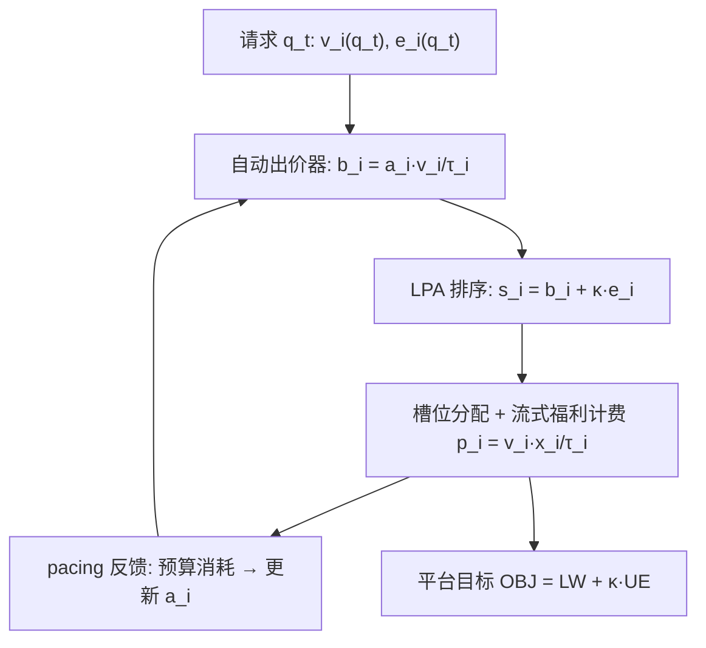

# Beyond Advertising: Mechanism Design for Platform-Wide Marketing Service "QuanZhanTui" (超越广告：全站推平台级营销服务的机制设计)

- **会议/期刊**: KDD 2025
- **作者与机构**: Ningyuan Li, Zhilin Zhang, Tianyan Long, Yuyao Liu, Rongquan Bai, Yurong Chen, Xiaotie Deng, Pengjie Wang, Chuan Yu, Jian Xu, Bo Zheng（北京大学 CFCS、阿里巴巴集团、Inria/ENS）
- **推荐链路定位**: 精排（流量分配与计费机制层）
- **研究方向**: CTR/CVR 预估与特征交叉 / 强化学习与动态探索推荐
- **论文原文**: [https://arxiv.org/abs/2507.02931v1](https://arxiv.org/abs/2507.02931v1)
- **开源代码**: 暂未开源

## TL;DR (1分钟核心速览)

传统电商广告仅覆盖 10%–20% 的广告流量，卖家无法通过投放直接影响自然流量带来的销量，导致库存与营销效率错配。本文首次形式化"全站推 (QuanZhanTui)"机制设计问题：卖家对平台**全部流量**曝光竞价以提升总销量。作者提出**库存约束价值最大化卖家模型**与**流式支付拍卖 (LPA)**——按 $s_{i,t}=b_{i,t}+\kappa e_i(q_t)$排序分配、按$\frac{1}{\tau_i}v_i(q_t)x_i$ 计费。理论上证明 LPA 在统一定价均衡下达到平台目标最优且激励相容；在合成与真实数据上，LPA 的 OBJ 较 GFP/GSP/VCG 分别提升 3.8%/6.7%/7.2%（合成）与 4.1%/7.5%/10.7%（真实），在线结果与离线理论上界差距 < 0.5%。

## Background & Motivation (背景与核心矛盾)

- **主流范式**: 电商平台将流量切分为自然流量与广告流量，卖家仅对广告流量竞价，自然流量由独立排序系统按有机分 (organic score) 分配；二者通过混排 (blending) 做帕累托权衡。
- **前人局限**: 其一，广告流量仅贡献总销量的 10%–20%，卖家加大广告投放仍可能大量库存滞销（如羽绒服案例中 3 万件被迫折价清仓）；其二，混排范式下卖家**始终缺乏直接影响自然流量销量的手段**，投放金额与总销量之间的关系不可控。
- **核心洞察 (Key Insight)**: 电商广告本身即为平台在售商品且高度定向，用户体验干扰极小；卖家真正关心的是**全站总销量**而非广告流量销量。因此可取消自然/广告流量之分，让卖家对全平台曝光竞价。
- **本文切入点**: 将全站推建模为**多目标（卖家流式福利 LW + 用户体验 UE）重复多槽拍卖**，设计支付规则直接锚定卖家流式福利的 LPA，使投放与总销量之间建立清晰可预期的映射。

## Method (核心方法设计)

### 1. 整体框架 (Overall Architecture)

平台对每个请求 $q_t$运行一次多槽拍卖，$n$个卖家的自动出价器 (auto-bidder) 以统一定价策略$b_{i,t}=a_i^{(t)}\frac{1}{\tau_i}v_i(q_t)$提交出价，其中$a_i^{(t)}$为 pacing 因子。LPA 按排序分$s_{i,t}=b_{i,t}+\kappa e_i(q_t)$降序分配$m$个槽位，并按卖家流式福利计费。pacing 算法依据预算消耗动态调整$a_i$，收敛至 pacing 均衡后，分配结果即为平台目标$\text{OBJ}=\text{LW}+\kappa\cdot\text{UE}$ 的最优解。整体闭环为：请求到达 → 自动出价 → LPA 排序分配与计费 → pacing 反馈更新。

### 2. 关键设计拆解 (Key Designs)

1. **库存约束价值最大化卖家模型 (Stock-Constrained Value Maximizer)**：传统预算约束模型无法刻画"销量封顶于库存"的物理事实。本文令卖家目标为 $\max\min\{S_i,\sum_t x_i(b_t;q_t)v_i(q_t)\}$，约束为$\sum_t p_i\le\frac{1}{\tau_i}\min\{S_i,\sum_t x_i v_i\}$。关键变换：由约束可推出预算上界$B_i=S_i/\tau_i$，从而将库存约束等价转写为预算 + ROI 双约束，使模型与平台现有出价接口兼容——这是全站推能工业落地的建模前提。

2. **流式支付拍卖 LPA (Liquid Payment Auction)**：若支付仍按出价 $b_{i,t}$收取，卖家可通过虚报$\tau_i$操纵排序分套利。LPA 改为**支付直接等于卖家流式福利贡献**：$p_i(b_t;q_t)=\frac{1}{\tau_i}v_i(q_t)x_i(b_t;q_t)$，总支付截断为$\min\{B_i,\frac{1}{\tau_i}\sum_t x_i v_i\}$。其理论动机来自拉格朗日对偶：平台目标最优解的分配恰为按$\lambda_i^*\frac{1}{\tau_i}v_i(q_t)+\kappa e_i(q_t)$排序，而$\lambda_i^*$ 正是满足预算约束的最优 pacing 因子——即 LPA 的排序分与计费规则天然与自动出价均衡对齐，且 ROI 约束被支付规则**结构性保证**。

3. **训练目标、均衡性质与推理效率**：无学习型损失，核心是均衡分析。定理 4.2 证明 pacing 均衡存在、存在逐点最大唯一均衡且所有均衡诱导相同分配与支付；定理 4.4 证明均衡分配即平台目标最优解；定理 4.5 证明真实上报 $(B_i,\tau_i)$是弱占优策略（激励相容）；定理 4.7 给出$O(n/\epsilon)$迭代的$\epsilon$-均衡求解算法。在线推理仅需一次排序 + 一次除法计费，开销与 GFP 同级，远低于 VCG 的临界价计算。

## Experimental Setup & Evaluation Protocol (实验设置与评估协议)

- **数据集与预处理**: 合成数据 $n=10$卖家、$T=10^5$请求、$m=3$槽（曝光率$1/0.6/0.4$），$v_i,e_i$由 10 维隐特征内积经指数映射生成；真实数据取自某电商全站推服务，$n=50$、$T=10^5$、$m=6$槽（曝光率$1$至$0.4$），$v_i,e_i$采样自真实拍卖的预测 GMV 与 CTR，$\kappa=0.5$。各生成 10 个独立版本取均值。

| 数据集 | #Sellers | #Requests | #Slots | $\kappa$ | 特征/场景说明 |
| :--- | :---: | :---: | :---: | :---: | :--- |
| Synthetic | 10 | $10^5$| 3 | 1.0 | 高斯隐特征生成$v_i,e_i$ |
| Real-world | 50 | $10^5$ | 6 | 0.5 | 真实预算/ROI + 预测 GMV/CTR |

- **数据划分与防穿越 (Splitting Strategy)**: 无监督学习式划分；采用**在线重复拍卖模拟**（pacing 因子按 $a_i^{(t)}=\max(0,\min(1,a_i^{(t-1)}+\eta(B_i/T-p_i^{(t)})))$，$\eta=0.01$ 逐轮更新）与**离线均衡直接求解**两种设定互为校验。
- **排名评测协议 (Ranking Protocol)**: 非检索式排序评测，而是**全流量分配结果评测**——所有拍卖共享 LPA 的分配规则，仅支付规则不同，从而隔离计费机制的影响；指标为 LW、$\kappa\cdot$UE、OBJ、REV 四项绝对值和相对百分比。
- **对比基线与超参设置**: 基线为 VCG、GSP、GFP 三种经典拍卖；$\kappa$在$2^{-4}$至$2^{4}$ 间扫描以绘制帕累托前沿；未报告显著性检验（模拟实验方差由 10 次重复平均控制）。

## Key Experimental Results (实验关键数据)

### 1. 主实验对比 (Main Results)

| 数据集 | 拍卖 | LW | $\kappa\cdot$UE | OBJ | REV |
| :--- | :--- | :---: | :---: | :---: | :---: |
| Synthetic | **LPA (offline)** | **315608 (100.0%)** | **221100 (100.0%)** | **536709 (100.0%)** | **315608 (100.0%)** |
| Synthetic | **LPA (online)** | **313901 (99.5%)** | **221428 (100.1%)** | **535329 (99.7%)** | **313901 (99.5%)** |
| Synthetic | GFP | 296417 (93.9%) | 219863 (99.4%) | 516280 (96.2%) | 292670 (92.7%) |
| Synthetic | GSP | 284041 (90.0%) | 216508 (97.9%) | 500550 (93.3%) | 167262 (53.0%) |
| Synthetic | VCG | 281969 (89.3%) | 216156 (97.8%) | 498125 (92.8%) | 119574 (37.9%) |
| Real | **LPA (offline)** | **76913 (100.0%)** | **33084 (100.0%)** | **109998 (100.0%)** | **76913 (100.0%)** |
| Real | **LPA (online)** | **76699 (99.7%)** | **33055 (99.9%)** | **109754 (99.8%)** | **76699 (99.7%)** |
| Real | GFP | 73667 (95.8%) | 31791 (96.1%) | 105459 (95.9%) | 73106 (95.1%) |
| Real | GSP | 71368 (92.8%) | 30380 (91.8%) | 101748 (92.5%) | 45557 (59.2%) |
| Real | VCG | 69128 (89.9%) | 29053 (87.8%) | 98181 (89.3%) | 32865 (42.7%) |

### 2. 消融实验 (Ablation Study)

本文为机制设计类工作，无模块消融，但通过**支付规则替换**（共享分配、仅换计费）与 **$\kappa$ 扫描**构成等价消融：

| 配置 | LW 相对 LPA | UE 相对 LPA | 说明 |
| :--- | :---: | :---: | :--- |
| LPA（完整） | 100.0% | 100.0% | 流式福利计费 |
| 换 GFP 计费 | 93.9% / 95.8% | 99.4% / 96.1% | 按出价计费，预算利用率下降 |
| 换 GSP 计费 | 90.0% / 92.8% | 97.9% / 91.8% | 次价计费，收入塌陷至 53%/59% |
| 换 VCG 计费 | 89.3% / 89.9% | 97.8% / 87.8% | 收入仅 37.9%/42.7% |
| $\kappa$ 大 | 略优 | 各拍卖趋同 | UE 主导，区分度收窄 |
| $\kappa$ 小 | 优势扩大 | 略降 | LW 主导，LPA 领先显著 |

### 3. 关键实验发现 (Key Findings)

1. **LPA 同时改善 LW 与 UE，打破"收入-体验"零和**：合成数据上 LPA 的 LW 比 GFP 高 6.1%、UE 高 0.6%，而 REV 高 7.3%；真实数据上 REV 优势为 4.9%。原因在于流式福利计费使预算被更充分消耗，而非被次价/临界价机制"漏损"。
2. **在线 pacing 与离线理论上界差距 ≤ 0.5%**：合成数据 OBJ 达 99.7%、真实数据 99.8%，说明 LPA 与简单梯度式 pacing 算法高度兼容，无需复杂出价器即可逼近最优，这对工业部署是决定性优势。
3. **$\kappa$越小 LPA 优势越明显**：帕累托前沿分析显示，$\kappa$大时各拍卖 UE 趋同、LPA 仅略优 LW；$\kappa$ 减小时 LW 差距迅速拉开，表明在"重卖家福利"的业务配置下 LPA 的机制红利最大。

## Highlights & Limitations (亮点、对比与审稿批判)

- **与代表作对比 (vs. Prior Work)**: 与 BDFPA（Borgs et al.）相比，LPA 的缩放因子并非设计者指定，而是由统一定价自动出价**内生涌现**，且支付锚定流式福利而非出价；与混排机制（如 ads-organic blending 系列）相比，LPA 彻底取消自然/广告流量二分，卖家可直接操控全站销量；与预算约束拍卖文献相比，本文首次在自动出价环境中实现**约束私有信息下的激励相容**。
- **可迁移亮点**: 其一，"支付 = 福利贡献"的计费思路可迁移至任何带预算/ROI 约束的自动出价场景（如直播投流、应用商店推广）；其二，将库存约束等价转写为预算约束的技巧，可直接复用平台现有出价接口，零改造成本上线。
- **审稿级局限批判**: 其一，理论依赖 $v_i(q_t)$、$e_i(q_t)$ **无预测误差**的强假设，实际 GMV/CTR 预估偏差会破坏最优性与 IC 保证，论文未做鲁棒性分析；其二，实验仅与三种经典拍卖对比，缺少与 BDFPA 等约束感知拍卖的实证对照，且模拟环境的 pacing 算法单一（固定学习率梯度），未验证均衡收敛在真实高并发、非平稳流量下的稳定性。

## Rating (四维评分)

- **方法创新性 (Novelty)**: ⭐⭐⭐⭐ （首次形式化全站推机制设计，LPA 的"福利锚定计费"与内生缩放因子设计新颖，且有对偶理论支撑）
- **评估协议与实验扎实度 (Protocol & Experiments)**: ⭐⭐⭐ （合成+真实双数据、在线/离线双设定较完整，但基线仅 3 个、缺显著性检验与预估误差鲁棒性实验）
- **写作与数学规范度 (Clarity & Rigor)**: ⭐⭐⭐⭐⭐ （四条定理链条完整，从均衡存在性到最优性再到 IC 层层递进，证明严谨且动机段落直观）
- **工业落地与复现价值 (Industrial & Practical Value)**: ⭐⭐⭐⭐ （计费规则仅一次除法、与现有 pacing 系统零改造兼容，已在阿里全站推服务验证；但未开源，复现需自建模拟环境）

