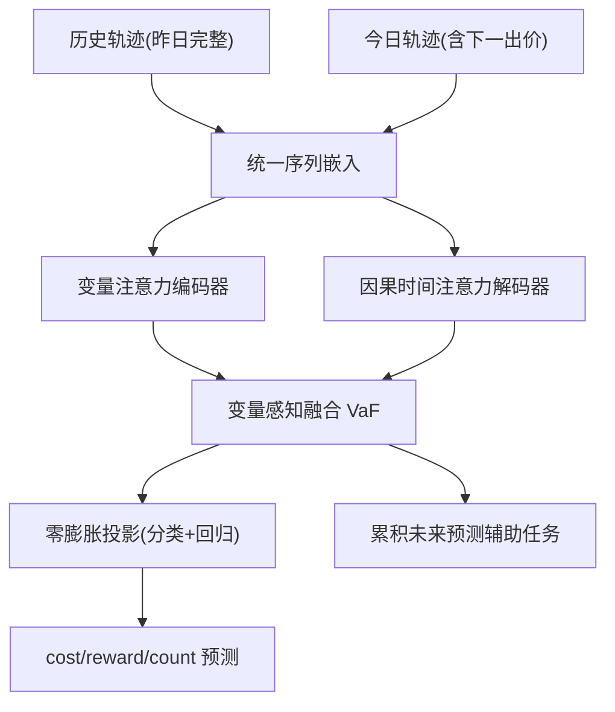
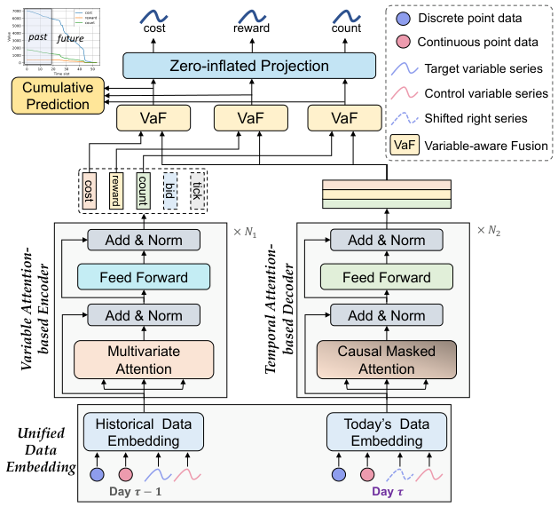

# Bid2X: Revealing Dynamics of Bidding Environment in Online Advertising from A Foundation Model Lens (从基础模型视角揭示在线广告出价环境动态)

- **会议/期刊**: KDD 2025
- **作者与机构**: Jiahao Ji, Tianyu Wang, Yeshu Li, Yusen Huo, Zhilin Zhang, Chuan Yu, Jian Xu, Bo Zheng（阿里巴巴集团）
- **推荐链路定位**: 精排（出价环境建模 / 自动出价决策支撑）
- **研究方向**: CTR预估与特征交叉 / 多任务学习与列表级重排
- **论文原文**: [https://arxiv.org/abs/2510.23410v2](https://arxiv.org/abs/2510.23410v2)
- **开源代码**: 暂未开源

## TL;DR (1分钟核心速览)

现有出价环境模型（LP/PID/RL）均为特定场景定制，跨场景泛化差。本文把"给定出价预测 cost/reward/count"重构为**场景无关的统一函数**，提出基础模型 Bid2X：统一序列嵌入编码异构数据、变量注意力+因果时间注意力双视角建模依赖、零膨胀投影联合分类-回归拟合零膨胀分布。在淘宝 8 个真实数据集上以 one-for-all 范式训练，MAE 全面大幅领先（如 BCB cost MAE 122.50 vs 最优基线 157.60），线上 A/B 测试 GMV +4.65%、ROI +2.44%。

## Background & Motivation (背景与核心矛盾)

- **主流范式**: 自动出价依赖环境函数 $f_\theta(Y\mid bid_t)$，LP 基于历史环境线性规划、PID 用控制论实时纠偏、RL 用环境模型学 bid→cost/reward 映射。
- **前人局限**: ① 各方法只从单一视角刻画环境（LP 静态、PID 局部、RL 隐式），无法全面描述；② 模型按特定场景（BCB、TargetROAS、人群/关键词）分别训练，新场景需重训，缺乏跨场景通用性。
- **核心洞察 (Key Insight)**: 出价环境存在**场景无关的普适规律**——边际收益递减、成本随出价单调、历史越长越可预测、存在周期性与邻近性。这些规律可由一个统一函数从多场景数据中习得。
- **本文切入点**: 借鉴语言模型"条件下一 token 预测"，把出价轨迹当作序列，用 one-for-all 基础模型从广域出价数据学习该普适函数。

## Method (核心方法设计)

### 1. 整体框架 (Overall Architecture)

输入分两路：**历史完整轨迹**（昨日）经变量注意力编码器学习变量间相关性；**今日不完整轨迹**（含下一时刻出价）经因果时间注意力解码器学习动态时序依赖。两路表征经变量感知融合（VaF）后，送入零膨胀投影输出 cost/reward/count 预测，并辅以累积未来预测自监督任务。训练采用条件下一 token 预测的自监督范式，无需人工标注。

<figure class="paper-figure" markdown="span">
  <figcaption>图2：我们的 Bid2X 模型的整体架构。</figcaption>
</figure>

### 2. 关键设计拆解 (Key Designs)

1. **统一序列嵌入 + 双注意力（变量 vs 时间）**：异构数据（点数据、时序、离散/连续）无统一编码方式，且现有方法只学变量依赖、忽略时序动态。历史数据按变量序列独立线性嵌入 $\boldsymbol{z}_c^{(\tau-1)}=\boldsymbol{c}^{(\tau-1)}\cdot\boldsymbol{W}_c^\top$，今日数据按时间槽整行嵌入并加位置编码；变量注意力把每个变量当 token 算相关图$\alpha_{m,n}$，时间注意力用因果掩码$\boldsymbol{M}$保证只看过去：$\boldsymbol{B}=\mathrm{Softmax}\big(\boldsymbol{Q}^{(\tau)}(\boldsymbol{K}^{(\tau)})^\top/\sqrt{D}\odot\boldsymbol{M}\big)$。直觉：变量注意力充当"上下文学习器"感知新场景变量关系，时间注意力捕捉环境动态演化。

2. **零膨胀投影（Zero-inflated Projection）**：出价数据大量零值（未赢得曝光），违背常规网络的正态假设；传统两步法（先分类再回归）受硬标签分类器误差拖累。本文端到端估计软非零概率并与幅值预测相乘：$\hat{y}_i=\Pr(y_i\neq0)\cdot\tilde{y}_i$，联合损失$\mathcal{L}_i^{(z)}=\text{CE}(\Pr(y_i\neq0),\mathbb{I}\{y_i\neq0\})+(y_i-\hat{y}_i)^2$。定理 4 证明该损失在$p,g$条件独立假设下收敛到真实零膨胀分布$\mathbb{E}[Y|\boldsymbol{x}]=p(\boldsymbol{x})g(\boldsymbol{x})$，且软标签允许预测器在分类失误时自我修正。

3. **训练目标、负采样与推理效率**：总损失 $\mathcal{L}=\mathcal{L}^{(z)}+\gamma\mathcal{L}^{(c)}$，其中$\mathcal{L}^{(c)}$ 为累积未来预测 MSE 辅助任务（提供全局视角）。无负采样（回归任务）。推理仅需一次前向，线上延迟仅 +0.05 秒。

## Experimental Setup & Evaluation Protocol (实验设置与评估协议)

- **数据集与预处理**: 淘宝广告平台 8 个数据集，覆盖 BCB、TargetROAS、不同预算/投放周期/人群/关键词场景，共 1.33 亿条出价轨迹、307 万条出价记录。

| 数据集 | 场景类型 | 说明 |
| :--- | :---: | :--- |
| BCB / TR | BCB、TargetROAS 策略 | 不同出价策略 |
| BS / BM / BL | 不同预算档位 | 预算规模差异 |
| D6 / D12 / D18 | 不同投放周期 | 时长差异 |

- **数据划分与防穿越 (Splitting Strategy)**: 每个数据集按 **1:1:1 比例划分** train/val/test；今日轨迹采用右移 + 零起始 token 防信息泄漏，因果掩码阻断未来信息。
- **排名评测协议 (Ranking Protocol)**: 回归任务，采用 **MAE / RMSE**（越低越好），非排序指标；全量测试集评估。
- **对比基线与超参设置**: 四类基线——景观预测（DLF、ADM）、启发式（LP）、变量建模（MMP、MLP、iTransformer）、时序建模（NST、Informer、Informer(fm)）。隐藏维 $D$搜索 32–1024，层数 2，$\gamma\in\{0.5,\dots,1.5\}$，Adam lr=1e-4，batch=128。Bid2X 以 one-for-all 范式跨全部数据集联合训练，基线逐数据集单独训练。

## Key Experimental Results (实验关键数据)

### 1. 主实验对比 (Main Results)

以 cost 目标 MAE 为例（RMSE 见原文表 1），Bid2X 在全部 8 数据集、3 个目标变量上均最优：

| 数据集 | MLP | iTrans. | NST | Informer(fm) | **Bid2X(fm)** | Improv.% |
| :--- | :---: | :---: | :---: | :---: | :---: | :---: |
| BCB | 157.60 | 183.83 | 161.79 | 158.55 | **122.50** | 22.3% |
| TR | 223.84 | 269.15 | 234.83 | 214.56 | **172.40** | 19.6% |
| BS | 184.27 | 207.98 | 186.42 | 187.06 | **148.28** | 19.5% |
| BM | 975.87 | 1223.86 | 1057.50 | 1015.16 | **751.83** | 25.9% |
| BL | 8427.86 | 7708.04 | 8222.52 | 6037.38 | **4170.21** | 30.9% |
| D6 | 198.76 | 243.03 | 208.37 | 206.43 | **158.81** | 20.1% |
| D12 | 139.27 | 165.90 | 149.90 | 140.57 | **109.27** | 21.5% |
| D18 | 119.63 | 133.25 | 120.81 | 113.55 | **88.96** | 21.7% |

### 2. 消融实验 (Ablation Study)

BCB 数据集 MAE（Cost / Reward / Count）：

| 变体 | Cost | Reward | Count |
| :--- | :---: | :---: | :---: |
| Bid2X 完整 | **122.50** | **5.94** | **12.02** |
| r/p va（变量注意力换时间注意力） | 135.06 | 6.39 | 12.73 |
| w/o va（去变量注意力） | 150.28 | 6.34 | 13.58 |
| w/o ta（去时间注意力） | 159.00 | 7.16 | 17.61 |
| w/o zip（去零膨胀投影） | 138.63 | 8.93 | 14.09 |
| w/o cfp（去累积预测任务） | 131.14 | 6.11 | 12.13 |

### 3. 关键实验发现 (Key Findings)

1. **双注意力缺一不可且时间注意力更关键**：去掉时间注意力（w/o ta）使 BCB cost MAE 从 122.50 升至 159.00（+29.8%），去掉变量注意力升至 150.28；BL 数据集降幅最大，说明复杂关系场景更依赖双视角建模。
2. **零膨胀投影对 reward 提升最显著**：w/o zip 使 BCB reward MAE 从 5.94 恶化到 8.93（+50%），印证零值主导的 reward 分布最需软概率建模；且该模块为端到端，优于两步法。
3. **基础模型具备零样本泛化与缩放律**：在未见人群场景上，Bid2X 零样本（虚线）即优于 1%/5% 少样本基线；性能随数据/模型规模呈幂律提升（$L=(N/3.87\times10^{75})^{-0.031}$），且单调性命中率 82%–85% 远超 Informer(fm) 的 22%–26%，线上 GMV +4.65%、ROI +2.44%。

## Highlights & Limitations (亮点、对比与审稿批判)

- **与代表作对比 (vs. Prior Work)**: 相比 LP（静态线性假设）、PID（局部反馈）、RL 环境模型（场景定制隐式建模），Bid2X 首次以 one-for-all 基础模型显式学习场景无关统一函数；相比 iTransformer/Informer 等时序模型，本文同时建模变量与时间双维度并处理零膨胀分布，跨场景稳定性显著更优。
- **可迁移亮点**: ① 零膨胀投影的软概率联合损失可迁移到任何零值主导的转化率/曝光预估任务；② 变量注意力作为"上下文学习器"适配新场景的思路，可迁移到多场景多任务精排。
- **审稿级局限批判**: ① 仅离线 MAE/RMSE 与单一平台线上 A/B，缺乏跨平台/跨广告主类型的外部验证；② 基础模型参数量增大带来 +0.05 秒延迟，实时竞价高并发下成本需进一步评估；③ 零膨胀损失收敛性依赖 $p,g$ 条件独立假设，真实数据中该假设可能不成立。

## Rating (四维评分)

- **方法创新性 (Novelty)**: ⭐⭐⭐⭐ （首次提出出价基础模型范式，双注意力+零膨胀投影组合新颖，且有收敛性定理支撑）
- **评估协议与实验扎实度 (Protocol & Experiments)**: ⭐⭐⭐⭐ （8 数据集 + 零样本/少样本 + 缩放律 + 物理规律验证 + 2 个月线上 A/B，覆盖全面；但缺跨平台验证）
- **写作与数学规范度 (Clarity & Rigor)**: ⭐⭐⭐⭐ （问题定义清晰、定理证明完整、符号规范；部分附录细节依赖原文）
- **工业落地与复现价值 (Industrial & Practical Value)**: ⭐⭐⭐⭐ （已在淘宝部署，GMV/ROI 双升，延迟仅 +0.05 秒；但暂未开源，复现需自建数据管线）

