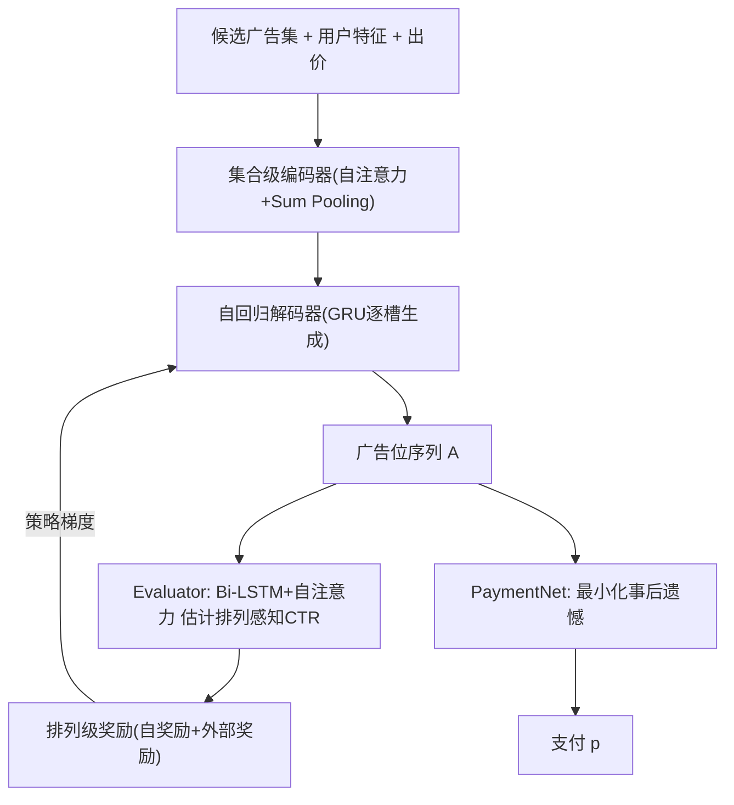

# Contextual Generative Auction with Permutation-level Externalities for Online Advertising (面向在线广告的排列级外部性上下文生成式拍卖)

- **会议/期刊**: KDD 2025
- **作者与机构**: Ruitao Zhu, Chufeng Shi, Zhenzhe Zheng, Fan Wu (上海交通大学)；Yangsu Liu, Dagui Chen, Zhenjia Ma, Jie Zhang, Jian Xu, Bo Zheng (阿里巴巴/淘宝)
- **推荐链路定位**: 重排（拍卖阶段，位于匹配-预估-拍卖三段式末端）
- **研究方向**: CTR预估与特征交叉 / 多任务学习与列表级重排
- **论文原文**: [https://arxiv.org/abs/2412.11544v1](https://arxiv.org/abs/2412.11544v1)
- **开源代码**: 暂未开源

## TL;DR (1分钟核心速览)

传统 GSP 依赖"独立 CTR 假设"，忽略同页其他广告对点击的影响（外部性）；DNA、SW-VCG 等学习式拍卖受限于"先预估后分配"范式，只能建模候选集级外部性，无法感知最终广告位序列的排列上下文。本文提出 CGA：基于理论推导的最优 DSIC 拍卖结构，将分配与支付解耦，用自回归生成器直接生成广告位序列、用排列感知评估器提供策略梯度奖励，并把 IC 约束改写为可微事后遗憾来学习支付网络。淘宝离线数据上 RPM 达最优枚举解的约 95%，线上 A/B 相比 DNA 提升 RPM +3.2%、GMV +6.4%，响应时间仅增 3ms。

## Background & Motivation (背景与核心矛盾)

- **主流范式**: GSP 及其变体（uGSP、DeepGSP）按 $b_i \cdot \text{pCTR}_i$ 排序分配，DNA 用集合编码器学习排序分，SW-VCG 将拍卖建模为广告-广告位最大权二分匹配。
- **前人局限**: 其一，这些方法均属"先预估后分配"（allocation-after-prediction），预估阶段对最终排列无感知，只能刻画候选集级外部性；其二，重排领域的 G-E 框架虽能建模列表上下文，却无法表达 IC/IR 等经济约束，不能直接优化平台收入。
- **核心洞察 (Key Insight)**: 淘宝工业数据显示，广告的排列感知 CTR 随广告位呈**非单调**关系（图1），即更高广告位未必带来更高点击——这直接动摇了 Myerson 引理中"分配单调性"的前提，使 IC 约束下的排列级外部性拍卖设计成为非平凡问题。
- **本文切入点**: 证明"最大化虚拟福利的分配规则在排列级外部性下仍满足单调性"（Lemma 1），从而 Myerson 拍卖的最优性得以保持，并据此把分配与支付解耦优化。

## Method (核心方法设计)

### 1. 整体框架 (Overall Architecture)

CGA 遵循理论推导出的最优 DSIC 拍卖结构：分配规则只需最大化期望虚拟福利 $\sum_{i \in \boldsymbol{A}} \tilde{\phi}(b_i, F_i)\Theta(\boldsymbol{x}_i; \boldsymbol{A}, \boldsymbol{X}, \boldsymbol{u})$，支付规则由 Myerson 公式给出，二者可独立优化。框架采用 Generator-Evaluator 范式：Generator 以自回归方式逐槽生成广告序列，Evaluator 对完整序列估计排列感知 CTR 并折算为排列级奖励，通过策略梯度回传指导 Generator；PaymentNet 则在冻结前两者后，以可微事后遗憾为约束学习支付率。在线推理仅部署 Generator，保证低延迟。

### 2. 关键设计拆解 (Key Designs)

1. **排列等变的自回归生成器**：为打破"先预估后分配"，编码器用无位置编码的自注意力 + Sum Pooling 保证**排列不变性**，解码器用 GRU 逐槽建模联合分布 $p(a_{A_1},\dots,a_{A_k}|\boldsymbol{c})=\prod_{t=1}^{k}p(a_{A_t}|\boldsymbol{c},a_{A_1},\dots,a_{A_{t-1}})$，并在 softmax 中注入虚拟价值偏置$z_{ti}=\text{softmax}([\text{MLP}([\boldsymbol{s}_t;\boldsymbol{h}_i])+e^{w}\tilde{\phi}_i]_i)$，使高虚拟价值广告获得更高分配概率，与最大化虚拟福利目标对齐；逐状态-广告对运算保证**排列等变性**，提升泛化。

2. **排列感知评估器与排列级奖励**：Evaluator 以 Bi-LSTM 捕捉双向序列信息、多头自注意力（含正弦位置编码）捕捉远距离广告交互，输出外部性校准向量 $\boldsymbol{\gamma}_{\boldsymbol{A}}\in(0,2)^k$，与上游点式 pCTR 逐元素相乘得$\Theta_{\boldsymbol{A}}=\min(\boldsymbol{\alpha}_{\boldsymbol{A}}\odot\boldsymbol{\gamma}_{\boldsymbol{A}},1)$，复用预估阶段用户兴趣。奖励分解为自奖励$r^{self}_{A_i}=\tilde{\phi}_i\Theta_i(\boldsymbol{b};\boldsymbol{A},\boldsymbol{u})$与外部奖励$r^{external}_{A_i}=\sum_{j\in\boldsymbol{A}_{-i}}\tilde{\phi}_j\Theta_j(\boldsymbol{b};\boldsymbol{A},\boldsymbol{u})-\sum_{j\in\boldsymbol{A}_{-i}}\tilde{\phi}_j\Theta_j(\boldsymbol{b}_{-i};\boldsymbol{A}_{-i},\boldsymbol{u})$，后者类比 VCG 边际贡献，刻画"选中某广告对同页其他广告 CTR 的扰动"。

3. **训练目标、负采样与推理效率**：Evaluator 用列表级 BCE 损失 $\mathcal{L}_E$预训练至收敛后冻结；Generator 损失$\mathcal{L}_G=-\frac{1}{|\mathcal{D}|}\sum_{s}\sum_{i}r_{A_{si}}\log z_{A_{si}}$（策略梯度，训练时按$z$采样探索、推理时取 argmax）；PaymentNet 用增广拉格朗日求解$\min_w -\mathbb{E}[\text{Rev}]$s.t. 经验事后遗憾$\widehat{rgt}_i=0$，损失$\mathcal{L}_P$含乘子项$\lambda_i\widehat{rgt}_i$与二次罚项$\frac{\rho}{2}(\widehat{rgt}_i)^2$，支付率经 sigmoid 保证 IR。推理仅需$k$步 GRU 解码，避免$P(n,k)$ 全排列枚举。

## Experimental Setup & Evaluation Protocol (实验设置与评估协议)

- **数据集与预处理**: 淘宝 2024 年 1 月真实日志，训练集 50 万次拍卖（1 月 20–23 日，1,100,875 广告主），测试集 10 万次拍卖（1 月 25 日，452,671 广告主），每次拍卖约 30 个候选广告，离线设广告位数 $k=3$。

| 数据集 | #Users | #Items | #Interactions | 稀疏度/密度 | 特征/场景说明 |
| :--- | :---: | :---: | :---: | :---: | :--- |
| Taobao 训练集 | — | 1,100,875 广告主 | 50 万次拍卖 | — | 每次约 30 候选，$k=3$ |
| Taobao 测试集 | — | 452,671 广告主 | 10 万次拍卖 | — | 时间外推（1/25） |

- **数据划分与防穿越 (Splitting Strategy)**: 全局时间戳切分（训练 1/20–1/23，测试 1/25），测试集与训练集无时间重叠。
- **排名评测协议 (Ranking Protocol)**: 离线为全排列/全候选拍卖模拟评估（非采样排序），指标为 RPM、CTR 与 IC 度量 $\Psi$（对每个广告主出价做$\alpha\in\{0.2j\}_{j=1}^{10}$ 反事实扰动，衡量相对效用增幅）。
- **对比基线与超参设置**: 基线分三档——无外部性（GSP）、集合级（DNA、SW-VCG）、排列级（VCG、EdgeNet、Optimal 枚举上界）；嵌入维度 8、4 头注意力、MLP 隐层 128/32、Adam 学习率 1e-3、batch 512；价值分布预设均匀与指数两种以规避分布估计偏差。

## Key Experimental Results (实验关键数据)

### 1. 主实验对比 (Main Results)

| 外部性建模 | 模型 | RPM (Uniform) | CTR (Uniform) | $\Psi$| RPM (Exponential) | CTR (Exponential) |$\Psi$ |
| :--- | :--- | :---: | :---: | :---: | :---: | :---: | :---: |
| 无 | GSP | 1141.40 (-9.7%) | 0.04359 (-7.1%) | 14.7% | 1179.22 (-12.2%) | 0.04050 (-9.8%) | 18.3% |
| 集合级 | DNA | 1195.75 (-5.4%) | 0.04537 (-3.3%) | 8.4% | 1257.11 (-6.4%) | 0.04283 (-4.6%) | 10.1% |
| 集合级 | SW-VCG | 1190.70 (-5.8%) | 0.04528 (-3.5%) | 5.6% | 1247.71 (-7.1%) | 0.04266 (-5.0%) | 7.4% |
| 排列级 | EdgeNet | 1205.87 (-4.6%) | 0.04561 (-2.8%) | 4.9% | 1266.52 (-5.7%) | 0.04315 (-3.9%) | 6.7% |
| 排列级 | VCG | 1085.78 (-14.1%) | 0.04791 (+2.1%) | 0.0 | 1321.85 (-15.8%) | 0.04602 (+2.5%) | 0.0 |
| 排列级 | Optimal | **1318.36 (+4.3%)** | **0.04772 (+1.7%)** | 0.0 | **1415.60 (+5.4%)** | **0.04589 (+2.2%)** | 0.0 |
| 排列级 | **CGA** | 1264.01 | 0.04692 | 2.1% | 1343.07 | 0.04490 | 3.7% |

CTR 预测精度对比（表2）：无外部性 LogLoss 0.2311 / AUC 0.7366；集合级 0.2286 / 0.7391；排列级 Evaluator **0.2237 / 0.7476**。

### 2. 消融实验 (Ablation Study)

| 变体 | RPM | CTR | $\Psi$ |
| :--- | :---: | :---: | :---: |
| CGA | **1264.01** | **0.04692** | **2.1%** |
| CGA-$\Theta$（去 Evaluator） | 1214.71 (-3.9%) | 0.04579 (-2.4%) | 3.7% |
| CGA (end2end) | 1181.85 (-6.5%) | 0.04504 (-4.0%) | 10.5% |
| CGA-$r^{self}$ | 1122.44 (-11.2%) | 0.04302 (-8.3%) | 18.9% |
| CGA-$r^{external}$ | 1210.92 (-4.2%) | 0.04575 (-2.5%) | 3.4% |
| CGA-$\tilde{\phi}$（虚拟价值换出价） | 1231.15 (-2.6%) | 0.04603 (-1.9%) | 2.8% |

线上 A/B（2% 流量，对比全量部署的 DNA）：RPM **+3.2%**、CTR **+1.4%**、GMV **+6.4%**、ROI **+3.5%**、RT 仅 **+1.6%**（约 3ms）。

### 3. 关键实验发现 (Key Findings)

1. **外部性粒度是收入的第一杠杆**：从无外部性→集合级→排列级，RPM 单调上升（Uniform 下 1141→1196→1264），且排列级 Evaluator 的 AUC 比点式高 1.1 个点（0.7476 vs 0.7366），说明收益来自更准的序列上下文预估而非抬价。
2. **G-E 解耦不可省**：去掉 Evaluator 掉 3.9% RPM，端到端联合训练掉 6.5% 且遗憾飙至 10.5%，验证 Corollary 1 的解耦最优性——收入梯度若穿过 PaymentNet 会破坏分配收敛。
3. **外部奖励是排列级建模的核心载体**：去掉 $r^{external}$掉 4.2% RPM、遗憾升至 3.4%，而去掉$r^{self}$ 崩至 -11.2%，说明"自身虚拟福利"是基础、"对他人 CTR 的边际扰动"才是排列级增益来源；CGA 以 2.1% 遗憾逼近枚举最优的约 95% 收入。

## Highlights & Limitations (亮点、对比与审稿批判)

- **与代表作对比 (vs. Prior Work)**: 相比 DNA/SW-VCG，CGA 首次在分配阶段直接生成序列而非对预估值排序，突破集合级外部性天花板；相比 EdgeNet 的贪心指针网络，自回归 + 全局 Evaluator 可感知后继广告影响；相比 NMA 的全排列枚举，以 $k$步解码将$P(n,k)$ 复杂度降至线性，具备在线可行性。
- **可迁移亮点**: ①"排列不变编码 + 排列等变解码"的组合可直接迁移到推荐列表重排与生成式召回；②将 IC 约束转为可微事后遗憾 + 增广拉格朗日的做法，可迁移到任何带约束的生成式决策任务。
- **审稿级局限批判**: ①离线评估依赖对价值分布（均匀/指数）的预设假设，真实广告主策略性出价下遗憾估计可能失真；②Evaluator 与 PaymentNet 串行三阶段训练，超参（$\rho$、$\lambda$ 初值）敏感且训练成本高，论文未给出收敛性保证（问题非凸）。

## Rating (四维评分)

- **方法创新性 (Novelty)**: ⭐⭐⭐⭐⭐ （首次将排列级外部性引入拍卖分配，并以 Lemma 1 严格证明 Myerson 最优性在非单调 CTR 下仍成立，理论+生成式建模双创新）
- **评估协议与实验扎实度 (Protocol & Experiments)**: ⭐⭐⭐⭐ （离线双分布 + 全排列上界对照 + 线上 A/B 闭环完整，但价值分布为预设而非真实估计，略损外部效度）
- **写作与数学规范度 (Clarity & Rigor)**: ⭐⭐⭐⭐ （DSIC/IR 定义、Myerson 引理到 Corollary 1 的推导链条清晰，奖励分解公式直观；附录证明未在正文展开稍显紧凑）
- **工业落地与复现价值 (Industrial & Practical Value)**: ⭐⭐⭐⭐ （线上仅增 3ms RT 即换 3.2% RPM，工程价值明确；但代码未开源、三阶段训练管线复现门槛较高）

