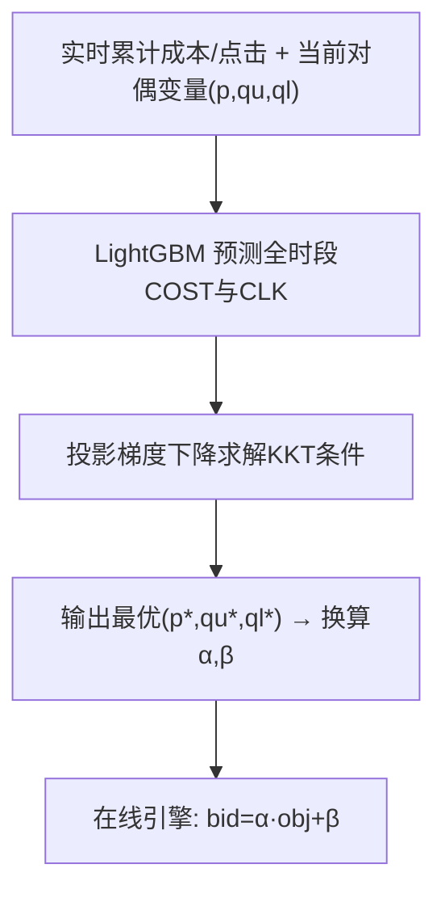
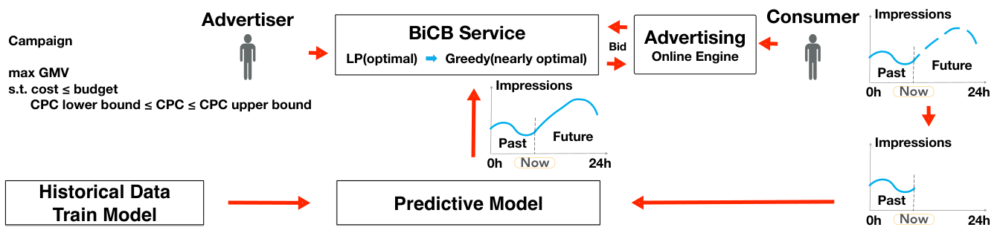

# Lightweight Auto-bidding based on Traffic Prediction in Live Advertising (基于流量预测的直播广告轻量级自动出价)

- **会议/期刊**: KDD 2025
- **作者与机构**: Bo Yang, Ruixuan Luo, Junqi Jin, Han Zhu（阿里巴巴淘天集团）
- **推荐链路定位**: 精排（出价决策层，服务于广告排序与计费）
- **研究方向**: CTR/CVR预估与特征交叉 / 强化学习与动态探索推荐
- **论文原文**: [https://arxiv.org/abs/2508.06069v1](https://arxiv.org/abs/2508.06069v1)
- **开源代码**: 暂未开源（论文声明代码已公开于 Zenodo DOI: 10.5281/zenodo.15552885，但未检测到 GitHub 仓库）

## TL;DR (1分钟核心速览)

直播广告要求秒级出价控制，但未来流量未知、LP求解复杂度高、RL/AIGB序列建模训练难收敛。本文提出 BiCB：先用 LightGBM 预测"给定对偶变量下全时段累计成本与点击"，再基于 LP 对偶分析导出的最优出价公式 $bid_i^*=\frac{C_u obj_i + C_u q_u^* - C_l q_l^*}{p^*+q_u^*-q_l^*}$，用投影梯度下降在线求解对偶变量。在 NeurIPS 2024 Auto-Bidding 数据集上，BiCB 达到 LP 最优解的 79.79%（BCB）/79.51%（BiCB），显著优于 Online LP（78.15%/75.71%）与 DT（75.22%）；线上 A/B 实验 GMV 提升 4.28%，CPC 违约率下降 6.25%。

## Background & Motivation (背景与核心矛盾)

- **主流范式**: 自动出价主流方法包括 PID 控制（局部时间窗反馈）、线性规划（依赖昨日全量流量明细）、RL/AIGB（序列决策建模）。
- **前人局限**: ① PID 只看最近 5 分钟局部窗口，无全时段优化，理论次优；② LP 依赖历史明细数据而非分布，泛化差且需大幅降采样，计算复杂度高；③ RL/AIGB 序列建模样本需求大、线上探索经济成本高、离线仿真与线上环境不一致，直播场景一天需控制 8640 次（10 秒级），序列长度远超图文广告的 48 次，训练难以收敛。
- **核心洞察 (Key Insight)**: 自动出价本质是**背包问题**——物品入袋顺序不重要，只需找到性价比阈值。因此序列建模并非必要，关键在于**提前知道全时段流量的成本/价值分布**，而非逐条流量明细。
- **本文切入点**: 用统计回归模型只预测"对偶变量 $\to$ 累计成本/点击"的聚合映射，绕开序列建模与流量明细预测，以极低复杂度逼近 LP 最优解。

## Method (核心方法设计)

### 1. 整体框架 (Overall Architecture)

BiCB 将出价拆为离线控制与在线计算两层。离线模块每 10 秒运行一次：读取实时累计成本/点击，加载 LightGBM 预测模型，对当前对偶变量 $(p,q_u,q_l)$预测全时段累计成本$\text{COST}$与点击$\text{CLK}$，用投影梯度下降迭代至满足 KKT 互补松弛条件，输出最优对偶变量并写入在线索引。在线引擎对每个请求只需按固定公式$bid=\alpha\cdot obj+\beta$计算，其中$\alpha,\beta$ 由离线对偶变量直接换算，无需修改在线代码即可切换出价算法。

<figure class="paper-figure" markdown="span">
  <figcaption>图1：BiCB自动出价系统概览：广告主的推广计划希望在点击成本（CPC）上下界等约束下最大化商品交易总额（GMV）。将消费者截至目前的需求作为流量输入预测模型，以估计全时段流量。BiCB利用上述全部信息，通过近似最优的贪心算法计算出价决策。</figcaption>
</figure>

### 2. 关键设计拆解 (Key Designs)

1. **上下界完整建模与对偶最优出价公式**：传统建模（BCB/MCB/USCB）只考虑 CPC 上界，本文补充 CPC 下界约束（筛选高质量流量）。对 LP 做拉格朗日对偶分析，由互补松弛定理导出最优出价：
$$bid_i^*=\frac{C_u\cdot obj_i + C_u q_u^* - C_l q_l^*}{p^*+q_u^*-q_l^*}$$
当 $p^*+q_u^*-q_l^*>0$ 时最优解等价于拍卖系统；作者进一步证明在"价值与成本正相关"的实际假设下该条件恒成立，保证出价公式的物理可实现性。

2. **对偶变量的轻量统计求解（"时间机器"）**：KKT 条件表明最优解只需满足"总成本 $=B$、总 CPC$=C_u$或$C_l$"三个互补条件，因此**只需预测累计成本与累计点击，无需预测转化**（转化稀疏且延迟大，远比成本/点击难估）。用 LightGBM 拟合$C(t,\text{features},p,q_u,q_l)$与$K(t,\text{features},p,q_u,q_l)$，跨多广告主多天数据训练提升泛化性。求解用投影梯度下降，损失为$\mathcal{L}_p=(B-\text{COST})^2$、$\mathcal{L}_{q_u}=(C_u\cdot\text{CLK}-\text{COST})^2$、$\mathcal{L}_{q_l}=(C_l\cdot\text{CLK}-\text{COST})^2$，并证明收敛需$O((\log\frac{1}{\epsilon})^2)$ 次迭代。

3. **理论近似保证与推理效率**：定理 1 证明贪心解与 0-1 规划最优解的价值误差不超过 $2\max_i obj_i$，CPC 误差可控（实例中误差 ≤2%）。推理侧 LightGBM 达 80k QPS，单 CPU 可支撑 1k 订单控制，而 RL 方法仅支持 200 订单，满足直播秒级控制需求。

## Experimental Setup & Evaluation Protocol (实验设置与评估协议)

- **数据集与预处理**: NeurIPS 2024 "Auto-Bidding in Large-Scale Auctions" 公开数据集，21 个广告周期，每周期 >50 万曝光、分 48 步；用 Official Round-Final Round 的 6 天训练、最后 1 天测试。BiCB 设定下按广告主数据分布生成 CPC 上下界。

| 数据集 | #Periods | #Impressions/Period | #Steps | 划分方式 | 场景说明 |
| :--- | :---: | :---: | :---: | :---: | :--- |
| NeurIPS 2024 Auto-Bidding | 21 | >500,000 | 48 | 前6天训练/最后1天测试 | 大规模拍卖竞价仿真 |

- **数据划分与防穿越 (Splitting Strategy)**: 时间顺序划分（前 6 天训练，最后 1 天测试），符合在线部署的因果时序。
- **排名评测协议 (Ranking Protocol)**: 全时段累计指标评估（非单请求排序），核心指标为 Revenue、Cost、预算达成率 BR、$R/R^*$（相对 LP 最优）、CPC 违约率 OCR、综合指标$G=\min(R/R^*,1.0)-\sum_j p_j$（$\lambda=100$）。
- **对比基线与超参设置**: Manual bid、Local PID、Online LP、IQL（离线 RL）、DT（AIGB/Transformer）、Offline LP（理论最优）、BiCB*（完美预测上界）。LightGBM 为回归模型，投影梯度下降步长自适应。

## Key Experimental Results (实验关键数据)

### 1. 主实验对比 (Main Results)

**BCB 设定（仅预算约束）**：

| 方法 | Revenue | Cost | BR | $R/R^*$ |
| :--- | :---: | :---: | :---: | :---: |
| Manual bid | 1163.21 | 87289.86 | 58.19% | 57.01% |
| Local PID | 1308.02 | 149788.03 | 99.86% | 64.10% |
| Online LP | 1594.54 | 146025.57 | 97.35% | 78.15% |
| IQL (RL) | 1505.75 | 113165.02 | 75.44% | 73.79% |
| DT (AIGB) | 1534.93 | 142705.18 | 95.14% | 75.22% |
| **BiCB** | **1628.06** | 148090.72 | 98.73% | **79.79%** |
| Offline LP (Optimal) | 2040.47 | 149998.09 | 100.00% | 100.00% |
| BiCB* (完美预测) | 2039.23 | 149927.55 | 99.95% | 99.93% |

**BiCB 设定（预算 + CPC 上下界约束）**：

| 方法 | Revenue | $R/R^*$ | OCR↓ | G↑ |
| :--- | :---: | :---: | :---: | :---: |
| Manual bid | 286.33 | 56.48% | 0.00% | 0.56 |
| Local PID | 297.64 | 58.72% | 20.83% | 0.54 |
| Online LP | 383.80 | 75.71% | 35.42% | 0.57 |
| **BiCB** | **403.03** | **79.51%** | **14.58%** | **0.71** |
| Offline LP (Optimal) | 506.92 | 100.00% | 0.00% | 1.00 |
| BiCB* (完美预测) | 489.65 | 96.59% | 0.00% | 0.97 |

**线上 A/B（预算分桶，263 个广告计划，2025-02-05 至 02-08）**：

| 方法 | Cost | GMV | ROI | CPC | OCR |
| :--- | :---: | :---: | :---: | :---: | :---: |
| Local PID | 242514 | 2381333 | 9.82 | 1.47 | 12.2% |
| **BiCB** | 240477(-0.84%) | **2483205(+4.28%)** | **10.33(+5.16%)** | 1.50(+2.50%) | **11.4%(-6.25%)** |

### 2. 消融实验 (Ablation Study)

| 配置 | $R/R^*$(BCB) |$R/R^*$ (BiCB) | 说明 |
| :--- | :---: | :---: | :--- |
| BiCB（LightGBM 预测） | 79.79% | 79.51% | 完整模型 |
| BiCB*（完美流量预测） | 99.93% | 96.59% | 预测精度上界 |
| Online LP（历史明细） | 78.15% | 75.71% | 无分布泛化 |
| Local PID（局部窗口） | 64.10% | 58.72% | 无全时段优化 |

### 3. 关键实验发现 (Key Findings)

1. **预测精度是唯一瓶颈**：BiCB 与 BiCB* 的差距（79.79% vs 99.93%）几乎全部来自 LightGBM 预测误差，而非贪心算法本身——证明对偶最优公式 + 贪心近似在完美预测下可达 96%+ 最优，算法理论上限极高。
2. **上下界约束下优势放大**：引入 CPC 下界后，Online LP 因历史/当日分布偏移导致 35.42% 广告主违约，而 BiCB 仅 14.58%，G 指标 0.71 远超 Online LP 的 0.57，说明基于分布预测的对偶求解比基于明细回放更鲁棒。
3. **出价参数稳定性是线上增益根源**：图 4 显示 Local PID 全天成本均匀但出价参数剧烈波动，BiCB 参数稳定且将预算向高效晚间时段倾斜，最终 ROI +5.16%、GMV +4.28%，验证了"对偶变量全天恒定才能保证最优性"的理论判断。

## Highlights & Limitations (亮点、对比与审稿批判)

- **与代表作对比 (vs. Prior Work)**: 相比 Local PID（MCB 的双 PID 控制），BiCB 引入全时段流量预测与理论最优公式，摆脱局部窗口次优；相比 Online LP，BiCB 预测分布而非明细，泛化性与鲁棒性更强；相比 RL/AIGB（DT），BiCB 无需序列建模与仿真环境，训练为简单监督回归，10 秒级控制下计算量低两个数量级。
- **可迁移亮点**: ① "只预测聚合量（累计成本/点击）而非明细"的思路可迁移到任何约束优化型出价/预算分配任务；② 在线出价抽象为 $bid=\alpha\cdot obj+\beta$ 的双参数接口，使算法迭代无需改动在线工程，工程解耦设计值得借鉴。
- **审稿级局限批判**: ① 离线实验仅用 NeurIPS 2024 单一仿真数据集，且 BiCB 设定下 CPC 上下界为人工按分布生成，与真实广告主约束分布可能存在偏差；② 理论近似保证依赖"价值与成本正相关"假设（Assumption 1），在冷启动或异常流量场景下该假设可能不成立，且 LightGBM 预测误差在流量突变（如直播爆点）时的鲁棒性未做压力测试。

## Rating (四维评分)

- **方法创新性 (Novelty)**: ⭐⭐⭐⭐ （将背包问题洞察与 LP 对偶分析结合，用聚合量预测替代序列建模，思路简洁且有完整理论支撑，但核心公式源自经典对偶理论，增量在于工程化组合）
- **评估协议与实验扎实度 (Protocol & Experiments)**: ⭐⭐⭐⭐ （离线 + 线上 A/B 双验证，含 BiCB* 上界与多类基线，指标覆盖 Revenue/BR/OCR/G 全面；扣分在单一数据集与人工生成约束）
- **写作与数学规范度 (Clarity & Rigor)**: ⭐⭐⭐⭐ （对偶推导、定理 1 误差界、投影梯度收敛性证明完整，附录严谨；部分符号在正文与附录间略有跳转）
- **工业落地与复现价值 (Industrial & Practical Value)**: ⭐⭐⭐⭐⭐ （已在阿里直播广告全量部署，80k QPS 轻量推理，线上 GMV +4.28%，工程实现细节与灾备/预扣费机制描述详实，落地价值极高）

