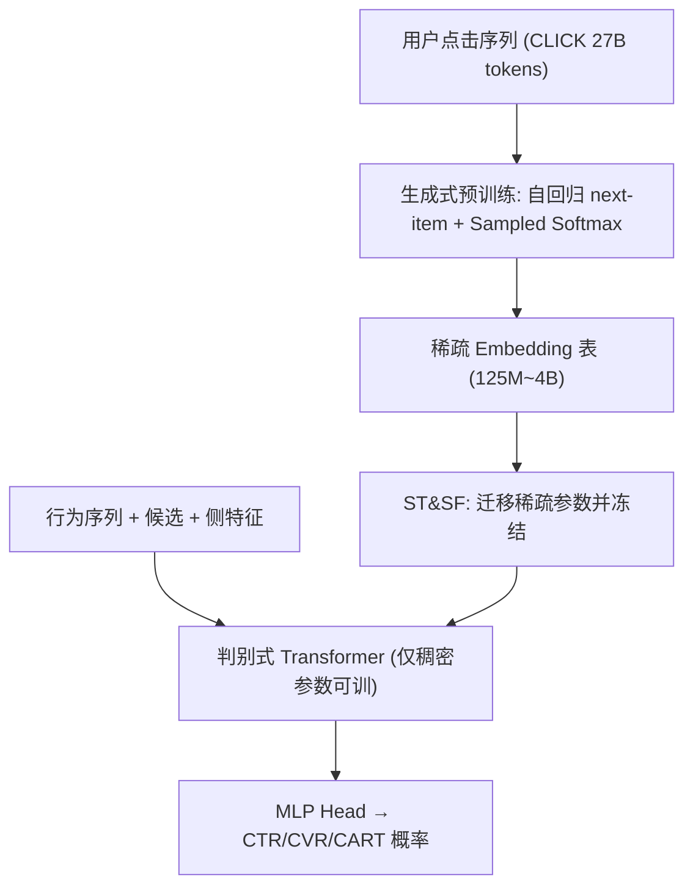
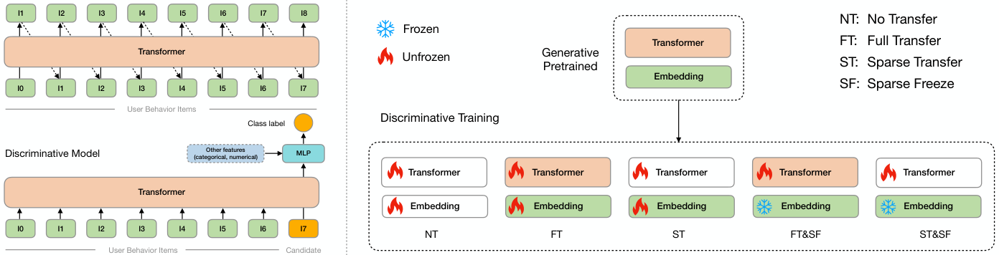

# Scaling Transformers for Discriminative Recommendation via Generative Pretraining (通过生成式预训练扩展判别式推荐中的 Transformer)

- **会议/期刊**: KDD 2025
- **作者与机构**: Chunqi Wang, Bingchao Wu, Zheng Chen, Lei Shen, Bing Wang, Xiaoyi Zeng（阿里巴巴国际数字商业集团 AliExpress）
- **推荐链路定位**: 精排（Ranking / CTR-CVR-CART 预估）
- **研究方向**: CTR/CVR 预估与特征交叉 / 生成式推荐
- **论文原文**: [https://arxiv.org/abs/2506.03699v2](https://arxiv.org/abs/2506.03699v2)
- **开源代码**: [https://github.com/chqiwang/gpsd-rec](https://github.com/chqiwang/gpsd-rec)

## TL;DR (1分钟核心速览)

判别式排序模型（CTR/CVR）因特征稀疏存在严重过拟合，且模型越大越差，Transformer 的缩放律在推荐领域长期失效。本文提出 GPSD：先用自回归生成式任务（sampled softmax 海量负采样）预训练 Transformer，再把稀疏 Embedding 迁移到判别模型并**冻结**，仅训练稠密参数。在工业级 CTR/CVR/CART 与三个公开数据集上 AUC 相对提升最高 9.46%/5.50%/3.84%，稠密参数从 13K 扩到 0.3B 仍稳定遵循幂律，线上 A/B 的 GMV 提升 7.03%。

## Background & Motivation (背景与核心矛盾)

- **主流范式**: 工业精排以 Embedding-MLP / 单层 Target-Attention（DIN、DIEN、BST、DMT）为主，Transformer 仅用单层，参数规模被刻意压小。
- **前人局限**: ① 判别式训练在稀疏 Embedding 上出现两类过拟合——epoch 切换处的 `one-epoch overfitting` 与首个 epoch 内即开始的 `within-one-epoch overfitting`，后者此前未被系统刻画；② 模型放大后验证 AUC 反而下降（图 1b），缩放律失效，[1,10] 亦观察到 embedding collapse。
- **核心洞察 (Key Insight)**: 自回归生成式训练（next-item + sampled softmax 大量随机负采样）在同等数据上训练/验证 loss 间隙恒定、几乎不过拟合——因为海量负采样让稀疏参数被"充分且稳定"地更新，而非被少数正样本反复过拟合。
- **本文切入点**: 把生成式预训练当作稀疏参数的"高质量初始化器"，判别式阶段只放开稠密参数，从而既保留生成式的抗过拟合性，又获得 Transformer 的可扩展性。

## Method (核心方法设计)

### 1. 整体框架 (Overall Architecture)

两阶段同构 Transformer：**生成式预训练**阶段在用户点击序列上做 next-item 自回归建模（Pre-Norm + RMSNorm + RoPE + SwiGLU，因果掩码，sampled softmax 负采样、序列内共享负样本、Embedding 与输出层权重绑定、BF16）；**判别式训练**阶段把行为序列与候选物品拼接（加 segment embedding 区分），经同构 Transformer 后接 MLP head 融合类别/数值特征，交叉熵输出点击/转化概率。两阶段之间通过五种迁移策略桥接，核心结论是"迁移稀疏 + 冻结稀疏"（ST&SF / FT&SF）最优。线上采用 incremental-GPSD：生成模型与排序模型均按天增量训练，每轮把生成侧稀疏参数灌入排序侧并冻结。

<figure class="paper-figure" markdown="span">
  <figcaption>图2：GPSD框架概览。左侧部分展示了基于Transformer架构的生成式与判别式模型，右侧部分展示了连接生成式预训练与判别式训练的五种策略。</figcaption>
</figure>

### 2. 关键设计拆解 (Key Designs)

1. **生成式预训练的抗过拟合机制（Sampled Softmax 海量负采样）**：全库 softmax 在 4M 词表下不可行，改用
$\hat{p}(x_l|x_{<l})=\frac{\exp f(x_l;x_{<l})}{\exp f(x_l;x_{<l})+\sum_{n\in N}\exp f(n;x_{<l})}$其中$N$ 为均匀采样负集（工业侧 4K 个/序列）。直觉：每个稀疏 Embedding 在每个 step 都被大量负样本"推远"，梯度信号密集且不集中于少数正例，等价于对稀疏表做持续的正则化式更新，故训练/验证间隙保持恒定小值。
2. **稀疏/稠密解耦的五种迁移策略（Sparse Freeze 是胜负手）**：将参数划分为稀疏（Embedding 表）与稠密（Transformer + MLP）两部分，比较 NT / FT / ST / FT&SF / ST&SF。关键发现是单纯 FT、ST 相对 NT 几乎无增益（甚至 -0.54%），而一旦**冻结稀疏参数**，AUC 立刻跃升——说明判别式阶段对稀疏表的梯度更新才是过拟合根源；冻结后稀疏表退化为"固定特征查表"，模型容量全部由稠密参数承担，从而恢复缩放能力。
3. **训练目标、负采样与推理效率**：生成阶段 $\mathcal{L}_{gen}=\sum_{X}\sum_{l}-\log\hat{p}(x_l|x_{<l})$，均匀负采样（省略修正项）；判别阶段$\mathcal{L}_{dis}=-\sum y\log \sigma(\cdot)$。推理沿用单向 Transformer + KV Cache，因果性带来显著在线加速；ST&SF 因解耦两阶段架构，支持跨架构迁移与增量训练，是线上首选。

## Experimental Setup & Evaluation Protocol (实验设置与评估协议)

- **数据集与预处理**:

| 数据集 | #Samples | #Tokens | Vocab | $L_{min}$/$L_{max}$ | 场景说明 |
| :--- | :---: | :---: | :---: | :---: | :--- |
| CLICK (工业预训练) | 278M | 27B | 4M | 50/100 | 按用户点击时序切子序列 |
| CTR / CVR / CART | 1.6B / 68M / 126M | - | 4M | 10/100 | 点击/转化/加购三任务 |
| CTR-XL | 5B | - | 4M | 10/100 | 大规模缩放实验专用 |
| Taobao | 969k | 39M | 4.1M | 10/200 | 公开，前 T-1 点击为序列 |
| Electronics / Foods | 192k / 127k | 1.2M / 890K | 63k / 41k | 2/50 | Amazon 评论序列 |

- **数据划分与防穿越 (Splitting Strategy)**: 工业数据按**全局时间戳切分**（最近一天为验证/测试，之前为训练）；公开数据沿用 [20] 的"末次点击为正、随机采一负"构造，序列前 T-1 项另建预训练集，属时间序划分。
- **排名评测协议 (Ranking Protocol)**: 采用 AUC（ROC 曲线下面积），对阈值不敏感；公开集为 1 正 1 负的成对判别设定，工业集为全量曝光日志上的排序评估。
- **对比基线与超参设置**: 公开集对比 DeepFM、DIN、DIEN、DMIN、DMR（Embedding 维 64）；工业集以 NT 为基线并做 4 档规模（L4H32A4→L4H256A4）横向对比。峰值学习率 5e-4/1e-4/5e-5（大模型降 LR 保稳定），batch 32K/16K/4K，负样本 4K，AdamW + 线性 warmup + cosine 衰减至 10%。

## Key Experimental Results (实验关键数据)

### 1. 主实验对比 (Main Results)

工业数据集（节选 L4H256A4 与 L4H64A4，AUC / 相对 NT 提升）：

| Model | Strategy | CTR | CVR | CART |
| :--- | :--- | :---: | :---: | :---: |
| L4H64A4 | NT | 0.6320 | 0.7913 | 0.7155 |
| L4H64A4 | FT | 0.6286 (-0.54%) | 0.7932 (0.24%) | 0.7185 (0.42%) |
| L4H64A4 | ST | 0.6357 (0.59%) | 0.7991 (0.99%) | 0.7187 (0.45%) |
| L4H64A4 | FT&SF | 0.6654 (5.28%) | 0.8204 (3.68%) | 0.7274 (1.66%) |
| L4H64A4 | **ST&SF** | **0.6716 (6.27%)** | **0.8249 (4.25%)** | **0.7281 (1.76%)** |
| L4H256A4 | NT | 0.6340 | 0.7941 | 0.7162 |
| L4H256A4 | **FT&SF** | **0.6940 (9.46%)** | **0.8378 (5.50%)** | **0.7437 (3.84%)** |
| L4H256A4 | ST&SF | 0.6916 (9.09%) | 0.8327 (4.86%) | 0.7381 (3.06%) |

公开数据集（ST&SF 增益，AUC）：

| Method | Taobao | Electronics | Foods |
| :--- | :---: | :---: | :---: |
| DeepFM | 0.9044 | 0.7985 | 0.7425 |
| DeepFM + ST&SF | 0.9547 (5.56%) | 0.8665 (8.52%) | 0.7948 (7.04%) |
| DIN + ST&SF | 0.9752 (4.40%) | 0.8800 (8.76%) | 0.8223 (6.64%) |
| DIEN + ST&SF | 0.9608 (2.36%) | 0.8788 (9.09%) | 0.8253 (5.77%) |
| DMIN + ST&SF | 0.9620 (3.43%) | 0.8790 (10.03%) | 0.8317 (7.27%) |
| DMR + ST&SF | 0.9684 (3.64%) | 0.8779 (7.08%) | 0.8240 (5.75%) |
| L4H256A4 (NT) | 0.8651 | 0.7710 | 0.7135 |
| **L4H256A4 + ST&SF** | **0.9808 (12.37%)** | **0.8847 (14.47%)** | **0.8370 (17.31%)** |

线上 A/B（AliExpress，30 天，L3H160A4 小模型）：GMV **+7.03%**、Orders +2.11%、Buyers +1.86%、CTR +3.78%。

### 2. 消融实验 (Ablation Study)

| 配置 | 关键变量 | CTR AUC | 结论 |
| :--- | :--- | :---: | :--- |
| (A) → / → FT&SF | 单向预训练+单向判别 | 0.6654 | 基线 |
| (B) ⇄ / ⇄ FT&SF | 双向预训练+双向判别 | 0.6662 | 双向略优但差距微小 |
| (C) → / → ST&SF | 单向+单向 | **0.6716** | ST&SF 下单向最优 |
| (D) ⇄ / ⇄ ST&SF | 双向+双向 | 0.6666 | 双向预训练反而拖累 |
| (E) → / ⇄ ST&SF | 单向预训练+双向判别 | 0.6707 | 判别方向影响很小 |
| (F) ⇄ / → ST&SF | 双向预训练+单向判别 | 0.6673 | 同上 |

跨架构迁移（图 6）：把 Transformer 预训练的稀疏参数经 ST&SF 迁到 HSTU 与 Wukong，两者缩放曲线均被显著抬升，证明稀疏表具有架构无关的通用性。

### 3. 关键实验发现 (Key Findings)

1. **冻结稀疏参数是唯一有效杠杆**：FT/ST 相对 NT 的增益在 -0.54%~1.64% 间徘徊，而 FT&SF/ST&SF 直接拉到 4%~9.46%，说明判别式阶段对 Embedding 的梯度更新是过拟合主因，而非模型容量不足。
2. **缩放律被真正恢复**：稠密参数从 13K（L1H32A4）扩到 327M（L24H1024A16），AUC 拟合 $y=0.7097-0.7553x^{-0.2364}$、Loss 拟合$y=0.3695+0.1420x^{-0.1915}$，推得 CTR-XL 上 AUC 经验上界约 0.7097、Loss 下界约 0.3695——这是推荐领域首次给出可预测的幂律边界。
3. **大模型在公开集上"反直觉"地需要 ST&SF 才能不退化**：L4H256A4 裸训在 Taobao 仅 0.8651（远低于 DeepFM 0.9044），加 ST&SF 后飙至 0.9808（+12.37%），说明小数据下大模型必须靠生成式初始化+冻结才能避免灾难性过拟合。

## Highlights & Limitations (亮点、对比与审稿批判)

- **与代表作对比 (vs. Prior Work)**: 相比 BST/DMT/ZEUS 只能停留在单层 Transformer，本文首次让精排 Transformer 扩到 0.3B 稠密参数；相比 MEDA 仅靠每 epoch 重置 Embedding 缓解 one-epoch overfitting，本文同时消除 within-one-epoch overfitting 并把泛化间隙压成常数；相比 HSTU 的"统一架构但独立训练"，本文真正**桥接**了生成与判别两阶段的训练。
- **可迁移亮点**: ① "稀疏冻结 + 稠密可训"的解耦范式可直接套到任何 Embedding-heavy 排序模型（多任务 MMoE、序列精排）；② ST&SF 支持跨架构迁移，可把已有 Transformer 预训练权重零成本灌入 HSTU/Wukong 等新 backbone。
- **审稿级局限批判**: ① 实验序列长度偏短（工业侧仅 10–100），长序列下的收益与显存开销未验证；② 线上仅部署 L3H160A4 小模型，0.3B 大模型的在线延迟与吞吐未给出；③ 预训练语料 CLICK 与下游 CTR 同源同分布，跨域/冷启动场景下稀疏表迁移是否仍有效存疑。

## Rating (四维评分)

- **方法创新性 (Novelty)**: ⭐⭐⭐⭐ （"生成式预训练+稀疏冻结"组合简单但切中稀疏过拟合要害，并首次给出推荐精排的幂律缩放边界）
- **评估协议与实验扎实度 (Protocol & Experiments)**: ⭐⭐⭐⭐⭐ （5B 工业样本 + 3 公开集 + 30 天线上 A/B + 跨架构迁移，证据链完整）
- **写作与数学规范度 (Clarity & Rigor)**: ⭐⭐⭐⭐ （两类过拟合的刻画清晰、五种策略对比直观，但 sampled softmax 的方差/偏差分析略简）
- **工业落地与复现价值 (Industrial & Practical Value)**: ⭐⭐⭐⭐⭐ （已开源、已在 AliExpress 全量上线并带来 GMV +7.03%，incremental-GPSD 可直接复用）

