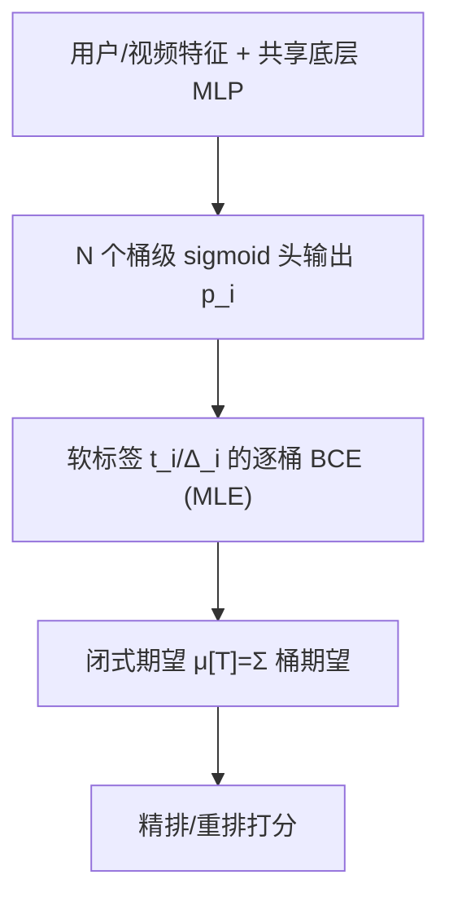

# SWaT: Statistical Modeling of Video Watch Time through User Behavior Analysis (基于用户行为分析的视频观看时长统计建模)

- **会议/期刊**: KDD 2025 (V.1)
- **作者与机构**: Shentao Yang, Haichuan Yang, Linna Du, Adithya Ganesh, Bo Peng, Boying Liu, Serena Li, Ji Liu（UT Austin / Meta AI / Ohio State University）
- **推荐链路定位**: 精排（重排中作为多目标之一）
- **研究方向**: CTR/CVR 预估与特征交叉 / 多任务学习与列表级重排
- **论文原文**: [https://arxiv.org/abs/2408.07759v2](https://arxiv.org/abs/2408.07759v2)
- **开源代码**: 暂未开源

## TL;DR (1分钟核心速览)

短视频场景下观看时长是核心反馈，但现有方法（WLR、D2Q、TPM、CREAD）只是对回归/分类损失做黑盒机械改造，未把"用户如何看视频"这一行为机理纳入建模。本文提出白盒统计框架 SWaT：把"随机跳看"与"顺序观看"两类行为假设直接翻译为分桶二项分布（SWaT-Binom）与分桶几何分布（SWaT-Geo），用软标签 BCE 做 MLE 拟合，并以闭式期望给出时长估计。在 KuaiRec/CIKM16 上 XAUC 达 0.609/0.688（较 TPM 提升 1.7%/1.8%），工业离线 Pearson 提升 0.81%，线上 A/B 五日平均观看时长 +5.07%。

## Background & Motivation (背景与核心矛盾)

- **主流范式**: 观看时长被当作标量回归（MSE）或借 WLR 用时长作样本权重做点击分类、再取指数还原；TPM/CREAD 则把回归拆成树状/离散化的一串分类任务。
- **前人局限**: ① 纯回归对长尾离群值敏感、分布偏斜导致训练不稳；② WLR 依赖"点击率极低"的近似假设，而短视频自动播放、无点击动作，该假设直接失效；③ 所有方法都把视频进度条视为同质，忽略用户兴趣沿进度条的非平稳衰减与视频长度约束。
- **核心洞察 (Key Insight)**: 观看时长本质是"用户逐秒决定是否继续看"的随机过程，其分布形态由行为模式决定——跳看型近似二项选择，顺序型近似几何衰减；只要把行为假设写成似然，就能得到可解释、可闭式求期望的统计模型。
- **本文切入点**: 用分桶（bucketization）把无限进度条切成 $N$段、每段学一个观看概率$p_i$，既刻画非平稳兴趣，又把无界时长目标转化为有界软标签，天然兼容工业多目标分类训练。

## Method (核心方法设计)

### 1. 整体框架 (Overall Architecture)

输入用户/视频特征经共享底层 MLP 后，输出层改为 $N$个桶级观看概率$\hat{p}_i$（每桶一个 sigmoid 头）。训练时由观测时长$t$按桶端点构造软标签$t_i/\Delta_i$，对每个桶独立做 BCE，等价于对分桶统计模型做 MLE，同时隐式形成多任务学习。推理时按所选行为假设的闭式期望$\hat{\mu}[T]=\sum_i(\cdot)$汇总各桶期望时长，作为精排/重排的打分分量。分桶还带来双重收益：短长视频的$\hat{p}_i$自然在低/高桶位衰减，从而隐式尊重视频长度约束；且每个$\log p_i$项权重被桶宽$\Delta_i$或 1 截断，消除了 WLR 中由$t$ 直接决定的梯度爆炸风险。

<figure class="paper-figure" markdown="span">
  ![图1：SWaT 框架概览。模型为每个桶 𝐵𝑖 输出观看概率 b𝑝𝑖，并据此计算观看时长 𝑇 的估计值 b𝜇\[𝑇\]。](../../../../assets/papers/2408.07759v2/figure_1.png)<figcaption>图1：SWaT 框架概览。模型为每个桶 𝐵𝑖 输出观看概率 b𝑝𝑖，并据此计算观看时长 𝑇 的估计值 b𝜇[𝑇]。</figcaption>
</figure>

### 2. 关键设计拆解 (Key Designs)

1. **SWaT-Binom：跳看型用户的二项模型**：假设桶内每秒独立同概率 $p_i$被选中观看、桶间可自由跳转，则桶内观看秒数服从二项分布。对二项似然开$\Delta_i$ 次方（幂函数单调，不改变极值点）后化为软标签 BCE：
$$\mathcal{L}_{\text{Binom}}=\frac{t_i}{\Delta_i}\log p_i+\left(1-\frac{t_i}{\Delta_i}\right)\log(1-p_i)$$
其中软标签按 $t$落在桶内位置线性插值（$t\le x_{i-1}$取 0，$t>x_i$取 1，否则取$(t-x_{i-1})/\Delta_i$）。期望估计为$\hat{\mu}=\sum_i \Delta_i\hat{p}_i$。直觉：软标签天然诱导$\hat{p}_i$ 单调不增，隐式编码"越往后越可能弃看"的顺序性，同时保留跳看自由度。

2. **SWaT-Geo：顺序观看型用户的分桶几何模型**：假设用户逐秒决定"再看一秒"或"停止"，桶内续看概率恒为 $p_i$，则$T$ 服从分桶几何分布：
$$\Pr(T=t)=p_n^{t-x_{n-1}}(1-p_n)\prod_{i=1}^{n-1}p_i^{\Delta_i}$$
对应 MLE 目标 $\mathcal{L}_{\text{Geo}}=(t-x_{n-1})\log p_n+\log(1-p_n)+\sum_{i<n}\Delta_i\log p_i$。相比 Binom，它无需把$x_N$设得足够大以覆盖时长上界，从根本上避免截断偏差；期望由附录 A 的等比级数闭式给出（式 6）。其退化版（全局单一$p$）恰好还原为$e^{y}$ 的 WLR 估计，但无需"小点击率"近似——这从理论上解释了 WLR 只是"均匀几何分布"的特例。

3. **训练目标、负采样与推理效率**：总损失即各桶 BCE 之和（无负采样概念，属回归转分类范式）；软标签构造采用"顺序观看 + 末桶弃看"的最小假设，仅用于训练、推理时不施加。推理仅需一次前向 + $O(N)$ 求和，与基线同架构同开销，可直接替换输出层上线。

## Experimental Setup & Evaluation Protocol (实验设置与评估协议)

- **数据集与预处理**:

| 数据集 | #Users | #Items | #Interactions | 稀疏度/密度 | 特征/场景说明 |
| :--- | :---: | :---: | :---: | :---: | :--- |
| KuaiRec | 7,176 | 10,728 | 12,530,806 | 稠密（全曝光矩阵） | 快手短视频日志，含真实观看时长 |
| CIKM16 Cup | 310,302 sessions | 122,991 | — | 会话级 | DIGINETICA 搜索停留时长，均值 3.981 |
| 工业离线 | — | — | 训练 >5×10¹⁰，测试 >1.5×10¹⁰ | 极大规模 | 短视频平台 3 天训练 / 次日测试 |

- **数据划分与防穿越 (Splitting Strategy)**: 公开数据集按 `80/20 随机划分`；工业数据按 `全局时间戳切分`（前 3 天训练、第 4 天测试），严格防穿越。
- **排名评测协议 (Ranking Protocol)**: 公开集用 `MAE`（数值精度）+ `XAUC`（实数标签的成对排序正确率，均匀采样样本对）；工业集用 `Pearson 相关系数`；线上用累计观看时长与观看次数。非采样排序，属全测试集评估。
- **对比基线与超参设置**: 基线为 WLR、D2Q、OR、TPM、CREAD；桶数默认 100（按目标值 1-百分位定义），KuaiRec 上 Binom/Geo 学习率 3e-3/5e-4，CIKM16 均为 2e-3，AdamW、weight decay 0；Geo 需将实数目标乘 $c$（KuaiRec 50、CIKM 100）后取整。未报告显著性检验与标准差（作者称多种子结果稳定）。

## Key Experimental Results (实验关键数据)

### 1. 主实验对比 (Main Results)

| Method | KuaiRec MAE↓ | KuaiRec XAUC↑ | CIKM16 MAE↓ | CIKM16 XAUC↑ |
| :--- | :---: | :---: | :---: | :---: |
| WLR | 6.047 | 0.525 | 0.998 | 0.672 |
| D2Q | 5.426 | 0.565 | 0.899 | 0.661 |
| OR | 5.321 | 0.558 | 0.918 | 0.664 |
| TPM | 4.741 | 0.599 | 0.884 | 0.676 |
| CREAD | **3.215** | 0.601 | 1.793 | 0.667 |
| SWaT-Binom | 3.363 | **0.609** | **0.847** | 0.683 |
| SWaT-Geo | 3.589 | 0.603 | 0.864 | **0.688** |
| **Improv. (vs best baseline)** | +4.6%* | **+1.3%** | **+4.2%** | **+1.8%** |

（*MAE 相对 CREAD 略逊，但 CREAD 在 CIKM16 上 MAE 严重退化至 1.793，泛化不稳。）

工业离线（Pearson Corr.）：Baseline 56.75% → SWaT-Binom 57.55%（+0.80%）、SWaT-Geo 57.56%（+0.81%）、V-Geo 57.54%（+0.79%）。

线上 A/B（五日平均）：累计观看时长 **+5.071%**，累计观看次数 **+4.898%**，逐日均为正增益（Day 3 最高 +6.175% / +7.683%）。

### 2. 消融实验 (Ablation Study)

| 配置 | 关键结论 |
| :--- | :--- |
| 桶数 {10,20,50,100,200} | 性能整体平稳；KuaiRec 上 Geo 在 50 桶最佳、Binom 在 10–20 桶 XAUC 更优；200 桶无额外收益 |
| 均匀 vs 非均匀分桶（工业） | Choice 4（96 百分位前 2-百分位 + 尾部 5-百分位加密，54 桶）最优：Binom +0.80%、Geo +0.81%，优于同桶数量级的 Choice 3（+0.47%/+0.37%） |
| 训练曲线 vs WLR | WLR 在训练前半程即过早收敛，SWaT 两模型全程持续改善，验证分桶对梯度方差的稳定作用 |

### 3. 关键实验发现 (Key Findings)

1. **分桶是"正则化 + 容量"的双赢开关**：把无界 $t$权重截断为$\le 1$ 的桶级权重后，WLR 的梯度不稳定被消除，训练曲线（图 6）显示 SWaT 在 100% 训练步仍在提升，而 WLR 在 40–60% 即平台化，这直接解释了工业 Pearson +0.8% 的稳定增益。
2. **非均匀分桶比堆桶数更值钱**：Choice 4 仅 54 桶即取得与 146 桶（Choice 6）相当甚至更优的增益，说明长尾右端加密比全局细网格更契合观看时长的偏斜分布，给出"先 100 桶、再向尾部倾斜"的实用调参法则。
3. **行为假设的选择应与用户分层匹配**：Binom 在 MAE 上更优（KuaiRec 3.363 vs 3.589），Geo 在排序 XAUC 上更强（CIKM16 0.688 vs 0.683），二者互补，作者建议按用户群聚类后分别部署，而非二选一。

## Highlights & Limitations (亮点、对比与审稿批判)

- **与代表作对比 (vs. Prior Work)**: 与 WLR 的本质区别在于——WLR 是"均匀几何分布 + 小点击率近似"的特例，本文给出其严格统计解释并推广到分桶非平稳情形；与 TPM/CREAD 的区别在于——后两者是树状/离散化的黑盒分类拆分，本文的每个桶概率都有明确的行为语义与闭式期望，可解释性显著更强。
- **可迁移亮点**: ① "软标签线性插值 + 逐桶 BCE"可迁移到任何有界连续目标（如播放完成度、阅读深度、停留时长）的多目标精排；② 用分桶截断梯度权重的思路可缓解其他长尾回归目标（如 LTV、GMV）的训练震荡。
- **审稿级局限批判**: ① 软标签构造依赖"顺序观看 + 末桶弃看"的强假设，而真实系统未记录桶级观看秒数，假设违背时标签有偏；② 桶端点需按数据分布人工设计（百分位网格），对分布漂移敏感，且论文未报告显著性检验与方差；③ 线上增益仅在"长视频"子群验证，短视频主场景的收益未披露。

## Rating (四维评分)

- **方法创新性 (Novelty)**: ⭐⭐⭐⭐ （首次把观看行为假设系统翻译为白盒统计模型，并给出 WLR 的几何分布理论解释，视角新颖但数学工具本身朴素）
- **评估协议与实验扎实度 (Protocol & Experiments)**: ⭐⭐⭐⭐ （公开集 + 十亿级工业离线 + 五日线上 A/B 三层验证完整，但缺显著性检验与多种子方差）
- **写作与数学规范度 (Clarity & Rigor)**: ⭐⭐⭐⭐ （假设—似然—期望推导链条清晰，附录给出完整闭式证明；桶端点与软标签的工程妥协交代充分）
- **工业落地与复现价值 (Industrial & Practical Value)**: ⭐⭐⭐⭐⭐ （仅替换输出层与损失、同架构同推理开销，已在亿级 DAU 平台上线并获稳定正收益，落地价值极高）

