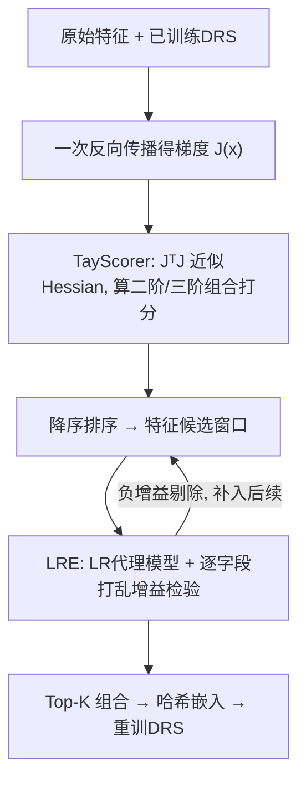
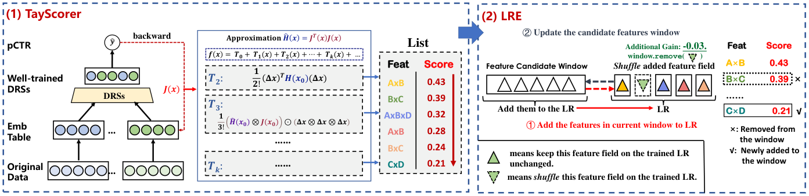

# TayFCS: Towards Light Feature Combination Selection for Deep Recommender Systems (面向深度推荐系统的轻量级特征组合选择)

- **会议/期刊**: KDD 2025
- **作者与机构**: Xianquan Wang (USTC)、Zhaocheng Du、Jieming Zhu、Chuhan Wu、Qinglin Jia、Zhenhua Dong (华为诺亚方舟实验室)
- **推荐链路定位**: 精排（CTR/CVR 预估的输入特征工程层）
- **研究方向**: CTR预估与特征交叉 / 特征选择
- **论文原文**: [https://arxiv.org/abs/2507.03895v1](https://arxiv.org/abs/2507.03895v1)
- **开源代码**: [https://github.com/xqwustc/TayFCS](https://github.com/xqwustc/TayFCS)

## TL;DR (1分钟核心速览)

工业界常用笛卡尔积显式构造高阶特征组合喂给 DRS，但组合数随阶数指数爆炸且绝大多数冗余。TayFCS 把"组合重要性"转化为对已训练模型的泰勒展开项，借助 Information Matrix Equality 用一次反向传播的梯度外积 $\mathbf{J}^\top\mathbf{J}$近似 Hessian，将$O(n^2)$的二阶导降为$O(n)$，再以 LR 滑窗+打乱增益检验剔除冗余组合。在 Frappe/iPinYou/Avazu 三数据集、DNN/DeepFM/Wide&Deep 三骨干上 AUC 最高提升 3.06% 相对值，线上 CVR +13.9%。

## Background & Motivation (背景与核心矛盾)

- **主流范式**: DeepFM/DCN/xDeepFM 等靠隐式网络建模特征交互，但受模型容量与数据量限制难以捕捉细粒度高阶共现；工业界因此用笛卡尔积显式构造二阶/三阶组合作为额外输入特征。
- **前人局限**: (1) 组合数 $|\mathcal{P}^*(\mathcal{F})|=2^{|\mathcal{F}|}-1-|\mathcal{F}|$ 指数增长，逐一"加特征-重训-评估"的精确选择在时间与显存上不可扩展；(2) AutoField/AdaFS/MvFS 等本质仍是**单特征**选择，且无法区分组合与其子成分之间的信息重叠（如邮编与省份同表位置），导致冗余。
- **核心洞察 (Key Insight)**: 组合的重要性信号其实藏在已训练模型的梯度里——泰勒展开的 $k$阶项系数正是$k$ 阶偏导，无需真正构造组合特征即可读出其贡献。
- **本文切入点**: 用 IME 把 Hessian 近似为梯度外积，一次 backward 得到全部二阶（乃至启发式三阶）组合打分，再用轻量 LR 代理模型做冗余剔除。

## Method (核心方法设计)

### 1. 整体框架 (Overall Architecture)

流程分两段：先训练一个 vanilla DRS，冻结参数后对每个样本做一次反向传播得到梯度 $\mathbf{J}(\boldsymbol{x})$，由 TayScorer 计算所有二阶/三阶组合的重要性分数并降序排列；随后 LRE 以窗口大小$S_w$取 Top 组合送入 LR 代理模型，逐字段打乱检验增益，剔除负增益组合并顺次补入后续组合，迭代至全部正增益或达$T_{iter}$。最终选出的$K$ 个组合经哈希嵌入表压缩后作为常规特征拼入原模型重训。

<figure class="paper-figure" markdown="span">
  <figcaption>图2：TayFCS框架概览。首先，(1)中的TayScorer方法形成特征列表，其中特征按其重要性分数降序排列。然后，使用LRE去除冗余特征。(2)中的特征颜色与(1)中的特征名称对应。该概览展示了一个示例：如果LRE检测到某些特征（如B×C）带来负增益，它们将从候选特征窗口中移除，特征列表中下一个重要特征将移入特征窗口。</figcaption>
</figure>

### 2. 关键设计拆解 (Key Designs)

1. **TayScorer（泰勒展开打分器）**：对 $f(\boldsymbol{x})$在展开点$\boldsymbol{x}_0$处做泰勒展开，二阶项$T_2=\frac{1}{2!}(\Delta\boldsymbol{x})^\top\mathbf{H}(\boldsymbol{x}_0)(\Delta\boldsymbol{x})$中$\frac{\partial^2 f}{\partial x_i\partial x_j}\Delta x_i\Delta x_j$即组合$(i,j)$的重要性。直接算 Hessian 需$O(n^2)$次反向传播，故借 IME 在 BCE 对数似然下成立$\mathbb{E}[\partial^2\ln f/\partial x_i\partial x_j]=-\mathbb{E}[(\partial\ln f/\partial x_i)(\partial\ln f/\partial x_j)]$，得近似$\hat{\mathbf{H}}(\boldsymbol{x})=\mathbf{J}^\top(\boldsymbol{x})\mathbf{J}(\boldsymbol{x})$，只需一次 backward。三阶启发式外推为$\hat{\mathbf{H}}\otimes\mathbf{J}$，即$T_3\approx\frac{1}{3!}[(\hat{\mathbf{H}}\otimes\mathbf{J})\odot(\Delta\boldsymbol{x}\otimes\Delta\boldsymbol{x}\otimes\Delta\boldsymbol{x})]$。展开点$\boldsymbol{x}_0$ 取各字段嵌入均值，保证起点"无信息"，使各字段贡献可分离。

2. **LRE（逻辑回归消除）**：打分只衡量单点贡献、无法识别组合与子成分的语义重叠。故以 LR 作代理（利用其强记忆性），窗口内特征入模训练后冻结，逐字段打乱并计算增益 $G(x_i)=\text{Perf}(\text{FW})-\text{Perf}(\text{FW}\setminus x_i)$；若$G(x_i)\le 0$说明该字段冗余，按$\text{FW}^{(t+1)}=(\text{FW}^{(t)}\setminus\{x_i:G(x_i)\le0\})\cup\{x_i\in\mathcal{C}_{ls}\}$ 剔除并补位。LR 训练极快，整体开销与原始训练同量级。

3. **训练目标、负采样与推理效率**：选择阶段沿用骨干模型 BCE 损失 $\mathcal{L}=-\frac{1}{|\mathcal{D}|}\sum_i[y_i\ln\hat{y}_i+(1-y_i)\ln(1-\hat{y}_i)]$，无额外负采样（CTR 任务本身为曝光样本二分类）。组合值超阈值$\tau=5.0e6$ 时用哈希取模压缩嵌入表。推理侧仅增加组合嵌入查表与更宽隐层，实测 Frappe/iPinYou/Avazu 推理耗时分别仅增 10%/12.5%/13.7%。

## Experimental Setup & Evaluation Protocol (实验设置与评估协议)

- **数据集与预处理**:

| 数据集 | #Fields | #Training | #Validation | #Test | 正样本率 |
| :--- | :---: | :---: | :---: | :---: | :---: |
| Frappe | 10 | 202,027 | 57,722 | 28,860 | 33.46% |
| iPinYou | 16 | 13,195,935 | 2,199,323 | 4,100,716 | 0.08% |
| Avazu | 24 | 32,343,172 | 4,042,897 | 4,042,898 | 16.98% |

- **数据划分与防穿越**: Frappe 按 7:2:1 比例划分；iPinYou 额外从训练集划 1/7 作验证；Avazu 按 8:1:1 比例划分。均为随机比例划分，非时间切分。
- **排名评测协议**: CTR 场景采用 AUC 与 Logloss 点估计指标（非 Full-Ranking 排序），并以 $\Delta\text{RelImp}=(\frac{\text{AUC}_{\text{method}}-0.5}{\text{AUC}_{\text{orig}}-0.5}-1)\times100\%$ 度量相对增益；AUC 提升 >0.001 视为显著。
- **对比基线与超参设置**: 骨干为 DNN/DeepFM/Wide&Deep，迁移目标为 DCN/MaskNet；基线含 Random、AutoField+（AutoField 的高阶扩展，批量 20）、AdaFS、MvFS。batch=10000，Adam + Xavier，早停 2 epoch；$K\in\{5,10,15,20\}$，$O_{dmax}=3$，$S_w\in\{10,20\}$，$T_{iter}=1$；显著性用$t$-test，$p\le0.05$。

## Key Experimental Results (实验关键数据)

### 1. 主实验对比 (Main Results)

| Model | Method | Frappe AUC↑ | ΔRelImp | iPinYou AUC↑ | ΔRelImp | Avazu AUC↑ | ΔRelImp |
| :--- | :--- | :---: | :---: | :---: | :---: | :---: | :---: |
| DNN | Original | 0.9735 | - | 0.7795 | - | 0.7937 | - |
| DNN | AutoField+ | 0.9865 | 2.74% | 0.7793 | -0.08% | 0.8013 | 2.59% |
| DNN | AdaFS | 0.9799 | 1.34% | 0.7799 | 0.14% | 0.7965 | 0.95% |
| DNN | MvFS | 0.9804 | 1.47% | 0.7803 | 0.27% | 0.7971 | 1.18% |
| DNN | **TayFCS** | **0.9868*** | **2.81%** | **0.7807** | **0.43%** | **0.8021*** | **2.88%** |
| DeepFM | Original | 0.9726 | - | 0.7784 | - | 0.7942 | - |
| DeepFM | AutoField+ | 0.9848 | 2.57% | 0.7800 | 0.60% | 0.7991 | 1.66% |
| DeepFM | **TayFCS** | **0.9871*** | **3.06%** | 0.7784 | -0.00% | **0.8021*** | **2.70%** |
| W&D | Original | 0.9770 | - | 0.7765 | - | 0.7941 | - |
| W&D | AutoField+ | 0.9857 | 1.84% | 0.7735 | -1.10% | 0.8009 | 2.29% |
| W&D | **TayFCS** | **0.9866*** | **2.02%** | 0.7762 | -0.10% | **0.8027*** | **2.92%** |

（* 表示相对最优基线的 $t$-test 显著性$p\le0.05$；Frappe/iPinYou/Avazu 分别加 5/5/10 个组合。）

### 2. 消融实验 (Ablation Study)

| Model | Metric | r.s. | w.o.h. | w.l.r.e. | TayFCS |
| :--- | :--- | :---: | :---: | :---: | :---: |
| Frappe-DNN | AUC↑ | 0.9718 | 0.9868 | 0.9861 | **0.9868** |
| Frappe-DeepFM | AUC↑ | 0.9711 | 0.9871 | 0.9848 | **0.9871** |
| Avazu-DNN | AUC↑ | 0.7936 | 0.7937 | 0.8013 | **0.8021** |
| Avazu-DeepFM | AUC↑ | 0.7944 | 0.7946 | 0.8006 | **0.8021** |

（r.s.=随机选组合；w.o.h.=去掉哈希表；w.l.r.e.=去掉 LRE。）

### 3. 关键实验发现 (Key Findings)

1. **组合选择远胜随机与单特征选择**：Random 在 Frappe-DNN 上甚至掉点 -0.36%，而 TayFCS 稳定 +2.8%~3.06%；AutoField+ 虽为最强基线，但在 iPinYou 上因正样本率仅 0.08%、梯度信息稀疏而失效（-0.08%），TayFCS 仍取得 +0.43%，说明梯度外积近似在极稀疏场景下更鲁棒。
2. **LRE 与哈希表各司其职且数据依赖**：去掉 LRE 后 Avazu-DeepFM 从 0.8021 降至 0.8006，验证冗余剔除有效；去掉哈希表在 Avazu 上几乎退化到随机水平（0.7946），但在 Frappe 上无影响——因 Frappe 重要组合值未超阈值 $\tau$，说明哈希表是高频字段数据集的必需品。
3. **组合收益可跨模型迁移且存在最优 $K$**：在 Avazu 上把 DNN 选出的组合迁移到 DCN/MaskNet，AUC 分别从 0.7942→0.8024、0.7964→0.8046（新 SOTA），证明收益来自输入特征而非模型结构；$K$从 5 增至 15 持续上升、$K=20$ 回落，印证"有效组合仅占少数"的动机。线上 A/B（TAML 骨干 + 12 个组合）两周后 CVR +13.9%、收入 +0.73%。

## Highlights & Limitations (亮点、对比与审稿批判)

- **与代表作对比 (vs. Prior Work)**: AutoField 用门控做字段级单特征选择、AdaFS/MvFS 用 controller 做样本级重加权，三者均需预构造全部组合并存储，复杂度指数级；TayFCS 首次把"组合重要性"转为免构造的泰勒项梯度近似，且显式处理组合-子成分冗余，是维度上的差异而非增量改进。
- **可迁移亮点**: (1) IME 梯度外积近似 Hessian 的技巧可迁移到任何需要二阶敏感度分析的场景（如特征归因、样本影响函数）；(2) "打分粗排 + LR 滑窗打乱增益精筛"的两阶段范式可复用到 embedding 维度裁剪或跨域特征迁移筛选。
- **审稿级局限批判**: (1) 三阶近似 $\hat{\mathbf{H}}\otimes\mathbf{J}$ 属启发式外推，缺乏严格误差界，更高阶未验证；(2) 组合仍带来额外嵌入空间与内存开销，作者自认未在特征值粒度去冗余；iPinYou 上 DeepFM/W&D 无提升甚至微降，说明方法对骨干交互能力与正样本率敏感，泛化边界未充分刻画。

## Rating (四维评分)

- **方法创新性 (Novelty)**: ⭐⭐⭐⭐ （首次将泰勒展开+IME 引入高阶组合选择，免构造、免重训的视角新颖，但三阶近似偏启发式）
- **评估协议与实验扎实度 (Protocol & Experiments)**: ⭐⭐⭐⭐ （三数据集×三骨干+迁移+消融+效率+线上 A/B 齐全，但均为随机比例划分、缺时间切分与冷启动验证）
- **写作与数学规范度 (Clarity & Rigor)**: ⭐⭐⭐⭐ （公式推导与伪代码清晰，IME 近似缺少误差分析，高阶项符号略密）
- **工业落地与复现价值 (Industrial & Practical Value)**: ⭐⭐⭐⭐⭐ （代码开源、分析开销与原始训练同量级、推理仅增约 10%、已有线上 CVR +13.9% 实证，落地价值极高）

