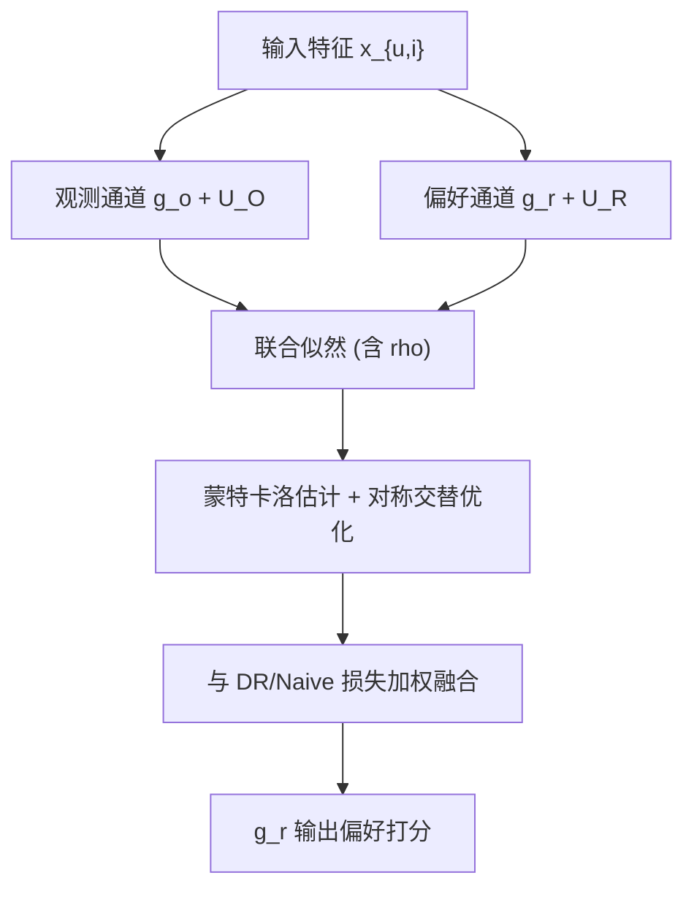
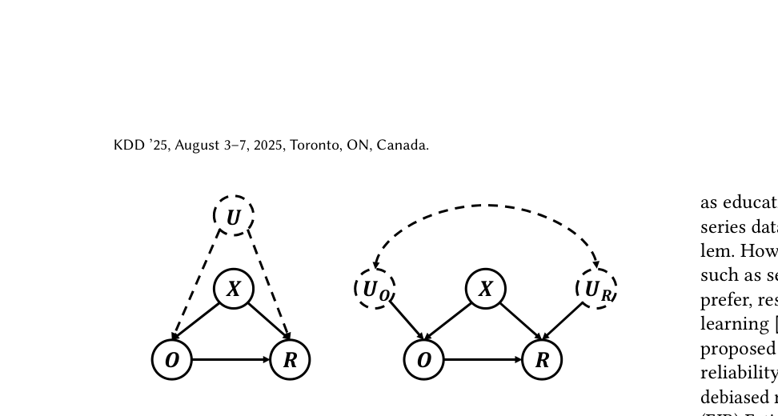

# Addressing Correlated Latent Exogenous Variables in Debiased Recommender Systems (面向相关潜在外生变量的去偏推荐系统)

- **会议/期刊**: KDD 2025 (V.2)
- **作者与机构**: Shuqiang Zhang, Yuchao Zhang, Jinkun Chen, Haochen Sui (Dalhousie University / BUCT / University of Michigan)
- **推荐链路定位**: 精排（预测模型训练阶段的无偏学习）
- **研究方向**: 去偏公平与工业架构 / 因果去偏
- **论文原文**: [https://arxiv.org/abs/2506.07517v1](https://arxiv.org/abs/2506.07517v1)
- **开源代码**: [https://github.com/WallaceSUI/kdd25-background-variable](https://github.com/WallaceSUI/kdd25-background-variable)

## TL;DR (1分钟核心速览)

现有去偏推荐（IPS/DR/EIB）在结构因果模型中都默认外生变量 $U_O, U_R$相互独立，但真实场景中"是否被观测"与"真实偏好"的随机扰动往往相关（如用户活跃度同时驱动曝光与点击）。本文放松该假设，用双变量正态潜变量刻画二者协方差$\rho$，推导含$\rho$ 的联合似然，并用蒙特卡洛数值估计二值偏好下的难解积分，再与任意去偏损失做多任务融合。在 Coat/Yahoo!R3/KuaiRec 的无偏测试集上，AUC 与 Recall/NDCG 全面超越 20+ 基线，Coat 上 N@5 相对最佳基线提升约 1.0%。

## Background & Motivation (背景与核心矛盾)

- **主流范式**: 去偏推荐沿 EIB（伪标签插补）、IPS（倾向重加权）、DR（二者结合）三条线展开，近期工作聚焦倾向学习改进、信息论正则与偏差-方差权衡。
- **前人局限**: 其一，所有方法在 SCM 中假设外生变量联合独立，一旦 $U_O$与$U_R$ 相关，观测机制与结果机制共享的随机扰动会制造伪相关，IPS/DR 的重加权无法消除；其二，处理"未测量混杂"的既有方案要么依赖敏感性分析的最坏情形界（无法保证无偏），要么依赖昂贵的 RCT 无偏数据校准。
- **核心洞察 (Key Insight)**: 作者严格区分了"未测量混杂"（$U$是影响$O,R$的未观测**内生**变量）与本文场景（$U_O,U_R$是分别作用于$O,R$ 的**外生**变量但彼此相关），后者无法用传统混杂调整处理，只能显式建模其联合分布。
- **本文切入点**: 在温和正态假设下把 $\rho$ 作为可学习参数写入数据生成过程，直接对观测数据的边际似然做极大化，从而在**不引入 RCT 数据**的前提下识别并校正相关性偏差。

## Method (核心方法设计)

### 1. 整体框架 (Overall Architecture)

模型将每个用户-物品对拆成两条带噪潜变量通道：观测通道 $z_{u,i}=g_o(x_{u,i};\theta_o)+U_{O,u,i}$，偏好通道$y_{u,i}=g_r(x_{u,i};\theta_r)+U_{R,u,i}$，其中$(U_O,U_R)$服从均值 0、方差 1、协方差$\rho$的双变量正态。$o_{u,i}=\mathbb{I}(z_{u,i}>0)$，$r_{u,i}=f_r(y_{u,i})$。训练时对观测集$\mathcal{O}$与未观测集$\mathcal{D}\setminus\mathcal{O}$分别写出边际/联合似然，二值偏好下用蒙特卡洛采样近似积分，并利用似然对称性交替优化$\theta_r$与$\theta_o$；最终与任意去偏损失加权融合。推理阶段仅用$g_r$ 打分，无额外开销。

<figure class="paper-figure" markdown="span">
  <figcaption>图1：传统未测量混杂（左）与潜在外生变量（右）的对比。虚线表示未观测或潜在的变量。</figcaption>
</figure>

### 2. 关键设计拆解 (Key Designs)

1. **相关外生变量的联合似然（连续偏好闭式解）**：痛点是把独立性换成相关性后，$\mathcal{O}$上的似然需要对$z$ 积分。作者利用双变量正态条件分布得到闭式：
$f(z_{u,i}>0,y_{u,i}|x_{u,i})=\frac{1}{\sqrt{2\pi}}e^{-\frac{(y_{u,i}-g_r)^2}{2}}\Phi\!\left(\frac{g_o+\rho(y_{u,i}-g_r)}{\sqrt{1-\rho^2}}\right)$，
未观测部分则为 $\Phi(-g_o)$。直觉上$\rho$ 把偏好残差"泄漏"进选择概率，使模型能区分"因相关噪声而被观测"与"因真实偏好而被观测"。

2. **二值偏好下的蒙特卡洛估计与对称交替优化**：二值情形积分无闭式，作者把 $f(z>0,y>0|x)$写成对标准正态$\epsilon$的期望$\mathbb{E}_\epsilon[\Phi(\frac{g_r+\rho\epsilon}{\sqrt{1-\rho^2}})\mathbb{I}\{\epsilon>-g_o\}]$，用$L$次采样均值近似。由于指示函数不可导，作者观察到该期望在交换$g_o,g_r$后结构对称，于是拆成$\mathcal{L}^R_{MLE}$（固定$\theta_o$优化$\theta_r$）与$\mathcal{L}^D_{MLE}$（固定$\theta_r$优化$\theta_o$）交替求解，规避了直接对$\mathbb{I}(\cdot)$ 求导导致的梯度爆炸/消失。

3. **训练目标与融合**：总目标 $\mathcal{L}_E=\alpha(-\mathcal{L}^B_{MLE})+(1-\alpha)\mathcal{L}_{Debias}$，$\mathcal{L}_{Debias}$可为 Naive 或 DR 损失，$\alpha$平衡似然项与去偏项。训练无需负采样（全观测对参与似然），推理仅前向$g_r$，与 NCF 主干同阶开销。

## Experimental Setup & Evaluation Protocol (实验设置与评估协议)

- **数据集与预处理**:

| 数据集 | #Users | #Items | #Interactions | 稀疏度/密度 | 特征/场景说明 |
| :--- | :---: | :---: | :---: | :---: | :--- |
| Coat | 290 | 300 | 6,960 MNAR 训练 / 4,640 MAR 测试 | ~0.08 | 服饰购买，5 分制二值化（<3 为 0） |
| Yahoo! R3 | 15,400 | — | >300,000 MNAR 训练 / 5,400×10 MAR 测试 | 极稀疏 | 音乐评分，同规则二值化 |
| KuaiRec | 1,411 | 3,327 | 4,676,570 观看比 | ~1.0（稠密） | 短视频，观看比二值化 |
| ML-100K (半合成) | 943 | 1,682 | 88,010 训练 / 44,005 无偏测试 | ~0.05 | 注入 $\rho\in\{-0.8,\dots,0.8\}$ 的合成噪声 |

- **数据划分与防穿越**: 真实数据采用"MNAR 训练集 + 独立 MAR 无偏测试集"的经典去偏协议；半合成数据按 $\rho$ 网格生成，测试集从全库随机抽取一半，保证无偏。
- **排名评测协议**: 在无偏测试集上做全候选排序，报告 AUC、Recall@K、NDCG@K；Coat/Yahoo!R3 取 $K=5$，KuaiRec 取$K=50$。
- **对比基线与超参设置**: 覆盖 NCF/CVIB/DIB（无倾向）、IPS/SNIPS/AS-IPS/IPS-V2/Multi-IPS/ESCM2-IPS、DR-JL/MRDR/DR-BIAS/DR-MSE/TDR-CL/DR-V2/Multi-DR/RD-DR/BRD-DR/ESCM2-DR/KBDR/DCE-DR/D-DR 共 20+ 基线；主干为 NCF（2k→k→k→1），嵌入维度 Coat 取 {4,8,16,32}、Yahoo/KuaiRec 取 {16,32,64,128}，蒙特卡洛样本量 Coat 取 [100,500]、其余 [10,60]，显著性用 pairwise t-test（$p<0.05$）。

## Key Experimental Results (实验关键数据)

### 1. 主实验对比 (Main Results)

| 数据集 / 指标 | 最佳基线 | Ours-Naive | Ours-DR | Improv.% (vs 最佳基线) |
| :--- | :---: | :---: | :---: | :---: |
| Coat AUC | 0.770 (TDR-JL/ESCM2-DR/DCE-DR) | 0.775 | **0.775** | +0.6% |
| Coat R@5 | 0.474 (BRD-DR) | 0.465 | **0.485\*** | +2.3% |
| Coat N@5 | 0.672 (BRD-DR) | 0.658 | **0.679\*** | +1.0% |
| Yahoo AUC | 0.704 (RD-DR) | 0.702 | **0.715\*** | +1.6% |
| Yahoo R@5 | 0.465 (D-DR) | 0.464 | **0.486\*** | +4.5% |
| Yahoo N@5 | 0.692 (D-DR) | 0.691 | **0.713\*** | +3.0% |
| KuaiRec AUC | 0.842 (Multi-DR) | **0.854\*** | 0.853 | +1.4% |
| KuaiRec R@50 | 0.706 (D-DR) | **0.721\*** | 0.715 | +2.1% |
| KuaiRec N@50 | 0.654 (D-DR) | 0.664 | **0.666\*** | +1.8% |

半合成 ML-100K 上（表 1），$\rho=0.8$时 Ours 的 MSE 为 **1.459**，而 DR 为 5.287、IPS 为 5.393；$\rho=-0.8$ 时 Ours 为 **1.481** vs DR 5.518，差距达 3.7 倍。

### 2. 消融实验 (Ablation Study)

| 配置 | Coat N@5 | Yahoo N@5 | KuaiRec N@50 | 说明 |
| :--- | :---: | :---: | :---: | :--- |
| Ours-DR（完整） | **0.679** | **0.713** | **0.666** | 似然 + DR 融合 |
| Ours-Naive | 0.658 | 0.691 | 0.664 | 去掉 DR 项，仅似然 + Naive |
| DR-JL（$\alpha=0$） | 0.633 | 0.678 | 0.649 | 纯 DR，无似然项 |
| NCF（无去偏） | 0.623 | 0.674 | 0.643 | 下界参照 |

### 3. 关键实验发现 (Key Findings)

1. **相关性越强，本文优势越大**：半合成实验中所有基线在 $|\rho|\le 0.2$时与本文接近，但$|\rho|=0.8$ 时基线 MSE 膨胀 3–4 倍而本文稳定在 1.46–1.48，直接验证"独立假设失效"是基线崩溃的根因。
2. **$\rho$可被准确识别**：图 2 显示$|\rho|$较大时估计值紧贴对角线，$|\rho|$小时方差增大——说明观测数据中相关性信息量随$|\rho|$衰减，这也解释了为何小$\rho$时需靠$\mathcal{L}_{Debias}$兜底（$\alpha$ 应取小）。
3. **融合优于单打**：Ours-DR 在三个真实数据集上均优于 Ours-Naive，Coat N@5 从 0.658 升至 0.679；而纯 DR 仅 0.633，说明似然项与 DR 项互补而非冗余。运行时间上 Ours 与 DR-JL 相当（Coat 89s vs 118s，KuaiRec 204s vs 215s），蒙特卡洛求和的并行性抵消了采样开销。

## Highlights & Limitations (亮点、对比与审稿批判)

- **与代表作对比 (vs. Prior Work)**: 相比 DR-JL/BRD-DR 等仍在外生独立假设下做重加权或误差插补，本文首次把"外生相关"作为一阶建模对象；相比 RD-DR 的敏感性分析最坏界（不保证无偏）与 Li et al. 的 RCT 校准（成本高），本文仅用有偏数据即实现可识别校正。
- **可迁移亮点**: ①"对称性拆解不可导指示函数"的技巧可迁移到任何含截断/门控的似然优化；②把 $\rho$ 作为可学习标量嵌入损失，可作为诊断工具反推线上选择机制的相关强度。
- **审稿级局限批判**: ①正态假设较强，真实曝光机制常呈重尾/多峰，误设时 $\rho$估计可能有偏；②蒙特卡洛采样在超大规模工业场景的扩展性存疑（作者自认），且$\alpha$ 对性能影响显著（图 4），需逐数据集调参，缺乏自适应方案。

## Rating (四维评分)

- **方法创新性 (Novelty)**: ⭐⭐⭐⭐ （首次系统区分并建模外生相关，似然+对称交替的推导干净，但正态假设限制了理论普适性）
- **评估协议与实验扎实度 (Protocol & Experiments)**: ⭐⭐⭐⭐⭐ （半合成 $\rho$ 网格 + 三个真实无偏测试集 + 20+ 基线 + 显著性检验，覆盖充分）
- **写作与数学规范度 (Clarity & Rigor)**: ⭐⭐⭐⭐ （连续/二值两种情形的推导完整、附录详尽，但符号在正文与附录间略有重复）
- **工业落地与复现价值 (Industrial & Practical Value)**: ⭐⭐⭐⭐ （代码开源、推理零额外开销、训练耗时与 DR 持平，但采样超参与 $\alpha$ 调优增加落地成本）

