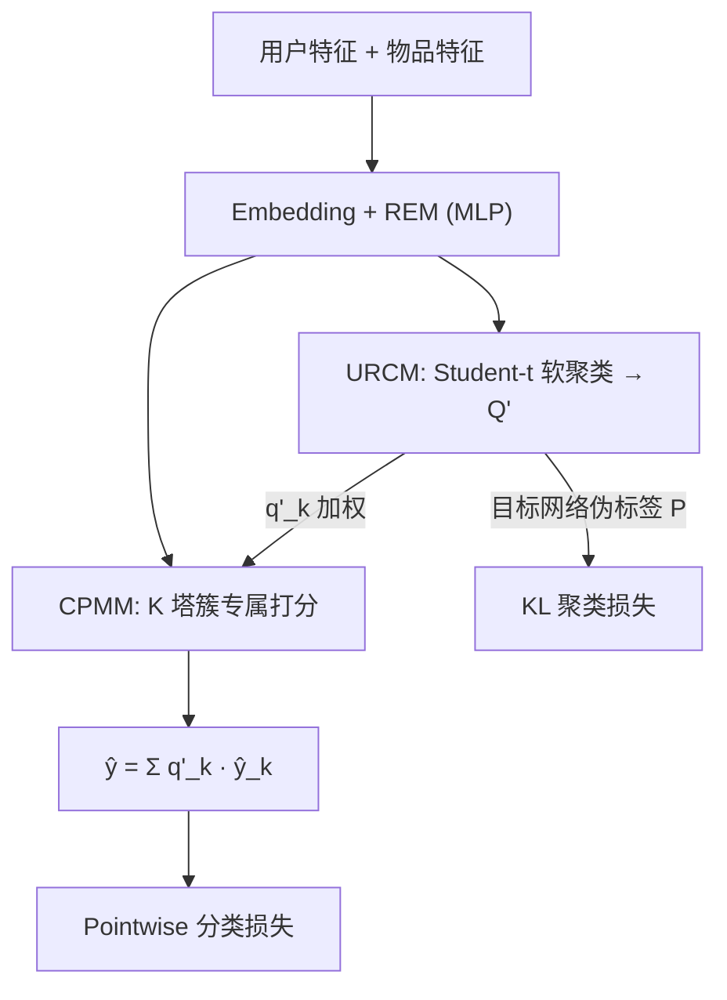
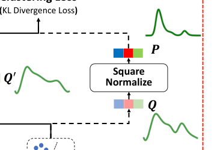

# Breaker: Removing Shortcut Cues with User Clustering for Single-slot Recommendation System (以用户聚类破除捷径线索的单槽推荐系统)

- **会议/期刊**: KDD 2025
- **作者与机构**: Chao Wang, Yue Zheng, Yujing Zhang, Yan Feng, Zhe Wang, Xiaowei Shi, An You, Yu Chen（美团）
- **推荐链路定位**: 精排（单槽位 pointwise 打分）
- **研究方向**: 去偏公平与工业架构 / CTR 预估与特征交叉
- **论文原文**: [https://arxiv.org/abs/2506.00828v1](https://arxiv.org/abs/2506.00828v1)
- **开源代码**: [https://github.com/yzheng51/breaker](https://github.com/yzheng51/breaker)

## TL;DR (1分钟核心速览)

单槽推荐每次只曝光一个物品，只能做 pointwise 建模，而用户侧特征远多于物品侧，导致 DNN 走捷径、只学"用户固有倾向"（点不点与物品无关），忽视真正关心的用户-物品偏好。Breaker 引入用户表征深度聚类辅助任务，把倾向相似的用户聚成一簇，人为抬高用户侧判别难度，再以多塔结构做簇专属偏好建模，并用延迟参数更新稳定联合训练。离线 Recall@1 相对最优基线提升 7.05%/7.14%，线上 CVR 提升 4.93%/7.15%，已服务美团支付千万级日活。

## Background & Motivation (背景与核心矛盾)

- **主流范式**: 单槽营销场景（如支付后广告位）候选物品仅 18–20 个、由运营手工配置，只能对每个物品独立做 pointwise 点击/转化预估，无法利用列表内排序信号。
- **前人局限**: ① 用户侧特征数量与信息量远超物品侧，模型极易先拟合"用户固有倾向"这一最省力的解；② 候选物品池极小且业务驱动，物品侧探索空间受限，进一步加剧捷径学习。
- **核心洞察 (Key Insight)**: 作者用 LightGBM 特征重要性验证——最强物品特征仅排第 7，最强用户特征重要性是其 6 倍；且加入物品特征后 LogLoss 仅降 $5\times10^{-5}$（图 1b/1c）。这说明模型几乎没在学用户-物品交互，物品特征近乎冗余。
- **本文切入点**: 既然捷径源于"用户侧太好区分"，那就主动把相似用户聚成一簇、抹平簇内用户差异，逼模型只能在簇内靠物品信息区分点击——即"提高任务难度以消除捷径"。

## Method (核心方法设计)

### 1. 整体框架 (Overall Architecture)

Breaker 将点击概率分解为簇条件概率的加权和：$P(Y|U,I)=\sum_{C\in\mathcal{C}}Q(Y|U,I,C)P(C|U)$。输入用户/物品特征经嵌入层与 REM（MLP）得到表征$E_u,E_i$；URCM 对$E_u$做 Student-t 软聚类输出簇分配概率$Q'$，并由目标网络生成伪标签$P$计算 KL 损失；CPMM 将$[E_u\oplus E_i]$送入$K$个塔，各塔输出按$q'_k$加权求和得最终打分。主网络与目标网络异步共享用户侧参数，每$M$ 步同步一次。

<figure class="paper-figure" markdown="span">
  <figcaption>图3：Breaker的结构，包含一个1○嵌入层，</figcaption>
</figure>

### 2. 关键设计拆解 (Key Designs)

1. **用户表征聚类模块 URCM（制造"用户侧难度"）**：用 Student-t 核度量表征与簇心相似度 $q'_{ij}=\frac{(1+\|e_i^u-\mu_j\|^2/\alpha)^{-\frac{\alpha+1}{2}}}{\sum_{j'}(\cdot)}$，目标网络经平方归一化生成高置信伪标签$p_{ij}=\frac{q_{ij}^2/f_j}{\sum_{j'}q_{ij'}^2/f_{j'}}$，以$\mathcal{L}_c=KL(P\|Q')$ 迭代锐化簇结构。直觉：簇内用户倾向趋同，模型无法再靠"这是哪类用户"直接猜点击，只能转向物品侧信息。

2. **簇专属多塔偏好建模 CPMM（簇驱动参数分化）**：$K$个塔共享同一输入$E_{in}=[E_u\oplus E_i]$，但输出按簇概率加权：$\hat{y}=\sum_{k=1}^{K}\hat{y}_{kc}\times q'_k$。梯度分析给出$\frac{\partial\mathcal{L}_p}{\partial W_k}=\frac{\partial\mathcal{L}_p}{\partial\hat{Y}}\frac{\partial\hat{Y}_{kc}}{\partial W_k}Q'_k$——第$k$塔参数主要由属于簇$k$ 的样本驱动，极端二值化时每塔只学本簇用户，从而在"同质用户群"内部挖掘细粒度物品偏好。

3. **延迟参数更新与训练目标**：聚类与分类任务梯度方向差异大，端到端易震荡，故目标网络参数每 $M$步（约一个 epoch 的 10%）从主网络复制一次并冻结。总损失$\mathcal{L}=\mathcal{L}_p+\lambda\mathcal{L}_c$，$\lambda=0.1$；$\mathcal{L}_p$ 为标准 NLL，无负采样（全量曝光样本 pointwise 训练），推理仅需一次前向，1.41M 参数。

## Experimental Setup & Evaluation Protocol (实验设置与评估协议)

- **数据集与预处理**: 来自美团支付两个不同广告位，采用 RCT（按 `hash(userID) mod n` 分桶，每桶用户看同一物品）采集三周，天然消除曝光偏置：

| 数据集 | #Users | #Items | #Interactions | 正样本 | 特征数 |
| :--- | :---: | :---: | :---: | :---: | :---: |
| Scenario A（显眼槽位） | 1,709,938 | 20 | 13,597,208 | 27,523 | 523 |
| Scenario B（弱曝光槽位） | 5,416,051 | 18 | 15,125,354 | 5,082 | 501 |

- **数据划分与防穿越 (Splitting Strategy)**: 比例划分，A 取 15%、B 取 20% 作测试集（正样本稀疏故加大测试比例）。
- **排名评测协议 (Ranking Protocol)**: 单槽场景只关心首位，故用 `Recall@1`；另引入因果效应指标 AER（全期望公式，在 RCT 样本上无偏估计业务目标期望），弥补 Recall 忽略无正反馈用户的缺陷。
- **对比基线与超参设置**: LightGBM、DeepFM、xDeepFM、DCN-V2、EDCN、AutoInt、FRNet、MultiCR；MLP 统一 4 层 256-64-32-10，Breaker 特征层 256-64、每塔 32-10，嵌入维度 10，$K\in\{2,3,4,5\}$ 调优后取 4，Adam lr=1e-3，batch=2048。

## Key Experimental Results (实验关键数据)

### 1. 主实验对比 (Main Results)

| 方法 | A: Recall@1 | A: AER | B: Recall@1 | B: AER | #Params(M) | 推理(s)↓ |
| :--- | :---: | :---: | :---: | :---: | :---: | :---: |
| LightGBM | 0.05040 | 0.002055 | 0.08259 | 0.0004800 | - | 9.74 |
| DeepFM | 0.05536 | 0.002303 | 0.08132 | 0.0004764 | 1.41 | 19.73 |
| xDeepFM | 0.05908 | 0.002438 | 0.08132 | 0.0004975 | 40.70 | 6978.30 |
| DCN-V2 | 0.05412 | 0.002125 | 0.08895 | 0.0005103 | 4.13 | 263.49 |
| EDCN | 0.05412 | 0.002125 | 0.08641 | **0.0005155** | 54.80 | 190.09 |
| AutoInt | 0.05461 | 0.002194 | 0.08894 | 0.0004925 | 1.42 | 3833.83 |
| FRNet | **0.05983** | **0.002533** | 0.08640 | 0.0004940 | 4.10 | 1450.91 |
| MultiCR | 0.05735 | 0.002447 | 0.08132 | 0.0004757 | 0.61 | 20.66 |
| **Breaker** | **0.06405** | **0.002676** | **0.09530** | **0.0005210** | 1.41 | **11.74** |
| Improv.% | +7.05% | +5.65% | +7.14% | +1.07% | - | - |

### 2. 消融实验 (Ablation Study)

| 变体 | A: Recall@1 | A: AER | B: Recall@1 | B: AER |
| :--- | :---: | :---: | :---: | :---: |
| Breaker$_{1-}$（去聚类辅助任务，仅多塔） | 0.05288 | 0.002242 | 0.08005 | 0.0004639 |
| Breaker$_{2-}$（去延迟更新） | 0.06306 | 0.002505 | 0.08513 | 0.0004978 |
| **Breaker（完整）** | **0.06405** | **0.002676** | **0.09530** | **0.0005210** |

### 3. 关键实验发现 (Key Findings)

1. **增益来自"破捷径"而非"多塔容量"**：Breaker$_{1-}$ 参数量与完整版相同却仅得 0.05288/0.08005，甚至低于单塔 FRNet，说明多塔本身无益；只有叠加聚类辅助任务后 Recall@1 才跃升至 0.06405，直接验证动机。
2. **簇数存在明显最优区间**：$K=4$时两场景均最优，过大或过小都掉点；场景 B 因正样本仅 5,082 条、指标波动更大，对$K$ 更敏感（图 6）。
3. **捷径确实被压制**：训练中 item-based AUC（物品内排序能力，间接反映"猜用户倾向"的能力）持续下降，而 Recall@1 同步上升（图 7）；同时各塔预测值相关系数矩阵整体偏低（图 8），证明 $K$个塔学到的是互补的细粒度偏好而非冗余。聚类质量上，Breaker 表征的轮廓系数 A 场景 0.97、B 场景 0.63，显著高于 Breaker$_{1-}$ 的 0.58/0.43。

## Highlights & Limitations (亮点、对比与审稿批判)

- **与代表作对比 (vs. Prior Work)**: MultiCR 同样用多塔解耦"固有倾向"与"物品偏好"，但缺少归纳偏置去主动消除捷径，A 场景 Recall@1 仅 0.05735；FRNet 靠上下文感知表征刷新 SOTA 但仍在同一捷径框架内；本文的差异在于把"去偏"转化为"提高用户侧任务难度"的训练策略，而非增加特征交互容量。
- **可迁移亮点**: ① "聚类抬高难度 + 簇专属塔"可迁移到任何用户特征压倒物品特征的场景（如冷启动、营销触达）；② 延迟参数更新（每 $M$ 步同步目标网络）是联合训练辅助聚类任务的通用稳定技巧，成本极低。
- **审稿级局限批判**: ① 候选物品仅 18–20 个且人工配置，物品侧信息极度贫乏，结论能否推广到千级候选池的常规推荐存疑；② 聚类数 $K$需逐场景调参且场景 B 敏感，缺乏自适应确定$K$ 的机制；③ 离线仅报告 Recall@1 与 AER，未给出 AUC/GAUC 等常规排序指标，评估维度偏窄。

## Rating (四维评分)

- **方法创新性 (Novelty)**: ⭐⭐⭐⭐ （把"捷径偏置"显式引入单槽推荐，并用"提高难度"的反直觉思路破局，梯度分析支撑充分）
- **评估协议与实验扎实度 (Protocol & Experiments)**: ⭐⭐⭐⭐ （RCT 采集消除曝光偏置、离线+线上 A/B 双验证且给出 p 值，但指标维度偏窄、仅两个私有场景）
- **写作与数学规范度 (Clarity & Rigor)**: ⭐⭐⭐⭐ （分解式建模与梯度推导清晰，算法伪代码完整；部分符号如 $Q$与$Q'$ 区分略易混淆）
- **工业落地与复现价值 (Industrial & Practical Value)**: ⭐⭐⭐⭐⭐ （1.41M 参数、推理比 DeepFM 快约 40%，已上线服务千万级 DAU，代码开源，复现门槛低）

