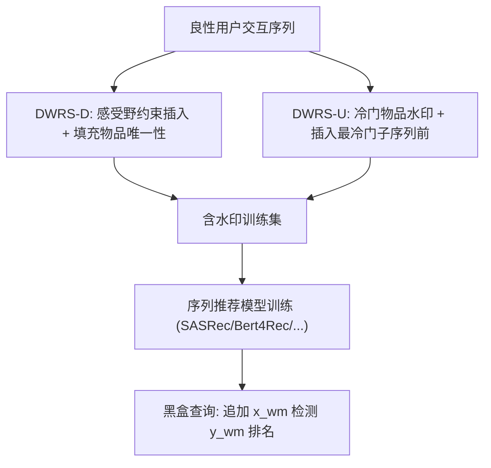
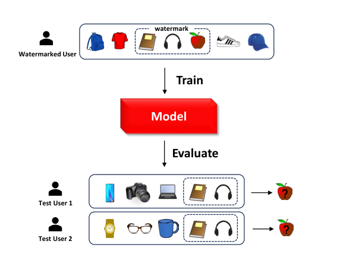

# Data Watermarking for Sequential Recommender Systems (序列推荐系统的数据水印)

- **会议/期刊**: KDD 2025
- **作者与机构**: Sixiao Zhang, Cheng Long (NTU); Wei Yuan, Hongxu Chen, Hongzhi Yin (UQ)
- **推荐链路定位**: 数据侧（训练数据版权保护），作用于召回/序列建模的训练数据
- **研究方向**: 去偏公平、可信隐私与工业架构 / 序列推荐
- **论文原文**: [论文原文链接](https://arxiv.org/abs/2411.12989v2)
- **开源代码**: [开源代码仓库链接](https://github.com/RinneSz/DWRS)

## TL;DR (1分钟核心速览)

针对推荐数据被未授权转售/训练却无法追溯的痛点，本文首次形式化序列推荐的**数据集水印 (DWRS-D)** 与**单用户水印 (DWRS-U)** 两个问题，将水印定义为一段连续物品序列，并借助 Transformer 注意力热图揭示的**感受野 (Receptive Field)** 约束插入位置与填充物品唯一性，使模型强记忆"水印体 $\to$目标物品"映射。在 5 个序列模型、3 个数据集上，水印 NDCG 普遍$>0.9$（Bert4Rec 亦$>0.7$），而 Oracle 模型水印成功率近$0$，模型效用几乎无损。

## Background & Motivation (背景与核心矛盾)

- **主流范式**: 视觉/文本/图领域的数据水印多借用后门攻击——在良性样本中植入触发器（像素块、同义词、子图），使模型学到"触发器 $\to$ 指定输出"的强关联，从而在黑盒查询时验证数据被使用。
- **前人局限**: ①推荐数据是"用户-物品交互序列"结构，下游任务是 Top-k 排序而非分类，像素/词元级触发器无法迁移；②已有的推荐**模型**水印（Zhang et al.）假设攻击者无数据访问权，其"独立重复序列"式水印一旦用于数据保护便极易被频繁模式挖掘识别并剔除。
- **核心洞察 (Key Insight)**: 作者绘制 SASRec/Bert4Rec 在 ML-1M/Beauty 上的注意力热图（图 3），发现目标物品的嵌入**只由感受野内少数相邻物品聚合**（$\boldsymbol{x}_i \approx \sum_{j\in RF}\alpha_{ij}\boldsymbol{V}_j$），且前序物品恒在感受野内——这意味着水印体必须与目标物品**连续相邻**才能被记忆。
- **本文切入点**: 以感受野为几何约束设计插入算法，用"填充物品唯一性"消除干扰关联，从而以极短水印（$l=3$）、极低插入率（$p=1\%$）实现高判别性水印。

## Method (核心方法设计)

### 1. 整体框架 (Overall Architecture)

DWRS 分两支：DWRS-D 面向数据集版权，迭代地在随机用户序列的随机位置插入水印 $S_{wm}=\{i^{wm}_1,\dots,i^{wm}_l\}$（前$l-1$个为水印体$x_{wm}$，末位为目标响应$y_{wm}$），并记录该位置感受野内的填充物品集合$\mathcal{I}_{filler}$，后续插入强制新位置感受野与$\mathcal{I}_{filler}$不相交，直至达到插入率$p$；DWRS-U 面向单用户，仅能改一条序列，故选取最冷门物品构成水印，并插入到目标序列中"平均流行度最低的子序列"$C_n$之前，借冷门子序列的过拟合容量补偿短水印的依赖缺失。检测阶段数据拥有者仅需黑盒查询：将$x_{wm}$追加到良性序列末尾，观察$y_{wm}$ 是否排在前列。

<figure class="paper-figure" markdown="span">
  <figcaption>图1：推荐系统数据水印示意图。将水印序列（书籍、耳机、苹果）插入训练序列中。模型通过为以书籍和耳机结尾的测试查询预测苹果来记住水印。</figcaption>
</figure>

### 2. 关键设计拆解 (Key Designs)

1. **感受野引导的插入与填充物品唯一性 (DWRS-D)**：痛点是无模型先验时无法保证水印体落入 $y_{wm}$的感受野，且感受野内非水印物品会与$y_{wm}$建立虚假关联、稀释水印信号。做法是先用热图估计数据集感受野范围（ML-1M 取前后各 5，Beauty/Steam 取全序列），每次插入后记录$\mathcal{I}_{filler}\leftarrow\mathcal{I}_{filler}\cup RF(pos)$，后续位置须满足$RF(pos)\cap\mathcal{I}_{filler}=\varnothing$。直觉上，填充物品全局唯一后，模型无法借重复填充物品"抄近路"，只能强化水印内部依赖。
2. **冷门子序列锚定的用户水印 (DWRS-U)**：单条序列中水印仅出现一次，信号极弱。作者观察到 $y_{wm}$的嵌入也会影响其后物品，故将水印插在平均流行度最低的长度$n$子序列$C_n$之前：$C_n$中冷门物品嵌入不稳、易被水印信息"融合"，从而在训练中反向拉动$y_{wm}$的嵌入更新，等效延长了依赖链。检测时丢弃$C_n$，仅用$x_{wm}$ 查询，保证水印本身仍短。
3. **训练目标、负采样与推理开销**：本文不改动任何推荐模型损失（沿用各基线原损失，如 SASRec 的 CE/BPR），水印通过数据投毒间接生效，属"免负采样改动"的纯数据侧方法；推理开销为零，检测仅需若干次前向查询，工业部署成本极低。

## Experimental Setup & Evaluation Protocol (实验设置与评估协议)

- **数据集与预处理**: 沿用 Zhang et al. 的预处理：

| 数据集 | #Users | #Items | 平均长度 | 最大长度 | 密度 |
| :--- | :---: | :---: | :---: | :---: | :---: |
| ML-1M | 6,040 | 3,416 | 165.5 | 2,277 | 4.84% |
| Beauty | 40,226 | 54,542 | 8.8 | 293 | 0.02% |
| Steam | 334,542 | 13,046 | 12.6 | 2,045 | 0.10% |

- **数据划分与防穿越**: 标准 `Leave-One-Out`——末位物品为测试、倒数第二位为验证。
- **排名评测协议**: 效用用 Recall@k / NDCG@k 衡量测试物品排名；水印有效性则将 $x_{wm}$追加至良性序列末尾，统计$y_{wm}$在**全库排序**中的 Recall@k / NDCG@k（$k\in\{5,10,20,100\}$），并与 Oracle（干净数据训练）对比判别性。
- **对比基线与超参**: 5 个序列模型（SASRec、Bert4Rec、NARM、CL4SRec、DuoRec）；DWRS-D 对比 `DWRS-D-base`（随机位置随机序列插入），DWRS-U 对比 6 种插入位置。默认 $l=3$、$p=1\%$，水印物品取自最冷门 10% 且$S_{wm}$ 在原数据中不存在，5 次运行取均值。

## Key Experimental Results (实验关键数据)

### 1. 主实验对比 (Main Results)

水印有效性（NDCG，图 4 与表 2 汇总）：

| 模型 | ML-1M (DWRS-D) | Beauty (DWRS-D) | Steam (DWRS-D) | Oracle 平均 N@10 |
| :--- | :---: | :---: | :---: | :---: |
| SASRec | **0.998+** | **0.99+** | **0.99+** | 0.00% |
| Bert4Rec | **0.90+** | **0.75+** | **0.80+** | 0.00% |
| NARM | **0.998+** | **0.99+** | **0.99+** | 0.00% |
| CL4SRec | **0.98+** | **0.95+** | **0.96+** | 0.00% |
| DuoRec | **0.9999** | **0.99+** | **0.99+** | 0.00% |
| DWRS-D-base | 略低（一致 $\le$ DWRS-D） | 略低 | 略低 | — |

DWRS-U（图 6）在多数模型/数据集上 Recall@10 达 $0.6\sim0.9$，Oracle 近$0$；Bert4Rec 在 Beauty/Steam 上最弱（欠拟合模型难以过拟合水印）。

### 2. 消融与超参实验 (Ablation & Sensitivity)

| 配置 | 关键指标 | 说明 |
| :--- | :---: | :--- |
| $l=2$ | Recall≈0 | 单物品水印体不足以记忆 |
| $l=3$ | Recall≈0.9 | 默认，性价比拐点 |
| $l=5/10$ | 略升 | 增益边际递减 |
| $p=0.1\%$ | R@10=85.77 | 插入率过低 |
| $p=0.5\%$ | R@10=99.66 | 接近饱和 |
| $p=1\%$ | R@10=99.74 | 默认 |
| $p=2\%$ | R@10=100 | 隐蔽性受损 |
| DWRS-U 插入位置 BUS vs. AUS/BPS/APS/Begin/Middle/End | BUS 显著最优 | 验证冷门子序列锚定有效 |
| 微调攻击 100 epoch | 有效性 1.0→0.8，效用 0.265→<0.245 | 攻击者效用代价不可接受 |

### 3. 关键实验发现 (Key Findings)

1. **感受野约束是有效性的关键**：DWRS-D 在所有模型/数据集上 NDCG 均 $\ge$随机插入基线，且$l=2$时 Recall 崩塌至 0、$l=3$ 即达 0.9，说明"水印体必须连续落入目标物品感受野"这一几何先验比单纯加长水印更高效。
2. **判别性极强**：Oracle 模型在三个数据集上的水印 NDCG 均 $\le 0.04\%$，与水印模型$>0.9$ 形成数量级差距，黑盒查询即可无歧义主张所有权。
3. **鲁棒性与效用可兼得**：微调 100 epoch 后水印 Recall 仍保持 0.8（Oracle 为 0），而攻击者模型效用跌破 0.245，形成"去水印即毁模型"的威慑；同时干净/水印模型效用无显著差距，插入率仅 1%、水印长度仅 3，隐蔽性良好。

## Highlights & Limitations (亮点、对比与审稿批判)

- **与代表作对比 (vs. Prior Work)**: 相较视觉 BadNets 类后门水印，本文触发器是"连续物品序列"而非像素块，且需满足排序任务的 Top-k 判别；相较 Zhang et al. 的推荐**模型**水印（独立重复序列、假设无数据访问），本文水印仅出现于少数用户、填充物品唯一，抗频繁模式挖掘，适用于数据转售场景。
- **可迁移亮点**: ①"用注意力热图估计感受野 $\to$ 约束投毒位置"的思路可迁移到任何 Transformer 序列投毒/去偏数据增强；②"冷门子序列作为过拟合锚点"可用于低资源下的数据增广或记忆增强。
- **审稿级局限批判**: ①DWRS-U 依赖"用户可见物品流行度"假设，且当目标用户无冷门子序列时方法退化、需加长水印；②感受野需按数据集人工设定（ML-1M 前后 5、Beauty 全序列），缺乏自适应估计，跨域迁移需重新调参；③未评估自适应攻击者（如检测异常连续冷门物品序列的过滤器）。

## Rating (四维评分)

- **方法创新性 (Novelty)**: ⭐⭐⭐⭐ （首次形式化推荐数据水印双场景，感受野约束与冷门子序列锚定均有清晰物理直觉）
- **评估协议与实验扎实度 (Protocol & Experiments)**: ⭐⭐⭐⭐ （5 模型 3 数据集 + 三类移除攻击 + 完整超参扫描，但主表以图呈现、缺少统一数值表）
- **写作与数学规范度 (Clarity & Rigor)**: ⭐⭐⭐⭐ （问题定义与四条性质清晰，感受野近似公式推导简洁，符号略松散）
- **工业落地与复现价值 (Industrial & Practical Value)**: ⭐⭐⭐⭐⭐ （纯数据侧、零推理开销、代码开源，1% 插入率即可部署，版权追溯场景直接可用）

