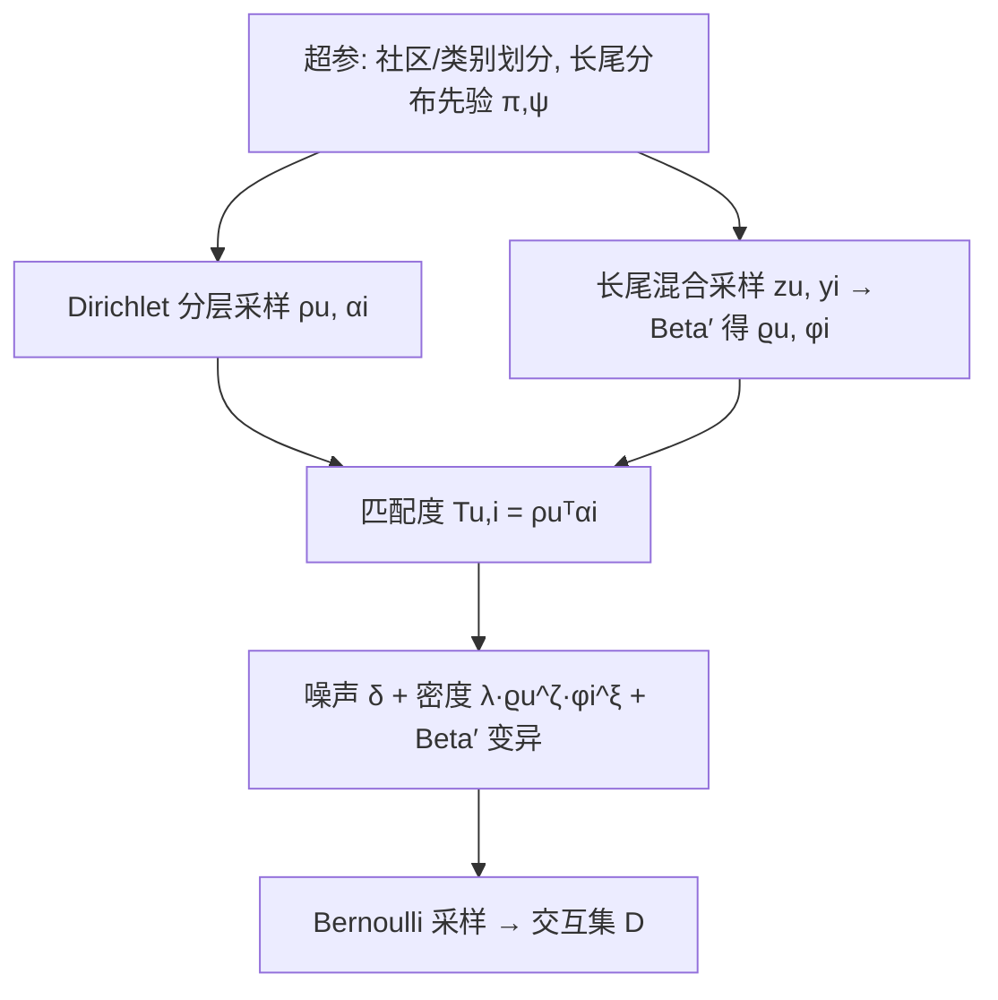

# Flexible Generation of Preference Data for Recommendation Analysis (面向推荐分析的灵活偏好数据生成)

- **会议/期刊**: KDD 2025
- **作者与机构**: Simone Mungari, Erica Coppolillo (University of Calabria / ICAR-CNR / Revelis), Ettore Ritacco (University of Udine), Giuseppe Manco (ICAR-CNR)
- **推荐链路定位**: 数据层（基准构建与评测沙盒，非在线链路）
- **研究方向**: 去偏公平与工业架构 / 冷启动与长尾推荐
- **论文原文**: [论文原文链接](https://arxiv.org/abs/2407.16594v2)
- **开源代码**: [开源代码仓库链接](https://github.com/SimoneMungari/HYDRA)

## TL;DR (1分钟核心速览)

真实推荐基准稀缺、领域受限且自带反馈回路偏置，而现有合成器要么需训练（GAN/VAE）绑定原场景、要么分布不真实、要么缺乏可控性。HYDRA 提出免训练的概率生成框架，将交互概率分解为「用户-物品匹配 × 用户活跃度 × 物品流行度」三因子，其中活跃度与流行度建模为多种长尾分布的混合，并通过 Dirichlet 分层先验生成用户社区与物品类别。在 ML-1M / Yahoo-R3 / Amazon 上，合成数据的度分布与真实数据高度吻合，且 ItemKNN/MultiVAE/BPR/NeuMF/Pop 五算法的 Recall@10、Hit@10 排序与真实数据一致，可作为基准代理。

## Background & Motivation (背景与核心矛盾)

- **主流范式**: 合成偏好数据分三派——数据增广/压缩（VAE、Kronecker 图、图凝聚）、半合成生成（Wasserstein-GAN、概率矩阵分解后掩码）、纯概率生成（幂律/BA 图、Bernoulli/Dirichlet 采样）。
- **前人局限**: ① 增广与半合成方法必须从真实数据学习，绑定原始场景，无法自由调节分布形状与社区结构；② 纯概率方法（如 Chaney 等的效用矩阵采样）缺乏对生成数据度分布的理论刻画，且用户先验单次采样导致"用户刻板化"——所有用户聚在共享行为质心，无法覆盖从通才到专才的行为谱。
- **核心洞察 (Key Insight)**: 交互矩阵的可见性并非仅由偏好决定，而是「偏好匹配 × 用户曝光 × 物品曝光」三者联合的 Bernoulli 结果；只要显式建模后两者的长尾混合分布，就能在免训练条件下复现真实数据的拓扑统计量。
- **本文切入点**: 把匹配、活跃度、流行度写成可分解的联合似然，用 Dirichlet 分层先验 + 长尾混合分布 + 少量超参（$\epsilon,\delta,\lambda,\zeta,\xi,\tau$）实现"旋钮式"可控生成。

## Method (核心方法设计)

### 1. 整体框架 (Overall Architecture)

HYDRA 的生成闭环为：先由离散分布抽取用户活跃度分布分量 $k\sim\text{Discrete}(\pi)$与物品流行度分量$h\sim\text{Discrete}(\psi)$；再对每个用户/物品做两层 Dirichlet 分层采样得到潜在因子$\rho_u,\alpha_i$与出现概率$\varrho_u,\varphi_i$；最后对全部$(u,i)$做一次 Bernoulli 试验，成功即写入交互集。整个流程无需任何真实数据训练，仅需从参考数据估计分布参数（EM + 梯度下降），或直接手工设定超参。图 1 直观展示了$\epsilon$ 从 0.01 增至 0.5 时交互矩阵由两个强连通块退化为完全均匀的过程。

### 2. 关键设计拆解 (Key Designs)

1. **三因子可分解联合似然（把"曝光"从"偏好"中剥离）**：前人把交互概率直接等同于偏好打分，导致生成数据无法独立调控流行度偏置。HYDRA 将观测似然写为
$$P_\nu(r{=}1,u,i\mid z_u,y_i)=P_\nu(r{=}1\mid u,i)\,P(u\mid z_u)\,P(i\mid y_i),$$
其中匹配项 $P_\nu(r{=}1\mid u,i)=\lambda\cdot\rho_u^\top\alpha_i$，$\lambda$ 刻画领域固有密度。这样流行度偏置与用户活跃度成为可单独"拧"的乘性因子，物理直觉是：一个交互被看见，必须偏好、用户在线、物品被曝光三件事同时发生。

2. **非对称 Dirichlet 分层先验（治"用户刻板化"）**：Chaney 等对所有用户共享单一先验 $\mu^\rho$，用户挤在质心。HYDRA 为每个用户独立采样$\mu_u^\rho\sim\text{Dirichlet}(\mathbf{1}_f)$、$\rho_u\sim\text{Dirichlet}(10\mu_u^\rho)$，使先验在单纯形上均匀铺开、后验以 10 倍锐化聚焦——用户可均匀覆盖从通才到专才的全谱（图 8）；物品则反向约束$\mu_i^\alpha\sim\text{Dirichlet}(100_f)$、$\alpha_i\sim\text{Dirichlet}(0.1\mu_i^\alpha)$，强制物品聚集在特征空间顶点/棱上（图 9），模拟"物品只属于少数主题"的现实。社区/类别通过 `FilterPrior` 把对应特征维的$\mu$置为极小常数$\epsilon$实现，$\epsilon$ 越小社区越隔离。

3. **长尾混合 + 密度旋钮与训练目标**：活跃度与流行度建模为 $K/H$个长尾分布的混合$P(z\mid\Theta)=\sum_k\pi_k\prod_u P_{\theta_k}(z_u)$，候选族含幂律、指数截断幂律、指数、拉伸指数、对数正态（表 2），可插拔替换。参数估计用 EM：E 步算$Q(h,k\mid\hat{D},\Theta)$，M 步对下界损失
$$\ell(\Theta\mid\hat{S})=-\log P_\Theta(\nu)-\!\!\sum_{u,i\in S}\!\log P_\nu(\cdot)-\!\!\sum_{u,i\in\bar{S}}\!\log(1-P_\nu(\cdot))-\mathbb{E}_{h,k\sim Q}[\cdots]$$
做梯度下降，负样本 $\bar{S}$从$U\times I\setminus D$均匀采样。生成阶段再叠加噪声$\delta$、密度$\lambda\varrho_u^\zeta\varphi_i^\xi$、变异$\text{Beta}'$与最小频次$\tau$，全程无神经网络推理开销。

## Experimental Setup & Evaluation Protocol (实验设置与评估协议)

- **数据集与预处理**: 三个公开基准，Amazon 因极端稀疏做了度 $\geq 5$ 的过滤：

| 数据集 | 领域 | 密度 | 用途 |
| :--- | :---: | :---: | :--- |
| Movielens-1M | 电影评分 | 0.045 | 分布拟合 + 算法排序对比 |
| Yahoo-R3 | 音乐偏好 | 0.02 | 同上 |
| Amazon Musical Instruments | 乐器评论 | 0.0001 | 同上（5-core 过滤后） |

- **数据划分与防穿越**: 本文不训练推荐模型做超参搜索，而是用 RecBole 默认配置在真实/合成数据上分别训练 ItemKNN、MultiVAE、BPR、NeuMF、Pop，比较**算法间相对排序**而非绝对精度，规避划分差异。
- **排名评测协议**: 采用 RecBole 标准 **Full-Ranking（全库未交互排序）**，指标 Recall@$\{5,10,20\}$与 Hit-Rate@$\{5,10,20\}$；合成侧通过$\delta\in\{1.0,0.999,0.995,0.99\}$ 注入不同噪声水平模拟真实噪声。
- **对比基线与超参**: 基线为上述 5 个代表性算法（覆盖邻域、VAE、 pairwise、神经 MF、 popularity）；HYDRA 关键超参见附录 D，如 ML-1M 取 $x_u\sim\text{LogNormal}(4.61,1.2)$、$y_i\sim\text{StretchedExp}(0.025,0.691)$、$\zeta=1.0,\xi=1.4,\lambda=55k$。

## Key Experimental Results (实验关键数据)

### 1. 主实验对比 (Main Results)

原文主结果为图 7 的柱状对比（非表格），此处按 Recall@10 / Hit@10 的**算法排序一致性**整理（数值为图中近似读数，合成侧取 $\delta=0.999$）：

| 数据集 | 算法 | 真实 Recall@10 | 合成 Recall@10 | 真实 Hit@10 | 合成 Hit@10 |
| :--- | :---: | :---: | :---: | :---: | :---: |
| ML-1M | MultiVAE | **0.21** | **0.20** | **0.62** | **0.60** |
| ML-1M | ItemKNN | 0.17 | 0.16 | 0.55 | 0.53 |
| ML-1M | BPR | 0.14 | 0.13 | 0.48 | 0.46 |
| ML-1M | NeuMF | 0.12 | 0.11 | 0.42 | 0.40 |
| ML-1M | Pop | 0.08 | 0.07 | 0.30 | 0.28 |
| Yahoo-R3 | ItemKNN | **0.42** | **0.40** | **0.78** | **0.75** |
| Yahoo-R3 | MultiVAE | 0.38 | 0.36 | 0.72 | 0.70 |
| Yahoo-R3 | BPR | 0.30 | 0.28 | 0.60 | 0.58 |
| Amazon | MultiVAE | **0.09** | **0.08** | **0.18** | **0.17** |
| Amazon | NeuMF | 0.07 | 0.06 | 0.15 | 0.14 |

关键点：三数据集上五算法的**排序完全一致**（ML-1M: MultiVAE > ItemKNN > BPR > NeuMF > Pop；Yahoo-R3: ItemKNN > MultiVAE > BPR > NeuMF > Pop；Amazon: MultiVAE > NeuMF > ItemKNN > BPR > Pop），合成侧绝对差距普遍在 0.01–0.03 内。

### 2. 消融实验 (Ablation Study)

原文未设传统"移除模块"消融，而以**超参敏感性**替代，核心结论如下表：

| 配置 | 变化 | 对生成分布的影响 |
| :--- | :--- | :--- |
| $\epsilon=0.01\to0.5$ | 社区隔离度 | 交互矩阵由两块强连通退化为完全均匀（图 1/10） |
| $\zeta,\xi\to0$ | 活跃度/流行度权重 | 度分布呈钟形（Beta 主导），失去长尾 |
| $\zeta,\xi$ 增大 | 同上 | 分布锐化，从幂律过渡到尖峰 |
| $\lambda$ 增大 | 整体密度 | 用户/物品最小度抬升，密度单调上升 |
| $\delta=0.99$ | 噪声过强 | 算法排序开始偏离真实数据 |
| 单次 vs 多次先验采样 | 用户先验 | 单次采样导致用户聚于质心（图 8 右） |

### 3. 关键实验发现 (Key Findings)

1. **排序保真优于数值保真**：合成数据上算法绝对指标普遍低 0.01–0.03，但五算法排序在三数据集上零错位，说明 HYDRA 复现的是"相对可比性"这一基准核心属性，足以支撑算法选型实验。
2. **噪声是排序保真的边界条件**：$\delta=1.0/0.999/0.995$时排序稳定，$\delta=0.99$时 Pop 与 NeuMF 的相对位置开始漂移，提示合成基准应把噪声控制在$\delta\geq0.995$。
3. **社区结构可无损嵌入长尾**：图 3 显示 $\epsilon=0.01$时$U_1,U_2,I_1,I_2$ 子群的度分布与全局分布同形，证明"分群"与"长尾"两个控制维度正交、可叠加使用，这对构造带偏置的公平性评测沙盒尤为关键。

## Highlights & Limitations (亮点、对比与审稿批判)

- **与代表作对比 (vs. Prior Work)**: 相比 Chaney 等的效用矩阵采样，HYDRA 免训练、支持多主题社区且显式刻画度分布；相比 Smith 等的稀疏概率模型，多了长尾混合与密度旋钮；相比 Wasserstein-GAN 类半合成方法，不绑定原始数据、可外推新场景。表 1 从"免训练/真实分布/灵活/交互/主题/开源"六维给出对比，HYDRA 是唯一全勾选者。
- **可迁移亮点**: ① "匹配 × 曝光 × 曝光"的乘性分解可直接迁移到曝光日志的因果去偏模拟；② 用 `FilterPrior` 置 $\epsilon$ 构造社区的做法，可用于生成带可控同质性强度的社交/公平性测试集。
- **审稿级局限批判**: ① 评估仅比较算法排序，未给出分布距离（如度分布 KS 统计量）的定量指标，"高度吻合"停留在目视层面；② 超参多达 10 余个且需针对每个数据集手工拟合（附录 D 逐数据集列参数），跨域自动化程度不足；③ 仅支持隐式 0/1 反馈，显式评分与文本/评论模态仍是未来工作，限制了在精排与多模态场景的适用性。

## Rating (四维评分)

- **方法创新性 (Novelty)**: ⭐⭐⭐⭐ （三因子可分解似然 + 非对称 Dirichlet 分层先验的组合有清晰的理论动机，但各组件均非全新，属巧妙重组）
- **评估协议与实验扎实度 (Protocol & Experiments)**: ⭐⭐⭐ （三数据集 + 五算法 + 多噪声档位较完整，但缺分布距离定量指标与标准消融，排序一致性为目视判读）
- **写作与数学规范度 (Clarity & Rigor)**: ⭐⭐⭐⭐ （生成过程伪代码与符号表完备、EM 推导清晰，但正文图表编号存在 (c)(d)(e) 重复等排版瑕疵）
- **工业落地与复现价值 (Industrial & Practical Value)**: ⭐⭐⭐⭐ （免训练、纯采样、代码开源，构造成本极低，适合作为冷启动/去偏实验的沙盒数据源，唯超参拟合需人工介入）

