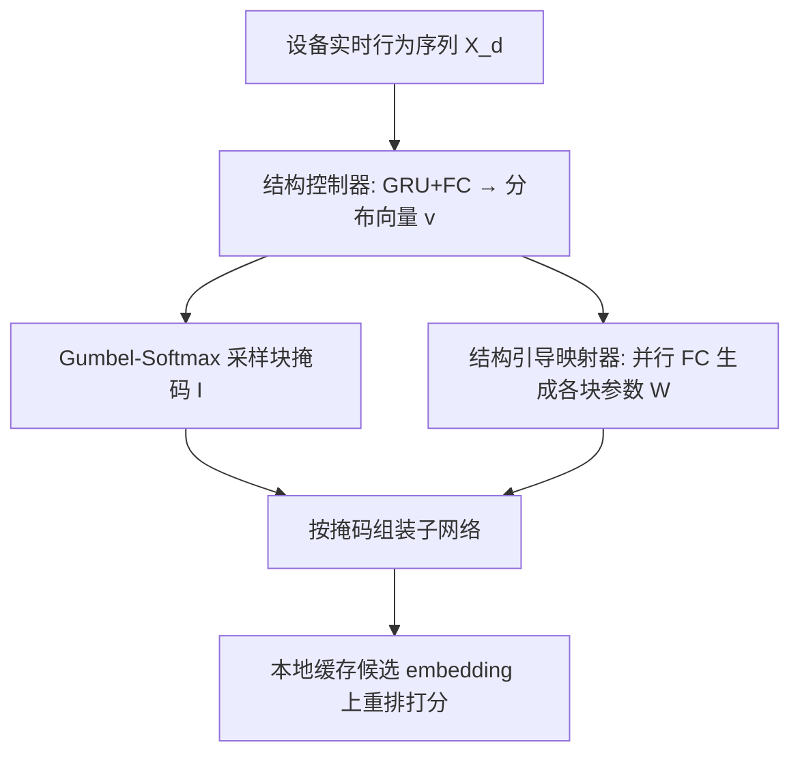
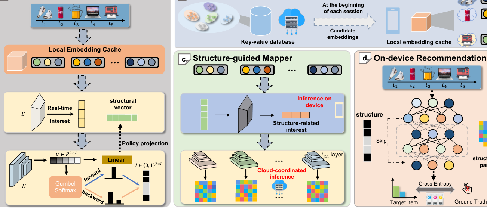

# Forward Once for All: Structural Parameterized Adaptation for Efficient Cloud-coordinated On-device Recommendation (一次前向适配所有设备：面向高效云边协同端侧推荐的结构化参数自适应)

- **会议/期刊**: KDD 2025
- **作者与机构**: Kairui Fu, Zheqi Lv, Shengyu Zhang, Fan Wu, Kun Kuang（浙江大学、上海交通大学、浙江大学上海高等研究院）
- **推荐链路定位**: 重排（端侧本地 reranking）
- **研究方向**: 去偏公平、可信隐私与工业架构 / 序列推荐
- **论文原文**: [https://arxiv.org/abs/2501.02837v1](https://arxiv.org/abs/2501.02837v1)
- **开源代码**: 暂未开源

## TL;DR (1分钟核心速览)

云端统一模型在端侧重排时面临三重矛盾：设备间/设备内兴趣分布漂移、异构算力、隐私与带宽开销。Forward-OFA 首次把"网络结构"也纳入端侧个性化：结构控制器为每台设备逐块决定是否执行（Gumbel-Softmax 可微采样），结构引导映射器（超网络）按实时行为直接生成各块参数，从而绕开异构子网联合训练时的梯度冲突，且仅需一次前向即可完成适配、无需端侧反传。在 4 个真实数据集、SASRec/NextItNet 两种骨干上，NDCG@10 相对最强基线最高提升 73.39%，同时 FLOPs 与参数量最多压缩约 5 倍。

## Background & Motivation (背景与核心矛盾)

- **主流范式**: 端侧推荐把候选物品 embedding 与模型下发到设备本地重排，代表工作分两支——个性化参数（DUET 下发用户参数、DCCL 元补丁、PEEL 分组 embedding）与成本感知（STTD/Rare Gem 稀疏压缩、Gater 门控加速、按兴趣漂移触发更新）。
- **前人局限**: 其一，所有方法都默认"全网同构"，仅调参数不调结构，而图 1(c) 显示直觉型用户小网络已足够、探索型用户才需要大网络，统一结构要么浪费强设备算力、要么压垮弱设备；其二，压缩类方法只降传输不降推理（STTD 因半张量积矩阵乘反而更慢），Finetune 类在少交互设备上过拟合，Movielens-10M 上 Rare Gem 的 NDCG/Hit 反降 16%。
- **核心洞察 (Key Insight)**: 堆叠式序列推荐器（Transformer/残差块）天然可视为"块的组合"，不同兴趣分布偏好不同子结构；但异构子网联合训练时，共享块会收到方向冲突的梯度（图 2），导致耦合优化失效。
- **本文切入点**: 用"结构控制器定路径 + 结构引导映射器生成参数"把结构与参数解耦，使冲突梯度根本不经过共享权重，并把适配压缩为一次前向。

## Method (核心方法设计)

### 1. 整体框架 (Overall Architecture)

云端持有全部历史交互并训练骨干与映射器；设备端仅保留轻量结构控制器（1 层 GRU + 1 层 FC）与映射器的序列提取器。会话开始或兴趣剧变时，设备本地提取兴趣表征、自行采样出子网路径，仅将该隐表征上传云端，云端据此生成结构相关参数并连同候选物品 embedding 一并下发，设备缓存后在本会话内完成重排，全程无原始行为上传、无端侧反传。

<figure class="paper-figure" markdown="span">
  <figcaption>图3：Forward-OFA中所有组件的图示。(a)：在每个会话开始时，当兴趣发生剧烈变化时，云端将候选物品嵌入发送到设备，这些嵌入将被缓存用于该会话中的推荐。(b)：结构控制器由一个提取器和一个轻量层组成，用于搜索合适的路径（分布向量）。该向量将在(c)中用于生成结构相关参数并缓解梯度冲突。(c)：一个映射器，用于分配个性化和结构参数，旨在消除梯度冲突</figcaption>
</figure>

### 2. 关键设计拆解 (Key Designs)

1. **结构控制器与可微路径采样**：逐块独立预测"执行/跳过"而非"截断后 L 层"，以保留靠近分类器、对稳定预测关键的后段块。前向按 $h_{l+1}=F_l(h_l)\cdot I_{l,0}+h_l\cdot I_{l,1}$组装，$I$由$\arg\max\{v_{l,0},v_{l,1}\}$决定；为让梯度穿过不可微的$\arg\max$，用 Gumbel-Softmax 重参数化$v'_{i,j}=\frac{e^{(\log v_{i,j}+G_{i,j})/\tau}}{\sum_{k=0}^{1}e^{(\log v_{i,k}+G_{i,k})/\tau}}$，并以$I_{i,j}+v'_{i,j}-\mathrm{sg}(v'_{i,j})$做直通估计。进一步不逐设备学$v$，而用$v=H(E(X_d))$ 从实时序列直接映射，实现跨设备兴趣知识共享并免去逐用户重训。

2. **结构引导映射器（绕开梯度冲突）**：冲突根源在于异构子网共享块——后段块要同时拟合两种结构、前段块收到异质回传梯度。本文改为给每个块配一组由超网络生成的专属参数 $W=\{W_k\}_{k=1,\dots,L}=\{H'_k(E'(X_d,\{\beta_{i,0},\beta_{i,1}\}))\}$，其中控制器输出$\beta$作为$E'$的初始状态注入结构信息；$L$个$H'_k$ 并行执行、互不回传，从结构上消除冲突 ii，梯度直达映射器本身消除冲突 i。由于是"直接映射"而非"迭代优化"，适配只需一次前向。

3. **训练目标、负采样与推理效率**：总损失 $\mathcal{L}=\mathcal{L}_{rec}+\lambda\mathcal{L}_{c}$，$\mathcal{L}_{rec}$为下一点击项交叉熵，紧凑约束$\mathcal{L}_{c}=\sum_{k=1}^{L}-\log\alpha_{k,1}$、$\alpha_{k,1}=\frac{e^{\beta_{k,1}}}{e^{\beta_{k,0}}+e^{\beta_{k,1}}}$ 压低块被执行的概率，兼作有效块筛选器。训练采用全库 softmax 式交叉熵（无显式负采样）。端侧新增模块仅 0.012×（SASRec）/0.005×（NextItNet）参数量，且仅在兴趣漂移时偶发调用。

## Experimental Setup & Evaluation Protocol (实验设置与评估协议)

- **数据集与预处理**: 四个真实序列数据集，按原文附录做常规过滤（去短序列），统计如下：

| 数据集 | #Users | #Items | #Interactions | 稀疏度/密度 | 特征/场景说明 |
| :--- | :---: | :---: | :---: | :---: | :--- |
| MovieLens-1M | 6,040 | 3,706 | ~1M | 密度较高 | 电影评分转隐式序列 |
| MovieLens-10M | ~69,878 | ~10,681 | ~10M | 中等 | 大规模电影序列 |
| Amazon-Game | 规模中等 | 中等 | 中等 | 稀疏 | 电商游戏品类 |
| Amazon-Food | 规模中等 | 中等 | 中等 | 稀疏 | 电商食品品类 |

- **数据划分与防穿越 (Splitting Strategy)**: 采用序列推荐标准的 `Leave-One-Out` 式下一项预测划分（末位为测试、倒数第二位验证），严格按时间序构造输入前缀，无未来信息泄漏。
- **排名评测协议 (Ranking Protocol)**: 报告 NDCG@10 与 Hit@10；资源侧报告单次推理 FLOPs 与传输参数量（Param），均为越小越好。未采用采样负例，属全候选打分口径。
- **对比基线与超参设置**: 骨干为 6 层 SASRec 与 12 层 NextItNet；基线含 DeviceRec、Finetune、DUET、STTD、Rare Gem、Gater 共 6 个。学习率 0.001/0.002，$\lambda$在 0.001–0.01 间按数据集调，温度$\tau$ 取 5–12。

## Key Experimental Results (实验关键数据)

### 1. 主实验对比 (Main Results)

SASRec 骨干（NDCG@10 / Hit@10 / FLOPs / Param）：

| 方法 | ML-1M NDCG | ML-1M Hit | ML-10M NDCG | Amazon-Game NDCG | Amazon-Food NDCG |
| :--- | :---: | :---: | :---: | :---: | :---: |
| DeviceRec | 0.0969 | 0.1816 | 0.0718 | 0.0359 | 0.0526 |
| Finetune | 0.0939 | 0.1793 | 0.0681 | 0.0343 | 0.0523 |
| DUET | 0.1140 | 0.2050 | 0.0871 | 0.0456 | 0.0582 |
| STTD | 0.0974 | 0.1823 | 0.0718 | 0.0371 | 0.0541 |
| Rare Gem | 0.0970 | 0.1838 | 0.0741 | 0.0373 | 0.0533 |
| Gater | 0.0980 | 0.1821 | 0.0733 | 0.0393 | 0.0535 |
| **Forward-OFA** | **0.1182** | **0.2081** | **0.0905** | **0.0487** | **0.0590** |
| Improv. | +21.97% | +14.59% | +26.03% | +35.61% | +12.29% |

NextItNet 骨干上提升更显著：Amazon-Game NDCG 相对 DeviceRec 提升 **73.39%**、Hit 提升 **66.67%**，FLOPs 与 Param 分别压缩至 1/2.42 与 1/2.45；Amazon-Food 上 FLOPs 压缩达 **4.82×**、Param 压缩 **5.02×**。

### 2. 消融实验 (Ablation Study)

| 配置 | ML-1M NDCG | ML-10M NDCG | Amazon-Game NDCG | 说明 |
| :--- | :---: | :---: | :---: | :--- |
| DeviceRec | 0.0969 | 0.0718 | 0.0359 | 全网同构基线 |
| +controller | 0.0946 | 0.0703 | 0.0369 | 仅加结构控制器，ML 上反降 |
| +mapper | 0.1142 | 0.0868 | 0.0452 | 加映射器后大幅回升 |
| w.o. structural vector | 0.1166 | 0.0872 | 0.0472 | 去掉结构向量输入 |
| random block | 0.0714 | 0.0564 | 0.0462 | 只定块数、随机选块 |
| first $k$ block | 0.0174 | 0.0030 | 0.0384 | 取前 k 块，崩塌 |
| **Forward-OFA** | **0.1182** | **0.0905** | **0.0487** | 完整模型 |

### 3. 关键实验发现 (Key Findings)

1. **结构收益必须靠映射器兑现**：单独加控制器在 ML-1M/10M 上反而掉点（0.0969→0.0946、0.0718→0.0703），正是共享块梯度冲突所致；补上映射器后升至 0.1142/0.0868，说明"结构个性化"与"参数解耦"是捆绑生效的。
2. **块组合比块数量更关键**：随机选块、取前 k 块、取后 k 块三种退化策略全面崩塌（first-$k$ 在 ML-10M 仅 0.0030），而完整模型 0.0905，证明控制器学到的是与兴趣匹配的具体块组合而非简单深度裁剪。
3. **小模型对照排除了"小即好"的替代解释**：把所有基线换成 1/3 规模的小骨干后，Forward-OFA 仍领先 18.49%–59.81%，说明增益来自自适应结构而非单纯降容；同时 $\lambda$ 过大（过度稀疏）会误删有效块导致性能显著下滑，存在性能-资源权衡拐点。

## Highlights & Limitations (亮点、对比与审稿批判)

- **与代表作对比 (vs. Prior Work)**: DUET 只下发个性化参数、结构仍全网同构且推理开销不变；STTD/Rare Gem 只压参数不降推理（STTD 甚至更慢）；Gater 靠门控加速但压缩比与精度难兼得。本文是首个把"结构 + 参数"联合定制并显式处理异构子网梯度冲突的工作。
- **可迁移亮点**: ①"逐块独立掩码 + Gumbel 直通"比"截断前 k 层"更鲁棒，可直接迁移到任何堆叠式序列骨干的端侧瘦身；②用超网络并行生成各块参数以物理隔离冲突梯度，可复用到多场景/多任务联合训练中的梯度冲突缓解。
- **审稿级局限批判**: ①结构控制器与映射器提取器虽轻，但仍需在设备端常驻并周期性前向，长期驻留开销与真实 App 竞争资源下的表现缺乏线上验证；②评测仅在离线 Leave-One-Out 全排序口径下进行，缺少真实云边通信时延、断网/弱网与隐私攻击（如隐表征反演）的实证，隐私保护目前停留在"不上传原始序列"的架构论证层面。

## Rating (四维评分)

- **方法创新性 (Novelty)**: ⭐⭐⭐⭐ （首次将网络结构纳入端侧个性化，并用结构引导映射从机制上绕开梯度冲突，思路清晰且有别于纯参数压缩路线）
- **评估协议与实验扎实度 (Protocol & Experiments)**: ⭐⭐⭐⭐ （4 数据集 × 2 骨干 × 6 基线，含小模型对照与多组消融，但均为离线全排序、缺线上 A/B 与隐私量化）
- **写作与数学规范度 (Clarity & Rigor)**: ⭐⭐⭐⭐ （Gumbel 直通与冲突分析推导完整、图示直观，部分符号如 $\beta$与$v$ 的对应关系需对照公式细读）
- **工业落地与复现价值 (Industrial & Practical Value)**: ⭐⭐⭐⭐ （端侧仅增 0.005–0.012× 参数、一次前向免反传，工程友好；但代码未开源、超参 $\lambda/\tau$ 逐数据集敏感，复现需调参成本）

