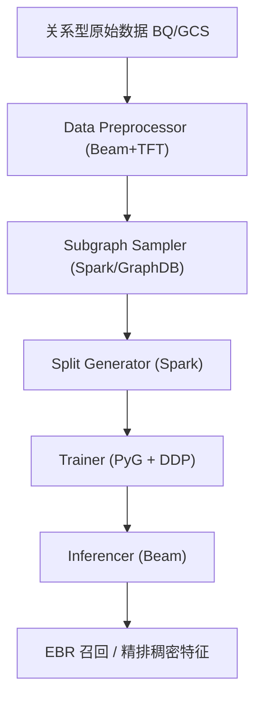
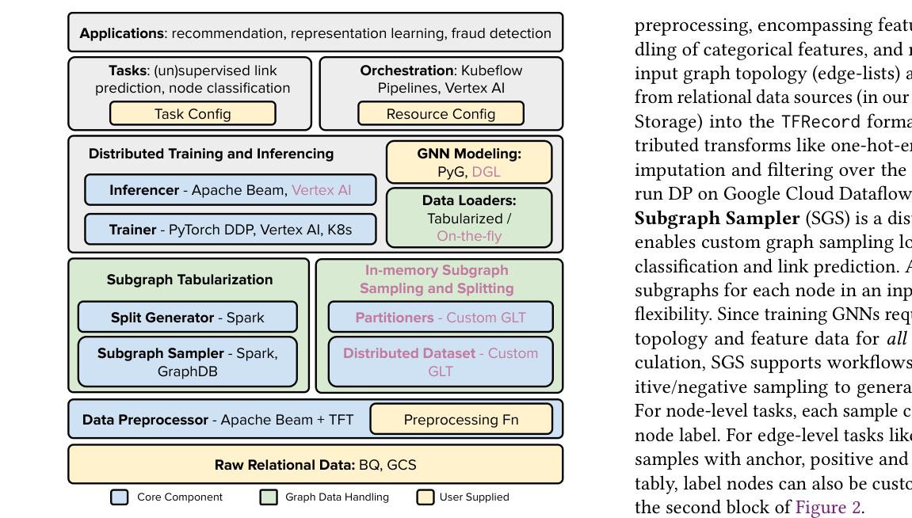

# GiGL: Large-Scale Graph Neural Networks at Snapchat (Snapchat 十亿级图神经网络系统)

- **会议/期刊**: KDD 2025
- **作者与机构**: Tong Zhao, Yozen Liu, Matthew Kolodner, Neil Shah 等，Snap Inc.
- **推荐链路定位**: 召回（GNN Embedding 供 EBR 向量检索）+ 精排稠密特征
- **研究方向**: 去偏公平、可信隐私与工业架构 / 图神经网络与知识图谱推荐
- **论文原文**: [论文原文链接](https://arxiv.org/abs/2502.15054v2)
- **开源代码**: [开源代码仓库链接](https://github.com/Snapchat/GiGL)

## TL;DR (1分钟核心速览)

工业界 GNN 落地的真正瓶颈不是模型层创新，而是十亿级图（Snapchat 日常 10–50B 边）无法塞进单机内存、且学术库默认图可全量驻留。GiGL 提出以**表格化子图采样（Tabularization）** 为核心、与 PyG 建模代码零侵入解耦的分布式图学习库，把预处理、k-hop 子图采样、划分、训练、推理拆成可独立重试的云上组件。在 900M 节点 / 16.8B 边的内部同构图与 MAG240M 上，端到端全流程 12 小时内完成，MRR 达 0.820；两年内支撑 35+ 次线上发布，好友推荐 EBR 首启带来 +10%/+11.6%/+7% 的核心指标提升。

## Background & Motivation (背景与核心矛盾)

- **主流范式**: 学术界 GNN 依赖 PyG/DGL 在单机内存内做全图或邻居采样训练，基准图规模停留在 ogbn-products（2.4M 节点 / 61M 边）量级。
- **前人局限**: ① 存储墙——100B 边仅 32-bit ID 就需 800GB，叠加节点/边特征后单机纵向扩展（如 624GB 高内存机 + Ray）随用户增长与特征膨胀迅速触顶；② 工程墙——实时采样方案（GraphLearn/ByteGNN/DeepGNN）需维护共享图状态与分区，运维复杂，且学术实现与工业假设错位。
- **核心洞察 (Key Insight)**: 把"图状态"从训练循环中彻底剥离——预先把所有 k-hop 子图样本物化（tabularize）到云存储，训练退化为标准 data-parallel ETL 消费，从而复用成熟的大数据栈（Spark/Beam）与建模栈（PyG）。
- **本文切入点**: 用表格化采样 + 组件化编排，让研究者写 PyG 代码、系统扛十亿级图，二者解耦。

## Method (核心方法设计)

### 1. 整体框架 (Overall Architecture)

GiGL 将 GNN 工作流拆为五个可独立调度、幂等重试的组件：**Data Preprocessor**（Beam + TensorFlow Transform，把关系型库中的边表与节点/边特征转成 TFRecord）、**Subgraph Sampler**（Spark/Scala 分布式生成每个锚点的 k-hop 子图，链接预测任务额外采样正/负样本构成三元组）、**Split Generator**（Spark 生成全局一致的 transductive/inductive 划分并屏蔽验证测试边）、**Trainer**（PyTorch DDP 消费样本，自动 collate 成批子图，用户直接写 PyG 全批训练循环）、**Inferencer**（Beam on Dataflow 并行 CPU/GPU 推理输出 embedding）。Kubeflow/VertexAI 负责编排，前置 Validation Checker 与 Config Populator 冻结资产路径以支持组件级复用与超参调优摊销。

<figure class="paper-figure" markdown="span">
  <figcaption>图1：GiGL 框架组件；品红色项为进行中的工作。</figcaption>
</figure>

### 2. 关键设计拆解 (Key Designs)

1. **表格化子图采样（Tabularization）**：痛点是不想维护共享图状态。核心是把 k-hop 子图连同特征一次性物化落盘，训练时只做 I/O 读取与 collate。两种后端：Pure-ETL 用 Spark 的 Join/GroupByKey 反复连接边表并 hydration 特征（从 Beam on Dataflow 重写后成本与耗时降低 ≥80%）；GraphDB 后端把 DP 输出灌入 NebulaGraph，用命令式图查询语言支持异构图上最灵活的邻居采样。直觉：把"图遍历"从在线前向传播中移到离线批处理，GPU 不再等图。
2. **实时采样后端（GLT 定制）**：为需要训练中自适应用图的场景，基于 GraphLearn-for-PyTorch 定制半随机分区——节点打散到各机、相邻边按源/目标节点共置，保证所有 1-hop 邻居机内可达，多跳采样走 gRPC。与表格化共享同一套编排与 DP 逻辑，仅在 Trainer/Inferencer 内部替换采样实现。
3. **训练目标、负采样与推理效率**：损失完全由用户定义，官方示例为三元组对比损失 $\mathcal{L}=\sum_{(a,p,n)} \max\left(0, \gamma - s(a,p) + s(a,n)\right)$，其中$s(\cdot,\cdot)$ 为 GNN 编码后的相似度，负样本采用 **in-batch 负采样**（同批其他锚点的正样本充当负例），无需额外负采样器。线上好友推荐实际采用 Sampled Softmax 检索损失，并叠加特征重构与白化去相关辅助损失做多任务训练。推理侧发现 GNN 参数量轻，**CPU 推理更易横向扩展**，故 Inferencer 走 Beam 并行 CPU。

## Experimental Setup & Evaluation Protocol (实验设置与评估协议)

- **数据集与预处理**: 内部同构图由 Snapchat 好友关系构建，三个小图为 Internal-full 的子采样版本：

| 数据集 | #Nodes | #Edges | #Node Feat | #Edge Feat | 说明 |
| :--- | :---: | :---: | :---: | :---: | :--- |
| MAG240M | 244.1M | 1.68B | 768 | 0 | 公开学术图，作者节点补零向量+度特征，转同构 |
| Internal-small | 3.57M | 125.9M | 249 | 19 | 内部图小样本 |
| Internal-less-feat | 899.4M | 16.84B | 155 | 10 | 降特征维度 |
| Internal-less-edge | 899.4M | 8.42B | 249 | 19 | 随机删 50% 边 |
| Internal-full | 899.4M | 16.84B | 249 | 19 | 生产级好友推荐图 |

- **数据划分与防穿越 (Splitting Strategy)**: Split Generator 生成**全局一致的 transductive 链接预测划分**，训练前显式 mask 掉验证/测试边，防止消息传递阶段信息泄漏。
- **排名评测协议 (Ranking Protocol)**: 链接预测任务报告 **MRR**（离线指标），未采用全库 Full-Ranking 的推荐指标口径；线上以业务指标（新好友数、双向通信好友数、观看时长等）为准。
- **对比基线与超参设置**: 系统层以 MAG240M 公开基准与内部图规模梯度为参照；建模层对比 GraphSAGE、GAT/GATv2、DCN 等 PyG 层，以及生产环境既有浅层图嵌入（SGE）控制组。资源固定为 16 训练 GPU + CPU 推理集群以保证公平。

## Key Experimental Results (实验关键数据)

### 1. 主实验对比 (Main Results)

组件级端到端耗时（分钟）与离线 MRR：

| 数据集 | Total | Preproc | Subgraph Sampler | Split | Trainer | Inferencer | MRR |
| :--- | :---: | :---: | :---: | :---: | :---: | :---: | :---: |
| MAG240M | 8h43m | 1h28m | 1h41m | 37m | 4h24m | 30m | 0.747 |
| Internal-small | 5h19m | 36m | 32m | 9m | 3h44m | 18m | 0.602 |
| Internal-less-feat | 9h00m | 2h10m | 1h50m | 28m | 3h25m | 1h07m | 0.704 |
| Internal-less-edge | 8h41m | 1h34m | 2h07m | 39m | 3h09m | 1h12m | 0.807 |
| **Internal-full** | **11h24m** | 2h31m | 2h29m | 50m | 4h04m | 1h30m | **0.820** |

线上业务增益（好友推荐，Table 2 节选）：

| 发布项 | 线上核心指标提升 |
| :--- | :---: |
| GraphSAGE on friend graph（EBR 首启） | +10%, +11.6%, +7% |
| 图定义更新：engagement graph | +8.9%, +5.8%, +10.8% |
| 模型更新：GAT | +6.5%, +2.92% |
| 损失更新：retrieval loss | +6.2%, +8.8% |
| EBR 方案更新：Stochastic EBR | +10.2%, +13.9% |

### 2. 消融实验 (Ablation Study)

Internal-full 上改变资源与超参（Table 7）：

| 配置 | Total 耗时 | MRR | 变化归因 |
| :--- | :---: | :---: | :--- |
| Baseline | 11h24m | 0.820 | — |
| 训练 GPU 减半 | 14h07m | — | Trainer 6h47m，近线性劣化 |
| 推理 CPU 减半 | 11h43m | — | Inferencer 1h49m，影响有限 |
| Early stop patience ×2 | 19h01m | **0.858** | 训练更充分，MRR +0.038 |
| 正样本数 ×2 | 15h58m | 0.835 | 采样与训练双增，MRR +0.015 |
| 邻居 fanout ÷2 | 7h29m | 0.786 | 省 35% 时间，MRR −0.034 |
| 移除边特征 | 9h27m | 0.806 | 省 17% 时间，MRR −0.014 |

### 3. 关键实验发现 (Key Findings)

1. **边数是耗时主因而非节点数**：Internal-less-edge 删半条边后总耗时从 11h24m 降至 8h41m（−24%），而节点数不变；这与 GNN 复杂度随边数线性增长的理论一致，说明工业优化的第一杠杆是图稀疏化而非减节点。
2. **图定义比模型迭代更值钱**：把 friendship graph 换成更稀疏的 engagement graph，不仅带来 +8.9%/+5.8%/+10.8% 的线上提升，还因图更稀疏而降低计算成本——"信号质量优先于图稠密化"这一反直觉结论直接推翻了学术界常用的图增广默认假设。
3. **Stochastic EBR 是最大单点收益**：用用户好友的 embedding 而非用户自身 embedding 作为 ANN 查询种子，拓宽候选空间，线上 +10.2%/+13.9%，超过任何一次模型层升级，说明**检索查询构造**在 EBR 链路中的杠杆常被低估。

## Highlights & Limitations (亮点、对比与审稿批判)

- **与代表作对比 (vs. Prior Work)**: 相比 GraphLearn/ByteGNN/DeepGNN 的实时采样路线，GiGL 默认走表格化，用存储换运维简单性与超参调优摊销；相比 AGL/TF-GNN 的表格化方案，GiGL 的关键差异是与 PyG 建模代码零侵入兼容（无需新语法定义 GNN 层），且同时保留可配置的实时采样后端。
- **可迁移亮点**: ① "组件幂等 + 资产路径冻结"的编排范式，可让多个 Trainer 复用同一份采样输出做超参搜索，直接迁移到任何离线特征/样本生成流水线；② 用好友 embedding 替代自身 embedding 做 ANN 查询种子的 Stochastic EBR 技巧，几乎零成本可移植到任何社交召回系统。
- **审稿级局限批判**: ① 评估以 MRR 与业务指标为主，缺少与学术 SOTA 链接预测模型在统一 Full-Ranking 协议下的公平对比，系统论文的"效果"论证偏弱；② 表格化带来数据重复存储与 I/O 瓶颈，论文承认需"仔细平衡 I/O 与 GPU 利用率"，但未给出存储放大倍数的定量分析；③ 实时采样后端与 GraphDB 后端的一致性对齐仍是"work-in-progress"，开源版本能力弱于内部版本。

## Rating (四维评分)

- **方法创新性 (Novelty)**: ⭐⭐⭐ （系统架构层面的工程创新扎实，但表格化采样与组件编排在工业界并非全新范式，缺少算法层理论贡献）
- **评估协议与实验扎实度 (Protocol & Experiments)**: ⭐⭐⭐ （规模梯度实验与线上 A/B 数据极具说服力，但离线仅用 MRR、缺少统一 Full-Ranking 与学术 SOTA 对比）
- **写作与数学规范度 (Clarity & Rigor)**: ⭐⭐⭐⭐ （组件职责、后端权衡、经验教训叙述清晰，公式极少但系统设计描述严谨）
- **工业落地与复现价值 (Industrial & Practical Value)**: ⭐⭐⭐⭐⭐ （完整开源、已在 Snapchat 支撑 35+ 发布，是十亿级 GNN 落地少有的可复现实战参考）

