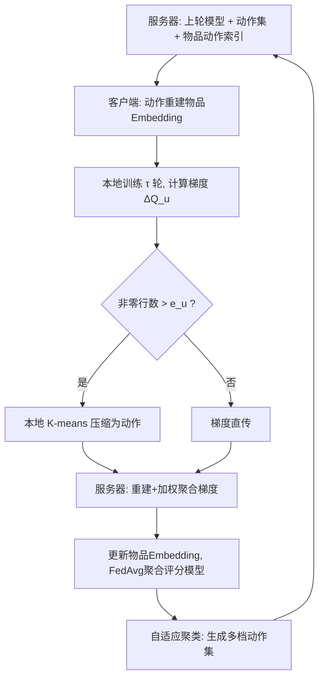
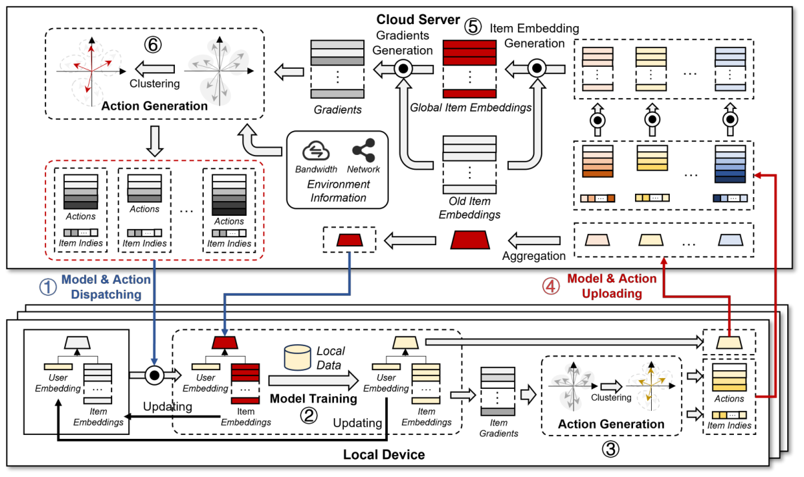

# Gradients as an Action: Towards Communication-Efficient Federated Recommender Systems via Adaptive Action Sharing (梯度即动作：基于自适应动作共享的通信高效联邦推荐系统)

- **会议/期刊**: KDD 2025
- **作者与机构**: Zhufeng Lu, Chentao Jia, Mingsong Chen (华东师范大学)；Ming Hu, Xiaofei Xie (新加坡管理大学)
- **推荐链路定位**: 召回（联邦训练的 Embedding 层通信）
- **研究方向**: 去偏公平、可信隐私与工业架构 / 协同过滤
- **论文原文**: [https://arxiv.org/abs/2507.08842v1](https://arxiv.org/abs/2507.08842v1)
- **开源代码**: [https://github.com/mastlab-T3S/FedRAS](https://github.com/mastlab-T3S/FedRAS)

## TL;DR (1分钟核心速览)

联邦推荐系统（FedRecs）的物品 Embedding 矩阵巨大，通信开销极高；现有压缩方法（TopK/SVD/CoLR）直接压缩 Embedding 本身，有损压缩破坏物品特征导致性能下降。本文提出 FedRAS，将物品**梯度**（而非 Embedding）视为“动作”，用 K-means 把梯度聚成少量簇中心共享传输，并设计自适应聚类机制动态调整簇数以适配异构带宽。在 ML-100K/1M、Lastfm-2K 上采用 Leave-One-Out + HR@10/NDCG@10 协议，最高 96.88% 压缩率下仍全面超越 SOTA，ML-1M 上 HR@10 相对 CoLR 提升 7.86%。

## Background & Motivation (背景与核心矛盾)

- **主流范式**: FedRecs 以 FedAvg 聚合用户本地训练的评分模型与物品 Embedding；由于物品数 $N$ 巨大，物品 Embedding 矩阵占据绝大部分通信负载，现有工作沿三条路线压缩：元学习（MetaMF）、低秩分解（JointRec/CoLR）、行削减（Bandit 选行）。
- **前人局限**: ① 这些方法直接对**物品 Embedding** 做有损压缩，解压后 Embedding 严重偏离原值，物品特征被破坏，性能随压缩率上升急剧下降（NCF 在 CR=96.88% 时甚至 HR 归零）；② 真实场景中设备带宽与算力异构且波动，固定压缩率的方案难以适配。
- **核心洞察 (Key Insight)**: 梯度幅值远小于 Embedding 本身，且梯度下降本身是随机的——即使梯度方向被轻微扰动，更新仍大概率指向损失下降方向，后续轮次还能自我纠正。因此压缩**梯度**比压缩 Embedding 的信息损失小得多。
- **本文切入点**: 把梯度看作“动作”（在空间中移动 Embedding 的位移），相似梯度的物品共享同一动作，只需传输少量动作中心 + 每个物品的动作索引即可更新全部物品。

## Method (核心方法设计)

### 1. 整体框架 (Overall Architecture)

每轮训练六步闭环：服务器按各客户端带宽下发上轮评分模型、动作集合（压缩梯度中心）及物品→动作索引；客户端用动作重建物品 Embedding 后本地训练；若待上传梯度非零行数超过带宽上限 $e_u$ 则本地 K-means 压缩，否则直传；服务器接收各客户端模型与动作，重建并聚合梯度更新物品 Embedding，FedAvg 聚合评分模型；最后服务器执行自适应聚类，为下一轮生成多档大小的动作集。核心思想是“传动作不传 Embedding”，且上下行均压缩。

<figure class="paper-figure" markdown="span">
  <figcaption>图1：FedRAS 的框架与工作流程。</figcaption>
</figure>

### 2. 关键设计拆解 (Key Designs)

1. **动作共享 (Action Sharing)**：痛点是把 $N\times d$的 Embedding 矩阵压缩传输会破坏物品特征。本文改为对聚合梯度$\Delta Q\in\mathbb{R}^{N\times d}$做 K-means，第$i$个物品梯度$\Delta q_i\in G_k$编码为簇心$\Delta q_i^{Enc}=\mathrm{Enc}(\Delta q_i)=\mu_k$，仅传$K$个中心与索引。由于$\|\Delta q_i\|\ll\|q_i\|$，约束梯度方向引入的误差远小于约束 Embedding 空间，且索引可用极少比特编码，通信开销可忽略。

2. **自适应聚类机制 (Adaptive Clustering)**：痛点在于跨轮梯度分布漂移、设备带宽异构，固定簇数 $K$不适用。以簇内平均余弦相似度$\mathrm{AvgCosSim}(c)=\frac{1}{|c|}\sum_{i\in c}\cos(\Delta q_i^c,\mu_c)$度量聚类质量，对最差簇做二分分裂（取簇内余弦相似度最低的两梯度作新中心），在$[C_e(1-\alpha),\,C_e(1+\alpha)]$区间内迭代，直到最小平均余弦相似度低于阈值或达上限$C_m$。阈值不手工调参，而取历史各轮“簇数恰达$C_e$ 时记录的最小平均余弦相似度”的均值自动确定，从而在控制通信量的同时保留梯度方向信息。

3. **梯度聚合修正与训练目标**：传统 FedAvg 对物品梯度按客户端数均分，忽略了各物品被训练次数的差异。本文改为按参与该物品训练的客户端比例放大：$\Delta q_i=\frac{1}{|S_t|}\sum_{u=1}^{S_t}\Delta q_i^u\times\frac{|S_t|}{|S_i|}$，其中$S_i$为训练过物品$i$的客户端集合，使梯度估计更准确、聚类更有效。总损失即各客户端 BCE 损失之和$\min\sum_{u=1}^{M}\mathcal{L}(F(p_u,Q,\theta))$；训练采用每正样本 4 负采样、SGD、batch=256、本地 2 epoch，推理阶段无额外开销（仅标准内积/MLP 打分）。

## Experimental Setup & Evaluation Protocol (实验设置与评估协议)

- **数据集与预处理**:

| 数据集 | #Users | #Items | #Interactions | 稀疏度 | 说明 |
| :--- | :---: | :---: | :---: | :---: | :--- |
| MovieLens-100K | 943 | 1,682 | 100,000 | 93.70% | 经典电影评分 |
| MovieLens-1M | 6,040 | 3,706 | 1,000,209 | 95.53% | 大规模电影评分 |
| Lastfm-2K | 1,482 | 12,399 | 70,390 | 99.62% | 音乐社交，过滤 <5 交互用户 |

- **数据划分与防穿越**: 采用 `Leave-One-Out`（每用户最后一条交互作测试，倒数第二条作验证），遵循 NCF 惯例。
- **排名评测协议**: 报告 HR@10 与 NDCG@10；训练时每正样本采样 4 个负例，测试阶段按 Leave-One-Out 标准协议对测试正例与候选集排序（原文未声明全库 Full-Ranking，属采样负例训练 + 标准 LOO 评测）。
- **对比基线与超参**: 骨干模型 MF 与 NCF（3 层 MLP，64/32/16）；基线为 Base(FedMF/FedNCF)、TopK 稀疏化、SVD 低秩、CoLR（SOTA）；Embedding 维度 $d=32$，每轮 10% 用户参与，压缩率 CR ∈ {90.63%, 93.75%, 96.88%}，波动因子$\alpha=0.2$。

## Key Experimental Results (实验关键数据)

### 1. 主实验对比 (Main Results)

下表摘取 MF 骨干在三个数据集、CR=96.88%（最严苛）下的 HR@10/NDCG@10，并附 ML-1M 全压缩率对比：

| 数据集 (CR=96.88%) | Base | TopK | SVD | CoLR | **FedRAS** | Improv.(HR vs CoLR) |
| :--- | :---: | :---: | :---: | :---: | :---: | :---: |
| ML-100K | 0.3892/0.1990 | 0.3309/0.1772 | 0.5228/0.2745 | 0.5589/0.3008 | **0.6299/0.3459** | +12.70% |
| ML-1M | 0.4551/0.2503 | 0.3969/0.2142 | 0.4904/0.2702 | 0.5710/0.3164 | **0.6496/0.3711** | +13.77% |
| Lastfm-2K | 0.4950/0.3284 | 0.6631/0.5020 | 0.7156/0.5267 | 0.7344/0.5399 | **0.8194/0.6918** | +11.57% |

ML-1M (MF) 跨压缩率 HR@10：CR=90.63% 时 FedRAS 0.6632 vs CoLR 0.6124（+7.86%）；CR=93.75% 时 0.6581 vs 0.5873。NCF 骨干下 FedRAS 同样全面领先（如 Lastfm-2K CR=96.88%：0.8150 vs CoLR 0.6825）。

### 2. 消融实验 (Ablation Study)

ML-100K、CR=93.75%、MF 骨干（图 3 数值）：

| 变体 | 改动 | HR@10 | NDCG@10 | 结论 |
| :--- | :--- | :---: | :---: | :--- |
| Default (FedRAS) | 完整模型 | **0.6331** | **0.3499** | 基准 |
| FedRAS-E | 聚类 Embedding 而非梯度 | 显著下降 | 显著下降 | 验证梯度更鲁棒 |
| FedRAS-F | 固定簇数（仅 K-means） | 下降 | 下降 | 自适应聚类有效 |
| FedRAS-T | 传统 FedAvg 聚合梯度 | 下降 | 下降 | 加权聚合更准 |

信息损失对比（ML-1M, CR=93.75%）：FedRAS 总损失 2.63，低于 CoLR 的 3.17 与直接聚类 Embedding (CE) 的 5.68。

### 3. 关键实验发现 (Key Findings)

1. **梯度压缩的鲁棒性被定量证实**：FedRAS 在 CR 从 90.63% 升到 96.88% 时性能几乎不降（ML-1M HR 0.6632→0.6496），而 Base 在 NCF 下 CR=96.88% 直接崩溃为 0.00；信息损失表显示梯度压缩总损失 2.63 仅为 Embedding 压缩 (CE) 5.68 的 46%，直接支撑“压缩梯度优于压缩 Embedding”的核心直觉。
2. **自适应聚类是异构场景的关键**：在带宽随机采样的异构设置下（CR 范围 10%–90% 混合），FedRAS 仍达 HR@10=0.6288，与同带宽质量同构设置（0.6352–0.6416）几乎持平，说明按带宽动态调整簇数可消除设备异构带来的性能损失。
3. **聚类分布偏斜带来低扰动**：ML-100K 上平均余弦相似度 0.6631，且大多数簇仅含少量梯度（图 4），意味着压缩只对少数物品产生较大扰动，整体梯度方向保持良好，这解释了为何轻微噪声甚至有助于跳出局部最优、使 FedRAS 在部分设置下超过无压缩 Base。

## Highlights & Limitations (亮点、对比与审稿批判)

- **与代表作对比 (vs. Prior Work)**: 与 CoLR（低秩分解 + 固定子矩阵）和 SVD（低秩近似）相比，FedRAS 压缩对象从 Embedding 换成梯度，从根本上规避了物品特征破坏；与 TopK 稀疏化相比，聚类共享保留了梯度方向结构而非简单截断，因而在极端压缩率下优势最大。
- **可迁移亮点**: ① “压缩增量（梯度/残差）而非压缩参数本体”的思路可迁移到任何大 Embedding 表的分布式同步场景（如 PS 架构、跨域联邦）；② 基于余弦相似度自动定阈值的自适应聚类，可复用到其他需要按带宽动态调粒度的量化/聚类压缩任务。
- **审稿级局限批判**: ① 每轮服务器需对 $N\times d$梯度做多次 K-means 与二分分裂，$N$ 达百万级时聚类本身的计算开销与收敛轮数未充分讨论；② 实验仅在 ML-100K/1M、Lastfm-2K 三个中小规模数据集与 MF/NCF 两个浅层骨干上验证，未涉及深度序列模型或工业级千万物品场景，且评测为 LOO 采样协议而非全库 Full-Ranking，泛化性存疑。

## Rating (四维评分)

- **方法创新性 (Novelty)**: ⭐⭐⭐⭐ （“梯度即动作”视角新颖，几何直觉清晰，但 K-means 聚类与自适应分裂本身属工程组合创新）
- **评估协议与实验扎实度 (Protocol & Experiments)**: ⭐⭐⭐⭐ （三数据集 × 两骨干 × 三压缩率覆盖充分，含异构带宽与信息损失验证，但缺全库排序与显著性检验）
- **写作与数学规范度 (Clarity & Rigor)**: ⭐⭐⭐⭐ （动作共享与自适应聚类公式定义清楚，算法伪代码完整，聚合修正公式推导略简）
- **工业落地与复现价值 (Industrial & Practical Value)**: ⭐⭐⭐⭐ （最高 96.88% 压缩率且代码开源，对带宽受限移动端 FedRec 部署价值高，但大规模聚类开销待工程优化）

