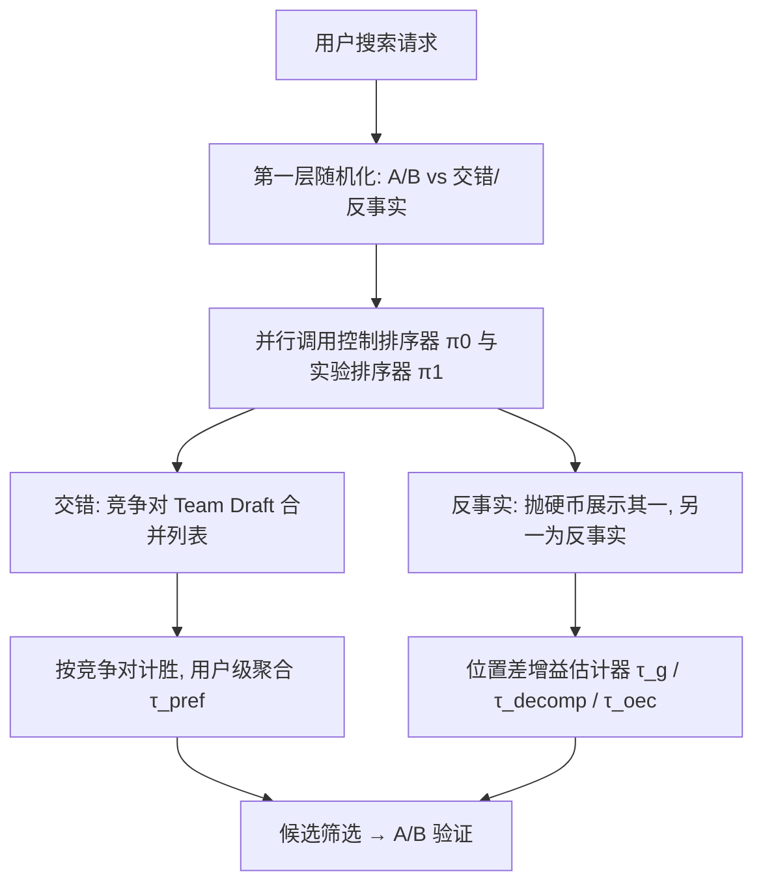

# Harnessing the Power of Interleaving and Counterfactual Evaluation for Airbnb Search Ranking (借力交错实验与反事实评估加速 Airbnb 搜索排序评测)

- **会议/期刊**: KDD 2025 (V.2)
- **作者与机构**: Qing Zhang, Michelle Du, Huiji Gao, Liwei He, Sanjeev Katariya (Airbnb)；Alex Deng (Microsoft)
- **推荐链路定位**: 重排 / 排序评测（实验平台层）
- **研究方向**: 去偏公平与工业架构 / 因果去偏
- **论文原文**: [论文原文链接](https://arxiv.org/abs/2508.00751v1)
- **开源代码**: 暂未开源

## TL;DR (1分钟核心速览)

Airbnb 搜索排序的 A/B 实验受限于低频交易（用户年均出行约两次）与稀疏转化指标，单个实验需数周才能达到统计功效，而离线评估（NDCG/IPW）与线上转化脱节且方差高。本文提出**竞争对式 Team Draft 交错实验**（一次抛硬币、成对计胜）与**在线反事实评估**（并行调用双排序器、仅展示其一、用位置差增益估计器打分），在 29/30 组与 A/B 对齐的真实生产语料上分别取得约 **50×** 与最高 **100×** 的灵敏度加速，方向一致率 82%、相关系数 0.60/0.65。

## Background & Motivation (背景与核心矛盾)

- **主流范式**: 工业界以 A/B 测试为金标准，辅以离线日志评估（NDCG、IPW 逆倾向加权）做候选筛选。
- **前人局限**: ① Airbnb 用户年均出行仅约两次、转化事件稀疏且延迟，A/B 需数周才达功效；② 离线评估只观测到日志排序器曝光过的物品，IPW 虽无偏但方差爆炸，且倾向分在复杂系统中难以获取，NDCG 与转化率常不一致。
- **核心洞察 (Key Insight)**: 交错实验（Interleaving）让同一用户同时"看见"两个排序器，把比较粒度从"用户群"下沉到"物品对"，方差骤降；但经典方法以点击为反馈，而本文目标是更稀疏的**预订转化**，且需满足生产级延迟约束。
- **本文切入点**: 用"竞争对 + 单次抛硬币"重构 Team Draft 以适配稀疏转化，并进一步提出不混合结果、仅借反事实位置差构造增益估计器的在线反事实评估。

## Method (核心方法设计)

### 1. 整体框架 (Overall Architecture)

系统采用**双层随机化投放**：第一层把流量划分为常规 A/B 与交错/反事实实验；第二层将后者映射到独立"lane"（每个实验独占槽位，无需对照组臂）。当用户命中交错实验，搜索栈**并行调用**控制与实验两个排序器，各自产出完整结果列表；交错路径由竞争对 Team Draft 合并成最终列表展示，反事实路径则按用户 ID+实验 ID 播种抛硬币只展示其一、另一列表留作反事实。两条路径均以用户为分析单元聚合胜/负，输出点估计与 p 值，用于筛选进入 A/B 的候选。

### 2. 关键设计拆解 (Key Designs)

1. **竞争对式 Team Draft（Competitive Pair TD）**：经典 TD 每轮抛硬币决定谁先选，信用计算繁琐且对稀疏事件噪声大。本文改为**仅在开始时抛一次硬币** $isCfirst$，此后每轮同时从两列表取下一个未入列物品：若不同则构成竞争对，按硬币结果定序并记录归属；若相同则无归属直接入列。合并列表长度取$l_I=\min(l_c,l_t)$。由于每队在任何位置"排第一"的概率均为 0.5，位置偏置被结构性消除；以"对"为信用单元使单次转化即可产生明确胜负信号，这正是稀疏转化下灵敏度提升的根源。

2. **位置差增益估计器（Estimated Reward）**：直接分解法 $\tau_{decomp}=\tau_{diff}+\theta\tau_{sim}$依赖绝对位置与阈值$k=4,\alpha=2$。本文新增仅看**相对位置差**的估计器：设预订概率模型$f(r)=\gamma^{-r}$，当展示排序器$w$更优（$r_i(1-w)-r_i(w)-\alpha>0$）时其增益为

$$g_i = 1-\gamma^{\max(|r_i(w)-r_i(1-w)|-\alpha,\,0)}$$

   即排名差超过容忍带 $\alpha$才计增益、且按指数衰减折算。直觉是：用户注意力随位置指数衰减，位置差越大、被"埋没"的物品越不可能被转化，故增益应随差值非线性放大。最终$\tau_g$统计展示组与反事实组的胜差，$\tau_{win-loss}$统计胜位与败位之差，主指标$\tau_{oec}=\beta_1\tau_{decomp}+\beta_2\tau_g$（$\beta_1=\beta_2=0.5$）。

3. **训练目标、负采样与推理效率**：本文非学习型模型，无损失函数与负采样；核心"训练"即估计器构造。工程上交错需并行双调用，延迟仍在搜索系统阈值内；反事实评估不改变用户所见列表，用户体验零扰动。事件归因上，预订被归因到实验期内该房源**所有曝光**（考虑多会话复合效应），而非仅最后一次。

## Experimental Setup & Evaluation Protocol (实验设置与评估协议)

- **数据集与预处理**: 全部基于 Airbnb 真实生产流量，非公开数据集模拟。交错语料 29 组、反事实语料 30 组"评估–A/B"配对，仅保留 A/B 阶段无或仅有微调的案例作为真值。

| 语料 | 实验对数 | 目标指标 | 场景说明 |
| :--- | :---: | :---: | :--- |
| 交错 vs A/B | 29 | 转化率 | 搜索排序候选筛选 |
| 反事实 vs A/B | 30 | 转化率 | 含集合级优化/次级目标重排案例 |

- **数据划分与防穿越 (Splitting Strategy)**: 在线随机化实验，用户级随机分流；反事实以用户 ID+实验 ID 播种，保证背靠背实验间分配独立，规避溢出效应。
- **排名评测协议 (Ranking Protocol)**: 在线真实交互，非离线 Full-Ranking/Sampled Ranking；以用户为分析单元，比例检验计算 p 值，并以与 A/B 点估计的皮尔逊相关系数衡量一致性。
- **对比基线与超参设置**: 交错对比 Amazon 的 BI+IPW 方案（其报告 60× 加速、语料仅 10 组）；反事实对比直接分解法。超参 $\gamma\in\{0.9,0.95\}$、$\alpha\in\{1,2\}$、$k=4$、$\theta=0.2$。

## Key Experimental Results (实验关键数据)

### 1. 主实验对比 (Main Results)

| 方法 | 语料规模 | 与 A/B 方向一致率 | 相关系数 | 灵敏度加速 |
| :--- | :---: | :---: | :---: | :---: |
| BI+IPW (Amazon) | 10 | — | — | 60× |
| **竞争对 TD（本文）** | 29 | **82%** | **0.60** | **~50×** |
| 直接分解 $\tau_{decomp}$| 30 | — | 0.55($\tau_{diff}$)/−0.29($\tau_{sim}$) | — |
| **$\tau_g$（本文）** | 30 | — | **0.66** | **~100×** |
| $\tau_{win-loss}$ | 30 | — | 0.58 | ~23× |
| **$\tau_{oec}$（主指标）** | 30 | — | **0.65** | ~15× |

### 2. 消融实验 (Ablation Study)

| 配置 | 相关系数 | 说明 |
| :--- | :---: | :--- |
| $\tau_g$,$\gamma=0.9$ | 0.644 | 衰减因子影响甚微 |
| $\tau_g$,$\gamma=0.95$ | 0.648 | 同上 |
| $\tau_g$,$\alpha=1$ | 0.64 | 容忍带过窄 |
| **$\tau_g$,$\alpha=2$** | **0.66** | 最优，位置微差不应区分质量 |
| $\tau_{win-loss}$,$\alpha=1\to2$ | 0.58→0.60 | 同向改善 |
| 无偏性校验（曝光/首位/倒数排名/命中） | Δ≈0.00%, p≈0.85–0.95 | 竞争对机制无系统性偏置 |

### 3. 关键实验发现 (Key Findings)

1. **相对位置差比绝对位置更有效**：$\tau_g$相关系数 0.66 高于$\tau_{diff}$的 0.55，而$\tau_{sim}$ 竟为 −0.29，说明"是否落在同一相似带"的绝对位置划分反而引入噪声，纯位置差信号更干净。
2. **交错在集合级优化下失效**：某实验对次级目标重排、A/B 转化中性，但交错显著为负——因为控制组高预订概率房源在竞争对中"显得更诱人"，用户被吸走；反事实评估因用户始终看到完整列表而不受此偏置，二者形成互补。
3. **灵敏度与保真度的张力被澄清**：TD 在列表平移/插入时"漏判"（如 $C=\{a,b,c,d\}$vs$T=\{b,c,d,a\}$预订$c$不计胜负），但反事实实验证明$\alpha=2$优于$\alpha=1$，即位置微差本就不该区分质量，该"保真度缺陷"并不损害灵敏度。

## Highlights & Limitations (亮点、对比与审稿批判)

- **与代表作对比 (vs. Prior Work)**: 相比 Amazon BI+IPW（需逐位置计算点击概率、信用归因复杂、语料仅 10 组），本文竞争对 TD 信用计算为 O(1) 计数、语料 29 组且计算更轻；相比直接分解法，新增 $\tau_g$ 摆脱绝对位置依赖，相关系数从 0.55 提至 0.66。
- **可迁移亮点**: ①"单次抛硬币 + 成对计胜"可低成本移植到任何双排序器在线对比；②以曝光/首位分布做**逐实验无偏性自检**（p 值门控）是可直接复用的数据质量守门技巧。
- **审稿级局限批判**: ①全部结论基于 Airbnb 单一业务与转化目标，外部效度有限，且未报告置信区间宽度与多重比较校正；②反事实评估在控制/实验排序器对实时用户信号利用能力差异悬殊时会"借用"对方互动而失真，论文仅建议"打折信任"却未给出量化修正方案。

## Rating (四维评分)

- **方法创新性 (Novelty)**: ⭐⭐⭐⭐ （竞争对 TD 与位置差增益估计器均为工程导向的巧妙增量，理论深度有限但直击稀疏转化痛点）
- **评估协议与实验扎实度 (Protocol & Experiments)**: ⭐⭐⭐⭐ （29/30 组真实生产配对语料难得，含无偏性校验与超参敏感性，但缺置信区间与显著性校正）
- **写作与数学规范度 (Clarity & Rigor)**: ⭐⭐⭐⭐ （估计器公式与直觉交代清晰，Algorithm 1 完整；部分符号如 $A[k_c]$与$C[k_c]$ 混用略欠严谨）
- **工业落地与复现价值 (Industrial & Practical Value)**: ⭐⭐⭐⭐⭐ （已在 Airbnb 日常运行上百实验，双层投放架构与延迟约束均经生产验证，迁移门槛低）

