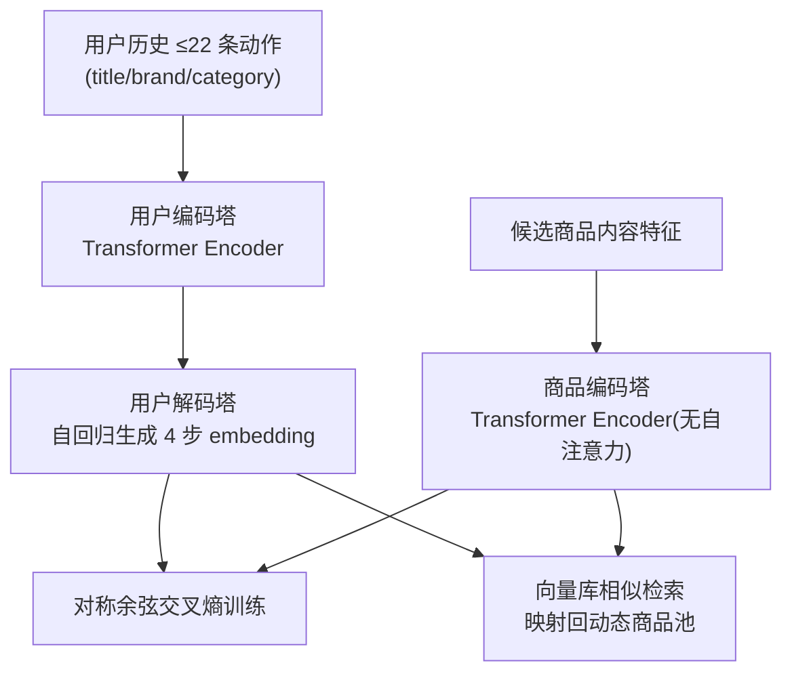

# MerRec: A Large-scale Multipurpose Mercari Dataset for Consumer-to-Consumer Recommendation Systems (面向 C2C 推荐的大规模多用途 Mercari 数据集)

- **会议/期刊**: KDD 2025
- **作者与机构**: Lichi Li, Zainul Abi Din, Zhen Tan, Sam London, Tianlong Chen, Ajay Daptardar（Mercari, Inc. / ASU / UNC）
- **推荐链路定位**: 召回（端到端多步向量检索）+ 精排 CTR/多任务基准
- **研究方向**: 去偏公平与工业架构 / 序列推荐
- **论文原文**: [https://arxiv.org/abs/2402.14230v2](https://arxiv.org/abs/2402.14230v2)
- **开源代码**: [https://github.com/mercari/mercari-ml-merrec-pub-us](https://github.com/mercari/mercari-ml-merrec-pub-us)

## TL;DR (1分钟核心速览)

C2C 电商推荐长期缺乏大规模、含丰富商品属性与多动作类型的数据集，学术界几乎被 B2C 范式垄断。本文发布 MerRec——来自 Mercari 平台 2023 年半年数据，含 5.56M 用户、83.07M 商品、1.27B 交互、6 类带时间戳动作、三级类目与文本属性，并首次提出无 SKU 场景下的 `product_id` 代理标识。配套提出三塔 Transformer 模型 Mercatran，在 CTR、SBR、多任务、推理加速四个任务上建立基准；线上 A/B 中 V2 相对 V1 带来订单 +124.4%、转化率 +23.8%、浏览 +92.1%。

## Background & Motivation (背景与核心矛盾)

- **主流范式**: 推荐研究几乎全部建立在 B2C 数据（Amazon、MovieLens、Tmall）之上，商品有标准 SKU、描述专业统一、用户角色单一。
- **前人局限**: ① C2C 平台商品由非专业卖家自述，标题/类目/品牌噪声大且无 SKU，同一 `product_id` 下 iPhone 4 到 iPhone 15 均价从 \$55 到 \$961 跨度极大（图 6），传统 item_id 建模无法区分；② 现有 C2C 数据集（Ali-CCP、Alibaba-iFashion）规模小、缺属性、缺多动作类型，无法支撑序列/多任务研究。
- **核心洞察 (Key Insight)**: C2C 商品是"一次性挂牌"——售出即下架、每日新增海量 listing，输出空间持续漂移，语言模型式"固定 item 词表 + 下一 token 预测"的序列推荐范式在此失效。
- **本文切入点**: 用内容特征（标题/品牌/类目）而非 item_id 编码商品，把预测目标从"下一个 token"改为"未来多步 embedding"，用向量库检索映射回动态商品池。

## Method (核心方法设计)

### 1. 整体框架 (Overall Architecture)

MerRec 以单张宽表按月分片存储（6 个月 × 数百 parquet），每行是一次带 `stime`、`session_id`、`event_id` 的用户动作快照，商品属性按"回看时刻"忠实还原。Mercatran 在此数据上采用三塔结构：用户编码塔（Transformer Encoder）压缩最长 22 条历史，用户解码塔（Transformer Decoder）自回归生成未来 4 步 embedding，商品编码塔（无自注意力的 Transformer Encoder）把候选商品内容特征编码进同一向量空间；训练时对每步预测与对应商品编码计算对称余弦交叉熵，推理时用户塔产出 4 个向量去向量库做相似检索。

### 2. 关键设计拆解 (Key Designs)

1. **无 SKU 的内容化商品表征（product_id 代理 + 内容编码）**：C2C 无标准 SKU，作者用 `brand_id ⊕ c2_id` 合成 `product_id` 作为粗粒度代理，但明确指出其粒度不足（图 6 的 iPhone 价格谱系）。Mercatran 进一步放弃 ID 嵌入，仅用标题/品牌/类目文本编码商品，使新挂牌商品无需重新训练即可被索引——这是应对"商品一次性、输出空间漂移"的关键算子替换。

2. **三塔多步自回归召回（Two-Tower → Three-Tower）**：双塔只输出单一用户向量，实测"只利用最近一次交互"，推荐多样性差（Mercatran V1 的痛点）。V2 增加解码塔，令模型一次生成未来 4 步 embedding，损失为对称交叉熵：
$$\mathcal{L}=-\frac{1}{4}\sum_{k=1}^{4}\left[\log\frac{\exp(\cos(\mathbf{u}_k,\mathbf{v}_k)/\tau)}{\sum_{j}\exp(\cos(\mathbf{u}_k,\mathbf{v}_j)/\tau)}+\log\frac{\exp(\cos(\mathbf{v}_k,\mathbf{u}_k)/\tau)}{\sum_{j}\exp(\cos(\mathbf{v}_k,\mathbf{u}_j)/\tau)}\right]$$
其中 $\mathbf{u}_k$为第$k$步用户解码向量、$\mathbf{v}_k$ 为对应商品编码。多步生成天然引入多样性，缓解只盯最近交互的退化。

3. **训练目标、去重与推理效率**：训练前对"同用户连续同动作同商品"事件去重，扩展注意力窗口的有效时间跨度（区别于 TransAct 的模型侧随机掩码）。线上部署采用两个异步批任务预计算用户/商品 embedding 存入特征库与向量库，单商品编码 40–50ms、单用户 4 向量生成 60–70ms，请求时以查表替代实时前向。

## Experimental Setup & Evaluation Protocol (实验设置与评估协议)

- **数据集与预处理**: MerRec 全量统计如下（`product_id` 为合成代理，非真实 SKU）：

| 数据集 | #Users | #Items | #Interactions | 稀疏度/密度 | 特征/场景说明 |
| :--- | :---: | :---: | :---: | :---: | :--- |
| MerRec | 5.56M | 83.07M | 1.27B | 密度约 2.7e-6 | 6 类动作、3399 类目/3 级、18.86B 标题 token、227M session |

- **数据划分与防穿越 (Splitting Strategy)**: CTR/MTL 用滚动窗口快照，历史窗口 7、预测第 8 个事件，按 **8:1:1 比例划分**；SBR 取序列**最后两个交互分别作验证/测试**（类 Leave-Last-Out）；Mercatran 用第 1 月训练、第 2 月验证、第 3 月测试的**跨月时间切分**，严格防穿越。
- **排名评测协议 (Ranking Protocol)**: SBR 与 Mercatran 均为**全库向量检索排序**（Mercatran 测试集 1.65M 商品全量索引），指标 nDCG@{5,20}、Recall@{5,20}；CTR/MTL 用 AUC 与 LogLoss。**未施加负采样**（作者明示留待后续探索）。
- **对比基线与超参设置**: CTR 对比 AFM/NFM/DCN/DCNv2/DeepFM/xDeepFM/W&D；SBR 对比 NextItNet/GRU4Rec/SASRec/Bert4Rec；MTL 对比 MMOE/ESMM/AITM/PLE/OMoE/STEM；IAR 对比 SkipRec 变体。受算力限制**未做充分超参搜索**，实验仅用首月数据子集。

## Key Experimental Results (实验关键数据)

### 1. 主实验对比 (Main Results)

**CTR 预测（首月子集，30.2M 商品 / 2.77M 用户）**：

| Model | AUC | LogLoss | 训练+验证时长(h) |
| :--- | :---: | :---: | :---: |
| AFM | **0.703** | **0.4114** | 21.6 |
| NFM | 0.6498 | 0.5394 | 21.2 |
| DCN | 0.6399 | 0.5657 | 20.8 |
| DCNv2 | 0.6209 | 0.6978 | 22.8 |
| DeepFM | 0.642 | 0.5554 | 20.3 |
| xDeepFM | 0.6066 | 0.78 | 52.8 |
| W&D | 0.6626 | 0.4843 | 21.1 |

**SBR 下一商品预测（10% 序列子集，885K 序列）**：

| Model | nDCG@5 | nDCG@20 | Recall@5 | Recall@20 |
| :--- | :---: | :---: | :---: | :---: |
| NextItNet | **0.257** | **0.298** | **0.348** | **0.490** |
| GRU4Rec | 0.244 | 0.286 | 0.333 | 0.477 |
| SASRec | 0.175 | 0.206 | 0.235 | 0.344 |
| Bert4Rec | 0.142 | 0.176 | 0.199 | 0.318 |

**MTL（view + like 双任务）**：

| Model | view AUC | like AUC | LogLoss | 时长(h) |
| :--- | :---: | :---: | :---: | :---: |
| Only view | 0.709 | N/A | 0.395 | 16.3 |
| Only like | N/A | 0.709 | 0.354 | 16.6 |
| MMOE | 0.712 | 0.713 | 0.744 | 22.61 |
| ESMM | 0.713 | 0.715 | 0.744 | 23.7 |
| AITM | **0.773** | 0.736 | 0.684 | 2.85 |
| PLE | **0.773** | 0.736 | 0.686 | 4.38 |
| OMoE | **0.773** | **0.737** | **0.684** | 3.3 |
| STEM | 0.772 | 0.736 | 0.683 | 9.68 |

**Mercatran 离线（跨月切分，全库检索）**：Title 输入下 item 级 nDCG@5 第 1 步 0.0410、第 4 步 0.0399；brand 级 Recall@20 达 0.6256，category 级 0.5988，多步衰减极小。

### 2. 消融实验 (Ablation Study)

Mercatran 输入特征消融（item 级 nDCG@5，第 1 步）：

| 输入特征 | nDCG@5 | Recall@20 | 说明 |
| :--- | :---: | :---: | :--- |
| Title + Brand + Category | 0.0407 | 0.1750 | 生产采用 |
| Title only | **0.0410** | 0.1735 | 略优，归因采样随机性/特征冗余 |
| Brand + Category | 0.0111 | 0.0609 | 粗粒度标识严重不足 |

IAR 消融：Skip-SASRec 相对 SASRec 的 nDCG@5 从 0.152 升至 **0.209**、Recall@20 从 0.314 升至 0.397；而 Skip-NextItNet 反而从 0.240 降至 0.195，说明跳块策略收益强依赖骨干。

### 3. 关键实验发现 (Key Findings)

1. **经典模型反超新模型**：CTR 上 AFM（AUC 0.703）显著领先 DCNv2（0.6209）与 xDeepFM（0.6066），交叉网络在 MerRec 高噪声 C2C 特征下更难调优；SBR 上 GRU4Rec 全面优于 SASRec，与 TenRec 结论相反，说明单一基准的模型排名不可外推。
2. **粗粒度标识是性能瓶颈**：仅用 Brand+Category 时 item 级 nDCG@5 仅 0.0111，不足 Title 输入的 1/3，直接印证 C2C 无 SKU 场景下内容级特征不可替代。
3. **多步生成几乎无衰减**：Mercatran 从第 1 步到第 4 步 item 级 nDCG@5 仅从 0.0407 降至 0.0371（−8.8%），brand 级 Recall@20 从 0.6085 到 0.6052，证明三塔自回归在动态商品池上具备稳定的多步召回能力；线上 V2 相对 V1 订单 +124.4%、浏览 +92.1%，验证多步多样性对真实业务的正向作用。

## Highlights & Limitations (亮点、对比与审稿批判)

- **与代表作对比 (vs. Prior Work)**: 相比 Ali-CCP（400K 用户、无商品属性）与 Alibaba-iFashion（单动作、无类目层级），MerRec 在商品数（+72% vs Amazon）、交互数（+122% vs Amazon）、交互类型（+50% vs DIGINETICA）、session 数（+2358% vs YOOCHOOSE）上全面领先；相比 eBay 的双塔内容召回（Wang et al.），Mercatran 用解码塔实现多步生成，解决双塔"只盯最近交互"的多样性缺陷。
- **可迁移亮点**: ① "内容编码 + 向量库检索"替代 ID 词表，可直接迁移到任何高频上新、商品一次性的场景（二手、票务、本地生活）；② 连续同动作同商品去重以扩展注意力有效时间窗，是零成本的序列预处理技巧。
- **审稿级局限批判**: ① 实验仅用首月数据子集且**未做超参搜索、未施加负采样**，CTR/MTL 的模型排名可能被欠调优污染，基准结论的可靠性打折；② `product_id` 代理粒度不足（同 ID 下 iPhone 跨代价差 17 倍），且离线评估仅用采样序列、未覆盖全量商品池，线上指标缺乏置信区间与显著性检验。

## Rating (四维评分)

- **方法创新性 (Novelty)**: ⭐⭐⭐⭐ （数据集本身填补 C2C 空白，三塔多步生成召回在工业场景有实质增量，但模型层面偏工程组合）
- **评估协议与实验扎实度 (Protocol & Experiments)**: ⭐⭐⭐ （四任务基准覆盖面广、跨月切分防穿越规范，但缺超参搜索、负采样与显著性检验）
- **写作与数学规范度 (Clarity & Rigor)**: ⭐⭐⭐⭐ （数据统计与特征说明详尽透明，公式简洁；Mercatran 训练细节与损失推导略简）
- **工业落地与复现价值 (Industrial & Practical Value)**: ⭐⭐⭐⭐⭐ （数据与代码全开源，含线上 A/B 与部署延迟数据，是少见的学术界-工业界闭环范本）

