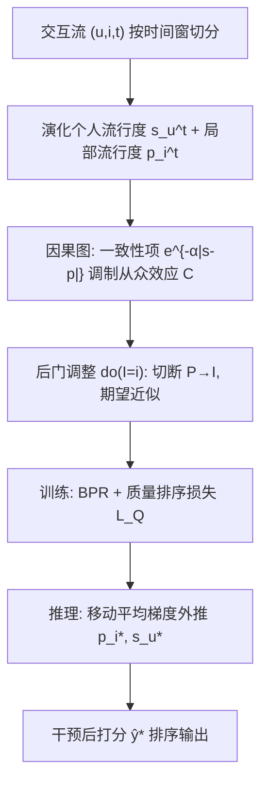

# Taming Recommendation Bias with Causal Intervention on Evolving Personal Popularity (基于演化个人流行度因果干预的推荐偏差抑制)

- **会议/期刊**: KDD 2025
- **作者与机构**: Shiyin Tan, Dongyuan Li, Renhe Jiang, Zhen Wang, Xingtong Yu, Manabu Okumura（Institute of Science Tokyo / The University of Tokyo / SMU）
- **推荐链路定位**: 召回（图协同过滤骨干上的打分与排序）
- **研究方向**: 去偏公平与工业架构 / 序列与会话推荐
- **论文原文**: [论文原文链接](https://arxiv.org/abs/2505.14310v2)
- **开源代码**: [开源代码仓库链接](https://github.com/ShiyinTan/CausalEPP)

## TL;DR (1分钟核心速览)

现有流行度去偏方法对所有用户"一刀切"地打压热门物品，且只考虑物品流行度或用户偏好的单侧时间演化，导致对"本就爱点热门"的用户过度去偏、对演化趋势错配的用户推荐失准。本文提出 CausalEPP：用**演化个人流行度** $s_u^t$量化每个用户对热门物品的偏好，构建含一致性项$e^{-\alpha|s_u^t-p_i^t|}$的因果图并做后门去混杂训练，推理期用移动平均趋势外推干预$p_i^*$与$s_u^*$。在 Ciao/Amazon-Music/Douban-Movie 三数据集、LightGCN 骨干下 Recall@20 相对最强基线最高提升 **20.4%**，同时将热门物品推荐占比从 75.8% 压到 55.5%（Amazon-Music）。

## Background & Motivation (背景与核心矛盾)

- **主流范式**: 因果去偏分三路——倾向加权（IPS/UDIPS）、对撞结构解耦（DICE/TIDE 分离物品质量与流行度）、混杂/中介结构干预（MACR/PPAC/PDA/DecRS 对物品流行度做 do 干预）。
- **前人局限一（用户同质化）**: TIDE、PDA 等对所有用户施加同等强度的去偏，忽略用户对热门物品的偏好差异。Douban-Movie 统计显示 14,975 名用户低频点击热门物品、32,823 名用户高频点击，统一去偏会让后者被强行推冷门、体验受损。
- **前人局限二（演化单侧化）**: PDA/DecRS 只更新物品流行度的时间演化，把用户偏好视为静态；而统计显示 14,709 人从"常点热门"转向"少点热门"、18,459 人反向迁移，仅看物品演化会把当前热门物品推给当前已不偏好热门的用户，造成演化错配。
- **核心洞察 (Key Insight)**: 用户决策由"个人流行度偏好"与"物品局部流行度"的**一致性**驱动——二者差距大时应弱化从众效应，差距小时可保留热门推荐；且一致性本身随时间漂移，需在推理期外推而非用末次观测值。
- **本文切入点**: 把演化个人流行度作为因果图节点嵌入从众效应，训练期切断 $P\to I$去混杂，推理期用移动平均梯度预测$p_i^*, s_u^*$ 做趋势引导干预。

## Method (核心方法设计)

### 1. 整体框架 (Overall Architecture)

输入为用户-物品-时间三元组流，按 100 个时间步切窗计算局部流行度 $p_i^t$与演化个人流行度$s_u^t$；以 MF/LightGCN 的匹配分$m_{ui}$为底座，叠加"质量项$q_i$+ 一致性加权的从众项$c_{ui}^t$"构成打分$\hat{y}_{ui}^t$；训练期用后门调整切断$P\to I$并以 BPR + 质量排序损失联合优化；推理期对$p_i^T, s_u^T$做移动平均趋势外推得到干预值$p_i^*, s_u^*$，重算从众项后排序输出。

### 2. 关键设计拆解 (Key Designs)

1. **演化个人流行度 + 一致性调制的从众效应**：痛点是对所有用户同强度去偏。定义 $s_u^t=\frac{|\{(u,i):i\in\mathcal{D}_u^{t-w_1,t},\,p_i^t>\hat{p}^t\}|}{|\mathcal{D}_u^{t-w_1,t}|}$，即以窗口内点击高流行物品（局部流行度前 20% 分位为阈值$\hat{p}^t$）的比例刻画偏好；从众项写成
$$c_{ui}^t=e^{-\alpha|s_u^t-p_i^t|}\cdot p_i^t\cdot \mathrm{MLP}(i)$$
差距大时一致性分趋 0、从众效应被自动抑制，差距小时保留热门信号——这使去偏强度随用户自适应，而非全局统一缩放。

2. **因果图去混杂 + 质量解耦损失**：痛点是从众效应同时混入"物品真好"与"只是热门"两部分。因果图含 $U,I,S,P,Q,C,M,Y$八节点，$I\leftarrow P$是混杂路径；对$do(I=i)$做后门调整得$P(Y|u,do(I=i),q)=\mathbb{E}_p[P(Y|q,C(S(u),p),M(u,i))]$，并用 Jensen 不等式把期望近似为$\mathbb{E}_p[\hat{y}_{ui}]\approx \mathrm{Tanh}(q_i+\mathbb{E}_p[c_{ui}])\cdot\mathrm{Softplus}(m_{ui})$。质量项由排序损失约束与全局流行度同序：
$$\mathcal{L}_Q=\sum_{i}\sum_{j\sim p_n}-\log\sigma\big(\mathrm{Sign}(d_i-d_j)(q_i-q_j)\big)$$
直觉是"全局流行度是质量的良性代理"，只剥离局部（短期）流行度的有害部分。

3. **训练目标与推理干预**：总损失 $\mathcal{L}=\mathcal{L}_{\text{BPR}}+\lambda\mathcal{L}_Q$，负采样为常规均匀分布$p_n$，无额外难负样本挖掘。推理期不做网格搜索，而用移动平均线梯度定向外推：$p_i^*=p_i^T+\frac{\partial \mathrm{MA}}{\partial t}(p_i^T)\cdot\Delta T_i$，$s_u^*=s_u^T+\frac{\partial \mathrm{MA}}{\partial t}(s_u^T)\cdot\Delta T_u$，再代入$c_{ui}^*=e^{-\alpha|s_u^*-p_i^*|}\cdot p_i^*\cdot\mathrm{MLP}(i)$。相比 PDA 在全值空间搜索，该做法把搜索空间压缩为"方向 + 步长"两个标量，推理开销近似为零。

## Experimental Setup & Evaluation Protocol (实验设置与评估协议)

- **数据集与预处理**: Ciao、Amazon-Music 做 `5-core` 过滤，Douban-Movie 做 `10-core` 过滤；时间划为 100 步，局部流行度窗口 $w_1=6$ 个月。

| 数据集 | #Users | #Items | #Interactions | 稀疏度/密度 | 特征/场景说明 |
| :--- | :---: | :---: | :---: | :---: | :--- |
| Ciao | 5,868 | 10,724 | 143,217 | 0.23% | 评分+社交，2000.5–2011.4 |
| Amazon-Music | 5,541 | 3,568 | 64,706 | 0.33% | 音乐评分，1998.04–2014.7 |
| Douban-Movie | 48,799 | 26,813 | 7,409,868 | 0.57% | 电影评分，2010.1–2017.3 |

- **数据划分与防穿越 (Splitting Strategy)**: 按时间顺序切 10 份，前 9 份训练，最后 1 份均分为验证/测试（严格时序切分，防未来信息泄漏）。
- **排名评测协议 (Ranking Protocol)**: 对用户未交互物品全库打分，检验 Top-K 是否命中，报告 Rec@20 / Pre@20 / NDCG@20，属无偏 `Full-Ranking`。
- **对比基线与超参设置**: 10 个基线覆盖 IPS/UDIPS（加权）、MACR/PPAC（反事实）、DICE/PD/TIDE（去混杂）、PARE/PDA（分布演化）；骨干为 MF 与 LightGCN，隐维 64，Adam，batch 8192；$\alpha=0.5,\lambda=0.2$，高流行分位 20%，$\Delta T_i=5,\Delta T_u=10$；t-test$p<0.05$ 显著性检验。

## Key Experimental Results (实验关键数据)

### 1. 主实验对比 (Main Results)

LightGCN 骨干，Rec@20 / NDCG@20（† 表示相对最优基线的显著提升）：

| 方法 | Ciao Rec | Ciao NDCG | Amazon Rec | Amazon NDCG | Douban Rec | Douban NDCG | Avg.Rank |
| :--- | :---: | :---: | :---: | :---: | :---: | :---: | :---: |
| LightGCN | 0.0181 | 0.0091 | 0.0528 | 0.0090 | 0.0227 | 0.0390 | 8.83 |
| MACR | 0.0220 | 0.0074 | 0.0522 | 0.0098 | 0.0315 | 0.0497 | 8.67 |
| PDA | 0.0204 | 0.0068 | 0.0698 | 0.0126 | 0.0409 | 0.0624 | 7.67 |
| PARE | 0.0227 | 0.0069 | 0.0697 | 0.0130 | 0.0426 | 0.0643 | 6.67 |
| TIDE | 0.0234 | 0.0102 | 0.0702 | 0.0140 | 0.0482 | 0.0726 | 3.89 |
| PPAC | 0.0245 | 0.0097 | 0.0705 | 0.0142 | 0.0485 | 0.0722 | 3.72 |
| **CausalEPP** | **0.0293**† | **0.0112**† | **0.0723**† | **0.0145**† | **0.0512**† | **0.0736**† | **2.11** |
| Improv. | +14.9% | +9.8% | +2.6% | +2.1% | +5.6% | +1.4% | — |
| **CausalEPP-Inv** | **0.0303**† | **0.0117**† | **0.0741**† | **0.0149**† | **0.0514**† | **0.0740**† | **1.00** |
| Improv. | +18.8% | +14.7% | +5.1% | +4.9% | +6.0% | +1.9% | — |

MF 骨干下 CausalEPP-Inv 在 Ciao 上 Rec@20 达 0.0322（+23.8%），Amazon-Music 0.0866（+2.7%），Douban 0.0490（+3.6%），平均排名 1.50。

### 2. 消融实验 (Ablation Study)

LightGCN 骨干，Rec@20（括号内为相对完整模型跌幅）：

| 变体 | Ciao | Amazon-Music | Douban-Movie |
| :--- | :---: | :---: | :---: |
| CausalEPP | 0.0293 | 0.0723 | 0.0512 |
| w/o quality | 0.0239 (-18.43%) | 0.0696 (-3.73%) | 0.0477 (-6.83%) |
| w/o consistency | 0.0277 (-5.46%) | 0.0710 (-1.80%) | 0.0504 (-1.56%) |
| CausalEPP-Inv | 0.0303 | 0.0741 | 0.0514 |
| eliminate $p$ | 0.0144 (-50.85%) | 0.0514 (-28.90%) | 0.0253 (-50.58%) |
| w/o evolution | 0.0285 (-5.94%) | 0.0718 (-3.10%) | 0.0499 (-2.92%) |
| w/o consistency (Inv) | 0.0296 (-2.31%) | 0.0726 (-2.02%) | 0.0513 (-0.19%) |

### 3. 关键实验发现 (Key Findings)

1. **质量解耦是最大单点贡献**：移除质量项在 Ciao 上 Rec@20 暴跌 18.43%，远超一致性项（5.46%），说明"把良性流行度（质量）与有害流行度分开"比"调一致性权重"更关键；图 5 进一步显示无质量损失时学到的 $q_i$ 与真实平均评分几乎无相关，加损失后才复现全局流行度-质量的正向趋势。
2. **"彻底消除流行度"是灾难性错误**：将 $p^*$设为全局均值$\mathbb{E}[p]$导致 Rec@20 平均下跌约 41%，而趋势外推干预反而在训练模型上再涨 3.45%（LightGCN）/1.98%（MF），证明干预应"定向修正"而非"归零"；去掉演化改用网格搜索$p^*,s^*$ 也掉 4.08%，说明方向信息本身有价值。
3. **去偏与精度可同时达成**：Amazon-Music 上热门物品真实占比 43.3%，LightGCN 推荐占比 75.8%（严重过推），CausalEPP 降至 55.5%；Douban-Movie 从 93.9% 降至 64.1%（真实 54.9%），且同期 Recall 不降反升，说明偏差压缩并非以精度为代价。

## Highlights & Limitations (亮点、对比与审稿批判)

- **与代表作对比 (vs. Prior Work)**: 相比 TIDE 仅用对撞结构分离质量、且从众效应不含用户侧因子，本文用混杂结构 + 用户/物品双侧一致性建模；相比 PPAC 按点击相似度硬分组去偏，本文用连续标量 $s_u^t$ 隐式分群且显式对齐演化；相比 PDA 在全值空间网格搜索干预值，本文用移动平均梯度把搜索降为"方向×步长"。
- **可迁移亮点**: (i) "一致性分 $e^{-\alpha|\cdot|}$ 调制交互强度"可迁移到跨域/多场景的兴趣-场景匹配打分；(ii) 用移动平均梯度外推替代网格搜索做推理期干预，是低开销的通用去偏推理技巧。
- **审稿级局限批判**: (i) 时间窗 $w_1$、分位阈值、$\Delta T_i/\Delta T_u$共 4 个超参需逐数据集调，且论文仅在 Amazon-Music 上做敏感性分析，跨域鲁棒性证据不足；(ii) 期望近似依赖 Jensen 不等式且用训练集平均流行度替代$\mathbb{E}_p[p_i^t]$，对流行度分布漂移剧烈的场景（如新闻）近似误差可能放大，论文未给出误差界实验。

## Rating (四维评分)

- **方法创新性 (Novelty)**: ⭐⭐⭐⭐ （演化个人流行度 + 双侧演化一致性干预是清晰的新视角，因果图推导完整但结构本身属混杂模型的常规扩展）
- **评估协议与实验扎实度 (Protocol & Experiments)**: ⭐⭐⭐⭐ （三数据集双骨干 + 10 基线 + 时序切分 Full-Ranking + 显著性检验齐全，但敏感性分析仅覆盖单数据集）
- **写作与数学规范度 (Clarity & Rigor)**: ⭐⭐⭐⭐ （因果图到 Eq.(5) 的后门推导链条清晰，Jensen 近似给出定理引用；部分符号上标 $t$ 省略处略影响可读性）
- **工业落地与复现价值 (Industrial & Practical Value)**: ⭐⭐⭐⭐ （代码开源，干预仅需两个标量外推、推理开销近零，可直接挂载在现有双塔/图召回骨干上）

