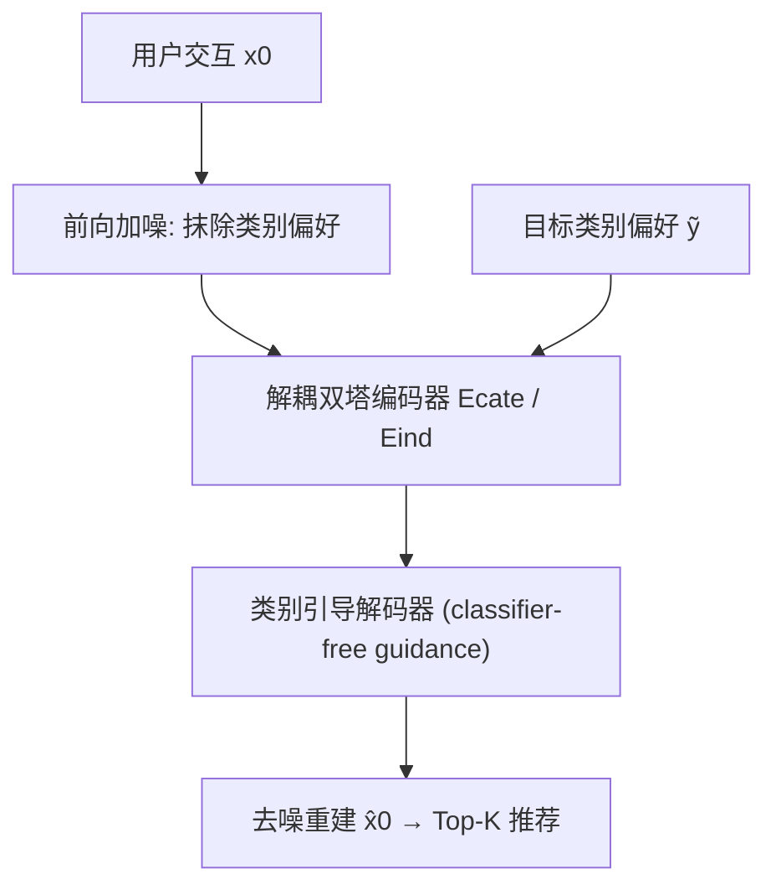
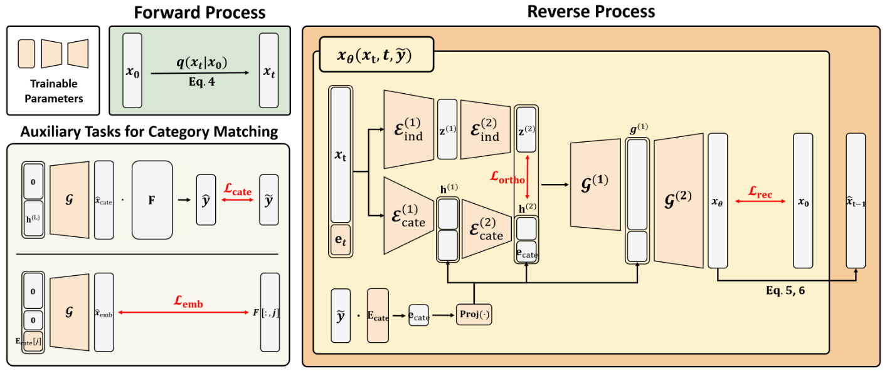

# Controlling Diversity at Inference: Guiding Diffusion Recommender Models with Targeted Category Preferences (推理阶段可控多样性的解耦扩散推荐模型)

- **会议/期刊**: KDD 2025
- **作者与机构**: Gwangseok Han, Wonbin Kweon, Minsoo Kim, Hwanjo Yu (POSTECH)
- **推荐链路定位**: 端到端生成式召回
- **研究方向**: 生成式推荐与离散语义ID / 去偏公平与可信推荐
- **论文原文**: [论文原文链接](https://arxiv.org/abs/2411.11240v2)
- **开源代码**: 暂未开源（匿名仓库已随文发布）

## TL;DR (1分钟核心速览)

现有多样性推荐方法将准确率-多样性权衡固化在训练超参中，推理阶段无法灵活调整。本文提出 D3Rec，将用户交互视为扩散生成目标：前向加噪抹除历史交互中潜伏的类别偏好，反向去噪时以**目标类别偏好 $\tilde{\boldsymbol{y}}$** 作为条件引导生成，并配合解耦双塔编码器与两个辅助任务保证生成结果与目标偏好对齐。在 ML-1M/Steam/Anime 三数据集上，D3Rec 在 Recall@10 上相对最优基线提升 3.55%–19.70%，Entropy@10 提升 3.13%–7.65%，且支持推理时通过温度$\tau$ 或任意目标分布单调调节多样性。

## Background & Motivation (背景与核心矛盾)

- **主流范式**: 多样性控制分两支——后处理（MMR/DPP/CATE 在候选集上重排）与端到端（DCRS/COR 在训练中联合优化准确率与多样性）。
- **前人局限**: (1) 后处理模块与候选生成解耦，多样性信号未进入训练，且额外重排带来显著推理延迟；(2) 端到端方法的权衡系数在训练时固定，用户想调整多样性只能重新训练或持续反馈，无法适配"今天想看动作片、明天陪人看爱情片"的即时需求。
- **核心洞察 (Key Insight)**: 用户交互中潜伏的类别偏好是偏置放大的根源；若能在生成过程中**显式分离"类别偏好"与"类别无关品味"**，则只需在推理时替换类别偏好向量即可任意调节多样性，而无需触碰模型参数。
- **本文切入点**: 用扩散模型的前向加噪天然抹除交互中的类别偏好，反向去噪时以目标类别偏好为条件引导，实现推理期可控。

## Method (核心方法设计)

### 1. 整体框架 (Overall Architecture)

D3Rec 将用户交互向量 $\boldsymbol{x}_0\in\{0,1\}^{|\mathcal{I}|}$作为扩散生成目标。前向过程按线性噪声调度逐步加噪至$\boldsymbol{x}_T$，抹除历史交互中的类别偏好；反向过程由解耦双塔编码器（类别偏好编码器$\mathcal{E}_{cate}$+ 类别无关编码器$\mathcal{E}_{ind}$）提取表征，经类别偏好引导的 U-Net 式解码器逐步去噪重建$\hat{\boldsymbol{x}}_0$。训练时目标偏好$\tilde{\boldsymbol{y}}$取用户原始类别分布$\boldsymbol{y}$，推理时可替换为任意目标分布。辅助任务$\mathcal{L}_{cate}$、$\mathcal{L}_{emb}$与正交解耦损失$\mathcal{L}_{ortho}$ 共同保证类别表征的可操控性。

<figure class="paper-figure" markdown="span">
  <figcaption>图2：D3Rec 的整体框架。在前向过程中，用户交互被破坏，从而削弱其中潜藏的类别偏好。在反向过程中，模型在目标类别偏好的引导下生成交互。第4.2节详细讨论 Lortho 和 Lrecon。第4.3节设计了两个辅助任务，分别使用 Lcate 和 Lemb，以确保生成的推荐与目标类别偏好一致。</figcaption>
</figure>

### 2. 关键设计拆解 (Key Designs)

1. **类别偏好引导的去噪（Classifier-Free Guidance）**：DiffRec 的反向过程无条件，无法反映个性化类别偏好。D3Rec 将去噪均值改写为条件形式，并用无分类器引导插值条件与无条件预测：
$$\tilde{\boldsymbol{x}}_\theta(\boldsymbol{x}_t,t,\tilde{\boldsymbol{y}})=(1+w)\cdot\boldsymbol{x}_\theta(\boldsymbol{x}_t,t,\tilde{\boldsymbol{y}})-w\cdot\boldsymbol{x}_\theta(\boldsymbol{x}_t,t,\boldsymbol{0}^{|\mathcal{C}|})$$
其中 $w$控制引导强度。直觉：$w$越大越强依赖目标类别，合成数据上需大$w$（>0.5）才能适配偏离原分布的目标，而真实数据上过大$w$ 反而损害精度（用户兴趣不止于类别）。

2. **解耦双塔 + 正交正则**：若类别信息与用户品味纠缠，替换 $\tilde{\boldsymbol{y}}$会连带破坏个性化。D3Rec 设$\mathcal{E}_{cate}$每层注入类别表征$\boldsymbol{e}_{cate}=\boldsymbol{E}_{cate}^\top\tilde{\boldsymbol{y}}$，$\mathcal{E}_{ind}$不注入，并用余弦正交损失$\mathcal{L}_{ortho}=\text{Cosine}(\boldsymbol{z}^{(L)},\boldsymbol{h}^{(L)})$强制两路表征正交。这样操纵$\tilde{\boldsymbol{y}}$ 只改变类别维度，保留类别无关品味。

3. **两个辅助任务 + 重加权训练**：$\mathcal{L}_{cate}$仅用$\boldsymbol{h}^{(L)}$解码并反推类别分布$\hat{\boldsymbol{y}}$逼近$\tilde{\boldsymbol{y}}$，确保类别编码器真正编码偏好；$\mathcal{L}_{emb}$仅用单类别嵌入解码，强制其与所属物品关联。针对类别长尾，借鉴 Focal Loss 构造$\boldsymbol{y}^{pos}/\boldsymbol{y}^{neg}$ 对正/负样本按类别稀有度重加权。总损失：
$$\mathcal{L}=\text{re-weight}(\mathcal{L}_{recon})+\mathcal{L}_{cate}+\lambda(\mathcal{L}_{ortho}+\mathcal{L}_{emb})$$
训练负采样为全库隐式反馈（0/1 交互），推理为确定性去噪（忽略协方差），并先加噪 $T'<T$ 步再去噪以保留个性化信息。

## Experimental Setup & Evaluation Protocol (实验设置与评估协议)

- **数据集与预处理**: 采用 20-core 过滤（用户/物品/类别），显式评分二值化（ML-1M ≥4、Anime ≥8 记为正）：

| 数据集 | #Users | #Items | #Interactions | #Categories | 场景说明 |
| :--- | :---: | :---: | :---: | :---: | :--- |
| ML-1M | 5,148 | 2,380 | 553,277 | 18 | 电影评分 |
| Steam Game | 31,572 | 6,070 | 1,351,659 | 12 | 游戏评论 |
| Anime 2023 | 143,907 | 7,947 | 12,803,010 | 21 | 动漫评分 |

- **数据划分与防穿越**: 按用户**比例划分** 60%/20%/20%（训练/验证/测试），ML-1M 与 Steam 按时间戳排序，Anime 无时间戳随机打乱。
- **排名评测协议**: 全库排序（对全部未交互物品打分取 Top-K），$K\in\{10,20\}$；精度用 Recall/NDCG，多样性用 Coverage/Entropy（基于推荐列表类别分布）。
- **对比基线与超参**: 精度基线 MultVAE/DiffRec；解耦基线 MacridVAE/DCRS；权衡基线 COR/Dual Process/MMR/PMF/DPP/CATE。隐藏维 [200,600]，batch 400，扩散步 $T\in\{10,15,20,100\}$，引导强度$w\in\{-0.7,\dots,0.5\}$，$\lambda\in\{1,10^{-2},10^{-4}\}$；5 个随机种子均值，单样本 t 检验$p<0.05$。

## Key Experimental Results (实验关键数据)

### 1. 主实验对比 (Main Results)

| 数据集 | 模型 | Recall@10 | NDCG@10 | Entropy@10 | Coverage@10 | Recall@20 | Entropy@20 |
| :--- | :--- | :---: | :---: | :---: | :---: | :---: | :---: |
| ML-1M | DiffRec | 0.0547 | 0.0989 | 0.6578 | 0.5300 | 0.0949 | 0.7099 |
| ML-1M | CATE | 0.0526 | 0.0910 | 0.6743 | 0.5426 | 0.0928 | 0.7599 |
| ML-1M | **D3Rec** | **0.0567** | **0.1006** | **0.7259** | **0.5919** | **0.0984** | **0.7838** |
| ML-1M | Improv.% | +3.55 | +1.71 | +7.65 | +9.10 | +2.95 | +3.15 |
| Steam | DiffRec | 0.0446 | 0.0511 | 0.6618 | 0.6397 | 0.0710 | 0.6932 |
| Steam | CATE | 0.0455 | 0.0522 | 0.6779 | 0.6146 | 0.0703 | 0.7435 |
| Steam | **D3Rec** | **0.0534** | **0.0659** | **0.7329** | **0.7188** | **0.0816** | 0.7427 |
| Steam | Improv.% | +14.98 | +19.38 | +8.12 | +12.36 | +11.16 | -0.10 |
| Anime | DiffRec | 0.0194 | 0.0272 | 0.6934 | 0.5040 | 0.0313 | 0.7360 |
| Anime | CATE | 0.0169 | 0.0221 | 0.7140 | 0.5197 | 0.0264 | 0.7676 |
| Anime | **D3Rec** | **0.0232** | **0.0322** | **0.7364** | **0.5553** | **0.0401** | **0.7795** |
| Anime | Improv.% | +19.70 | +18.22 | +3.13 | +6.84 | +28.37 | +1.56 |

### 2. 消融实验 (Ablation Study)

| 变体 | Steam Recall@20 | Steam Entropy@20 | 合成Steam Recall@20 | 合成Steam NDCG@20 |
| :--- | :---: | :---: | :---: | :---: |
| w/o two encoder | 0.0813 | 0.7496 | 0.2286 | 0.1612 |
| w/o $\mathcal{L}_{ortho}$ | 0.0800 | 0.7435 | 0.2284 | 0.1607 |
| w/o $\mathcal{L}_{cate}$ | 0.0798 | 0.7236 | 0.2293 | 0.1680 |
| w/o $\mathcal{L}_{emb}$ | 0.0806 | 0.7310 | 0.2306 | 0.1691 |
| w/o re-weight | 0.0809 | 0.7029 | 0.2320 | 0.1671 |
| **D3Rec** | **0.0816** | **0.7427** | **0.2331** | **0.1703** |

### 3. 关键实验发现 (Key Findings)

1. **解耦是可控性的前提**：移除双塔或 $\mathcal{L}_{ortho}$ 后，合成 Steam 上 NDCG@20 从 0.1703 跌至 0.1607/0.1612（约 -5.6%），说明类别表征与用户品味纠缠时，替换目标偏好会连带破坏个性化，解耦损失是"只动类别、不动品味"的关键。
2. **重加权主导多样性**：移除 re-weight 后 Steam Entropy@20 从 0.7427 降至 0.7029（-5.4%），是消融中多样性跌幅最大的组件，印证类别长尾不平衡是多样性瓶颈。
3. **任意目标偏好适配能力随分布偏移增强**：在 $C_{KL}$最高的 ML-1M 合成集上，D3Rec 相对 COR 的 Recall@10 提升达 +143.05%，而$C_{KL}$ 较低的 Steam/Anime 仅 +11.75%/+4.99%，说明目标分布偏离越远，条件引导的收益越显著；同时噪声数据（30% 噪声）下 D3Rec 仅降 -1.23% Recall@20，远优于 MultVAE/DiffRec 的 -3%~-5.6%。

## Highlights & Limitations (亮点、对比与审稿批判)

- **与代表作对比 (vs. Prior Work)**: 相比 DiffRec（无条件扩散，多样性不可控），D3Rec 将类别偏好作为去噪条件实现推理期操控；相比 COR（端到端但权衡固化、温度方向甚至反向），D3Rec 的多样性随 $\tau$ 单调变化且 Pareto 前沿更靠右上；相比 CATE（后处理，Anime 上调控幅度极小且推理延迟最大），D3Rec 端到端生成无额外重排开销。
- **可迁移亮点**: (1) "前向加噪抹除偏置属性 + 反向条件引导注入目标属性"的解耦范式可迁移到年龄/地域等敏感属性去偏；(2) 用辅助任务反推条件表征（$\mathcal{L}_{cate}$）确保条件编码器真正编码目标，是条件生成模型的通用正则技巧。
- **审稿级局限批判**: (1) 扩散去噪需多步迭代，推理开销与 DiffRec 同量级但显著高于 MultVAE/COR，工业级低延迟场景需蒸馏或步数压缩；(2) 多样性仅以类别分布（Coverage/Entropy）度量，未覆盖物品级/语义级多样性，且类别信息依赖平台标注质量；引导强度 $w$ 在真实与合成数据上最优区间相反，需按场景调参。

## Rating (四维评分)

- **方法创新性 (Novelty)**: ⭐⭐⭐⭐ （将 classifier-free guidance 与类别解耦结合，首次实现扩散推荐的推理期多样性操控，思路清晰但组件多为已有技术的巧妙组合）
- **评估协议与实验扎实度 (Protocol & Experiments)**: ⭐⭐⭐⭐ （三真实+三合成数据集、全库排序、5 种子 t 检验、消融与鲁棒性分析完整，但多样性指标仅限类别层面）
- **写作与数学规范度 (Clarity & Rigor)**: ⭐⭐⭐⭐ （扩散推导与损失定义规范，符号统一，但部分超参搜索空间在正文与附录间略有出入）
- **工业落地与复现价值 (Industrial & Practical Value)**: ⭐⭐⭐ （推理期可调控对业务策略极友好，但多步去噪延迟与匿名代码仓库的可复现性打了折扣）

