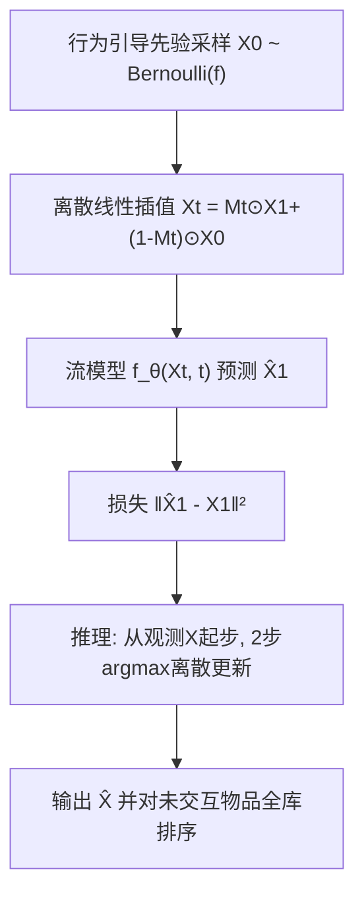
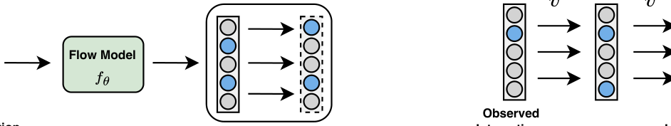

# Flow Matching for Collaborative Filtering (面向协同过滤的流匹配生成式推荐)

- **会议/期刊**: KDD 2025
- **作者与机构**: Chengkai Liu, Yangtian Zhang, Jianling Wang, Rex Ying, James Caverlee (Texas A&M University / Yale University / Google DeepMind)
- **推荐链路定位**: 召回（生成式用户全物品交互矩阵重建）
- **研究方向**: 生成式推荐与离散语义ID
- **论文原文**: [论文原文链接](https://arxiv.org/abs/2502.07303v2)
- **开源代码**: [开源代码仓库链接](https://github.com/chengkai-liu/FlowCF)

## TL;DR (1分钟核心速览)

生成式CF长期受困于VAE后验近似不准与扩散模型连续高斯噪声对二值隐式反馈的失真，且扩散推理需多步采样。本文提出FlowCF，将流匹配引入协同过滤：用全局物品频率构造**行为引导先验**替代高斯先验，用**离散流框架**（离散线性插值与期望向量场）保持交互二值性。在ML-1M/ML-20M/Amazon-Beauty全库排序协议下，R@10相对最优基线提升1.98%–4.96%，且推理仅需2步采样，速度最快。

## Background & Motivation (背景与核心矛盾)

- **主流范式**: 生成式CF以VAE（Mult-VAE/RecVAE/MacridVAE）与扩散模型（DiffRec）为代表，直接建模用户-物品交互矩阵的分布并重建，而非学习判别式表征。
- **前人局限**: 其一，VAE依赖变分近似与KL散度，后验近似不准导致重建偏好模糊、训练不稳定且收敛慢；其二，扩散模型在连续空间对二值交互加高斯噪声，连续插值产生分数值，与隐式反馈的离散本质错配，且随机弯曲路径需多步采样，推理昂贵。
- **核心洞察 (Key Insight)**: 流匹配可学习确定性的**直线轨迹**，训练稳定、采样步数少；且其框架对先验设计与状态空间高度可定制，恰好能针对推荐数据的稀疏性、流行度偏置与二值性做改造。
- **本文切入点**: 把"先验"换成由全局物品频率导出的伯努利分布，把"连续流"换成在离散状态空间演化、但期望仍线性变化的离散流。

## Method (核心方法设计)

### 1. 整体框架 (Overall Architecture)

FlowCF 以 MLP 实现流模型 $f_\theta$，学习从源分布到目标偏好分布的向量场。训练时从行为引导先验采样二值矩阵$X_0$，与真实交互$X_1=\bar{X}$之间按离散线性插值构造中间态$X_t$，模型输入$(X_t,t)$直接预测目标交互$\hat{X}_1$，并以$\|\hat{X}_1-X_1\|^2$优化。推理时把观测交互$X$ 视作含噪中间态，从较后时间步起步，用预测向量场做 argmax 离散更新，仅 2 步即得预测矩阵，再对未交互物品排序。

<figure class="paper-figure" markdown="span">
  <figcaption>图 2：FlowCF 概览。(a) 在来自行为引导先验的样本 𝑋0 与历史交互 𝑋1 之间创建一组插值 𝑋𝑡。(b) 训练期间，FlowCF 使用近似真实流的流模型学习预测向量场。(c) 推理时，FlowCF 利用流模型预测的向量场。</figcaption>
</figure>

### 2. 关键设计拆解 (Key Designs)

1. **行为引导先验 (Behavior-Guided Prior)**：高斯先验无法刻画稀疏与长尾流行度，且推荐需要的是"从含噪行为分布"而非"纯噪声"出发。本文用全局物品频率 $f_i=\frac{\text{item }i\text{ 的交互数}}{|\mathcal{U}|}$构造逐用户共享的伯努利先验$p=\mathrm{Bernoulli}(\mathbf{1}_{|\mathcal{U}|}\otimes \mathbf{f})$，采样$X_0\in\{0,1\}^{|\mathcal{U}|\times|\mathcal{I}|}$。直觉是让起点本身携带流行度与稀疏结构，使流只需学习"行为修正"而非从零生成。

2. **离散流框架 (Discrete Flow Framework)**：连续线性插值 $X_t=tX_1+(1-t)X_0$会产生分数值，破坏二值性。本文改为离散插值$X_t=M_t\odot X_1+(\mathbf{1}-M_t)\odot X_0$，其中$M_t\sim\mathrm{Bernoulli}(t)$，每个元素以概率$t$取$X_1$、否则取$X_0$。关键性质是期望仍线性：$\mathbb{E}[X_t]=tX_1+(1-t)X_0$，故期望向量场$u_t=\frac{X_1-\mathbb{E}[X_t]}{1-t}$ 与连续情形同构，从而在保持离散结构的同时继承流匹配的理论一致性。

3. **训练目标、负采样与推理效率**：将 $u_t$与预测场$v_t=\frac{\hat{X}_1-\mathbb{E}[X_t]}{1-t}$代入条件流匹配损失，分母相消得极简目标$\mathcal{L}_t=\mathbb{E}_{t,X_1,X_t}\|\hat{X}_1-X_1\|^2$，即直接回归交互矩阵，**无需负采样**（全物品重建式训练）。推理更新为$X^{i}_{t+\frac{1}{N}}=1$若$X^i_t+v^i_t/N\ge 0.5$否则$0$，并每步用$X_t\leftarrow X_t\vee X$ 保留已观测交互；因起点非纯噪声，可从倒数第二步起步，仅 2 步采样。

## Experimental Setup & Evaluation Protocol (实验设置与评估协议)

- **数据集与预处理**: 将显式评分二值化（$\ge 4$为正、$<4$丢弃），过滤交互数$<5$ 的用户与物品（`5-core`）：

| 数据集 | #Users | #Items | #Interactions | 密度 | 场景说明 |
| :--- | :---: | :---: | :---: | :---: | :--- |
| MovieLens-1M | 6,034 | 3,126 | 574,376 | 3.04% | 中等规模电影 |
| MovieLens-20M | 136,674 | 13,681 | 9,977,451 | 0.53% | 大规模电影 |
| Amazon-Beauty | 10,553 | 6,087 | 94,148 | 0.15% | 极稀疏电商 |

- **数据划分与防穿越 (Splitting Strategy)**: 按 `8:1:1` 比例划分训练/验证/测试。
- **排名评测协议 (Ranking Protocol)**: 采用无偏 `Full-Ranking`（对每个用户全部未交互物品排序），指标为 R@10/20 与 N@10/20。
- **对比基线与超参设置**: 基线覆盖非生成式（MF-BPR、LightGCN、SGL）、DAE（CDAE、Mult-DAE）、VAE（Mult-VAE、MacridVAE、RecVAE）与扩散（DiffRec）；离散步数 $N$在 ML-1M/Beauty 取 9、ML-20M 取 50，采样步数固定 2；提升以$p<0.05$ 显著性检验标注。

## Key Experimental Results (实验关键数据)

### 1. 主实验对比 (Main Results)

| 方法 | ML-1M R@10 | ML-1M N@10 | ML-20M R@10 | ML-20M N@10 | Beauty R@10 | Beauty N@10 |
| :--- | :---: | :---: | :---: | :---: | :---: | :---: |
| MF-BPR | 0.1764 | 0.1924 | 0.1980 | 0.1779 | 0.0871 | 0.0487 |
| LightGCN | 0.1859 | 0.1849 | 0.2055 | 0.1855 | 0.1032 | 0.0579 |
| SGL | 0.1936 | 0.2086 | 0.2219 | 0.1947 | 0.1093 | 0.0624 |
| Mult-VAE | 0.1855 | 0.1952 | 0.2472 | 0.2134 | 0.1009 | 0.0583 |
| RecVAE | 0.2049 | 0.2146 | 0.2487 | 0.2217 | 0.1153 | 0.0677 |
| DiffRec | 0.2055 | 0.2208 | 0.2530 | 0.2362 | 0.1190 | 0.0731 |
| **FlowCF** | **0.2157** | **0.2320** | **0.2580** | **0.2394** | **0.1245** | **0.0755** |
| Improv.% | +4.96% | +5.07% | +1.98% | +1.02% | +4.62% | +3.28% |

### 2. 消融实验 (Ablation Study)

| 变体 | 先验 | ML-1M R@10 | ML-20M R@10 | Beauty R@10 |
| :--- | :--- | :---: | :---: | :---: |
| CFlowCF (连续流) | Uniform | 0.2103 | 0.2473 | 0.1098 |
| CFlowCF (连续流) | Gaussian | 0.2116 | 0.2523 | 0.1189 |
| CFlowCF (连续流) | Behavior-Guided | 0.2132 | 0.2549 | 0.1202 |
| FlowCF (离散流) | Random Binary | 0.2035 | 0.1888 | 0.0018 |
| FlowCF (离散流) | Uniform | 0.2054 | 0.0938 | 0.0020 |
| FlowCF (离散流) | Gaussian | 0.2028 | 0.1963 | 0.0020 |
| **FlowCF (离散流)** | **Behavior-Guided** | **0.2157** | **0.2580** | **0.1245** |

### 3. 关键实验发现 (Key Findings)

1. **离散流对先验极度敏感，行为引导先验是"必需品"而非"锦上添花"**：离散流下 Uniform/Gaussian/Random 先验在 Beauty 上直接崩塌至 R@10≈0.002，而行为引导先验达 0.1245；原因是二值 $X_0$ 的正例密度必须匹配真实数据密度，稠密先验引入大量假阳性使模型无法恢复正确模式。
2. **离散流优于连续流，且增益来自结构保持**：同为行为引导先验，离散 FlowCF 在 ML-1M 上 R@10 0.2157 vs 连续 CFlowCF 0.2132，Beauty 上 0.1245 vs 0.1202，说明保持二值性对稀疏数据尤为关键。
3. **鲁棒性与效率双赢**：在自然噪声与 10%–50% 随机噪声训练下，FlowCF 性能退化率低于 VAE 类方法；ML-20M 上收敛最快、每轮推理时间与 Mult-VAE/RecVAE 相当，远快于需多步采样的 DiffRec。

## Highlights & Limitations (亮点、对比与审稿批判)

- **与代表作对比 (vs. Prior Work)**: 相比 Mult-VAE/RecVAE 的 KL 变分近似，FlowCF 直接回归交互、无分布匹配，训练更稳；相比 DiffRec 的连续高斯扩散，FlowCF 用离散流保持二值性且直线轨迹使采样从多步降至 2 步；相比 CFlowCF，离散流在稀疏数据上更准但更依赖先验设计。
- **可迁移亮点**: (1) "用全局频率构造伯努利先验"可迁移到任何以二值矩阵为生成目标的推荐/链接预测任务；(2) "期望线性 + 离散 argmax 更新"的桥接技巧可用于其他离散状态空间的生成建模。
- **审稿级局限批判**: (1) 离散流对先验密度高度敏感，先验设计不当会训练失败，泛化到新域需重新校准频率；(2) 全物品矩阵重建的显存与计算随 $|\mathcal{I}|$ 线性增长，超大规模物品库（千万级）部署成本未评估，且仅在三个二值化电影/电商数据集验证，缺少工业级线上 A/B。

## Rating (四维评分)

- **方法创新性 (Novelty)**: ⭐⭐⭐⭐ （首次将流匹配引入CF，行为引导先验与离散流两处改造均有明确理论支撑——期望线性保持）
- **评估协议与实验扎实度 (Protocol & Experiments)**: ⭐⭐⭐⭐ （三数据集全库排序、8个基线、噪声鲁棒性与效率分析齐全，但缺工业级验证）
- **写作与数学规范度 (Clarity & Rigor)**: ⭐⭐⭐⭐ （从期望向量场推导到简化损失的链条清晰，符号一致，复杂度分析略简）
- **工业落地与复现价值 (Industrial & Practical Value)**: ⭐⭐⭐⭐ （代码开源，2步推理速度优势明显，但全物品重建的扩展性待验证）

