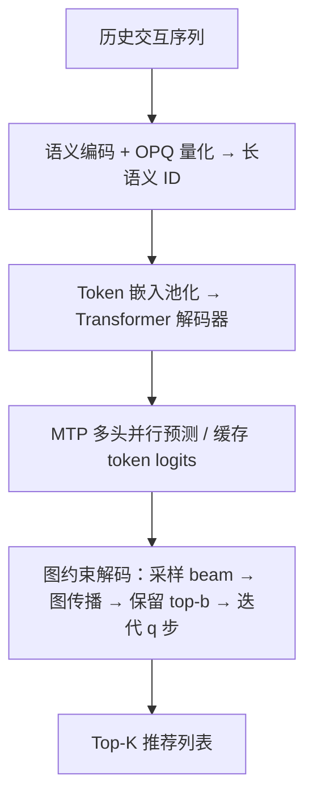
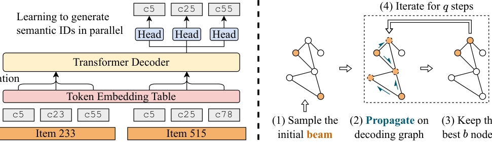

# Generating Long Semantic IDs in Parallel for Recommendation (面向推荐的并行长语义 ID 生成)

- **会议/期刊**: KDD 2025
- **作者与机构**: Yupeng Hou, Jiacheng Li, Ashley Shin, Jinsung Jeon, Abhishek Santhanam, Wei Shao, Kaveh Hassani, Ning Yao, Julian McAuley（UCSD & Meta AI）
- **推荐链路定位**: 端到端生成式召回
- **研究方向**: 生成式推荐与离散语义 ID / 序列推荐
- **论文原文**: [https://arxiv.org/abs/2506.05781v1](https://arxiv.org/abs/2506.05781v1)
- **开源代码**: [https://github.com/facebookresearch/RPG_KDD2025](https://github.com/facebookresearch/RPG_KDD2025)

## TL;DR (1分钟核心速览)

现有语义 ID 生成式推荐（TIGER 等）依赖自回归逐 token 生成 + beam search，导致推理需 $O(bm)$ 次前向、延迟高，语义 ID 被迫压缩到 4 位、表达力受限。RPG 改用**无序长语义 ID（OPQ 量化，最长 64 位）+ 多 token 并行预测（MTP）损失**，推理时用**图约束解码**在相似语义 ID 图上迭代传播，避免生成非法组合。在 Amazon 四个类目 Leave-Last-Out 全库排序下，NDCG@10 平均超最强生成式基线 12.6%，且推理内存降约 25×、速度提升约 15×。

## Background & Motivation (背景与核心矛盾)

- **主流范式**: 语义 ID 生成式推荐把物品量化为离散 token 序列，用 Transformer 自回归逐 token 生成下一物品的语义 ID，并以 beam search 解码 top-K 列表（TIGER、HSTU）。
- **前人局限一（效率）**: 自回归 + beam search 使单次推荐需约 $O(bm)$ 次序列模型前向，推理延迟与内存随 beam 与 ID 长度线性膨胀。
- **前人局限二（表达力）**: 为控制延迟，语义 ID 通常仅 4 位，难以承载丰富内容语义；而检索式方法（VQ-Rec）虽可用 32 位，却需与物品数成正比的运行时内存。
- **核心洞察 (Key Insight)**: OPQ 语义 ID 各 token 编码独立子向量，给定序列后条件独立，故可**并行预测所有 token**；且两 ID 仅少数位不同时，其 logit 和相近（图 2 实证），可借图结构引导解码。
- **本文切入点**: 用无序长 ID + MTP 损失实现单步并行生成，再用图约束解码在稀疏合法 ID 空间中高效搜索。

## Method (核心方法设计)

### 1. 整体框架 (Overall Architecture)

输入用户历史交互序列，每个物品先经语义编码器（如 text-embedding-3-large）得到稠密向量，再用 OPQ 量化为 $m$位无序语义 ID；各 token 经分码本嵌入表查表后池化为物品级表示$\boldsymbol{v}_i$，送入 Transformer 解码器得到序列表示$\boldsymbol{s}$。训练时对$m$ 个 token 分别用独立投影头做多 token 预测；推理时先缓存各码本 token logits，再在预构建的相似语义 ID 图上迭代传播 beam，输出 top-K。图 1 给出整体流程。

<figure class="paper-figure" markdown="span">
  <figcaption>图 1：RPG 的整体框架。</figcaption>
</figure>

### 2. 关键设计拆解 (Key Designs)

1. **无序长语义 ID 与 MTP 损失**：痛点在于自回归要求 token 有序依赖，限制长度。RPG 用 OPQ 生成 $m$位（至多 64）无序 ID，假设各 token 在给定$\boldsymbol{s}$ 下条件独立，损失为
$$\mathcal{L}=-\sum_{j=1}^{m}\log\frac{\exp(\boldsymbol{e}_{c_{t,j}}^{\top}\mathrm{g}_j(\boldsymbol{s})/\tau)}{\sum_{c\in\mathcal{C}^{(j)}}\exp(\boldsymbol{e}_{c}^{\top}\mathrm{g}_j(\boldsymbol{s})/\tau)}$$
其中 $\mathrm{g}_j$为第$j$ 位专属 MLP 投影头。该损失在 token 空间而非物品空间优化，既显式注入子物品语义，又天然支持并行预测。

2. **高效 logit 计算**：朴素枚举候选需 $O(Nmd)$。RPG 先缓存$\boldsymbol{p}^{(j)}=\mathrm{softmax}(\boldsymbol{E}_j\mathrm{g}_j(\boldsymbol{s})/\tau)\in\mathbb{R}^{M}$，候选 ID 的 logit 即$\sum_j\log \boldsymbol{p}^{(j)}_{c_j}$，复杂度降至$O(Mmd+Nm)$，与物品数解耦。

3. **图约束解码**：并行预测丢失 token 间依赖，$256^{32}$级空间中合法 ID 极稀疏。RPG 以物品为节点、以$\prod_j \boldsymbol{e}_{j,c_{1,j}}^{\top}\boldsymbol{e}_{j,c_{2,j}}$为边权构建相似 ID 图并保留 top-$k$边；解码时采样初始 beam，沿图扩展$b\times k$邻居、按缓存 logit 保留 top-$b$，迭代$q$步。因节点含自环，beam 平均 logit 单调不降，复杂度$O(Mmd+bqkm)$，与物品池大小无关。

## Experimental Setup & Evaluation Protocol (实验设置与评估协议)

- **数据集与预处理**: Amazon Reviews 四个类目，按时间排序构造交互序列：

| 数据集 | #Users | #Items | #Interactions | 平均序列长 | 说明 |
| :--- | :---: | :---: | :---: | :---: | :--- |
| Sports | 18,357 | 35,598 | 260,739 | 8.32 | 常用基准 |
| Beauty | 22,363 | 12,101 | 176,139 | 8.87 | 常用基准 |
| Toys | 19,412 | 11,924 | 148,185 | 8.63 | 常用基准 |
| CDs | 75,258 | 64,443 | 1,022,334 | 14.58 | 大规模（约 4× Sports） |

- **数据划分与防穿越**: `Leave-Last-Out`（最后一项测试、倒数第二项验证），序列按评论时间升序排列。
- **排名评测协议**: 无偏 `Full-Ranking`（对全库未交互物品排序），指标 Recall@{5,10} 与 NDCG@{5,10}，取验证集最优 checkpoint。
- **对比基线与超参**: 物品 ID 基线 Caser/GRU4Rec/HGN/BERT4Rec/SASRec/FDSA/S3-Rec；语义 ID 基线 RecJPQ/VQ-Rec/TIGER/HSTU。RPG 用 2 层 Transformer（$d=448$、FFN 1024、4 头，约 13M 参数对齐 TIGER），$\tau\in\{0.03,0.05,0.07\}$，$m\in\{4,8,16,32,64\}$，$b=10$，$k\in\{50,100,500\}$，$q\in\{2,3,5\}$；配对 t 检验$p<0.05$。

## Key Experimental Results (实验关键数据)

### 1. 主实验对比 (Main Results)

| Model | Sports R@10 | Sports N@10 | Beauty R@10 | Beauty N@10 | Toys R@10 | Toys N@10 | CDs R@10 | CDs N@10 |
| :--- | :---: | :---: | :---: | :---: | :---: | :---: | :---: | :---: |
| SASRec | 0.0350 | 0.0192 | 0.0605 | 0.0318 | 0.0675 | 0.0374 | 0.0619 | 0.0263 |
| S3-Rec | 0.0385 | 0.0204 | 0.0647 | 0.0327 | 0.0700 | 0.0376 | 0.0375 | 0.0182 |
| VQ-Rec | 0.0300 | 0.0173 | 0.0664 | 0.0383 | 0.0737 | 0.0423 | 0.0520 | 0.0292 |
| TIGER | 0.0400 | 0.0225 | 0.0648 | 0.0384 | 0.0712 | 0.0432 | 0.0748 | 0.0411 |
| HSTU | 0.0414 | 0.0215 | 0.0704 | 0.0389 | 0.0669 | 0.0357 | 0.0638 | 0.0346 |
| **RPG** | **0.0463** | **0.0263** | **0.0809** | **0.0464** | **0.0869** | **0.0490** | 0.0735 | **0.0415** |
| Improv. (N@10 vs 最强基线) | — | +16.9% | — | +19.3% | — | +13.4% | — | +1.0% |

RPG 在 12 项指标中 11 项第一，NDCG@10 平均提升 12.6%；CDs 上 R@10 略低于 TIGER（0.0735 vs 0.0748），但 N@10 反超。

### 2. 消融实验 (Ablation Study, NDCG@10)

| 变体 | Sports | Beauty | Toys | CDs |
| :--- | :---: | :---: | :---: | :---: |
| (1.1) OPQ → Random | 0.0179 | 0.0359 | 0.0288 | 0.0078 |
| (1.2) OPQ → RQ | 0.0242 | 0.0421 | 0.0458 | 0.0406 |
| (2.1) 无投影头 | 0.0252 | 0.0423 | 0.0430 | 0.0361 |
| (2.2) 共享投影头 | 0.0256 | 0.0424 | 0.0438 | 0.0368 |
| (3.1) beam search 解码 | 0.0000 | 0.0000 | 0.0000 | 0.0000 |
| (3.2) 去图约束 | 0.0082 | 0.0214 | 0.0205 | 0.0183 |
| **RPG** | **0.0263** | **0.0464** | **0.0490** | **0.0415** |

### 3. 关键实验发现 (Key Findings)

1. **语义 ID 必须承载语义**：随机 token 使 CDs N@10 从 0.0415 崩至 0.0078，说明 MTP 损失依赖 OPQ 子向量语义；RQ 替代 OPQ 亦全面下降（CDs 0.0406），印证 RQ 的信息分布不均与可扩展性缺陷。
2. **图约束解码是长 ID 可用的前提**：去掉图约束后 N@10 跌至 0.0082–0.0214，而传统 beam search 直接归零——因无序 OPQ ID 无序列依赖，beam search 陷入局部最优；$q$从 0 增至 2 提升显著、$q>2$饱和，$k>100$ 收益递减。
3. **长 ID 与强编码器协同增益**：Sports/Toys 最优长度 16、Beauty 32、CDs 64，性能随长度单调上升；同一 sentence-t5-base 下 RPG 长 ID 已超 TIGER，换 text-embedding-3-large 后进一步提升（Sports N@10 0.0238→0.0263），而 TIGER 换强编码器并不稳定受益。冷启动分组 [0,5] 等四档中 RPG 全面领先，验证 MTP 对长尾物品语义的学习能力。

## Highlights & Limitations (亮点、对比与审稿批判)

- **与代表作对比**: 相较 TIGER（RQ-VAE + 自回归 + beam search），RPG 把每实例前向次数从 $O(bm)$降到$O(1)$，且 ID 长度可扩至 64；相较 VQ-Rec（检索式、内存随物品数增长），RPG 推理内存与时间均与物品池无关，且显式优化子物品语义；相较 HSTU（离散特征 token 生成），RPG 用 OPQ 无序 ID + 图解码获得更强表达力。
- **可迁移亮点**: (i) "缓存 token logits + 候选 ID 求和" 的 logit 计算可迁移到任何乘积量化召回场景；(ii) 以相似 ID 图做迭代 beam 精化的思路，可复用于其他无序码本解码任务。
- **审稿级局限批判**: (i) 需预构建并存储 top-$k$ 相似 ID 图与 token 嵌入表，总存储高于纯生成式模型（表 8），物品更新需重建图；(ii) 4 位 ID 下 RPG 明显弱于 TIGER（Sports N@10 0.0117 vs 0.0243），方法优势强依赖长 ID 与强语义编码器，短 ID 场景不适用；CDs 上 R@10 未超 TIGER，Recall 与 NDCG 结论不完全一致。

## Rating (四维评分)

- **方法创新性 (Novelty)**: ⭐⭐⭐⭐ （以"无序长 ID + MTP 并行 + 图约束解码"重构生成式推荐范式，洞察清晰但各组件均有前作影子）
- **评估协议与实验扎实度 (Protocol & Experiments)**: ⭐⭐⭐⭐ （四数据集含大规模 CDs、全库排序、显著性检验与完整消融，但缺线上 A/B 与采样排序对照）
- **写作与数学规范度 (Clarity & Rigor)**: ⭐⭐⭐⭐ （MTP 损失与复杂度推导清晰，条件独立假设的合理性论证略简）
- **工业落地与复现价值 (Industrial & Practical Value)**: ⭐⭐⭐⭐⭐ （代码开源，推理内存降 25×、提速 15×，与物品数解耦，工程价值突出）

