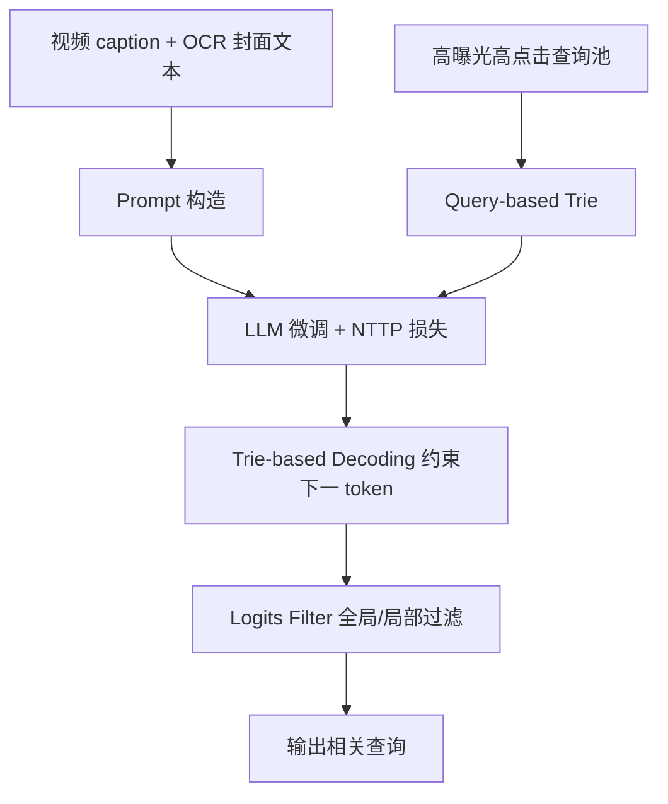
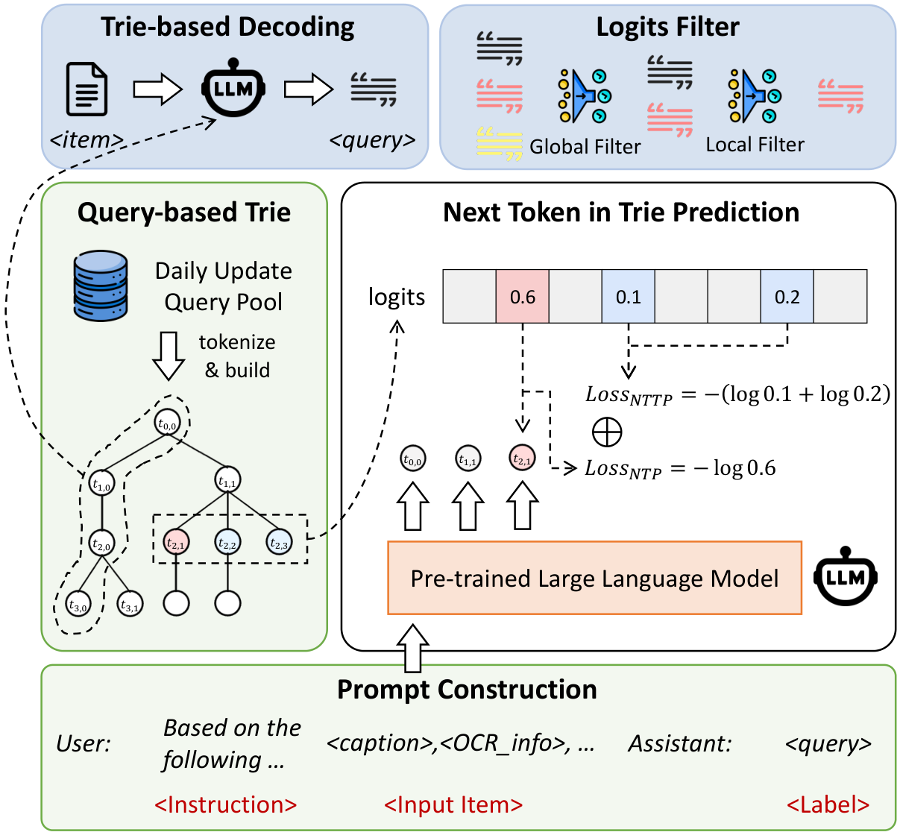

# GREAT: Guiding Query Generation with a Trie for Recommending Related Search about Video at Kuaishou (以 Trie 引导查询生成的短视频相关搜索推荐)

- **会议/期刊**: KDD 2025
- **作者与机构**: Ninglu Shao (中国人民大学)、Jinshan Wang、Chenxu Wang、Qingbiao Li、Han Li (快手科技)、Xiaoxue Zang
- **推荐链路定位**: 端到端生成式（召回/生成一体）
- **研究方向**: 生成式推荐与离散语义 ID / 大语言模型推荐
- **论文原文**: [https://arxiv.org/abs/2507.15267v1](https://arxiv.org/abs/2507.15267v1)
- **开源代码**: [https://github.com/rainym00d/KuaiRS](https://github.com/rainym00d/KuaiRS)

## TL;DR (1分钟核心速览)

本文首次系统定义短视频相关搜索中的 Item-to-Query (I2Q) 推荐任务，并发布快手真实数据集 KuaiRS（102 万 video-query 对）。针对检索式双塔缺乏深度交互、纯生成式 LLM 幻觉与字面质量差的两难，提出 GREAT：用高曝光高点击查询构建 Trie，训练时加 NTTP 辅助损失、推理时做 Trie 约束解码 + Logits Filter 后处理。离线 Edit@1 达 4.34（优于微调 Qwen 的 4.48），线上 5 天 A/B 曝光 +0.251%、CTR +0.174%、搜索结果页 CTR +0.396%，相关性 +5.5%、字面质量 +6.0%。

## Background & Motivation (背景与核心矛盾)

- **主流范式**: 工业界 I2Q 以检索式为主——item 与 query 分别过 BERT 类编码器得 embedding，再算相似度召回；近期出现直接用 LLM 生成 query 的生成式路线。
- **前人局限**: ① 双塔独立编码，item 与 query 之间无深度交互，效果上限受限；② 纯生成式虽保证相关性，但缺乏高质量领域数据，易产生错别字、谣言等字面质量问题，且风格与平台不符。
- **核心洞察 (Key Insight)**: 平台已积累大量高曝光、高点击的真实查询，这些查询本身就是"高质量答案空间"；若把该空间组织成 Trie，就能在训练与解码两端同时约束 LLM 的输出分布。
- **本文切入点**: 用 Trie 把"检索式的可控性"注入"生成式的深度语义理解"，兼顾相关性、有效性与字面质量。

## Method (核心方法设计)

### 1. 整体框架 (Overall Architecture)

GREAT 由五模块构成：Prompt 构造（拼接 caption 与 OCR 封面文本）、Query-based Trie（每日更新、15 天时间窗、按 LLM tokenizer 分词建树）、NTTP 训练任务、Trie-based Decoding 推理、Logits Filter 后处理。训练阶段在标准 NTP 之外，额外要求模型关注 Trie 中当前路径的子节点集合，使训练与推理的候选空间对齐；推理阶段把候选词表收缩为 Trie 子节点，再用全局/局部 logits 阈值过滤低质结果，形成"生成—约束—过滤"闭环。

<figure class="paper-figure" markdown="span">
  <figcaption>图2：GREAT的框架。在数据准备阶段，我们为LLM的输入构建提示词，并通过收集高曝光和高点击率的查询词构建基于查询词的trie。在训练阶段，引入NTTP任务以提升LLM生成高质量查询词的能力。在推理阶段，基于Trie的解码引导LLM生成下一个token，减少查询词中的幻觉和谣言，而Logits Filter进一步过滤低质量结果，确保查询词的高相关性和字面质量。</figcaption>
</figure>

### 2. 关键设计拆解 (Key Designs)

1. **NTTP：把 Trie 结构写进训练损失**：仅用 NTP 学不到平台查询风格，故在预测 $t_i$时，额外要求模型对 Trie 中路径$s_{i-1}$的子节点集合$\mathrm{Trie}(s_{i-1})$给出高概率：$\mathcal{L}_{NTTP}=\sum_{t_j\in \mathrm{Trie}(s_{i-1})}\log p_{t_j}$。直觉是让模型在训练时就"看见"高质量查询的分支结构，缩小训练/推理候选空间错配。

2. **Trie-based Decoding：把束搜索换成树搜索**：推理时不再对全词表 softmax，而是仅在当前节点的子节点中按 logits 选 token；单子节点时直接确定，多子节点时比较 logits。这从根上消除词表外幻觉与错别字，同时显著降低解码计算量。

3. **Logits Filter 与训练目标**：总损失 $\mathcal{L}=\mathcal{L}_{NTP}+\alpha\cdot\mathcal{L}_{NTTP}$（$\alpha=0.1$）。后处理用全局分$F_G(q)=\frac{1}{n}\sum_{i=0}^{n}p_{t_i}$与局部分$F_L(q)=\min(p_{t_0},\dots,p_{t_n})$双阈值（$\theta_G=0.2,\theta_L=0.05$）过滤。基座为 Qwen 2.5 1.5B，学习率 5e-5，总 batch 128，8×V100 训练；生成式范式无需负采样。

## Experimental Setup & Evaluation Protocol (实验设置与评估协议)

- **数据集与预处理**: KuaiRS 取自快手 2024-05-23 至 05-29 用户日志，过滤曝光 <1000 或点击 <10 的样本，并用 MBVR 相似度阈值 0.44 保证 item-query 相关性，另过滤敏感词。

| 数据集 | #Users | #Items | #Interactions | 稀疏度/密度 | 特征/场景说明 |
| :--- | :---: | :---: | :---: | :---: | :--- |
| KuaiRS-Train | — | 439,896 | 1,000,000 | 每 video 约 2 query | caption 均长 32.55，OCR 均长 16.24，query 均长 7.41 |
| KuaiRS-Valid | — | 7,814 | 10,000 | 每 video 约 1 query | caption 均长 35.15 |
| KuaiRS-Test | — | 7,791 | 10,000 | 每 video 约 1 query | caption 均长 34.85 |

- **数据划分与防穿越 (Splitting Strategy)**: 按时间排序取前 100 万条为训练集，剩余 2 万条随机均分为验证/测试集（时间切分 + 随机留出混合）。
- **排名评测协议 (Ranking Protocol)**: 离线采用新提出的 `Edit@k`——计算 top-k 生成结果与 ground truth 的平均编辑距离（越小越好），可兼容生成结果落在查询池外的情况；线上采用 5 天 A/B，指标含曝光、CTR、搜索结果页 CTR、人工标注相关性与字面质量合格率。
- **对比基线与超参设置**: 基线含 SimCSE、bge-base/large-zh-v1.5（原始与微调）、Qwen 2.5 1.5B（zero-shot 与微调）；离线为公平比较召回量未启用 Logits Filter。

## Key Experimental Results (实验关键数据)

### 1. 主实验对比 (Main Results)

| Method | Edit@1 | Edit@5 | Edit@10 | Edit@20 | avg. |
| :--- | :---: | :---: | :---: | :---: | :---: |
| SimCSE | 4.81 | 5.37 | 5.69 | 6.01 | 5.47 |
| bge-base-zh-v1.5 | 5.43 | 5.97 | 6.27 | 6.59 | 6.07 |
| bge-large-zh-v1.5 fine-tuned | 4.71 | 5.35 | 5.62 | 5.94 | 5.41 |
| Qwen 2.5 1.5B zero-shot | 9.37 | 15.24 | 17.89 | 19.92 | 15.60 |
| Qwen 2.5 1.5B fine-tuned | 4.48 | 5.28 | 5.73 | 6.10 | 5.40 |
| **GREAT (Ours)** | **4.34** | **5.20** | **5.53** | **5.80** | **5.22** |

线上 A/B（相对基线，5 天均值）：

| Method | Exposure | CTR | CTR_SRP | Relevance | Literal Quality |
| :--- | :---: | :---: | :---: | :---: | :---: |
| SimCSE | +0.062% | +0.027% | -0.053% | +1.0% | -0.5% |
| bge-large fine-tuned | +0.127% | +0.079% | -0.088% | +2.5% | -1.5% |
| Qwen 2.5 1.5B fine-tuned | -0.158% | +0.109% | -0.146% | +7.5% | -5.0% |
| **GREAT (Ours)** | **+0.251%** | **+0.174%** | **+0.396%** | **+5.5%** | **+6.0%** |

### 2. 消融实验 (Ablation Study)

| Setting | Edit@1 | Edit@5 | Edit@10 | Edit@20 | Relevance | Literal Quality |
| :--- | :---: | :---: | :---: | :---: | :---: | :---: |
| GREAT | **4.34** | **5.20** | **5.53** | **5.80** | +6.22% | +6.91% |
| w/o NTTP | 4.42 | 5.25 | 5.68 | 5.97 | +5.04% | +3.03% |
| w/o Trie-based Decoding | 4.37 | 5.24 | 5.62 | 5.93 | +7.21% | +0.4% |
| w/o Both | 4.48 | 5.28 | 5.73 | 6.10 | — | — |
| w/o Logits Filter | — | — | — | — | +1.68% | +2.8% |

### 3. 关键实验发现 (Key Findings)

1. **生成式显著优于检索式，Trie 再进一步**：微调 Qwen 的 Edit@1 为 4.48，已优于最强检索基线 bge-large 微调的 4.71；GREAT 再降至 4.34，说明 NTTP 与 Trie 解码在生成式基础上仍有稳定增益。
2. **两模块互补且缺一不可**：单独去掉 NTTP（4.42）或 Trie 解码（4.37）均劣于完整模型，但都优于纯微调（4.48）；而去掉 Trie 解码后相关性反而最高（+7.21%）但字面质量骤降至 +0.4%，印证"无约束生成更相关但更不真实"的权衡。
3. **线上避免跷跷板效应**：微调 Qwen 相关性 +7.5% 却使曝光 -0.158%、字面质量 -5.0%；GREAT 是唯一在曝光、CTR、搜索结果页 CTR、相关性、字面质量五项上全部为正的方法，且 5 天内指标逐日上升，体现数据积累带来的持续增益。

## Highlights & Limitations (亮点、对比与审稿批判)

- **与代表作对比 (vs. Prior Work)**: 相比 SimCSE/BGE 双塔检索，GREAT 用 LLM 实现 item 与 query 的深度语义交互；相比纯微调 Qwen 生成，GREAT 通过 Trie 在训练（NTTP）与推理（约束解码）两端注入高质量查询先验，解决了后者字面质量崩塌的问题。
- **可迁移亮点**: ① "高质量候选池 → Trie → 训练辅助损失 + 约束解码"这一范式可迁移到语义 ID 生成式召回、标签/标题生成等开放词表生成任务；② Edit@k 指标为生成式检索提供了兼容池外输出的评测思路。
- **审稿级局限批判**: ① 离线仅用编辑距离衡量，未评估多样性、覆盖率与长尾查询的生成能力；② Trie 依赖每日更新与 15 天窗口，冷门/新兴 query 无法被生成，存在系统性覆盖偏差；③ 线上收益为相对值且幅度较小（曝光 +0.251%），缺乏与更大规模 LLM 或 RAG 式方案的对比。

## Rating (四维评分)

- **方法创新性 (Novelty)**: ⭐⭐⭐⭐ （Trie 同时约束训练损失与解码路径的思路简洁有效，但本质是受控解码的工程化组合）
- **评估协议与实验扎实度 (Protocol & Experiments)**: ⭐⭐⭐⭐ （离线+5 天线上 A/B+人工评测较完整，但离线指标单一、缺多样性分析）
- **写作与数学规范度 (Clarity & Rigor)**: ⭐⭐⭐⭐ （框架图与公式清晰，NTTP 与 Logits Filter 定义明确，理论分析偏薄）
- **工业落地与复现价值 (Industrial & Practical Value)**: ⭐⭐⭐⭐⭐ （真实快手场景落地、开源 KuaiRS 数据集与代码，1.5B 小模型即可上线，工程价值高）

