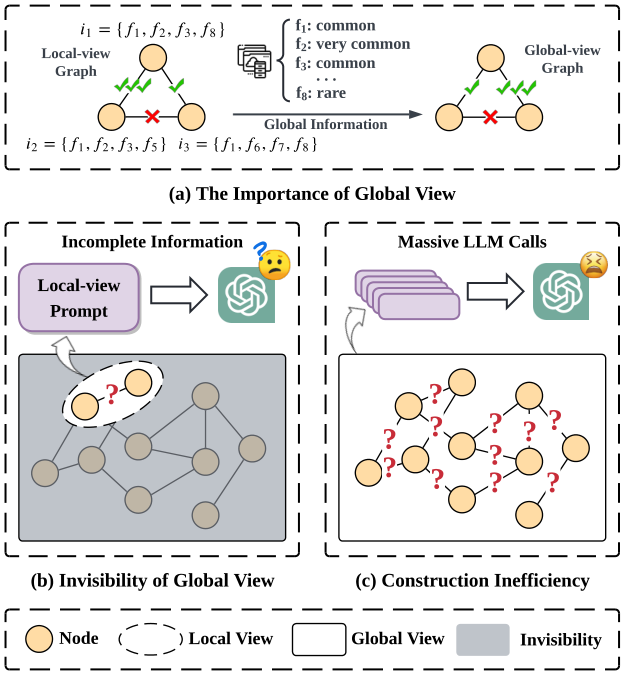
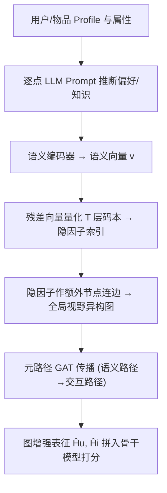

# An Automatic Graph Construction Framework based on Large Language Models for Recommendation (基于大语言模型的推荐自动图构建框架)

- **会议/期刊**: KDD 2025
- **作者与机构**: Rong Shan, Jianghao Lin, Weinan Zhang 等（上海交通大学）；Chenxu Zhu, Bo Chen, Jieming Zhu, Ruiming Tang（华为诺亚方舟实验室）
- **推荐链路定位**: 召回（图增强表征，可插拔至多种骨干）
- **研究方向**: 图神经网络与知识图谱推荐 / 大语言模型推荐
- **论文原文**: [https://arxiv.org/abs/2412.18241v2](https://arxiv.org/abs/2412.18241v2)
- **开源代码**: [https://github.com/LaVieEnRose365/AutoGraph](https://github.com/LaVieEnRose365/AutoGraph)

## TL;DR (1分钟核心速览)

现有 GNN 推荐几乎只优化"给定图上的模型结构"，而构图阶段被忽视；用 LLM 构图的前作又受困于**全局视野缺失**（pairwise 局部比较）与 **$O(N^2)$调用不可扩展**。AutoGraph 改为**逐点**让 LLM 推断用户偏好/物品知识并编码为语义向量，再用**残差向量量化**抽取隐因子作为额外节点连边，从而以$O(N)$ 调用获得全局视野图，并配以元路径消息传播。在三个公开数据集、四种骨干、Full-Ranking 协议下 NDCG@10 相对最优基线最高提升 **43.57%**，华为广告线上 A/B 提升 RPM **2.69%**、eCPM **7.31%**。

## Background & Motivation (背景与核心矛盾)

- **主流范式**: LightGCN/CCGNN 等在**预定义图**（点击连边、实体抽取、知识图谱人工标注）上做 GCN 传播与学习策略优化，构图被视为既定前提。
- **前人局限**: 规则构图过于浅层，无法刻画复杂语义信号；人工标注知识图谱成本高、难扩展。LLM 构图路线（TopoI2I 等）虽自动化，但 (1) 受 LLM 上下文窗口与数据规模限制，只能做**局部 pairwise 比较**，看不到全局特征频率等上下文；(2) pairwise 调用复杂度 $O(N^2)$，百万级用户/物品下不可行，降采样/预过滤又引入噪声。
- **核心洞察 (Key Insight)**: 图 1(a) 的例子极具说服力——若 $i_1=\{f_1,f_2,f_3,f_8\}$、$i_2=\{f_1,f_2,f_3,f_5\}$、$i_3=\{f_1,f_6,f_7,f_8\}$，局部看$i_1$更像$i_2$；但一旦知道$f_8$是稀有特征，$i_1$–$i_3$ 的关联应被显著增强。**全局统计量会翻转最优图结构**，而 pairwise LLM 永远看不到它。
- **本文切入点**: 用**向量量化码本**充当"全局语义聚类中心"，把逐点语义向量映射到共享隐因子上，隐因子天然携带全局视野，且构图只需 $O(N)$ 次 LLM 调用。

<figure class="paper-figure" markdown="span">
  <figcaption>图1：(a) 全局视图信息（如全局特征频率）可改变最优图结构的重要性说明，以及现有基于LLM的图构建方法的两个局限，包括(b) 全局视图不可见和(c) 构建效率低下。</figcaption>
</figure>

## Method (核心方法设计)

### 1. 整体框架 (Overall Architecture)

AutoGraph 分两阶段。**阶段一（量化构图）**：对每个用户/物品单独构造 prompt，调用 LLM 生成偏好/知识描述，经语义编码器得到语义向量 $v$；随后用$T$层残差量化把$v$压缩为$T$个码本索引（隐因子）；最后把每个隐因子视为**额外节点**，与对应用户/物品连边，得到含$\{U,I,Q^u,Q^i\}$四类节点的异构图。**阶段二（图增强推荐）**：在该图上按四条元路径做 GAT 消息传播，先语义路径后交互路径，得到图增强表征$\hat{H}_u,\hat{H}_i$，作为辅助特征拼入任意下游推荐模型打分。整个框架 model-agnostic，构图与训练解耦。

### 2. 关键设计拆解 (Key Designs)

1. **逐点语义向量生成（把 $O(N^2)$压到$O(N)$）**：痛点是对比式构图必须两两调 LLM。本文改为对每个节点单独调用一次，$v_{uj}=\mathrm{Encoder}(\mathrm{LLM}(\mathcal{T}_{uj}))\in\mathbb{R}^{D_v}$，调用次数降为$O(N)$；若用开源 LLM 可直接取最后一层隐状态当语义向量，省去额外编码器。这是效率提升的第一根支柱。

2. **残差向量量化抽取隐因子（全局视野的真正来源）**：逐点语义向量噪声大且彼此孤立，无法直接构图。本文用 $T$个码本$\{C_t\}_{t=1}^T$（每本$K$个码向量）做残差量化：$m_t=\arg\min_k\|r_t-c^t_k\|_2^2$，$r_{t+1}=r_t-c^t_{m_t}$，$r_1=x$（DNN 编码输出），量化表示$\hat{x}=\sum_{t=1}^T c^t_{m_t}$再经解码器重构$v$。训练目标为重构损失 + commitment 损失：
$$\mathcal{L}_{rq}=\|v-\hat{v}\|_2^2+\sum_{t=1}^{T}\left(\|\mathrm{sg}[r_t]-c^t_{m_t}\|_2^2+\beta\|r_t-\mathrm{sg}[c^t_{m_t}]\|_2^2\right)$$
**直觉**：码本是在**全体用户/物品语义向量上联合学习**的共享聚类中心，因此"某用户落在第 $t$层第$k$ 个码字"这一事件本身就编码了全局分布信息——两个共享同一隐因子的用户/物品被隐式判定为语义相近，无需任何 pairwise 比较。用户侧与物品侧各训一套参数。

3. **元路径消息传播与训练目标**：图上定义四条元路径——交互路径 $i\to u$、$u\to i$，语义路径$u\to q\to u$、$i\to q\to i$。先用 GAT 在语义路径上聚合得$H_u,H_i$，再在交互路径上以$H_u\cup H_i$为输入聚合得$\hat{H}_u,\hat{H}_i$（式 7–8），实现"先语义、后协同"的两级融合。GAT 注意力为标准的$\alpha_{tj}=\mathrm{softmax}_j(\mathrm{LeakyReLU}(\mathbf{a}^\top[W e_t\|W e_j]))$。最终$\mathrm{score}=\Phi(S_u,F_u,F_i,\hat{H}_u,\hat{H}_i)$。量化阶段为自监督重构（无负采样），推荐阶段沿用各骨干原有损失（如 SASRec 的 next-item CE / YouTubeDNN 的 sampled softmax），推理时仅需一次前向查表，无额外 LLM 调用。

## Experimental Setup & Evaluation Protocol (实验设置与评估协议)

- **数据集与预处理**: MovieLens-1M、Amazon-Books、BookCrossing 三个公开数据集（统计表置于附录 B，正文未列全量数字），沿用前作的标准过滤与序列构造流程。

- **数据划分与防穿越 (Splitting Strategy)**: 采用序列推荐的 **Leave-One-Out** 式划分（最后一项测试、倒数第二项验证），与 SASRec/GRU4Rec 系基线一致。

- **排名评测协议 (Ranking Protocol)**: 采用 **Full-Ranking（全库未交互物品排序）**，指标为 NDCG@10、HR@10、MRR、GAUC，截断 $K=10$；显著性检验为$p<0.001$（表中$*$ 标注）。

- **对比基线与超参设置**: 四类骨干（YouTubeDNN / MIND / GRU4Rec / SASRec，分别覆盖 DNN、胶囊网络、GRU、自注意力四种算子）；基线分两组——LLM 增强类 KAR、UIST，图增强类 LightGCN、CCGNN、TopoI2I。LLM 侧线上使用华为 PanGu。

## Key Experimental Results (实验关键数据)

### 1. 主实验对比 (Main Results)

以最强骨干 SASRec 为例（其余骨干趋势一致）：

| 模型 (SASRec 骨干) | ML-1M NG@10 | ML-1M HR@10 | ML-1M MRR | Amz-Books NG@10 | Amz-Books HR@10 | BX NG@10 | BX GAUC |
| :--- | :---: | :---: | :---: | :---: | :---: | :---: | :---: |
| SASRec (vanilla) | 0.0823 | 0.1672 | 0.0721 | 0.0802 | 0.1543 | 0.0952 | 0.8142 |
| + KAR | 0.0896 | 0.1788 | 0.0786 | 0.0852 | 0.1588 | 0.1043 | 0.8138 |
| + UIST | 0.0882 | 0.1707 | 0.0787 | 0.0862 | 0.1638 | 0.1078 | 0.8298 |
| + LightGCN | 0.0829 | 0.1652 | 0.0733 | 0.0845 | 0.1553 | 0.0960 | 0.8145 |
| + CCGNN | 0.0867 | 0.1717 | 0.0768 | 0.0855 | 0.1588 | 0.1055 | 0.8230 |
| + TopoI2I | 0.0917 | 0.1825 | 0.0798 | 0.0864 | 0.1604 | 0.1026 | 0.8177 |
| **+ AutoGraph** | **0.1047** | **0.1924** | **0.0941** | **0.0959** | **0.1797** | **0.1114** | **0.8376** |
| **Rel.Impr** | **+14.22%** | **+5.46%** | **+17.98%** | **+10.99%** | **+9.76%** | **+3.28%** | **+0.94%** |

YouTubeDNN 骨干上提升更猛：ML-1M NDCG@10 从 0.0492（KAR）升至 0.0707，**+43.57%**；MRR **+48.14%**。MIND 骨干 ML-1M NDCG@10 **+18.41%**、MRR **+21.05%**。唯一负向点是 YouTubeDNN 在 Amazon-Books 的 GAUC（−0.65%），说明 GAUC 在稀疏数据上对图增强不敏感。

**效率对比（表 2）**：初始构图复杂度 LightGCN $O(1)$/ CCGNN$O(N)$/ TopoI2I$O(NE)$/ AutoGraph$O(N)$；实际耗时 ML-1M 上 TopoI2I 需 **190 小时**，AutoGraph 仅 **18 小时**（含 LLM 调用），CCGNN 5 分钟但效果最差。增量节点插入 AutoGraph 为$O(1)$、约 6.6 秒，TopoI2I 需$O(E)$、约 193 秒。平均 GAUC 相对提升：AutoGraph **2.81%** vs. TopoI2I 1.18%、CCGNN 0.93%、LightGCN 0.50%。

### 2. 消融实验 (Ablation Study)

| 图变体 (YouTubeDNN / MIND) | ML-1M NG@10 | ML-1M HR@10 | ML-1M MRR | Amz-Books NG@10 | Amz-Books MRR |
| :--- | :---: | :---: | :---: | :---: | :---: |
| AutoGraph (full) | **0.0707 / 0.0643** | **0.1221 / 0.1166** | **0.0686 / 0.0622** | **0.0609 / 0.0737** | **0.0545 / 0.0656** |
| w/o $u\to q\to u$ | 0.0526 / 0.0560 | 0.0990 / 0.1057 | 0.0516 / 0.0545 | 0.0491 / 0.0593 | 0.0458 / 0.0532 |
| w/o $i\to q\to i$ | 0.0454 / 0.0467 | 0.0961 / 0.0975 | 0.0434 / 0.0450 | 0.0480 / 0.0553 | 0.0433 / 0.0504 |
| w/o $u\to i$&$i\to u$ | 0.0546 / 0.0594 | 0.1065 / 0.1102 | 0.0522 / 0.0572 | 0.0546 / 0.0662 | 0.0492 / 0.0590 |
| $N/A$ (vanilla) | 0.0418 / 0.0462 | 0.0888 / 0.0979 | 0.0402 / 0.0437 | 0.0432 / 0.0519 | 0.0394 / 0.0461 |

### 3. 关键实验发现 (Key Findings)

1. **语义路径比交互路径更值钱**：去掉 $i\to q\to i$ 后 YouTubeDNN 在 ML-1M 的 NDCG@10 从 0.0707 跌到 0.0454（−35.8%），跌幅甚至大于去掉两条交互路径（0.0546，−22.8%）。这直接证明增益主要来自 LLM 语义 + 量化隐因子带来的全局视野，而非又一层协同过滤传播。
2. **增益与骨干容量呈"补短板"关系**：最弱的 YouTubeDNN 拿到最大相对提升（NDCG@10 +43.57%），最强的 SASRec 只有 +14.22%，说明图增强表征提供的是骨干自身难以从 ID/序列中学到的语义补充信号，而非简单叠加容量。
3. **效率与效果同时占优，且可增量更新**：AutoGraph 构图耗时约为 TopoI2I 的 1/10（18h vs. 190h），增量插入快 29 倍（6.6s vs. 193.6s），同时平均 GAUC 提升是后者的 2.4 倍——$O(N)$ 逐点范式没有以质量为代价换取效率。

## Highlights & Limitations (亮点、对比与审稿批判)

- **与代表作对比 (vs. Prior Work)**: 与 **KAR/UIST** 的本质区别在于后两者只把 LLM 语义当**附加特征**喂给模型，不做多跳邻居聚合；与 **TopoI2I** 的区别在于后者仍是 pairwise 局部相似度增删边，$O(N^2)$ 且无全局统计；与 **LightGCN/CCGNN** 的区别在于图本身由学习得到的量化码本自动生成，而非规则或 NER 抽取。
- **可迁移亮点**: (1) "逐点 LLM 调用 + 向量量化聚类"是把任意节点级 LLM 语义转成**全局可比较离散结构**的通用配方，可迁移到跨域对齐、多模态 ID 生成；(2) 码本索引天然可做增量插入（新节点只需量化查表），非常适合流式工业场景。
- **审稿级局限批判**: (1) 初始构图仍需 18–202 小时，瓶颈在 LLM 逐点推理，论文未给出蒸馏或缓存复用方案；(2) 码本大小 $K$、层数$T$、commitment 系数$\beta$ 等超参敏感性只在附录 F 简述，正文缺乏系统分析；(3) 线上 A/B 仅报告 RPM/eCPM 两个商业指标，未披露 CTR 或用户侧长期指标，且实验组仅 10% 流量、为期十天，统计功效有限。

## Rating (四维评分)

- **方法创新性 (Novelty)**: ⭐⭐⭐⭐ （首次把残差向量量化引入 LLM 构图，"码本即全局视野"的洞察简洁且有说服力，但量化本身是成熟技术）
- **评估协议与实验扎实度 (Protocol & Experiments)**: ⭐⭐⭐⭐ （三数据集 × 四骨干 × Full-Ranking + $p<0.001$ 显著性 + 效率表 + 线上 A/B，覆盖完整；扣分在数据集统计与超参分析被挤到附录）
- **写作与数学规范度 (Clarity & Rigor)**: ⭐⭐⭐⭐ （两阶段流程与四条元路径定义清晰，量化公式规范；元路径聚合的式 7–8 略简，缺少对 $H_u\cup H_i$ 拼接方式的细节说明）
- **工业落地与复现价值 (Industrial & Practical Value)**: ⭐⭐⭐⭐⭐ （已开源，华为广告主流量模型，RPM +2.69% / eCPM +7.31%，增量插入 $O(1)$，model-agnostic 可直接插拔）

