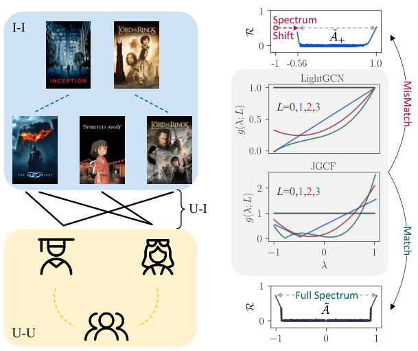
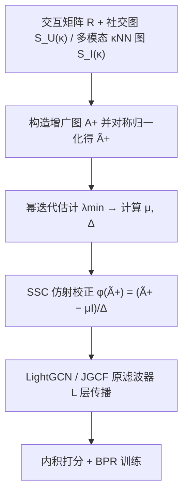

# Collaborative Filtering Meets Spectrum Shift: Connecting User-Item Interaction with Graph-Structured Side Information (协同过滤遇上频谱偏移：连接用户-物品交互与图结构化辅助信息)

- **会议/期刊**: KDD 2025
- **作者与机构**: Yunhang He, Cong Xu, Jun Wang, Wei Zhang（华东师范大学 & 上海创智学院）
- **推荐链路定位**: 召回（图协同过滤表征学习）
- **研究方向**: 图神经网络与知识图谱推荐 / 多模态推荐
- **论文原文**: [https://arxiv.org/abs/2502.08071v2](https://arxiv.org/abs/2502.08071v2)
- **开源代码**: [https://github.com/yhhe2004/SSC-KDD](https://github.com/yhhe2004/SSC-KDD)

## TL;DR (1分钟核心速览)

将社交网络或多模态 κNN 相似图并入 U-I 二部图后，增广邻接矩阵的最高频率不再落在 $-1$，而是随辅助信息强度右移，导致 LightGCN/JGCF 等基于"全频谱$[-1,1]$假设"的滤波器给错频率权重。本文提出 SSC：用平移因子$\mu$与缩放因子$\Delta$把偏移谱拉回$[-1,1]$，数学上等价于直接对$\tilde{A}_+$ 做仿射变换，零额外推理开销。在 3 个多模态与 2 个社交数据集、8:1:1 比例划分下，LightGCN+SSC 相对提升最高 23.33%（Baby R@10），并全面超越 FREEDOM、MMSSL、DSL 等专用模型。

## Background & Motivation (背景与核心矛盾)

- **主流范式**: 图协同过滤以 U-I 二部图为输入，LightGCN 等价于固定低通多项式滤波器，JGCF 用 Jacobi 基同时强调低频与高频；社交/多模态推荐则另设专用模块或辅助损失来注入辅助图。
- **前人局限**: ① 专用模块（LATTICE 动态图、SHaRe 图重写、MMSSL 对比损失）与数据类型强绑定，换任务即失效，且对辅助信息噪声敏感（κNN 邻居增多时甚至劣于不用辅助信息）；② 直接把辅助图并入增广图 $\tilde{A}_+$ 再套用 LightGCN/JGCF，性能仍不及专用模型。
- **核心洞察 (Key Insight)**: 作者用绝对 Rayleigh 商 $\mathcal{R}(U_{:,\lambda};B)=|x^\top Bx|/x^\top x$度量各频率对测试图$B$的重要性，发现随 κ 增大，$\lambda_{\min}$单调右移（κ-rescaling 收敛到$\min(\lambda_{\min}(\tilde{S}),0)$，κNN 收敛到$\approx 0$），而$\lambda_{\max}\equiv 1$ 固定——全频谱假设崩塌，滤波器权重与真实重要性错配。
- **本文切入点**: 不重设计滤波器，而是把偏移后的谱"搬回"滤波器预设的定义域，让现成频谱 GNN 直接复用。

<figure class="paper-figure" markdown="span">
  <figcaption>图1：(a) 图结构辅助信息的整合导致(b) 频谱偏移。LightGCN 和 JGCF 针对 ˜𝐴 的全频谱设计，应用于增强邻接矩阵 ˜𝐴+ 时不可避免地产生不匹配。</figcaption>
</figure>

## Method (核心方法设计)

### 1. 整体框架 (Overall Architecture)

输入为交互矩阵 $R$与图结构化辅助信息（用户社交图$S_U(\kappa)=\kappa S_U$或物品多模态 κNN 平均图$S_I(\kappa)$），先拼成增广图$A_+$并做对称归一化得$\tilde{A}_+$；随后用幂迭代粗估$\lambda_{\min}$，算出$\mu,\Delta$并对$\tilde{A}_+$施加仿射校正；校正后的图直接喂入未改动的 LightGCN 或 JGCF 滤波器做$L$ 层传播，最后以内积打分、BPR 损失训练。整个校正发生在构图阶段，训练与推理图规模不变。

### 2. 关键设计拆解 (Key Designs)

1. **频谱偏移校正算子 SSC**：痛点是滤波器 $g(\lambda)$按$[-1,1]$设计，而$\tilde{A}_+$的谱被压缩到$[\lambda_{\min},1]$。本文定义复合滤波$g^+(\lambda)=g\circ\phi(\lambda)$，其中$\phi(\lambda)=(\lambda-\mu)/\Delta$；取$\mu=(\lambda_{\max}+\lambda_{\min})/2$、$\Delta=(\lambda_{\max}-\lambda_{\min})/2$ 即可精确还原全谱。关键恒等式是它无需特征分解：
$$\phi(\tilde{A}_+)=\frac{1}{\Delta}(\tilde{A}_+-\mu I).$$
直觉上这只是对邻接矩阵做一次"减均值除半宽"的标准化，把被辅助图压扁的谱重新拉伸，使低频/高频重新落到滤波器预期的响应区间。

2. **因子估计与骨干适配**：$\lambda_{\max}\equiv 1$已知，只需估$\lambda_{\min}$，利用$1-\text{power\_iteration}(I-\tilde{A}_+)\approx\lambda_{\min}$（100 次迭代）即可，几行代码完成。代入 LightGCN 得$H=\sum_{l=0}^{L}\frac{1}{L+1}\left(\frac{1}{\Delta}(\tilde{A}_+-\mu I)\right)^l E$；代入 JGCF 则把 Jacobi 基$P_l^{a,b}$的自变量换成$\phi(\lambda)$，从而在偏移谱上仍近似保持基的正交性。作者强调精确校正未必最优（真实变换比仿射更复杂），估计值只作为调参起点，在邻域内微调。

3. **训练目标、负采样与推理效率**：损失沿用标准 BPR，负采样为均匀采样（未引入额外难负样本策略）；SSC 不改变参数量、不增加图规模，训练时间与骨干几乎持平（Baby 上 LightGCN 4m42s vs +SSC 4m48s），远低于 FREEDOM（7m22s）与 MMSSL（28m22s）。

## Experimental Setup & Evaluation Protocol (实验设置与评估协议)

- **数据集与预处理**:

| 数据集 | #Users | #Items | #Interactions | 稀疏度/密度 | 特征/场景说明 |
| :--- | :---: | :---: | :---: | :---: | :--- |
| Ciao | 6,804 | 17,660 | 139,112 | 0.116% | 社交，含 106,433 条 U-U 边，剔除 <3 交互节点 |
| LastFM | 1,875 | 4,613 | 77,465 | 0.895% | 社交，25,182 条 U-U 边，剔除 <3 交互节点 |
| Baby | 19,445 | 7,050 | 160,792 | 0.117% | 多模态，CNN 视觉 + MiniLM 文本，5-core |
| Sports | 35,598 | 18,357 | 296,337 | 0.045% | 多模态，同上，5-core |
| Electronics | 192,403 | 63,001 | 1,689,188 | 0.014% | 多模态，同上，5-core |

- **数据划分与防穿越 (Splitting Strategy)**: 全部数据集采用 **8:1:1 比例划分**（训练/验证/测试），非 Leave-One-Out；超参在验证集上按 NDCG@20 选择。
- **排名评测协议 (Ranking Protocol)**: 采用 **Full-Ranking 全库排序**（对全部未交互物品打分），报告 Recall@{10,20} 与 NDCG@{10,20}；5 次独立运行做配对 t 检验，$p\le0.05$记 `*`、$p\le0.01$ 记 `**`。
- **对比基线与超参设置**: 基线覆盖四类——传统 CF（MF-BPR、LightGCN、JGCF）、可学习多项式滤波（ChebyNet、JacobiConv）、多模态 SOTA（MMGCN、LATTICE、BM3、FREEDOM、MMSSL）、社交 SOTA（DiffNet++、DSL、SHaRe）。嵌入维度 $d=64$，batch size 2048，学习率搜$\{1\text{e-}4,\dots,5\text{e-}3\}$；κ 在多模态搜$\{0,5,10,15,20\}$、社交搜$\{0,0.25,\dots,1.5\}$，$\mu\in[0,0.4]$、$\Delta\in[0.4,1.0]$ 步长 0.05。

## Key Experimental Results (实验关键数据)

### 1. 主实验对比 (Main Results)

多模态推荐（节选 Baby / Sports，Full-Ranking）：

| 模型 | Baby R@10 | Baby R@20 | Baby N@20 | Sports R@10 | Sports R@20 | Sports N@20 |
| :--- | :---: | :---: | :---: | :---: | :---: | :---: |
| MF-BPR | 0.0417 | 0.0638 | 0.0284 | 0.0586 | 0.0885 | 0.0401 |
| LATTICE | 0.0562 | 0.0875 | 0.0388 | 0.0683 | 0.1024 | 0.0466 |
| FREEDOM | 0.0649 | 0.0991 | 0.0434 | 0.0715 | 0.1088 | 0.0479 |
| MMSSL | 0.0595 | 0.0929 | 0.0442 | 0.0667 | 0.1001 | 0.0482 |
| LightGCN | 0.0543 | 0.0851 | 0.0372 | 0.0633 | 0.0956 | 0.0432 |
| **LightGCN+SSC** | **0.0666** | **0.1044** | **0.0458** | **0.0762** | **0.1135** | **0.0513** |
| Improv.% | +22.61% | +22.69% | +23.20% | +20.40% | +18.77% | +18.78% |
| JGCF | 0.0563 | 0.0874 | 0.0385 | 0.0664 | 0.0999 | 0.0456 |
| **JGCF+SSC** | **0.0672** | **0.1019** | **0.0453** | **0.0783** | **0.1177** | **0.0529** |
| Improv.% | +19.34% | +16.55% | +17.71% | +17.92% | +17.82% | +15.94% |

社交推荐（Ciao / LastFM）：

| 模型 | Ciao R@10 | Ciao R@20 | Ciao N@20 | LastFM R@10 | LastFM R@20 | LastFM N@20 |
| :--- | :---: | :---: | :---: | :---: | :---: | :---: |
| DiffNet++ | 0.0482 | 0.0774 | 0.0379 | 0.2434 | 0.3320 | 0.2604 |
| DSL | 0.0532 | 0.0827 | 0.0409 | 0.2495 | 0.3375 | 0.2659 |
| SHaRe | 0.0519 | 0.0827 | 0.0409 | 0.2442 | 0.3352 | 0.2595 |
| LightGCN | 0.0473 | 0.0770 | 0.0381 | 0.2527 | 0.3430 | 0.2690 |
| **LightGCN+SSC** | **0.0547** | **0.0861** | **0.0431** | **0.2588** | **0.3502** | **0.2772** |
| Improv.% | +15.71% | +11.80% | +13.06% | +2.43% | +2.10% | +3.05% |
| JGCF | 0.0498 | 0.0778 | 0.0397 | 0.2555 | 0.3465 | 0.2736 |
| **JGCF+SSC** | **0.0543** | **0.0803** | **0.0413** | **0.2583** | **0.3504** | **0.2772** |
| Improv.% | +9.04% | +3.20% | +3.91% | +1.10% | +1.12% | +1.32% |

### 2. 消融实验 (Ablation Study)

原文未设传统"逐模块移除"消融，而以**可学习滤波对照 + 因子敏感性**替代，本质是验证"固定滤波器 + SSC"优于"端到端学滤波"：

| 配置 | Ciao R@20 | Ciao N@20 | Baby R@20 | Baby N@20 |
| :--- | :---: | :---: | :---: | :---: |
| ChebyNet（可学习） | 0.0722 | 0.0375 | 0.0609 | 0.0259 |
| JacobiConv（可学习） | 0.0726 | 0.0379 | 0.0716 | 0.0316 |
| LightGCN（无校正） | 0.0770 | 0.0381 | 0.0851 | 0.0372 |
| LightGCN+SSC | **0.0861** | **0.0431** | **0.1044** | **0.0458** |

$\mu$敏感性（Baby，$\mu^*=0.1203$）：$\mu=0$时 R@20 为 0.1033，$\mu=0.1203$时 0.1045，$\mu=0.2$时降至 0.1019；$\Delta$敏感性（$\Delta^*=0.8797$）：$\Delta=1$时 0.1032，$\Delta=0.8$时 0.1038，$\Delta=0.6$ 时跌至 0.1006。

### 3. 关键实验发现 (Key Findings)

1. **校正收益与辅助信息强度正相关**：Baby 上 LightGCN+SSC 的 R@10 相对提升 22.61%，而 Electronics 仅 15.01%、LastFM 仅 2.43%——后者社交图信息量本就弱（SHaRe/DSL 甚至不如纯 LightGCN），说明 SSC 的增益主要来自"把有用的辅助谱重新对齐"，而非无差别注入。
2. **固定滤波 + 校正胜过端到端学滤波**：ChebyNet/JacobiConv 在 Ciao 上 R@20 仅 0.0722/0.0726，低于未校正 LightGCN 的 0.0770，更远低于 +SSC 的 0.0861，印证推荐场景下可学习多项式滤波训练不稳，而两参数仿射校正更鲁棒。
3. **统一卷积框架带来抗噪性**：多模态特征加高斯噪声 $\delta>0.15$ 后 FREEDOM 性能显著下滑，而 LightGCN+SSC 几乎持平骨干；社交图伪造边比例升至 1.0 时 SHaRe 因自监督图重写形成噪声正反馈而恶化，SSC 因不引入额外图改写保持稳定。

## Highlights & Limitations (亮点、对比与审稿批判)

- **与代表作对比 (vs. Prior Work)**: 与 LATTICE/FREEDOM 的"专图专用模块"相比，SSC 不区分辅助信息类型，一套仿射变换通吃社交与多模态；与 GUME 同样走增广图路线，但 GUME 沿用等权卷积、未对齐频谱，SSC 明确指出并修正了这一错配；与 ChebyNet/JacobiConv 的"学滤波"路线相比，SSC 只调两个标量，规避了训练不稳定性。
- **可迁移亮点**: ① "先诊断谱、再仿射校正"的思路可直接迁移到任何在异构/增广图上复用二部图滤波器的场景（如 KG 增强、跨域共享图）；② 用 Rayleigh 商做频率重要性诊断，可作为评估任意图增强是否"谱兼容"的通用探针。
- **审稿级局限批判**: ① 仍需额外调 $\kappa,\mu,\Delta$ 三个超参，且论文承认精确谱校正未必最优、需在估计值邻域手工微调，自动化程度有限；② 实验全部为离线 Full-Ranking，缺少线上 A/B 与冷启动分桶验证，"缓解稀疏性"的核心动机未被直接量化；③ 仅验证 LightGCN/JGCF 两个骨干，对更深的可学习滤波或非对称辅助图（如有向社交）适用性未知。

## Rating (四维评分)

- **方法创新性 (Novelty)**: ⭐⭐⭐⭐ （首次定量刻画增广图频谱右移并给出 κ-rescaling/κNN 两种构造下的理论收敛值，校正算子极简但洞察扎实）
- **评估协议与实验扎实度 (Protocol & Experiments)**: ⭐⭐⭐⭐ （5 数据集 × 2 骨干 × 4 类基线，Full-Ranking + 配对 t 检验齐全，但缺逐模块消融与线上验证）
- **写作与数学规范度 (Clarity & Rigor)**: ⭐⭐⭐⭐ （Rayleigh 商诊断与定理 3.1 推导清晰，仿射等价性证明简洁；超参估计部分坦承近似性，严谨）
- **工业落地与复现价值 (Industrial & Practical Value)**: ⭐⭐⭐⭐⭐ （零额外推理开销、几行代码即插即用、已开源，训练时间与骨干持平，工程落地门槛极低）

