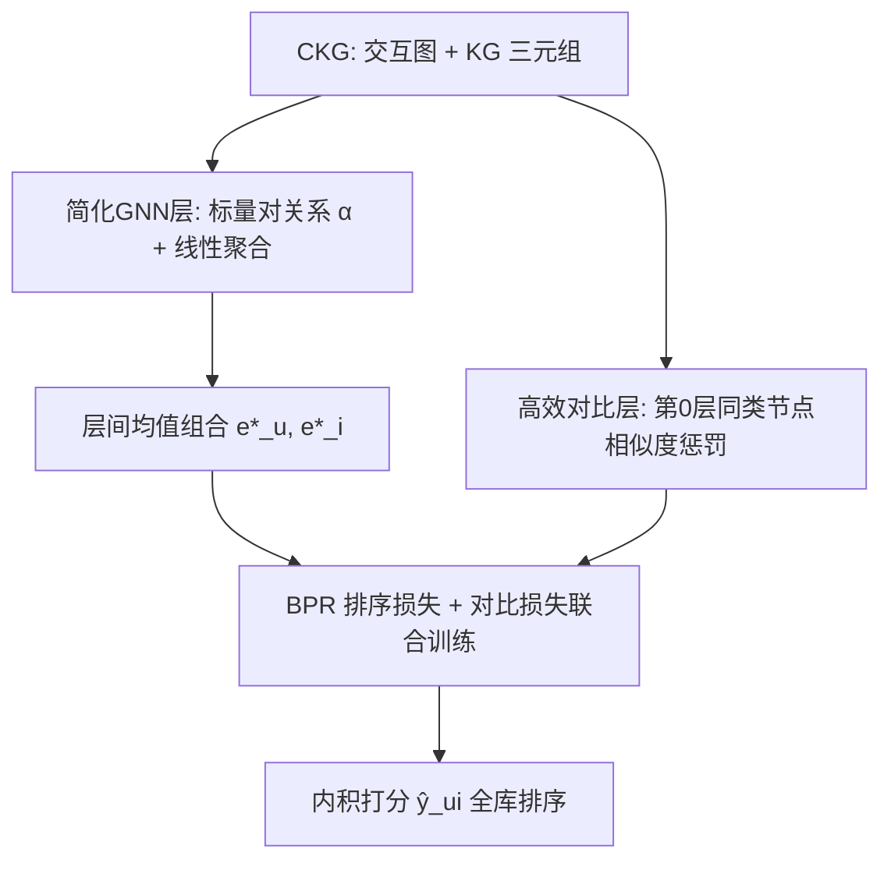
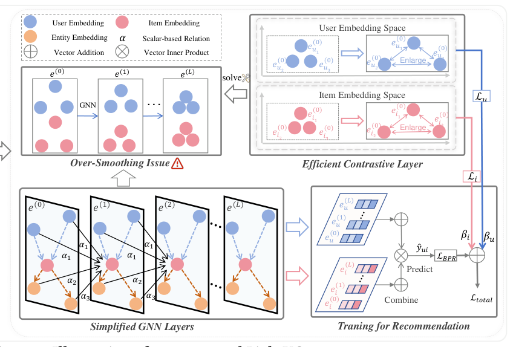

# LightKG: Efficient Knowledge-Aware Recommendations with Simplified GNN Architecture (轻量知识图谱推荐：简化 GNN 架构的高效知识感知推荐)

- **会议/期刊**: KDD 2025
- **作者与机构**: Yanhui Li, Dongxia Wang, Zhu Sun, Haonan Zhang, Huizhong Guo（浙江大学 / 新加坡科技设计大学）
- **推荐链路定位**: 召回（Top-10 全库排序）
- **研究方向**: 图神经网络与知识图谱推荐 / 自监督对比学习
- **论文原文**: [https://arxiv.org/abs/2506.10347v1](https://arxiv.org/abs/2506.10347v1)
- **开源代码**: [https://github.com/1371149/LightKG](https://github.com/1371149/LightKG)

## TL;DR (1分钟核心速览)

本文针对知识图谱推荐（KGRS）在**稀疏交互**下"模型越复杂反而越差"的核心痛点，通过系统实验揭示注意力机制在稀疏场景几乎无效甚至有害（移除后平均 Recall 反升 1.1%–6.05%），进而提出 LightKG：将关系编码为**标量对**、采用**线性聚合**、并用**免子图生成的对比层**直接最小化同类节点相似度。在 4 个基准数据集、Full-Ranking 协议下，LightKG 超越 12 个 SOTA KGRS 平均 5.8%，相比带 SSL 的 KGRS 节省 84.3% 训练时间。

## Background & Motivation (背景与核心矛盾)

- **主流范式**: GNN-based KGRS 成为主流，通过 CKG 上的多层邻域聚合编码高阶关系；近年叠加自监督对比学习（MCCLK/KGRec/DiffKG）以缓解稀疏，但训练时间暴涨（ML-1M 上 MCCLK 单 epoch 达 161s）。
- **前人局限一**: 实验发现 GNN-based KGRS 仅在稠密场景（80%/40% 采样）领先，稀疏场景（20%/10%）下甚至被 embedding-based 的 CFKG 反超，SSL 也救不回来。
- **前人局限二**: 模型复杂度与稀疏场景 Recall 呈强负相关（Last.FM 上 Pearson $r=-0.9374$，ML-1M 上$-0.6682$）；把 6 个 SOTA 模型的注意力权重固定为 1 后，稀疏度越高提升越明显（10% 采样时平均 +6.05%）。
- **核心洞察 (Key Insight)**: 复杂机制（注意力、多图学习）需要大量数据才能学好参数，稀疏场景下反而过拟合/泛化差；简单线性结构更适配稀疏。
- **本文切入点**: 用"标量对关系 + 线性聚合 + 轻量对比"三件套，在保留 KG 语义的同时把复杂度压到 $O(d(|\mathcal{G}_{UI}|+|\mathcal{G}_{KG}|))$。

## Method (核心方法设计)

### 1. 整体框架 (Overall Architecture)

LightKG 在协同知识图谱 CKG 上工作：输入用户-物品交互图与 KG 三元组，经 $L$ 层简化 GNN 层（标量对关系编码 + 线性归一化聚合）得到各层节点表示，层间均值组合得最终 embedding；同时在第 0 层挂载高效对比层，直接对同类节点（用户-用户、物品-物品）施加相似度惩罚以缓解过平滑；最终以 BPR 排序损失 + 双侧对比损失联合训练，推理时用内积全库排序。

<figure class="paper-figure" markdown="span">
  <figcaption>图2：我们提出的LightKG的示意图。</figcaption>
</figure>

### 2. 关键设计拆解 (Key Designs)

1. **标量对关系编码 + 线性聚合（Simplified GNN Layer）**：前人把关系编码为向量 $\boldsymbol{e}_r$或变换矩阵$\boldsymbol{W}_r$并接入注意力，参数量与计算量随$d^2$膨胀。LightKG 将同类型关系编码为一对可学习标量$\alpha_{rtk}$（有向，$\alpha_{rtk}\neq\alpha_{rkt}$），并去掉非线性激活，聚合算子为：
$$\boldsymbol{e}_k^{(l)}=\sum_{(k,r,t)\in\mathcal{N}_k}\frac{\alpha_{rtk}}{\sqrt{|\mathcal{N}_k|}\sqrt{|\mathcal{N}_t|}}\boldsymbol{e}_t^{(l-1)}$$
直觉：标量相当于"节点类型隐标签"——当所有 embedding 相同时，$\alpha_{iu}\neq\alpha_{ui}$保证用户与物品表示在传播后仍可区分，避免 LightGCN 式的同质坍缩；同时该式在$\alpha_{iu}=\alpha_{ui}=1$ 时退化为 LightGCN，故 LightKG 是其严格扩展，天然继承交互图上的高效信息提取能力。

2. **高效对比层（Efficient Contrastive Layer）**：前人 SSL（MCCLK/KGRec）需生成并比较子图，开销巨大。LightKG 直接在原始图第 0 层最小化同类节点相似度，并引入两个修正因子——节点固有相似度 $s_{i,j}$与邻居数权重$w_{i,j}$：
$$\min\mathcal{L}_u=\sum_{u_1,u_2\in\mathcal{U}}w_{u_1,u_2}\exp\big((1-s_{u_1,u_2})\boldsymbol{e}_{u_1}^{(0)\top}\boldsymbol{e}_{u_2}^{(0)}\big)$$
其中 $s_{i,j}=\frac{|\mathcal{N}_i\cap\mathcal{N}_j|}{\sqrt{|\mathcal{N}_i||\mathcal{N}_j|}}$，$w_{i,j}=1-\frac{1}{\sqrt{|\mathcal{N}_i||\mathcal{N}_j|}}$。直觉：交互高度重叠的用户不应被强行推开（$1-s$抑制惩罚），邻居多的节点更易过平滑故权重更大；物品侧$\mathcal{L}_i$ 同理。

3. **训练目标、负采样与推理效率**：总损失 $\mathcal{L}_{total}=\mathcal{L}_{BPR}+\beta_u\mathcal{L}_u+\beta_i\mathcal{L}_i+\lambda\|\Theta\|_2^2$，负采样为 BPR 标准随机负采样（每正样本配 1 个随机负样本，搜索空间$\{1,2,5,10\}$），无需 hard negative 或额外子图。推理为内积全库排序，单层复杂度$O(d(|\mathcal{G}_{UI}|+|\mathcal{G}_{KG}|))$，低于所有对比 GNN-KGRS。

## Experimental Setup & Evaluation Protocol (实验设置与评估协议)

- **数据集与预处理**:

| 数据集 | #Users | #Items | #Interactions | 稀疏度/密度 | 特征/场景说明 |
| :--- | :---: | :---: | :---: | :---: | :--- |
| AMZ-B | 20,347 | 4,230 | 234,323 | 密度约 0.27% | 评分≥4 且 20-core 过滤 |
| ML-1M | 6,039 | 3,499 | 573,637 | 密度约 2.7% | 评分≥4 过滤 |
| BX | 11,018 | 9,059 | 24,644 | 密度约 0.025% | 原始发布版，未额外过滤 |
| Last.FM | 1,873 | 3,847 | 21,173 | 密度约 0.29% | 原始发布版，未额外过滤 |

- **数据划分与防穿越**: 比例划分 `8:1:1`（训练/验证/测试），非 Leave-One-Out；稀疏实验通过随机采样训练交互比例（Last.FM 用 80%/40%/20%/10%，ML-1M 用 80%/40%/20%/10%/5%）模拟不同稀疏度。
- **排名评测协议**: 无偏 `Full-Ranking`（全库未交互物品排序），报告 Recall@10 与 MRR@10；显著性用 paired t-test，$p<0.01$。
- **对比基线与超参设置**: 13 个基线，覆盖 KG-free（LightGCN）、embedding-based（CFKG/CKE）、path-based（RippleNet/MCRec）、监督 GNN（KGCN/KGNN-LS/KGAT/KGIN）、自监督 GNN（MCCLK/KGRec/DiffKG/CL-SDKG）。统一 embedding 维度 $d=64$、Adam、batch=2048、GNN 层数$\{1,2,3,4\}$、$\beta_u,\beta_i\in\{10^{-4},\dots,10^{-9}\}$，贝叶斯优化 30 次，全部在 RecBole 复现，实验重复 5 次。

## Key Experimental Results (实验关键数据)

### 1. 主实验对比 (Main Results)

| Model | AMZ-B R@10 | AMZ-B MRR | ML-1M R@10 | ML-1M MRR | BX R@10 | BX MRR | Last.FM R@10 | Last.FM MRR |
| :--- | :---: | :---: | :---: | :---: | :---: | :---: | :---: | :---: |
| LightGCN | 0.1980 | 0.1052 | 0.1855 | 0.3453 | 0.0468 | 0.0198 | 0.2695 | 0.1204 |
| KGAT | 0.1925 | 0.0997 | 0.1830 | 0.3412 | 0.0499 | 0.0233 | 0.2583 | 0.1152 |
| KGIN | 0.2090 | 0.1099 | 0.1969 | 0.3551 | 0.0801 | 0.0399 | 0.2727 | 0.1242 |
| MCCLK | 0.2025 | 0.1065 | 0.1853 | 0.3474 | 0.0607 | 0.0359 | 0.2699 | 0.1228 |
| KGRec | 0.2035 | 0.1094 | 0.1960 | 0.3570 | 0.1033 | 0.0540 | 0.2560 | 0.1118 |
| DiffKG | 0.2039 | 0.1116 | 0.1846 | 0.3428 | 0.0581 | 0.0318 | 0.2520 | 0.1192 |
| CL-SDKG | 0.2036 | 0.1134 | 0.1861 | 0.3428 | 0.0924 | 0.0532 | 0.2409 | 0.1054 |
| **LightKG** | **0.2120** | **0.1173** | **0.2029** | **0.3785** | **0.1154** | 0.0515 | **0.2929** | **0.1350** |
| Improv.% | +1.42% | +3.44% | +3.52% | +6.02% | +11.71% | −4.63% | +7.41% | +8.70% |

训练效率（单 epoch，Tab.1）：LightKG 在 ML-1M 仅 19.07s，而 MCCLK 161.48s、KGRec 99.69s、DiffKG 115.46s、CL-SDKG 281.2s；相比带 SSL 的 KGRS 平均节省 84.3% 训练时间。

### 2. 消融实验 (Ablation Study)

| 变体 | Last.FM R@10 | BX R@10 | ML-1M R@10 | AMZ-B R@10 |
| :--- | :---: | :---: | :---: | :---: |
| LightKG (完整) | 0.2929 | 0.1154 | 0.2029 | 0.2120 |
| w/o 用户侧对比 ($\beta_u=0$) | 接近完整 | 接近完整 | 略降 | 略降 |
| w/o 物品侧对比 ($\beta_i=0$) | 接近完整 | 接近完整 | 略降 | 略降 |
| w/o 双侧对比 ($\beta_u=\beta_i=0$) | 明显下降 | 明显下降 | 明显下降 | 明显下降 |

KG 利用实验（Tab.7）：LightKG 加 KG 后 Last.FM Recall 从 0.2725 升至 0.2929（+7.49%），BX 从 0.0654 升至 0.1154（+76.48%）；而 KGAT/KGRec 去掉 KG 后 Last.FM 反而略升，说明其未能有效利用 KG。

### 3. 关键实验发现 (Key Findings)

1. **稀疏度越高，简化收益越大**：Last.FM 10% 采样下 LightKG 相对最佳 GNN-KGRS 提升 102.4%，而 80% 稠密下仅 8.52%，直接验证"复杂度-稀疏度负相关"假设；同时 LightKG 在稠密场景仍全面领先，说明简化并非牺牲稠密性能。
2. **对比层是稀疏场景的关键增益源**：去掉双侧对比层后各数据集 Recall 明显下降，但仅保留单侧（用户或物品）即可接近完整性能——因为 CKG 统一图结构使一侧的判别性增强自然传导至另一侧，这为工业部署提供了"只挂一侧"的省算力选项。
3. **标量关系确实捕获了全局语义但牺牲细粒度**：LightKG 聚合系数方差在 4 个数据集上均最高（Last.FM 0.5500 vs KGAT 0.0670），说明其全局区分度更强；但在 ML-1M 上"Titanic"经 film-actor-film 连接的 51 部电影权重方差仅 0.0009（KGAT 0.0174），导致 BX 上 MRR 排名第三——这是标量编码的固有精度上限。

## Highlights & Limitations (亮点、对比与审稿批判)

- **与代表作对比 (vs. Prior Work)**: 相比 KGAT/KGIN 的注意力加权聚合，LightKG 用标量对替代向量/矩阵关系并去掉非线性，参数量与复杂度降一个量级；相比 MCCLK/KGRec 的子图对比 SSL，LightKG 免去子图生成与跨视图配对，训练时间降至 16.8%–82.7%；相比 LightGCN，LightKG 在 $\alpha=1$ 时严格退化为前者，故在 KG 缺失时仍稳健（Last.FM 无 KG 时 0.2725 仍高于多数基线）。
- **可迁移亮点**: (1) "标量对作为节点类型隐标签"可迁移到任何异质图推荐，用极低参数实现类型区分；(2) 对比层的邻居数权重 $w_{i,j}=1-1/\sqrt{|\mathcal{N}_i||\mathcal{N}_j|}$ 是通用的过平滑缓解技巧，可直接插入现有 GNN 推荐模型。
- **审稿级局限批判**: (1) 标量关系无法区分同一关系类型下的细粒度语义（如演员对电影的不同贡献），在依赖精确排序的 MRR 指标上已暴露短板（BX 上落后 KGRec/CL-SDKG）；(2) 稀疏实验通过随机采样训练集模拟，而非真实冷启动用户/物品划分，评估协议与工业稀疏分布仍有差距；(3) $\beta_u,\beta_i$最优值差异可达两个数量级（ML-1M 上$10^{-5}$vs$10^{-7}$），超参敏感度高，实际调参成本不低。

## Rating (四维评分)

- **方法创新性 (Novelty)**: ⭐⭐⭐⭐ （标量对关系编码 + 免子图对比层的组合简洁有力，且有 LightGCN 退化性证明与节点标签理论解释支撑）
- **评估协议与实验扎实度 (Protocol & Experiments)**: ⭐⭐⭐⭐ （4 数据集 × 13 基线 × 5 稀疏度 × 5 次重复 + paired t-test，Full-Ranking 协议规范；但稀疏模拟方式偏理想化）
- **写作与数学规范度 (Clarity & Rigor)**: ⭐⭐⭐⭐ （公式简洁、复杂度分析与 LightGCN 等价性推导清晰，动机实验链条完整；标量编码的语义上限在正文中坦诚讨论）
- **工业落地与复现价值 (Industrial & Practical Value)**: ⭐⭐⭐⭐⭐ （开源代码 + RecBole 复现 + 训练时间省 84.3%，线性聚合易于分布式实现，单侧对比层可进一步降本，落地价值极高）

