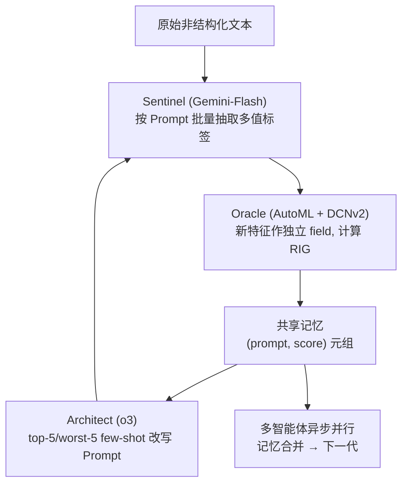
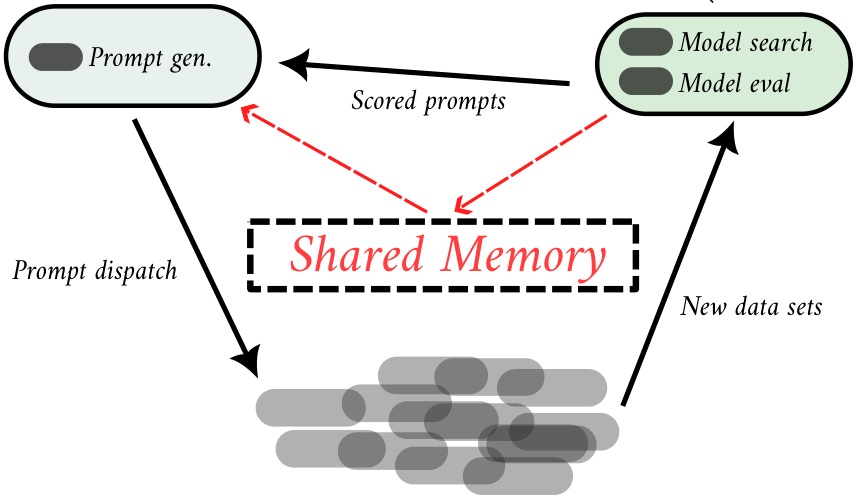

# Agent0: Leveraging LLM Agents to Discover Multi-value Features from Text for Enhanced Recommendations (利用 LLM 智能体从文本中发现多值特征以增强推荐)

- **会议/期刊**: KDD 2025 (Agent4IR Workshop)
- **作者与机构**: Blaž Škrlj, Benoît Guilleminot, Andraž Tori（Teads 广告技术公司）
- **推荐链路定位**: 特征工程 / 数据侧（服务于精排 CTR 模型输入）
- **研究方向**: 大语言模型推荐 (LLM4Rec) / CTR 预估与特征交叉
- **论文原文**: [https://arxiv.org/abs/2507.18993v1](https://arxiv.org/abs/2507.18993v1)
- **开源代码**: 暂未开源（仅引用 all-MiniLM-L6-v2 句向量模型）

## TL;DR (1分钟核心速览)

本文针对推荐系统中最昂贵、最依赖人工的环节——从原始非结构化文本中构造高信号**多值类别特征（multi-value categorical feature）**——提出 Agent0：由 Architect（o3，负责改写抽取 Prompt）、Sentinel（Gemini-Flash，负责批量把文本转成特征值）、Oracle（内部 AutoML + DCNv2，负责评估特征增益）三个角色构成的 LLM 智能体闭环，用 RIG（相对信息增益）作为奖励信号驱动 Prompt 迭代，并支持多智能体共享记忆的异步并行搜索。在 Teads 真实广告生产数据上，系统自主发现的 Prompt 使 DCNv2 基线取得 **0.005+ RIG** 的稳定提升，单个研究周期较人工流程提速 **2–3 倍**，且产出的是低基数、可解释、可人工复核的紧凑特征空间。

## Background & Motivation (背景与核心矛盾)

- **主流范式**: 工业推荐系统已大量引入 LLM 生成的特征或文本 Embedding（如 LLM 语义表征增强），但绝大多数工作把 LLM 当作"黑盒编码器"，输出高维稠密向量直接喂给下游模型。
- **前人局限**: 其一，高维 Embedding 训练与推理开销大，且与已有上下文特征信号高度冗余——作者观察到"仅少量上下文特征即可提供与高维 Embedding 相近的信号"；其二，Embedding 不可解释、基数不可控，数据科学家无法对特征域/类型做精细干预，而多值类别特征恰恰是" notoriously hard to engineer"的人工瓶颈。
- **核心洞察 (Key Insight)**: 特征工程本质上是一个"假设生成 → 数据构造 → 离线评估 → 假设修正"的闭环科研过程，这与 LLM Agent 的 plan-memory-tool 迭代范式同构；因此可以把数据科学家的工作流直接映射为三个异构 LLM 角色的分工。
- **本文切入点**: 用"强推理模型改写 Prompt + 快模型批量抽取 + AutoML 打分反馈"的三角色闭环，把 Prompt 当作可优化的"假设"，把 RIG 当作可微不可导的黑盒奖励，做 beam-search 式的 Prompt 进化。

## Method (核心方法设计)

### 1. 整体框架 (Overall Architecture)

Agent0 把人工特征工程流程逐环节映射为三个组件：**Sentinel** 接收 Architect 下发的 Prompt 模板，对全量原始文本做批量 grounding，输出逗号分隔的多值标签（如 `create account, log in, donate, chatgpt, waymo`），是整条链路中网络调用最密集的部分，配有文档级缓存以避免重复请求；**Oracle** 将新特征作为一个独立 field 接入 DCNv2（分配专属 Embedding 空间），在数据末 20% 上计算 RIG 并与无该特征的基线做差，得到该 Prompt 的标量得分；**Architect** 读取共享记忆中 top-5 与 worst-5 的 (prompt, score) 元组作为 few-shot 上下文，重写下一轮 USER Prompt。三者通过一个网络化共享记忆（磁盘/服务）解耦，从而支持任意数量 Agent0 实例跨异构机器异步并行，形成"带周期性同步的 beam search"。

<figure class="paper-figure" markdown="span">
  <figcaption>图 2：Agent0 主要组件概览。由两个 LLM 和一个 AutoML 组件组成的联盟构成反馈回路。</figcaption>
</figure>
图 2：Agent0 主要组件概览——两个 LLM 与一个 AutoML 组件构成反馈回路。

### 2. 关键设计拆解 (Key Designs)

1. **RIG 作为可比较的特征增益奖励**：痛点在于不同数据集 CTR 基线差异巨大，绝对 AUC 提升不可跨实验比较。作者采用相对信息增益，以"恒定预测经验 CTR $\bar{p}$"为参照系做归一化：
$$\mathrm{RIG} = 1 - \frac{\mathrm{CE}(\hat{p}, y)}{\mathrm{CE}(\bar{p}, y)},\quad \mathrm{CE}(p,y) = -\frac{1}{N}\sum_{i=1}^{N}\left[y_i\log p_i + (1-y_i)\log(1-p_i)\right]$$
取值落在 $(-\infty, 1]$，$1$为完美预测、$0$ 为等价于常数基线、负值表示劣于基线。物理直觉：它把"新特征是否真的带来增量信息"折算成一个与数据分布无关的无量纲量，天然适合作为 Agent 的标量 reward。

2. **Architect 的记忆增强 Prompt 进化**：痛点在于通用 Prompt 只能抽出泛化词，无法对齐具体业务的下游模型。Architect 的输入被构造成 `核心 Prompt + 正反馈 + 负反馈` 三段式（图 7），即把历史最优与最差 Prompt 作为 few-shot 注入，并施加"输出格式不变、只返回新 USER Prompt"的硬约束。这样做的直觉是：让强推理模型在"已被验证有效/无效"的邻域内做局部搜索，而非盲目重写，从而稳定收敛。最终自主发现的 Prompt（图 1）自发涌现出**层级优先级（主题 > 实体 > 意图 > 人群 > 情感/时效 > 时空）**、1–3 词长度约束、同义/父子去重、按预测价值降序排列等工程技巧。

3. **训练目标、负采样与推理效率**：本文不训练新的推荐模型，下游 DCNv2 沿用生产配置，因此无负采样设计；核心"训练信号"是 Oracle 返回的 RIG 标量。推理开销集中在 Sentinel 的批量文本转换（百万级实例），作者通过文档级缓存、批推理（预计 5–10× 加速）与"Agent0 视作普通微服务"的网络访问限制来控制成本；Architect 虽用 o3 且延迟不优，但因调用频次低而非瓶颈。

## Experimental Setup & Evaluation Protocol (实验设置与评估协议)

- **数据集与预处理**: 采用 Teads 真实广告生产数据（未公开），原始输入为广告落地页等非结构化文档集合；特征以 vowpal/csv 形式进入生产级数据转换管线。论文未披露用户/物品规模统计，故下表仅列可确认信息：

| 数据集 | #Users | #Items | #Interactions | 稀疏度/密度 | 特征/场景说明 |
| :--- | :---: | :---: | :---: | :---: | :--- |
| Teads 生产广告数据（私有） | 未披露 | 未披露 | 百万级实例 | 未披露 | 广告落地页原始文本 → 多值类别特征；DCNv2 精排 |

- **数据划分与防穿越 (Splitting Strategy)**: 采用**全局时间顺序切分**，以数据末 20% 作为评估段，RIG 在该段上计算并多次平均，符合生产环境的时间外推设定。
- **排名评测协议 (Ranking Protocol)**: 非 ranking 指标评测，而是 CTR 概率预估的 **RIG（相对信息增益）**；对比方式为"含新特征模型 vs. 不含新特征的同一 DCNv2 基线"的 RIG 差值（relative score）。
- **对比基线与超参设置**: 基线即无多值特征的 DCNv2 生产小模型；对照还包括人工设计的 seed prompt 与纯 Embedding 方案。多智能体实验部署 4–5 个 Agent0 实例，仅共享记忆、其余完全独立；Prompt 嵌入分析使用 all-MiniLM-L6-v2 + UMAP 降维。

## Key Experimental Results (实验关键数据)

### 1. 主实验对比 (Main Results)

本文为系统/案例研究型论文，未提供传统 Baseline 对照表，核心结果为"Agent0 发现特征 vs. 无该特征基线"的 RIG 增量：

| 配置 | 特征来源 | RIG (相对基线) | 说明 |
| :--- | :--- | :---: | :--- |
| DCNv2 基线 | 无多值特征 | 0.000 | 参照系 |
| + 人工 seed prompt 特征 | 通用抽取模板 | 小幅正增益 | 泛化词为主，信号弱 |
| + **Agent0 最优 Prompt 特征** | Architect 自主进化 | **0.005+** | 论文报告的最高 lift |
| + 多智能体（5 实例）并行 | 共享记忆合并 | 正增益分布（图 8） | 多数实例得分为正 |

### 2. 消融实验 (Ablation Study)

论文未做严格组件消融，但提供了等价的功能性对照：

| 变体 | 关键变化 | 效果 |
| :--- | :--- | :--- |
| w/o Architect 反馈（仅 seed prompt） | 无 top-5/worst-5 few-shot | 增益显著低于进化后 Prompt |
| w/o 多智能体（单实例） | 串行搜索 | 探索多样性下降，收敛慢 |
| w/ 多智能体但无共享记忆 | 各自独立 | 无法跨实例复用最优解，收敛退化 |
| w/ 共享记忆（完整） | 异步合并 + 周期性同步 | 一旦发现新最优，全体快速收敛 |

### 3. 关键实验发现 (Key Findings)

1. **紧凑特征可与高维 Embedding 互补而非替代**：作者明确指出，仅少量上下文特征即可逼近高维 Embedding 的信号量，而 Agent0 产出的低基数特征在 Embedding-first 模型上仍提供"otherwise missed"的互补信息，说明二者应并联使用。
2. **Prompt 进化的收益来自"格式约束"而非"语义创意"**：最终最优 Prompt 的增益主要源于层级优先级、去重、长度与排序等硬约束带来的输出稳定性，这解释了为何 Architect 的指令模板强制"输出格式不变"。
3. **多智能体存在收敛同质化风险**：图 9 的 UMAP 显示各 Agent 的 Prompt 嵌入占据潜空间相似区域、无专属分区（因共用同一 Architect），且共享记忆使全体在发现新最优后迅速趋同——这意味着探索-利用权衡需靠异构 Agent 或温度调节来补偿。

## Highlights & Limitations (亮点、对比与审稿批判)

- **与代表作对比 (vs. Prior Work)**: 相较于 LLM-as-Encoder 路线（把文本压成稠密向量），Agent0 输出的是**可解释、基数可控的离散类别特征**，可直接作为 DCNv2 的独立 field 参与显式交叉；相较于 AlphaEvolve 等面向代码/系统级优化的 agent 系统，本文首次把 agentic 闭环落到推荐系统的**数据侧特征工程**，且 Oracle 直接复用生产 AutoML，评估可信度高。
- **可迁移亮点**: (1) 用 RIG 这类归一化增益作为黑盒 reward，可无缝迁移到任何"生成候选 → 离线评估"的特征/样本挖掘闭环；(2) "top-k / worst-k few-shot 注入 + 格式硬约束"的 Prompt 进化模板，可直接复用于标签体系构建、query 改写等任务。
- **审稿级局限批判**: 其一，**评估面过窄且不可复现**——仅单一私有广告数据集、单一 DCNv2 Oracle、单一 RIG 指标，缺少公开基准与多架构（如 DeepFM/DIN）泛化验证，Oracle 偏置可能使结论过拟合 DCNv2；其二，**成本与收敛性存疑**——依赖 o3 级模型带来延迟与费用，多智能体因共享记忆快速同质化，实际探索效率可能低于宣称的 2–3× 提速，且缺少与人工特征工程的严格 A/B 对照。

## Rating (四维评分)

- **方法创新性 (Novelty)**: ⭐⭐⭐⭐ （首次将 Architect-Sentinel-Oracle 三角色 agent 闭环用于推荐数据侧特征工程，角色分工与人工科研流程的映射颇具巧思，但单点技术均为已有组件的组合）
- **评估协议与实验扎实度 (Protocol & Experiments)**: ⭐⭐⭐ （RIG 指标设计合理且贴合生产，但仅单数据集、单 Oracle、无公开基准与严格消融，统计显著性缺失）
- **写作与数学规范度 (Clarity & Rigor)**: ⭐⭐⭐⭐ （RIG 定义与 Prompt 模板交代清晰、图表丰富，但缺少复杂度分析与形式化的问题定义）
- **工业落地与复现价值 (Industrial & Practical Value)**: ⭐⭐⭐⭐ （直接跑在 Teads 生产管线、产出可人工复核的紧凑特征，工程价值明确；但代码未开源、依赖私有数据与付费 LLM，复现门槛高）

