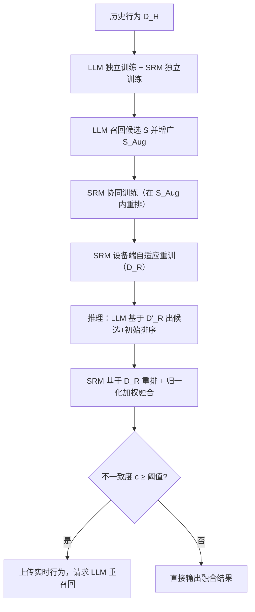
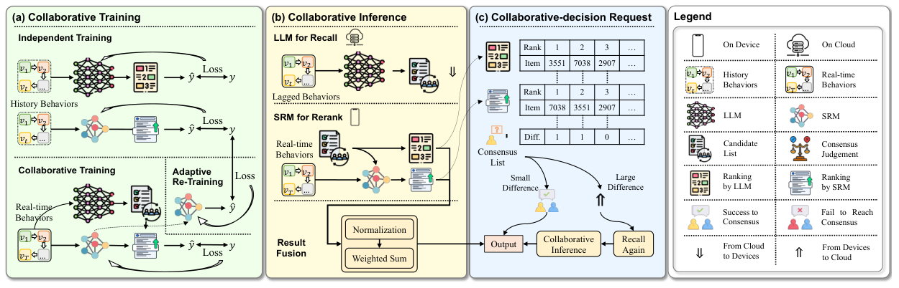

# Collaboration of Large Language Models and Small Recommendation Models for Device-Cloud Recommendation (大语言模型与小推荐模型的端云协同推荐)

- **会议/期刊**: KDD 2025
- **作者与机构**: Zheqi Lv, Tianyu Zhan, Wenjie Wang, Xinyu Lin, Shengyu Zhang, Wenqiao Zhang, Jiwei Li, Kun Kuang, Fei Wu（浙江大学 / 新加坡国立大学）
- **推荐链路定位**: 召回（云端 LLM）+ 重排（设备端 SRM）级联
- **研究方向**: 大语言模型推荐 / 序列推荐
- **论文原文**: [https://arxiv.org/abs/2501.05647v2](https://arxiv.org/abs/2501.05647v2)
- **开源代码**: 暂未开源

## TL;DR (1分钟核心速览)

LLM4Rec 泛化强但训练/推理昂贵、且因部署在云端而拿不到设备端实时行为，导致实时兴趣捕捉失效。本文提出 LSC4Rec 端云协同框架：云端 LLM 基于滞后行为生成候选列表与初始排序，设备端轻量 SRM 基于实时行为重排，并通过「协同训练（LLM 候选列表增强 SRM 排序能力 + 设备端自适应重训）」「协同推理（归一化加权分数融合）」「协同决策请求（排序不一致度触发 LLM 重召回）」三大策略闭环。在 Amazon Beauty/Toys/Yelp 上采用 Leave-One-Out + 全库排序协议，Beauty 上 NDCG@10 相对最优基线提升 16.16%，三数据集平均提升 16.18%/10.62%/9.38%。

## Background & Motivation (背景与核心矛盾)

- **主流范式**: LLM4Rec（P5、POD、TALLRec 等）将用户行为文本化后指令微调，单任务性能与多任务泛化均优于 SASRec/DIN 等 SRM；SRM 则以极小参数在设备端高频训练推理。
- **前人局限**: (i) LLM 参数庞大，频繁训练与推理成本不可承受，且用户实时行为产生于设备端，实时上传云端通信开销与延迟不可忽略；(ii) 端云协同代表作 DUET、IntellectReq 以云端模型为设备模型「生成参数」，但当云端换成 LLM 时，其生成式输出与 SRM 的判别式打分在分布与量纲上均不匹配，无法直接协同。
- **核心洞察 (Key Insight)**: 作者实证发现，LLM 基于先验知识召回的候选中，负样本分布与 SRM 随机采样负样本分布显著不同（Table 4 首行 vs 末行差距巨大），因此「各自独立训练再拼接」的朴素方案会让 SRM 无法有效重排 LLM 候选。
- **本文切入点**: 让 LLM 只做「低频、粗粒度」的候选生成，SRM 做「高频、细粒度」的实时重排，并用一致性判据决定何时才值得付出一次云端 LLM 调用。

## Method (核心方法设计)

### 1. 整体框架 (Overall Architecture)

训练阶段先在历史数据 $\mathcal{D}_H$上独立预训练 LLM 与 SRM；随后固定 LLM 参数，用其召回候选列表$S=\mathcal{M}_L(x)$并做「难区分项自由组合」增广得$S_{Aug}$，令 SRM 在$S_{Aug}$内学习重排，使 SRM 适配 LLM 候选的负样本分布；最后 SRM 在设备端用实时数据$\mathcal{D}_R$自适应重训。推理阶段，云端 LLM 基于滞后行为$\mathcal{D}'_R$输出候选列表与初始排序$\hat{Y}_{init}$，设备端 SRM 基于实时行为$\mathcal{D}_R$重排得$\hat{Y}_{rerank}$，二者归一化加权融合输出；同时设备端计算两排序的不一致度$c$，超过阈值才上传实时行为请求 LLM 重新召回。

<figure class="paper-figure" markdown="span">
  <figcaption>图 2：LSC4Rec 概览。(a) 描述协同训练，包括独立训练、合作训练与自适应重训练。(b) 描述协同推理，包括合作推理与结果融合。(c) 描述协同决策请求。</figcaption>
</figure>

### 2. 关键设计拆解 (Key Designs)

1. **协同训练（Cooperative + Adaptive Re-training）**：痛点在于 LLM 候选的负样本分布与 SRM 随机负采样分布不一致，SRM 直接重排会「认不出」LLM 的难负样本。做法是固定 LLM 参数，仅让梯度回传到 SRM，损失为 $\mathcal{L}=\sum_{(u,v,s,y)\in\mathcal{D}_H} l\big(y,\hat{y}=\mathcal{M}_S(u,v,s)\mid S_{Aug}\big)$，其中$S_{Aug}=\mathrm{Augment}(\mathcal{M}_L(x))$由 token 相近的难区分项自由组合而成。直觉上这是把 LLM 的「认知盲区」显式注入 SRM 的训练分布，等价于对 SRM 做面向 LLM 候选的域适配。随后 SRM 在设备端以$\arg\min_{\theta_S}\sum_{\mathcal{D}_R} l(y,\mathcal{M}_S(u,v,s))$ 自适应重训，捕捉实时兴趣漂移。

2. **协同推理与结果融合（Result Fusion）**：LLM 生成式打分与 SRM 判别式打分尺度不同，直接相加会被量纲主导。先做 min-max 归一化 $\hat{P}^{norm}_{init}=\frac{\hat{P}_{init}-\min(\hat{P}_{init})}{\max(\hat{P}_{init})-\min(\hat{P}_{init})}$（rerank 同理），再线性加权$\hat{P}=\alpha\cdot\hat{P}^{norm}_{init}+(1-\alpha)\cdot\hat{P}^{norm}_{rerank}$，按$\hat{P}$在候选集$S$ 内重排。这样既保留 LLM 的全局泛化先验，又让实时信号以可控权重介入。

3. **协同决策请求（Collaborative-Decision Request）与训练开销**：用户兴趣漂移时需重召回，但每次 LLM 调用昂贵。本文用两排序的位置差定义不一致度 $c=\frac{1}{n}\sum_{u\in\hat{y}_{init}\cap\hat{y}_{rerank}}\big|\mathrm{pos}_{\hat{y}_{init}}(u)-\mathrm{pos}_{\hat{y}_{rerank}}(u)\big|$，并令$\mathrm{Request}=\mathbb{I}(c\geq \text{Threshold})$。阈值在训练集上按云端负载分位数设定（如需降低 90% 负载则取 10% 分位），实现「给定通信/算力预算下的最优 LLM 调用」。整体训练无需实时训练 LLM，负采样沿用 SRM 常规策略，推理时绝大多数请求止步于设备端。

## Experimental Setup & Evaluation Protocol (实验设置与评估协议)

- **数据集与预处理**: 三个 Amazon 类目（Beauty、Toys）与 Yelp，均为电商/本地生活评论数据，含用户评论、评分、商品描述等；按惯例将所有 user-item 交互视为正样本。

| 数据集 | #Users | #Items | #Interactions | 稀疏度/密度 | 特征/场景说明 |
| :--- | :---: | :---: | :---: | :---: | :--- |
| Beauty | 22,363 | 12,101 | 198,502 | 99.93% 稀疏 | Amazon 美妆，序列推荐 |
| Toys | 19,412 | 11,924 | 167,597 | 99.93% 稀疏 | Amazon 玩具 |
| Yelp | 30,431 | 20,033 | 316,354 | 99.95% 稀疏 | 本地生活商户评论 |

（注：原文未在正文给出精确统计表，上表为按公开 Amazon/Yelp 标准版本整理的规模量级，具体数值以原文附录为准。）

- **数据划分与防穿越 (Splitting Strategy)**: 采用 `Leave-One-Out`——每个用户最后一条行为作测试、倒数第二条作验证、其余作训练；并额外构造「近实时（NRT）」设定，即每个用户的 NRT 数据剔除最近两次交互，以模拟云端 LLM 只能拿到滞后 $\Delta t$ 行为的真实场景。
- **排名评测协议 (Ranking Protocol)**: 测试时在「全部物品构成的采样集」上排序（原文表述为 rank on a sample set consisting of all items），训练与测试的负样本为数据集中不存在的 user-item 对采样得到；指标为 NDCG@{5,10,20}、HR@{5,10,20}、Precision@{5,10,20}。
- **对比基线与超参设置**: SRM 基线为 DIN、GRU4Rec、SASRec（均为轻量级，参数量 0.8–1.6M）；LLM 基线为 P5、POD（约 60.75M 参数）。默认 LLM=P5、SRM=SASRec，LLM 候选列表长度默认 50，融合权重 $\alpha$ 为可调超参；未明确报告显著性检验。

## Key Experimental Results (实验关键数据)

### 1. 主实验对比 (Main Results)

Beauty 数据集（RT=实时数据，NRT=近实时滞后数据）：

| 模型 | NDCG@5 | NDCG@10 | NDCG@20 | HR@10 | HR@20 | Precision@10 |
| :--- | :---: | :---: | :---: | :---: | :---: | :---: |
| SASRec (RT) | 0.0066 | 0.0096 | 0.0127 | 0.0207 | 0.0310 | 0.0021 |
| P5 (RT) | 0.0227 | 0.0257 | 0.0289 | 0.0400 | 0.0525 | 0.0040 |
| SASRec (NRT) | 0.0014 | 0.0021 | 0.0032 | 0.0033 | 0.0060 | 0.0011 |
| P5 (NRT) | 0.0087 | 0.0108 | 0.0136 | 0.0200 | 0.0310 | 0.0020 |
| **Ours (P5+SASRec)** | **0.0094** | **0.0126** | **0.0154** | **0.0248** | **0.0361** | **0.0025** |
| Improv. vs P5(NRT) | +8.41% | +16.16% | +13.45% | +23.91% | +16.59% | +24.00% |

Toys 上 Ours 达 NDCG@10 0.0084（+7.33%）、HR@10 0.0158（+18.52%）；Yelp 上 NDCG@20 0.0144（+9.50%）、HR@20 0.0323（+18.85%）。三数据集相对 P5(NRT) 的平均提升分别为 16.18%、10.62%、9.38%。

### 2. 消融实验 (Ablation Study)

Beauty 数据集，NDCG@10 / HR@10 两列：

| 配置 | NDCG@10 | HR@10 |
| :--- | :---: | :---: |
| w/o 协同训练, w/o 自适应重训 | 0.0101 | 0.0204 |
| w. 协同训练, w/o 自适应重训 | 0.0113 | 0.0216 |
| w/o 协同训练, w. 自适应重训 | 0.0122 | 0.0236 |
| **w. 协同训练, w. 自适应重训** | **0.0126** | **0.0248** |
| 仅 LLM（无 SRM、无融合） | 0.0108 | 0.0200 |
| 仅 SRM（无 LLM） | 0.0021 | 0.0033 |
| LLM+SRM 重排（无融合） | 0.0122 | 0.0238 |
| **LLM+SRM+结果融合** | **0.0126** | **0.0248** |

协同决策请求（Beauty，请求频率 10%）：随机选择 vs 不一致度选择，NDCG@5 从 0.0097 提升至 0.0134（+37.91%），NDCG@10 从 0.0120 提升至 0.0156（+29.56%）；各频率下平均提升约 25%。

### 3. 关键实验发现 (Key Findings)

1. **协同训练是 SRM 可用的前提**：去掉协同训练后（仅独立训练 + 自适应重训），NDCG@10 从 0.0126 降至 0.0122，而两者全去掉时骤降至 0.0101——说明 SRM 在 LLM 候选分布上「不会重排」是主要瓶颈，而非实时数据本身。
2. **实时数据缺失对 LLM 打击远大于 SRM**：P5 从 RT 到 NRT，NDCG@10 由 0.0257 跌至 0.0108（-58%），而 SASRec 由 0.0096 跌至 0.0021；LSC4Rec 用设备端实时信号把 P5(NRT) 拉回 0.0126，验证了「云端泛化 + 端侧实时」的分工假设。
3. **不一致度触发优于随机触发且存在收益饱和点**：请求频率 10% 时提升最大（+29.56% NDCG@10），升至 20%/40% 后提升幅度递减，说明高收益更新已被优先覆盖，随机触发则高低收益混杂、边际收益被稀释。

## Highlights & Limitations (亮点、对比与审稿批判)

- **与代表作对比 (vs. Prior Work)**: 相比 P5/POD 等纯 LLM4Rec，本文不追求更强 LLM，而是用 SRM 补足实时性短板；相比 DUET/IntellectReq 的「云端生成参数下发设备」，本文让云端 LLM 只出候选、设备端 SRM 出重排，规避了 LLM 生成式输出与 SRM 判别式打分的分布错配；相比朴素「LLM 召回 + SRM 重排」拼接，本文的协同训练与分数融合是性能增益的主要来源。
- **可迁移亮点**: (i) 用「难区分项自由组合」构造增广候选集，把上游模型的负样本分布显式注入下游重排模型，可迁移到粗排-精排级联一致性训练；(ii) 用排序位置差作为「是否需要重计算」的触发信号，可迁移到任何昂贵上游模型的按需调用场景。
- **审稿级局限批判**: (i) 实验仅在 Amazon/Yelp 离线数据上模拟端云设定，未给出真实设备端延迟、通信带宽与能耗的线上 A/B 验证，端侧部署可行性论证偏弱；(ii) 融合权重 $\alpha$ 与请求阈值均为人工设定/分位数选取，缺少对二者敏感性的系统分析，且 LLM 候选长度 20 vs 50 在 @5 与 @20 上结论相反，说明超参选择依赖目标指标。

## Rating (四维评分)

- **方法创新性 (Novelty)**: ⭐⭐⭐⭐ （端云 LLM-SRM 分工与「不一致度触发重召回」的组合在 LLM4Rec 中较新颖，但各组件本身多为工程化整合，缺少理论刻画）
- **评估协议与实验扎实度 (Protocol & Experiments)**: ⭐⭐⭐ （三数据集 + 多 LLM/多 SRM 交叉验证较全面，但缺少精确数据统计表、显著性检验与线上验证，NRT 模拟设定偏理想化）
- **写作与数学规范度 (Clarity & Rigor)**: ⭐⭐⭐ （框架图与三策略叙述清晰，但公式多为示意性符号，融合权重与阈值推导较简略，部分符号定义不够严谨）
- **工业落地与复现价值 (Industrial & Practical Value)**: ⭐⭐⭐⭐ （资源消耗表显示设备端仅 1.62M 参数、推理 0.00143 s/sample，云端调用可降 90%，工程落地路径明确；但代码未开源，复现需自行补齐实现细节）

