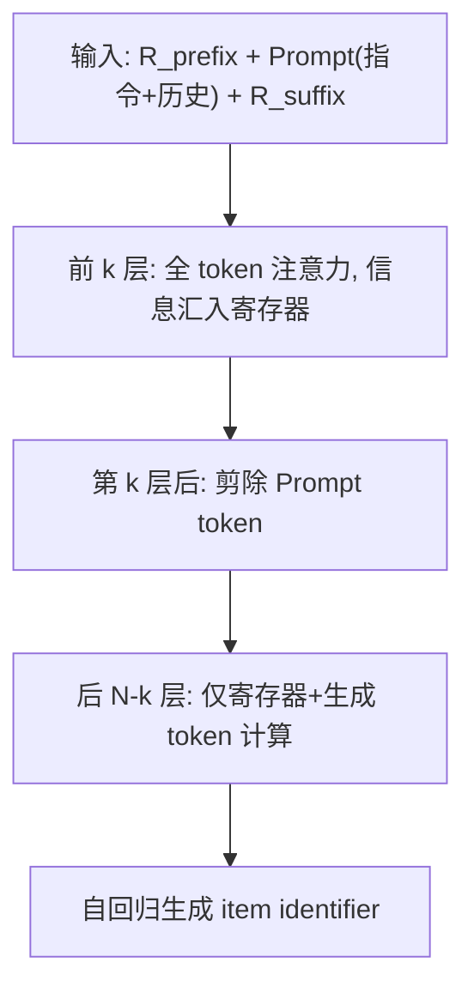
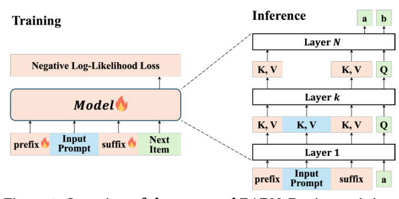

# EARN: Efficient Inference Acceleration for LLM-based Generative Recommendation by Register Tokens (基于寄存器 Token 的 LLM 生成式推荐高效推理加速)

- **会议/期刊**: KDD 2025
- **作者与机构**: Chaoqun Yang (清华), Xinyu Lin / Xianjing Han / Tat-Seng Chua (NUS), Wenjie Wang (USTC), Yongqi Li (PolyU), Teng Sun (山大)
- **推荐链路定位**: 生成式端到端（LLM 自回归生成 item identifier 的推理加速）
- **研究方向**: 大语言模型推荐 / 生成式推荐
- **论文原文**: [https://arxiv.org/abs/2507.00715v1](https://arxiv.org/abs/2507.00715v1)
- **开源代码**: [https://github.com/transcend-0/EARN](https://github.com/transcend-0/EARN)

## TL;DR (1分钟核心速览)

LLMRec 因超长 prompt 与 KV Cache 内存压力导致推理延迟高，而缓存压缩在仅 1–5 步解码的推荐任务上加速有限、prompt 压缩又易丢弃关键交互历史。EARN 通过分析发现 LLMRec 存在「层间注意力稀疏反转」与「首尾双注意力汇」两大现象，在输入首尾插入可学习寄存器 token，用前 $k$层把任务指令与交互历史压缩进寄存器，第$k$ 层后直接剪除 prompt token。在 Beauty/Games/MovieLens 三数据集、LC-Rec/TIGER 两方法、Llama/Qwen 两架构上，实现最高 3.79× 加速、80.8% KV Cache 缩减，且 Recall/NDCG 全面优于全量微调。

## Background & Motivation (背景与核心矛盾)

- **主流范式**: LLMRec 将任务指令与用户历史交互拼成 prompt，自回归生成 item ID；推理分 prefilling（矩阵乘、compute-bound）与 decoding（向量-矩阵乘、memory-bound）两阶段，KV Cache 随序列线性膨胀。
- **前人局限**: ① 缓存压缩（StreamingLLM/SnapKV）虽能砍 90%+ cache，但推荐解码仅 1–5 步，端到端加速仅 1.0–1.2×；② prompt 压缩（POD/500xCompressor）在推荐中难以区分 item 重要性，高压缩比下 Recall 直接崩到 0.0005 量级。
- **核心洞察 (Key Insight)**: 作者在 3 数据集 × 2 方法 × 2 架构上观察到：**层间稀疏反转**——NLP 任务前稀疏后稠密（0.06→0.03），LLMRec 恰好相反（0.01→0.07），即前几层信息密集、后层高度冗余；**双注意力汇**——注意力同时沉向序列头部与尾部窄区间，尾部 token 可见全部前序 token，天然具备摘要能力。
- **本文切入点**: 既然前 $k$层已把信息汇总到首尾，就让首尾寄存器 token 承接压缩职责，后$N-k$ 层只算寄存器与生成 token。

## Method (核心方法设计)

### 1. 整体框架 (Overall Architecture)

输入序列重构为 $X=[R_{\text{prefix}}; \text{Prompt}; R_{\text{suffix}}]$，其中$R_{\text{prefix}}$替换原 BOS token 承担「任务指示 + 注意力分流」，$R_{\text{suffix}}$置于交互历史末尾承担「历史摘要」。训练时全序列参与前向，但第$k$层之后注意力只保留寄存器与生成 token；推理时 prefilling 与 decoding 均在第$k$ 层后物理移除 prompt 的 KV，从而同时削减 FLOPs 与显存访问。整个流程无需改动 LLM 主干结构，仅新增两组可学习 embedding 并端到端微调。

<figure class="paper-figure" markdown="span">
  <figcaption>图3：所提出的 EARN 概览。训练时，前缀寄存器和后缀寄存器也可训练。推理时，在第 𝒌 层之后，EARN 移除提示 token 以实现加速。</figcaption>
</figure>

### 2. 关键设计拆解 (Key Designs)

1. **前缀寄存器 (Prefix Register)**：动机来自 head sink——原 BOS 吸收冗余注意力但无任务语义。用可学习虚拟 token 替换 BOS，既保留分流功能又注入推荐任务先验（借鉴 prompt tuning）。消融显示去掉它 R@20 从 0.0273 降至 0.0252（Llama, $k{=}7$），说明其作用是「任务感知增强」而非信息承载。

2. **后缀寄存器 (Suffix Register)**：动机来自 tail sink——序列末 token 可见全部前序，具备摘要潜力。将 $n$个可学习 token 放在历史交互之后，由前$k$层放大其摘要能力。这是性能主导项：去掉后 R@10 从 0.0174 崩至 0.0041（Llama,$k{=}7$），且$k$ 越小跌幅越大，说明低层更依赖后缀寄存器承载的压缩历史。

3. **训练目标、负采样与推理效率**：采用标准 next-token 负对数似然，无额外负采样：
$$\mathcal{L}=-\sum_{j=1}^{|Y|}\log P(Y_j\mid X,Y_{<j})$$
与普通微调的唯一差异是第 $l>k$层注意力掩掉 prompt token。效率上，注意力 FLOPs 比$\Gamma_{\text{attn}}\approx k/N$，KV Cache 缩减比$\Gamma_{\text{cache}}\approx (N-k)/N$，理论加速$\Omega\approx N/k$；典型配置$N{=}32,k{=}8,r{=}2$下 cache 降至 75%、加速约 4×。默认超参启发式：$k$取总层数 1/4，$n{=}1$（前后各一）。

## Experimental Setup & Evaluation Protocol (实验设置与评估协议)

- **数据集与预处理**: Beauty、Games、MovieLens-1M 三个真实交互数据集，沿用 LC-Rec/TIGER 的 item identifier 构造与序列切分（详见原文附录 A.3）。

| 数据集 | 领域 | 说明 |
| :--- | :---: | :--- |
| Beauty | 美妆 | 与 Games 同为 Amazon 类目，序列较短 |
| Games | 视频游戏 | 交互较密集 |
| MovieLens-1M | 电影 | 用户-电影评分转隐式交互 |

- **数据划分与防穿越 (Splitting Strategy)**: 沿用 LLMRec 主流的时间序 next-item 预测划分（历史 $i_1..i_T$预测$i_{T+1}$），训练/验证/测试按用户序列切分。
- **排名评测协议 (Ranking Protocol)**: 生成式范式下以 beam/贪心生成 item identifier 后计算 Recall@{10,20} 与 NDCG@{10,20}，非全库打分；效率侧测 Walltime Speedup $\omega$、Throughput$\tau$、KV Cache Reduction$\gamma$、KV Cache Memory$\sigma$。
- **对比基线与超参设置**: 基线覆盖 Finetune、SkipLayers、prompt 压缩（POD、500xCompressor）、cache 压缩（StreamingLLM、SnapKV）、gist 类（Gist、AnLLM）；主干为 Llama-7B（MHA）与 Qwen2.5-7B（GQA），方法实例化于 LC-Rec 与 TIGER。

## Key Experimental Results (实验关键数据)

### 1. 主实验对比 (Main Results)

LC-Rec + Llama-7B（节选，完整见原文 Table 1）：

| 数据集 | 方法 | $\omega$↑ |$\gamma$%↑ | R@10 | R@20 | N@20 |
| :--- | :--- | :---: | :---: | :---: | :---: | :---: |
| Beauty | Finetune | 1.00 | 0.0 | 0.0145 | 0.0225 | 0.0108 |
| Beauty | 500xCompressor | 2.31 | 74.8 | 0.0005 | 0.0006 | 0.0003 |
| Beauty | SnapKV | 1.20 | 94.5 | 0.0054 | 0.0061 | 0.0032 |
| Beauty | Gist | 1.18 | 17.5 | 0.0048 | 0.0077 | 0.0036 |
| Beauty | **EARN** | **3.79** | 80.5 | **0.0167** | **0.0265** | **0.0124** |
| Games | Finetune | 1.00 | 0.0 | 0.0167 | 0.0273 | 0.0138 |
| Games | **EARN** | **3.53** | 80.8 | **0.0180** | **0.0291** | **0.0142** |
| MovieLens | Finetune | 1.00 | 0.0 | 0.0247 | 0.0449 | 0.0288 |
| MovieLens | **EARN** | **3.21** | 79.7 | **0.0259** | **0.0452** | **0.0341** |

LC-Rec + Qwen2.5-7B 上 EARN 同样取得 2.71–3.11× 加速、66.7–75.2% cache 缩减，MovieLens R@20 从 0.0421 提升至 0.0591（+40.4%）。

### 2. 消融实验 (Ablation Study)

| 模型 | $k$ | 配置 | R@10 | R@20 | N@20 |
| :--- | :---: | :--- | :---: | :---: | :---: |
| Llama | 7 | Finetune | 0.0145 | 0.0225 | 0.0108 |
| Llama | 7 | EARN | **0.0174** | **0.0273** | **0.0127** |
| Llama | 7 | w/o Register Training | 0.0048 | 0.0060 | 0.0025 |
| Llama | 7 | w/o Prefix Register | 0.0172 | 0.0252 | 0.0132 |
| Llama | 7 | w/o Suffix Register | 0.0041 | 0.0075 | 0.0031 |
| Qwen | 7 | EARN | **0.0155** | **0.0265** | **0.0122** |
| Qwen | 7 | w/o Suffix Register | 0.0044 | 0.0071 | 0.0031 |

### 3. 关键实验发现 (Key Findings)

1. **寄存器必须训练，不能白嫖**：直接在微调模型上插入寄存器推理（w/o RT），Llama $k{=}7$ 的 R@10 相对掉 72%（0.0174→0.0048）、N@20 掉 80%，说明寄存器摘要能力是训练习得而非架构自带。
2. **后缀寄存器是性能命脉，前缀寄存器是锦上添花**：去掉 SR 导致 R@10 崩至 0.0041（-76%），而去掉 PR 仅小幅波动甚至 N@20 略升（0.0132 vs 0.0127），印证「历史压缩」比「任务指示」更关键；且 SR 在低层（$k{=}7$）的贡献显著大于高层（$k{=}15$）。
3. **加速与精度存在明确甜点区**：$k<4$（Llama）或$k<7$（Qwen）时加速高但 Recall 显著损失，$k\ge13$后加速骤降而 Recall 不再增长；$k$取 1/4 层数、$n{=}1$ 即可在三个数据集上同时拿到高加速与正收益，且序列越长收益越大（20K 长度下加速达 7×）。

## Highlights & Limitations (亮点、对比与审稿批判)

- **与代表作对比 (vs. Prior Work)**: 相比 StreamingLLM/SnapKV 只优化 decoding，EARN 同时压缩 prefilling 与 decoding；相比 500xCompressor 把历史压成单 token 导致精度归零，EARN 用「前 $k$层 + 首尾寄存器」保留可学习摘要路径；相比 Gist/AnLLM 用全部层做压缩（开销大、压缩比与精度难两全），EARN 只借前$k$ 层，天然把「压缩成本」与「加速收益」解耦。
- **可迁移亮点**: ① 「层间稀疏反转」诊断可直接用于其他长 prompt 生成式任务（如对话推荐、序列生成）的层剪枝定位；② 首尾双寄存器 + 第 $k$ 层剪枝的范式可平移到任意 decoder-only LLM 的推理框架，无需改结构。
- **审稿级局限批判**: ① 评测仅在 7B 级模型与三个中等规模数据集上，未验证 70B/ MoE 或工业级亿级 item 词表下的表现；② 寄存器训练需全参微调，冷启动成本与「训练时也剪枝」的一致性（训练仍算全序列前向）未被充分讨论；③ 生成式评测依赖 beam 解码，未报告与全库排序协议的可比性。

## Rating (四维评分)

- **方法创新性 (Novelty)**: ⭐⭐⭐⭐ （从注意力稀疏反转与双 sink 现象反推架构设计，动机-机制-收益链条完整，但寄存器 token 本身非全新概念）
- **评估协议与实验扎实度 (Protocol & Experiments)**: ⭐⭐⭐⭐ （3 数据集 × 2 方法 × 2 架构 + 效率/精度双维度 + 完整消融与超参分析，惟缺大规模工业验证）
- **写作与数学规范度 (Clarity & Rigor)**: ⭐⭐⭐⭐ （FLOPs 与 KV Cache 复杂度推导清晰，$\Gamma_{\text{attn}}\approx k/N$、$\Omega\approx N/k$ 结论直观，符号统一）
- **工业落地与复现价值 (Industrial & Practical Value)**: ⭐⭐⭐⭐⭐ （代码开源、无需改模型结构、默认超参启发式明确，3.79× 加速与 80% cache 缩减对毫秒级推荐场景直接可用）

