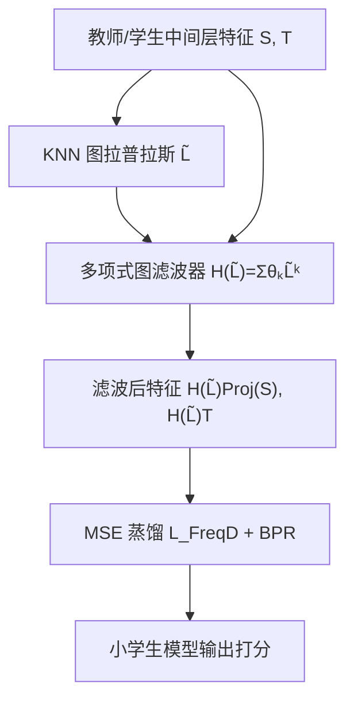

# Exploring Feature-based Knowledge Distillation for Recommender System: A Frequency Perspective (从频域视角探索推荐系统的特征知识蒸馏)

- **会议/期刊**: KDD 2025
- **作者与机构**: Zhangchi Zhu, Wei Zhang（华东师范大学）
- **推荐链路定位**: 召回（模型压缩 / 蒸馏加速）
- **研究方向**: 大语言模型推荐 / 协同过滤与双塔召回
- **论文原文**: [论文原文链接](https://arxiv.org/abs/2411.10676v2)
- **开源代码**: [开源代码仓库链接](https://github.com/woriazzc/KDs)

## TL;DR (1分钟核心速览)

特征级知识蒸馏（KD）在 CV/NLP 中效果优异，但在推荐系统中却系统性弱于响应级方法，作者从图信号频域视角给出解释：常规特征蒸馏损失等价于对特征所有频率分量**等权**最小化，而学生容量有限时恰恰学不好、却最关键的**低频知识**（节点邻域共性）被忽视。为此提出 FreqD：用极稀疏多项式图滤波器对学生/教师特征先滤波再蒸馏，等价于对低频分量加权。在 3 数据集 × 3 骨干、全库排序协议下，Recall@20 相对最强基线最高提升 18.23%，且仅需教师 10% 参数量即可逼近教师精度。

## Background & Motivation (背景与核心矛盾)

- **主流范式**: 推荐模型靠增大 embedding 维度提升容量，但 embedding 占参数大头，带来存储与推理延迟问题；KD 通过"大教师→小学生的中间层特征对齐（FitNet/DE/PHR）或 logits 对齐（CD/RRD/UnKD）"实现压缩。
- **前人局限**: 与 CV/NLP 相反，推荐系统中特征级 KD 反而**普遍弱于**响应级 KD（原文 Table 4 中 FitNet 全面落后 CD/RRD）；且现有特征级方法（DE 的多投影器、PHR 的个性化网络）只做维度对齐，**完全忽略特征不同频率分量的差异**。
- **核心洞察 (Key Insight)**: 借助图信号处理，低频分量刻画节点与邻居的**共性**、高频刻画**差异**；实验（图 1）显示学生容量越小，低频分组的蒸馏损失越大，而 Table 1 的"置零消融"表明去掉低频知识后 Recall@20 从 0.0862 暴跌至 0.0657——**被忽视的低频恰恰最重要**。
- **本文切入点**: 将"知识"定义为特征的不同频率分量，证明常规 KD 是等权损失，进而用图滤波实现低频重加权，且不引入特征分解开销。

## Method (核心方法设计)

### 1. 整体框架 (Overall Architecture)

先用冻结教师构建 user-user / item-item KNN 图并算归一化拉普拉斯 $\tilde{L}$；训练时对学生特征$\mathbf{S}$与教师特征$\mathbf{T}$分别施加同一个稀疏多项式图滤波器$H(\tilde{L})$，再做投影对齐与 MSE 蒸馏，与基座 BPR 损失加权联合优化。核心闭环是"滤波即重加权"：无需显式计算每个频率分量，仅一次稀疏矩阵乘法即可隐式完成低频加权。

### 2. 关键设计拆解 (Key Designs)

1. **频域知识定义与等权性定理（Theorem 1）**：将第 $k$类知识定义为特征的第$k$个频率分量$\tilde{\mathbf{X}}_k=\mathbf{u}_k\mathbf{u}_k^\top\mathbf{X}$。由于$\{\mathbf{u}_k\}$ 构成正交基，可证常规损失可完全分解为
$$\mathcal{L}_{FD}=\sum_{k=1}^{|\mathcal{V}|}\|\text{Proj}(\tilde{\mathbf{S}}_k)-\tilde{\mathbf{T}}_k\|_F^2,$$
即 FitNet 对所有频率**等权**，这正是低频知识被淹没的根源。

2. **图滤波等价重加权（Theorem 2 + FreqD）**：直接按频率加权需对 $\tilde{L}$做完整特征分解，工业上不可行。作者证明：对特征先滤波再算 MSE，等价于设权重$g(\lambda_i)=h^2(\lambda_i)$：
$$\|\mathcal{H}(\tilde{L})\text{Proj}(\mathbf{S})-\mathcal{H}(\tilde{L})\mathbf{T}\|_F^2=\sum_{k=1}^{|\mathcal{V}|}h^2(\lambda_k)\|\text{Proj}(\tilde{\mathbf{S}}_k)-\tilde{\mathbf{T}}_k\|_F^2.$$
取 $h(\lambda)=1-\alpha\lambda$（$0\le\alpha\le0.5$，随频率递减），并用$H(\tilde{L})=\sum_{k=0}^{K}\theta_k\tilde{L}^k$的多项式形式避免特征分解，$K=0$ 时精确退化为 FitNet，故 FitNet 是本文的零阶特例。

3. **训练目标与效率**：总损失 $\mathcal{L}=\mathcal{L}_{Base}+\beta\cdot\mathcal{L}_{FreqD}$，负采样沿用 BPR 的均匀随机负采样（无额外难负采样）。复杂度仅$O(|\mathcal{B}|d_Sd_T+|\mathcal{R}|(d_S+d_T))$，比 DE 的$O(K|\mathcal{B}|d_Sd_T)$ 更省；滤波前对 KNN 图做 edge dropout 防过拟合。

## Experimental Setup & Evaluation Protocol (实验设置与评估协议)

- **数据集与预处理**（过滤交互数 < 10 的用户/物品）：

| 数据集 | #Users | #Items | #Interactions | 稀疏度 | 场景说明 |
| :--- | :---: | :---: | :---: | :---: | :--- |
| CiteULike | 5,219 | 25,181 | 125,580 | 99.89% | 学术文献收藏 |
| Gowalla | 29,858 | 40,981 | 1,027,370 | 99.92% | LBSN 签到 |
| Yelp2018 | 41,801 | 26,512 | 1,022,604 | 99.91% | 本地商户点评 |

- **数据划分与防穿越**: 按时间戳**时序 8:1:1** 划分训练/验证/测试，避免未来交互泄漏。
- **排名评测协议**: 无偏 **Full-Ranking（全库未交互物品排序）**，指标 Recall@{10,20}、NDCG@{10,20}，5 次独立运行取均值并做配对 t 检验（$p\le0.05$）。
- **对比基线与超参**: 响应级 CD/RRD/UnKD、关系级 HTD、特征级 DE/FitNet；骨干 BPRMF、LightGCN、SimpleX；学生维度统一 $d_S=20$，教师维度 300–2000 不等；$\beta\in\{0.01,0.05,0.1,0.5\}$，早停基于验证集 NDCG@20。

## Key Experimental Results (实验关键数据)

### 1. 主实验对比 (Main Results)

以 BPRMF 与 LightGCN 骨干为例（R=Recall, N=NDCG）：

| 骨干 | 方法 | CiteULike R@20 | Gowalla R@20 | Yelp R@20 | Yelp N@20 |
| :--- | :--- | :---: | :---: | :---: | :---: |
| BPRMF | Teacher | 0.0442 | 0.1544 | 0.0660 | 0.0339 |
| BPRMF | Student | 0.0284 | 0.1329 | 0.0586 | 0.0299 |
| BPRMF | CD | 0.0347 | 0.1389 | 0.0608 | 0.0310 |
| BPRMF | RRD | 0.0362 | 0.1395 | 0.0626 | 0.0319 |
| BPRMF | UnKD | 0.0348 | 0.1401 | 0.0601 | 0.0312 |
| BPRMF | HTD | 0.0337 | 0.1379 | 0.0600 | 0.0309 |
| BPRMF | DE | 0.0331 | 0.1372 | 0.0598 | 0.0305 |
| BPRMF | FitNet | 0.0326 | 0.1352 | 0.0599 | 0.0301 |
| BPRMF | **FreqD** | **0.0428** | **0.1494** | **0.0669** | **0.0344** |
| BPRMF | Improv. | +18.23% | +6.64% | +6.87% | +7.84% |
| LightGCN | 最佳基线 RRD | 0.0359 | 0.1627 | 0.0671 | 0.0338 |
| LightGCN | **FreqD** | **0.0384** | **0.1712** | **0.0702** | **0.0359** |
| LightGCN | Improv. | +6.96% | +5.22% | +4.62% | +4.97% |

SimpleX 骨干上 FreqD 同样全面最优（Gowalla R@20 0.1739，+7.28%），且多数配置下已逼近甚至超过教师。

### 2. 消融实验 (Ablation Study)

| 配置 | CiteULike R@20 | Gowalla R@20 | Yelp R@20 | 说明 |
| :--- | :---: | :---: | :---: | :--- |
| FitNet（等权，$K=0$） | 0.0326 | 0.1352 | 0.0599 | 本文零阶特例 |
| FreqD 线性 $h(\lambda)=1-\alpha\lambda$ | **0.0428** | 0.1494 | 0.0669 | 默认配置 |
| FreqD 二次 $h(\lambda)=a\lambda^2+b\lambda+1$ | — | **0.1502** | 0.0673 | 略优但更复杂 |
| 去掉低频组 $w_1=0$ | 0.0657 | — | — | 性能断崖式下跌 |
| 去掉高频组 $w_4=0$ | 0.0855 | — | — | 几乎无损 |

（后两行为原文 Table 1 的 BPRMF 原始学生设置，用于验证频率重要性。）

### 3. 关键实验发现 (Key Findings)

1. **低频是命门**：BPRMF 下去掉最低频组使 Recall@20 从 0.0862 降至 0.0657（-23.8%），而去掉最高频组仅降至 0.0855，定量印证"等权蒸馏错配了知识重要性"。
2. **重加权即涨点**：仅把 FitNet 换成线性低频增强滤波，CiteULike 上 R@20 从 0.0326 跃至 0.0428（+31%），说明瓶颈不在容量对齐而在频率权重分配。
3. **压缩比惊人**：Table 7 显示学生参数仅为教师 10% 时，R-R@10 仍达 1.00–1.03（与教师持平），推理延迟降至约 1/4；半尺寸学生甚至反超教师（R-R@10 达 1.15–1.20）。

## Highlights & Limitations (亮点、对比与审稿批判)

- **与代表作对比 (vs. Prior Work)**: 相比 DE/PHR 靠多投影器或个性化网络做"空间维度对齐"，FreqD 首次从**频域**解释并修正蒸馏目标，且 FitNet 是其 $K=0$ 特例，理论包含关系清晰；相比 CD/RRD 等响应级方法需对全物品非均匀采样，FreqD 训练开销更低（Table 5 中 FreqD 每 epoch 耗时约为 CD 的 1/4）。
- **可迁移亮点**: ①"滤波即重加权"技巧可无缝迁移到关系级 KD（对齐样本相似度矩阵前先滤波）；②多项式图滤波器 $H(\tilde{L})=\sum\theta_k\tilde{L}^k$ 是替代特征分解的通用轻量工具，可用于任何需要频域加权的图推荐任务。
- **审稿级局限批判**: ①仅验证线性/二次滤波器，作者自承为保稀疏性牺牲了滤波器表达力，最优频率响应未探索；②KNN 图需在训练前用冻结教师一次性构建，教师更新或跨域场景下图的时效性与迁移性存疑；③实验限于三个公开中小规模数据集，未给出工业级千万级用户图上的滤波开销实测。

## Rating (四维评分)

- **方法创新性 (Novelty)**: ⭐⭐⭐⭐ （频域视角解释特征 KD 失效并提出等权性定理，理论切入点新颖，但重加权思想本身不算颠覆）
- **评估协议与实验扎实度 (Protocol & Experiments)**: ⭐⭐⭐⭐ （3 数据集 × 3 骨干 × 全库排序 + 配对 t 检验 + 效率/显存/推理多维评测，惟缺大规模工业验证）
- **写作与数学规范度 (Clarity & Rigor)**: ⭐⭐⭐⭐ （两个定理与等价性证明链条完整，FitNet 特例关系阐述清晰，符号统一）
- **工业落地与复现价值 (Industrial & Practical Value)**: ⭐⭐⭐⭐⭐ （代码开源，仅增一次稀疏滤波，10% 参数逼近教师精度，压缩收益直接可落地）

