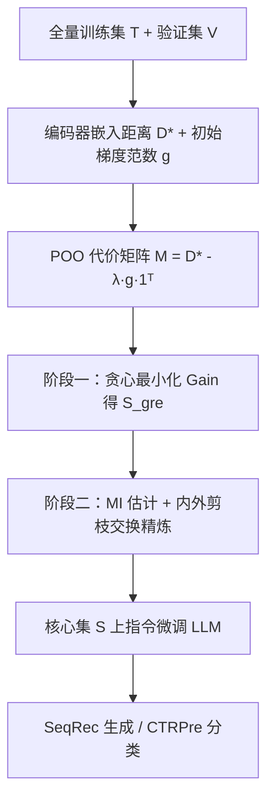
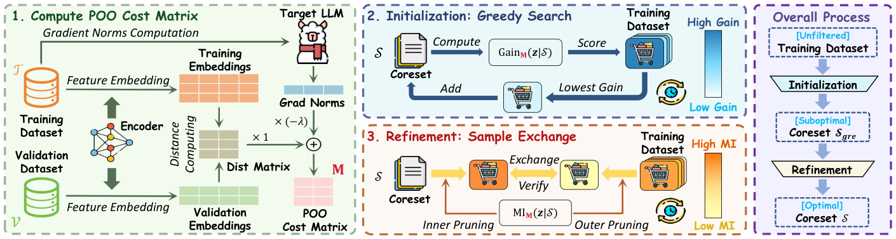

# GORACS: Group-level Optimal Transport-guided Coreset Selection for LLM-based Recommender Systems (组级最优传输引导的 LLM 推荐核心集选择)

- **会议/期刊**: KDD 2025
- **作者与机构**: Tiehua Mei, Hengrui Chen, Peng Yu, Jiaqing Liang, Deqing Yang（复旦大学数据科学学院）
- **推荐链路定位**: 训练数据侧优化（服务于 LLM 指令微调，覆盖生成式 SeqRec 与判别式 CTR 两条链路）
- **研究方向**: 大语言模型推荐 / 冷启动与长尾（数据效率视角）
- **论文原文**: [https://arxiv.org/abs/2506.04015v1](https://arxiv.org/abs/2506.04015v1)
- **开源代码**: [https://github.com/Mithas-114/GORACS](https://github.com/Mithas-114/GORACS)

## TL;DR (1分钟核心速览)

LLM 推荐的全量指令微调代价高昂，而现有核心集选择要么（分布匹配类）与下游微调目标错位，要么（重要性排序类）逐样本挑选、丢失推荐数据固有的样本间关联。GORACS 用 Kantorovich-Rubinstein 对偶把"训练-测试损失差"用最优传输距离界定、再用初始梯度范数界定训练损失，合成一个可高效计算的测试损失上界代理目标 POO，并用"贪心初始化 + 带双向剪枝的交换精炼"两阶段算法求解组级子集。在 Amazon 三数据集上，仅用 20% 时间、15% FLOPs 即超越全量微调，SeqRec 的 HR@10 相对最强基线提升 5.3%–7.8%。

## Background & Motivation (背景与核心矛盾)

- **主流范式**: LLMRec 依赖指令微调对齐推荐任务；PEFT 只削减参数侧开销，无法应对数据量本身的膨胀，因此"选小核心集"成为数据侧的关键杠杆。
- **前人局限一（目标错位）**: 分布匹配类（DSIR、CCS、D² Pruning、FDMat）只保证特征空间覆盖，不直接最小化测试损失；重要性类（GraNd、EL2N、DEALRec）按单样本影响力排序，与最终微调目标同样不严格对齐。
- **前人局限二（个体级偏差）**: 逐样本挑选会过度聚焦决策边界附近的高难度样本，牺牲泛化；而推荐数据中用户-物品交互与时间依赖天然构成样本间集体结构，个体级方法对此视而不见。
- **核心洞察 (Key Insight)**: 若子集分布与测试分布的最优传输距离小，则在其上训练的模型泛化好；且 LLM 微调收敛时训练损失非零，必须显式保留"模型相关"的训练损失项——不同 LLM 的样本梯度范数分布显著不同（图 2a），而子集平均梯度范数与最终训练损失呈强负相关（$R=-0.93$，图 2b）。
- **本文切入点**: 把核心集选择重写为"最小化测试损失上界"的组级优化问题，用 OT 距离 + 梯度范数构造免重训的代理分数。

## Method (核心方法设计)

### 1. 整体框架 (Overall Architecture)

GORACS 把核心集选择形式化为 $\mathcal{S}^*=\arg\min_{|\mathcal{S}|=n}\mathbb{E}_{\boldsymbol{z}\sim\mathcal{P}}[\mathcal{L}_{\phi^*_\mathcal{S}}(\boldsymbol{z})]$，但直接求解需对每个候选子集重训 LLM，不可行。于是先用定理 4.1（OT 界泛化差）+ 定理 4.2（梯度范数界训练损失）合成代理目标 POO，再把 POO 改写为带特殊代价矩阵$\mathbf{M}$的 OT 距离；随后 ITRA 两阶段求解：贪心搜索快速得到初始核心集$\mathcal{S}_{gre}$，再通过"内/外双向剪枝 + 边际改进估计"筛选候选交换对进行精炼。最终在选出的子集上做指令微调，推理时按原 LLMRec 范式解码（SeqRec 走 BIGRec 的标题生成 +$L_2$ 接地匹配，CTRPre 走 TALLRec 的 Yes/No 二分类）。

<figure class="paper-figure" markdown="span">
  <figcaption>图 1：GORACS 概览。它选取一个代表性核心集 S ⊂ T，以最小化 POO 分数（式 9），该分数已被证明是测试损失的上界（第 4.1 节）。为此，GORACS 的流程包含三个阶段：1）计算特征嵌入距离和梯度范数以构建 POO 代价矩阵 M（第 4.2.1 节）；2）通过贪心添加 Gain 分数最低的样本构建初始核心集 S𝑔𝑟𝑒（第 4.2.2 节）；3）通过迭代地将 S𝑔𝑟𝑒 中的低质量样本与 S𝑔𝑟𝑒 外的高质量样本交换来精炼 S𝑔𝑟𝑒，其质量由以下方式衡量</figcaption>
</figure>

### 2. 关键设计拆解 (Key Designs)

1. **代理优化目标 POO（把不可算的测试损失变成可算的上界）**：由 KR 对偶，$L$-Lipschitz 损失下测试损失满足$\mathbb{E}_{\mathcal{P}}[\mathcal{L}]\le\mathbb{E}_{\mu_\mathcal{S}}[\mathcal{L}]+L\cdot OT_{\mathbf{D}^*}(\mu_\mathcal{S},\mu_\mathcal{V})$；再由全批量 GD 首步的$G$-光滑性得$\mathbb{E}_{\mu_\mathcal{S}}[\mathcal{L}]\le\Lambda-\frac{C}{|\mathcal{S}|}\sum_{\boldsymbol{z}\in\mathcal{S}}\|\nabla_\phi\mathcal{L}_{\phi_0}(\boldsymbol{z})\|$。两者合并即得可优化分数：

$$\mathcal{S}(\mathcal{S})=OT_{\mathbf{D}^*}(\mu_\mathcal{S},\nu_\mathcal{V})-\frac{\lambda}{|\mathcal{S}|}\sum_{\boldsymbol{z}\in\mathcal{S}}\|\nabla_\phi\mathcal{L}_{\phi_0}(\boldsymbol{z})\|$$

直觉：第一项管"分布对齐"（组级覆盖），第二项管"样本对参数的实际更新量"（模型相关重要性），$\lambda$ 平衡二者。相比前人假设训练损失为零，这里显式保留梯度项，正是 LLM 间差异的来源。

2. **ITRA 两阶段组级求解（把组合爆炸压成可算的交换搜索）**：将 POO 写成 $OT_{\mathbf{M}}(\mu_\mathcal{S},\mu_\mathcal{V})$，代价矩阵$\mathbf{M}=\mathbf{D}^*-\lambda\boldsymbol{g}\cdot\mathbf{1}^T$。阶段一把耦合约束松弛为$\Omega_\mathcal{S}$，内层 OT 获得闭式解，问题退化为 p-median：$\min_{\mathcal{S}}\sum_{j=1}^{|\mathcal{V}|}\min_{\boldsymbol{z}_i\in\mathcal{S}}M_{ij}$，用边际增益$Gain_{\mathbf{M}}(\boldsymbol{z}|\mathcal{S})=\sum_j(M_{\boldsymbol{z}j}-M_{*j})_-$ 贪心加点。阶段二用 OT 对偶稳定性估计边际改进：

$$MI_{\mathbf{M}}(\boldsymbol{z}|\mathcal{S})\approx\sup_{y\in\mathbb{R}}\Big[\tfrac{1}{|\mathcal{S}|}y+\tfrac{1}{|\mathcal{V}|}\sum_j(M_{\boldsymbol{z}j}-f^{\mathbf{M}}_{\boldsymbol{z}j}(\boldsymbol{u}^*)-y)_-\Big]$$

最优 $\hat{y}_{\boldsymbol{z}}$即第$R=\lceil|\mathcal{V}|/|\mathcal{S}|\rceil$大的节点值，可并行计算；据此做外层（保留$MI$最小的$k$个待加入样本）与内层（保留$MI$最大的$k$个待移除样本）剪枝，只验证 top-$k$交换对，无改进即早停。由于$\mu_\mathcal{S}$仅支撑在$\mathcal{S}$上，OT 只需$|\mathcal{S}|\times|\mathcal{V}|$子矩阵，复杂度从$|\mathcal{T}|\times|\mathcal{V}|$ 大幅下降。

3. **判别式任务的标签增强与训练开销**：对 CTRPre，将联合分布分解为类条件分布之和，对每类独立最小化 $\mathcal{S}(\mathcal{S}_k,\mathcal{V}_k)$并约束$|\mathcal{S}_k|=p_k|\mathcal{S}|$，保证类比例与验证集一致、类内细粒度选择。训练侧无额外负采样设计（沿用 BIGRec/TALLRec 原有监督），选择阶段仅需一次前向+一次反传求初始梯度范数与嵌入，无需反复重训；Games 上选择耗时 1.63h、训练 1.29h，合计 FLOPs 约为全量训练的 15%。

## Experimental Setup & Evaluation Protocol (实验设置与评估协议)

- **数据集与预处理**: Amazon Review 三数据集，全部保留 `5-core`，按用户交互时间戳排序构造序列（前若干历史物品为输入、下一物品为输出），序列时间戳取输出物品时间戳。

| 数据集 | #Users | #Items | #Interactions | 稀疏度/密度 | 特征/场景说明 |
| :--- | :---: | :---: | :---: | :---: | :--- |
| Games | 约 2.4 万 | 约 1.1 万 | 约 23 万 | 极稀疏 | 视频游戏评论，序列较长 |
| Food | 约 2.1 万 | 约 1.0 万 | 约 17 万 | 极稀疏 | 精细食品评论，规模最小 |
| Movies | 约 4.2 万 | 约 2.0 万 | 约 60 万 | 极稀疏 | 影视评论，规模最大 |

- **数据划分与防穿越 (Splitting Strategy)**: 严格按时间戳切分防泄漏；Food 用 `8:1:1` 比例划分，Games/Movies 取时间序最后 5,000 条为测试、其前 5,000 条为验证。
- **排名评测协议 (Ranking Protocol)**: SeqRec 采用 `Sampled Ranking`——每个测试样本随机采 99 个用户未交互物品作负样本（1:99），报告 HR@{5,10}、N@ {5,10}；CTRPre 报告 AUC。两任务均额外报告 Test Loss (TL) 作为微调质量指标。
- **对比基线与超参设置**: 基线含 Random、分布类（DSIR、CCS、D² Pruning、FDMat）、重要性类（GraNd、EL2N、DEALRec、MODERATE）；骨干为 BIGRec（SeqRec）与 TALLRec（CTRPre），嵌入编码器默认 RoBERTa-base，核心集预算 $n\le 1024$，$\lambda$ 为平衡超参（图 3 中取 0.1/0.5 验证代理分数与测试损失的线性关系）。

## Key Experimental Results (实验关键数据)

### 1. 主实验对比 (Main Results)

SeqRec（BIGRec 骨干，Games/Food/Movies）：

| 方法 | Games N@10 | Games HR@10 | Food N@10 | Food HR@10 | Movies N@10 | Movies HR@10 | Movies TL↓ |
| :--- | :---: | :---: | :---: | :---: | :---: | :---: | :---: |
| Random | 0.2074 | 0.3219 | 0.1002 | 0.1658 | 0.1512 | 0.2392 | 0.8674 |
| DSIR | 0.1494 | 0.2572 | 0.0881 | 0.1540 | 0.1137 | 0.2002 | 1.1580 |
| CCS | 0.2081 | 0.3230 | 0.0944 | 0.1607 | 0.1496 | 0.2386 | 0.9498 |
| D² | 0.1888 | 0.3020 | 0.0892 | 0.1600 | 0.1321 | 0.2296 | 0.9169 |
| GraNd | 0.1801 | 0.2814 | 0.0959 | 0.1693 | 0.1226 | 0.2152 | 1.2360 |
| EL2N | 0.1445 | 0.2444 | 0.0824 | 0.1478 | 0.1043 | 0.1860 | 1.2380 |
| DEALRec | 0.2046 | 0.3208 | 0.1016 | 0.1665 | 0.1517 | 0.2414 | 0.8443 |
| **GORACS** | **0.2195** | **0.3404** | **0.1075** | **0.1783** | **0.1610** | **0.2568** | **0.7643** |
| Improv.% | +5.48% | +5.39% | +5.81% | +5.32% | +6.13% | +6.38% | -9.48% |

CTRPre（TALLRec 骨干）：

| 方法 | Games AUC↑ | Games TL↓ | Food AUC↑ | Food TL↓ | Movies AUC↑ | Movies TL↓ |
| :--- | :---: | :---: | :---: | :---: | :---: | :---: |
| Random | 0.5933 | 0.4903 | 0.5986 | 0.4837 | 0.6590 | 0.4089 |
| CCS | 0.6381 | 0.4783 | 0.6170 | 0.4864 | 0.6442 | 0.4868 |
| FDMat | 0.6552 | 0.4765 | 0.6099 | 0.4836 | 0.6339 | 0.4139 |
| MODERATE | 0.5385 | 0.5030 | 0.5533 | 0.4843 | 0.6624 | 0.4201 |
| **GORACS** | **0.6949** | **0.4563** | **0.6306** | **0.4713** | **0.6944** | **0.3945** |
| Improv.% | +6.06% | -4.24% | +2.20% | -2.54% | +4.83% | -3.52% |

### 2. 消融实验 (Ablation Study)

Food 数据集（图 4 数值化）：

| 变体 | SeqRec N@10 | SeqRec HR@10 | CTRPre AUC | CTRPre TL↓ |
| :--- | :---: | :---: | :---: | :---: |
| GORACS 全量 | **0.1075** | **0.1783** | **0.6306** | **0.4713** |
| w/o OT | 显著下降（最大跌幅） | 显著下降 | 0.4721 | 0.8697 |
| w/o grad | 小幅下降 | 小幅下降 | 下降 | 上升 |
| w/o S-1（去贪心初始化） | 下降 | 下降 | 下降 | 上升 |
| w/o S-2（去精炼） | 下降 | 下降 | 下降 | 上升 |
| w/o labels（CTRPre 用算法 1） | — | — | 明显下降 | 明显上升 |

### 3. 关键实验发现 (Key Findings)

1. **OT 项是性能主引擎，梯度项是"模型适配器"**：移除 OT 后 CTRPre AUC 从 0.6306 崩至 0.4721（低于随机），说明组级分布对齐不可替代；而移除梯度项仅小幅下降，但图 6 显示在 LLaMA-7B 与 LLaMA-3.2-3B 上 GORACS(w/o grad) 仍稳定优于 DEALRec，说明梯度项提供的是跨骨干的增量增益而非性能支柱。
2. **核心集在 $n\ge 256$ 时反超全量训练，且降低流行度偏差**：Games 上全量训练 N@5 仅 0.1702、HR@5 0.2302，低于 GORACS 的 0.1924/0.2586；图 7 显示 ARP@10 随预算增大先降后升，全量训练因记忆热门物品使流行度偏差回升——核心集选择实质上是"去流行度偏置的正则化"。
3. **ITRA 的剪枝策略决定交换效率**：贪心初始化把起点从 0.172 降到 0.149；内层剪枝对交换成功率与耗时影响最大（GIO 达 Pass@1=100%、平均耗时 4.44s，而 GRR 因候选全被拒而提前终止），验证了"贪心阶段误纳的次优样本需靠内层剪枝精准剔除"的设计直觉。

## Highlights & Limitations (亮点、对比与审稿批判)

- **与代表作对比 (vs. Prior Work)**: 与 FDMat 同为 OT 系方法，但 FDMat 只做分布匹配、不优化测试损失，GORACS 把 OT 嵌入测试损失上界并叠加梯度项；与 DEALRec 相比，后者依赖代理序列模型算影响力、用启发式加权和融合影响/努力分数，GORACS 用单一可证界 + 非线性 OT 捕捉样本间关系，且在 Games 上选择耗时（1.63h vs 1.75h）与 FLOPs（1.01e18 vs 1.07e18）均更低。
- **可迁移亮点**: ①"OT 界泛化差 + 梯度范数界训练损失"这一上界构造可直接迁移到任何需要数据筛选的微调场景（如多模态推荐、跨域迁移的源域采样）；②用 OT 对偶稳定性做边际改进估计 + 双向剪枝，是把组合优化压到可算规模的通用技巧。
- **审稿级局限批判**: ①测试分布用验证集近似，未利用用户历史的时间信息构造更真实的测试分布（作者自认留作未来工作），在分布漂移强的场景下上界可能松弛；②理论分析基于全批量 GD 与 $G$-光滑假设，与实际 AdamW + 小批量微调存在偏差；③评测采用 1:99 采样排序而非 Full-Ranking，且仅三个 Amazon 域，跨域/跨平台泛化性仍待验证。

## Rating (四维评分)

- **方法创新性 (Novelty)**: ⭐⭐⭐⭐ （首次把"最小化测试损失"的核心集目标引入 LLMRec，OT 界 + 梯度界的合成上界有严格定理支撑，组级视角切中推荐数据关联性）
- **评估协议与实验扎实度 (Protocol & Experiments)**: ⭐⭐⭐⭐ （双任务三数据集、8+ 基线、消融/效率/编码器/骨干/预算多维分析齐全，但采样排序与验证集近似测试分布略削弱说服力）
- **写作与数学规范度 (Clarity & Rigor)**: ⭐⭐⭐⭐ （三个定理层层递进、POO 到 OT 形式的改写推导清晰，附录含完整证明与算法伪代码；部分符号如 $\nu_\mathcal{V}$与$\mu_\mathcal{V}$ 混用需留意）
- **工业落地与复现价值 (Industrial & Practical Value)**: ⭐⭐⭐⭐⭐ （代码已开源，20% 时间/15% FLOPs 超越全量训练，选择阶段无需重训 LLM，对 LLMRec 落地是直接可用的降本手段）

