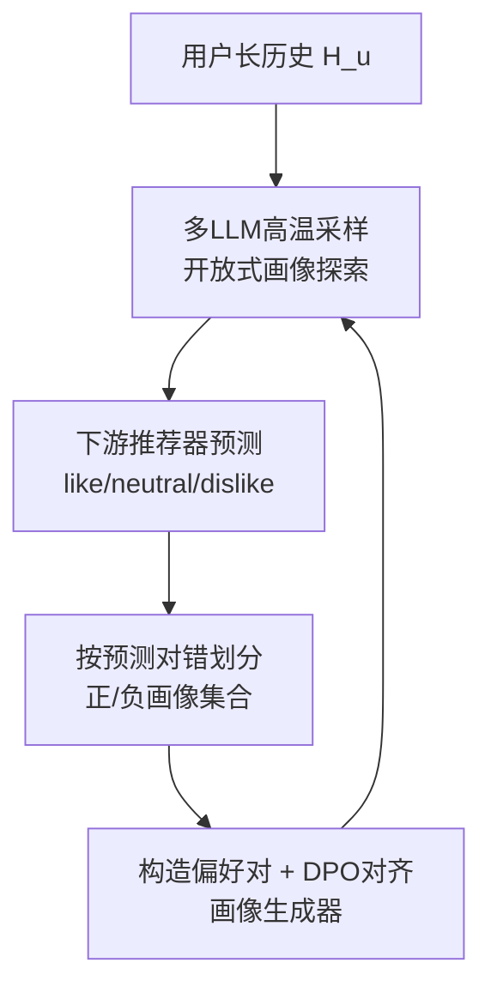
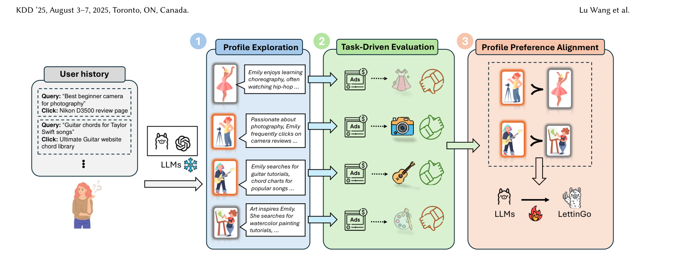

# LettinGo: Explore User Profile Generation for Recommendation System (让画像"放手"生长：面向推荐系统的用户画像生成探索)

- **会议/期刊**: KDD 2025
- **作者与机构**: Lu Wang, Di Zhang, Fangkai Yang, Pu Zhao 等（Microsoft Corporation / Peking University）
- **推荐链路定位**: 端到端生成式（画像生成 + LLM 零样本偏好预测）
- **研究方向**: 大语言模型推荐 / 生成式推荐
- **论文原文**: [https://arxiv.org/abs/2506.18309v1](https://arxiv.org/abs/2506.18309v1)
- **开源代码**: 暂未开源

## TL;DR (1分钟核心速览)

LLM 推荐中直接把长交互历史塞进 prompt 会因 token 膨胀引入噪声（图1显示性能先升后降），而现有画像方法用固定格式 prompt 或 SFT 把画像"框死"，无法适配下游任务。LettinGo 提出三阶段框架：多 LLM 高温采样探索开放式画像 → 以下游推荐预测对错作为画像质量的隐式标签 → 用成败画像对构造偏好数据做 DPO 对齐。在 MovieLens/Yelp/Amazon Books 三数据集的三分类（like/neutral/dislike）评估中，Amazon Books 上 Acc 从 63.7%（SFT）提升至 70.4%，较 10H 基线平均提升约 20 个百分点。

## Background & Motivation (背景与核心矛盾)

- **主流范式**: 传统画像用 embedding 向量表征用户，缺乏可解释性与动态更新能力；LLM 时代则用文本画像，把长历史压缩为自然语言摘要再喂给推荐模型。
- **前人局限**: 其一，直接输入长历史受 token 限制，噪声与关键信息丢失并存（图1中 LLaMA 8B 在三个数据集上均出现"先升后降"的拐点）；其二，KAR/RLMRec/PALR 等方法依赖固定格式 prompt，SFT 进一步把生成器锁死在训练见过的格式上，难以适配不同领域与演化中的任务需求。
- **核心洞察 (Key Insight)**: "好画像"没有客观 ground truth，其质量只能由**下游推荐任务的表现**间接定义——因此画像生成应当是一个反馈驱动的对齐问题，而非格式模仿问题。
- **本文切入点**: 放弃格式约束，用 DPO 把"下游预测成功/失败"转化为画像对的偏好信号，让生成器自己探索什么样的画像对推荐有用。

## Method (核心方法设计)

### 1. 整体框架 (Overall Architecture)

输入用户长历史 $\mathbf{H}_u$（近$K$条之外的部分）生成画像$\mathbf{p}_u=f_{\text{LLM}}(\mathbf{H}_u)$，再与最近$K$条短历史$\mathbf{h}_u$及候选物品$t$拼成 prompt 送入下游推荐器得$\hat{y}_u=f_{\text{Rec}}(\mathbf{p}_u,\mathbf{h}_u,t)$。三阶段闭环：先用 GPT-4o-mini、Claude、LLaMA2/3 等多个 LLM 以温度 1.0 各采样$N=10$个画像以保证多样性并避免对单一基座过拟合；再以预测是否正确把画像划入正/负集合；最后对同一用户的所有$(p^+,p^-)$ 对做 DPO 微调，得到任务对齐的画像生成器。

<figure class="paper-figure" markdown="span">
  <figcaption>图2：LettinGo概览，包含三个阶段。首先进行画像探索，从现有LLM生成多样化的用户画像。这些画像随后用于下游推荐系统进行任务驱动评估。最后，将评估后的画像构建为成对偏好数据，用于在画像偏好对齐中训练画像生成器。</figcaption>
</figure>

### 2. 关键设计拆解 (Key Designs)

1. **开放式画像探索（Profile Exploration）**：痛点是用固定模板 prompt 生成的画像千篇一律、跨域迁移差。本文仅给一个通用指令（"尽可能包含有助于预测目标物品情感的内容"），不规定字段与结构，靠高采样温度与多模型异构采样制造格式多样性——实验显示 MovieLens 画像呈叙事体、Yelp 画像呈"兴趣/偏好菜系/情感分析/预测洞察"的结构化列表、Amazon Books 则介于两者之间，证明格式本身应由领域数据"长出来"而非人工指定。

2. **任务驱动评估与偏好对构造（Task-Driven Evaluation）**：痛点是画像无监督标签。本文把画像质量定义为下游预测正确性：对每个用户，凡使 $\hat{y}=y_u$的画像入$\mathcal{P}^+_u$，否则入$\mathcal{P}^-_u$，两者均非空时做笛卡尔积生成偏好三元组$(\mathbf{H}_u,p^+,p^-)$。这一"以推荐成败为奖励"的弱监督信号，绕开了人工标注画像的不可行性。

3. **DPO 画像偏好对齐与训练目标**：痛点在于 SFT 会把生成器约束到训练集格式。本文改用 DPO 损失，仅要求正画像的对数概率高于负画像：
$$\mathcal{L}_{\text{DPO}}=-\mathbb{E}_{(\mathbf{H}_u,p^+_u,p^-_u)}\left[\log\sigma\left(f_{\text{LLM}}(p^+_u\mid\mathbf{H}_u)-f_{\text{LLM}}(p^-_u\mid\mathbf{H}_u)\right)\right]$$
由于偏好对来自真实下游反馈，梯度方向天然指向"对推荐有用的画像特征"，同时保留输出格式自由度。训练用 LLaMA-Factory，batch size 与学习率网格搜索；推理时温度置 0 保证确定性，画像生成一次即可缓存复用，在线开销仅为一次短 prompt 前向。

## Experimental Setup & Evaluation Protocol (实验设置与评估协议)

- **数据集与预处理**: 仅保留交互数 > 70 的用户；测试集取每人最后交互物品并随机抽 2000 用户；训练集从剩余用户抽 3000 人，按 1000/1000/1000 分组分别用 30/50/70 条历史采样画像，使生成器适应变长输入。

| 数据集 | #Users | #Items | #train | #test | 特征/场景说明 |
| :--- | :---: | :---: | :---: | :---: | :--- |
| MovieLens-10M | 71,567 | 10,681 | 15,637 | 2,000 | 标题、类型 |
| Amazon-Books | 1,850,187 | 483,579 | 13,212 | 2,000 | 标题、类目 |
| Yelp | 19,800 | 22,734 | 14,427 | 2,000 | 商户名、类目 |

- **数据划分与防穿越 (Splitting Strategy)**: 按时间取最后交互作测试（类 Leave-One-Out 的时序切分），画像仅由测试物品之前的长历史生成，短历史取最近 10 条，无未来信息泄漏。
- **排名评测协议 (Ranking Protocol)**: 非全库排序，而是**三分类情感预测**（like/neutral/dislike）的零样本评估，指标为 Accuracy 与 weighted-F1（macro 平均），沿用 GPG 与 Kang et al. 的范式。
- **对比基线与超参设置**: 基线含 10H（仅最近 10 条）、KAR、RLMRec、PALR（仅替换其画像 prompt，其余组件固定）；画像生成器与下游推荐器均为 LLaMA3-8B-Instruct，另用 LLaMA2-13B 与 Qwen2.5-7B 验证迁移性；采样温度训练 1.0、推理 0。

## Key Experimental Results (实验关键数据)

### 1. 主实验对比 (Main Results)

LLaMA3-8B 下三数据集结果（Acc / F1，%），最优加粗：

| Method | MovieLens Acc | MovieLens F1 | Yelp Acc | Yelp F1 | Amazon Acc | Amazon F1 |
| :--- | :---: | :---: | :---: | :---: | :---: | :---: |
| 10H | 44.95 | 41.08 | 37.45 | 42.92 | 48.15 | 55.93 |
| KAR | 51.00 | 49.91 | 67.90 | 61.60 | 67.40 | 69.84 |
| RLMRec | 48.00 | 47.07 | 61.30 | 58.96 | 63.60 | 67.42 |
| PALR | 48.10 | 47.26 | 64.10 | 59.47 | 66.40 | 69.29 |
| Ours 10H+30P | 51.80 | 51.05 | 70.70 | 62.91 | 70.55 | 71.79 |
| Ours 10H+50P | 52.80 | 51.16 | 70.65 | 63.17 | 70.75 | 71.71 |
| **Ours 10H+70P** | **53.00** | **51.69** | 70.40 | 62.94 | 70.40 | 71.27 |

LLaMA2-13B 上同趋势（MovieLens 51.09 / Yelp 66.35 / Amazon 65.75 Acc），Qwen2.5-7B 上 MovieLens 由 10H 的 52.50 升至 58.30（10H+30P），验证跨基座可迁移。

### 2. 消融实验 (Ablation Study)

| 数据集 | Without DPO | SFT | With DPO |
| :--- | :---: | :---: | :---: |
| MovieLens | 50.9 | 51.1 | **53.0** |
| Yelp | 64.9 | 66.2 | **70.4** |
| Amazon Books | 59.1 | 63.7 | **70.4** |

### 3. 关键实验发现 (Key Findings)

1. **DPO 对齐的增益随数据稀疏度放大**：MovieLens 上 DPO 仅比 SFT 高 2.1%，Yelp 高 4.2%，而 Amazon Books 高达 6.7%——说明在物品空间巨大、用户兴趣更分散的稀疏域，任务反馈信号比格式模仿更能筛出有效画像。
2. **历史长度并非越长越好，且存在数据集依赖的最优点**：MovieLens 在 70 条时最优（53.00），Yelp 在 50 条时最优（70.65），Amazon 在 30 条时最优（70.55），与图1"先升后降"的动机一致，印证长历史噪声与兴趣漂移的权衡。
3. **小模型对齐后可超越闭源大模型画像**：MovieLens 上 DPO 生成的 10H+70P 画像达 53.00 Acc / 51.69 F1，优于 GPT-4o 生成画像的 52.80 / 51.30，且画像 token 数显著短于原始历史（图3），同时降低上下文长度与推理成本。

## Highlights & Limitations (亮点、对比与审稿批判)

- **与代表作对比 (vs. Prior Work)**: KAR/RLMRec/PALR 均把画像当作"固定 prompt 的产物"或"辅助特征"，画像格式先验强、与下游任务解耦；LettinGo 首次把画像生成本身作为可优化对象，用下游成败替代人工偏好标注。相较 RLHF 式方案，DPO 无需奖励模型，训练成本低一个量级。
- **可迁移亮点**: ①"下游任务正确性 → 偏好对"的弱监督构造范式可平移到 query 改写、召回文本增强等任意无 ground-truth 的中间表示生成任务；②多 LLM 异构高温采样 + 去重配对，是低成本构造多样性偏好数据的通用技巧。
- **审稿级局限批判**: ①评估仅为三分类情感预测而非真实 Top-N 排序，缺少 NDCG/HR 等排名指标与全库排序协议，结论对排序场景的外推性存疑；②偏好对仅按"预测对/错"二值划分，未建模置信度与错误严重程度，且正负样本比例失衡时 DPO 信号可能退化；③画像生成依赖多个商用 LLM 采样，数据构造成本与可复现性未量化，线上需为每个用户预生成并缓存画像，冷启动用户仍无解。

## Rating (四维评分)

- **方法创新性 (Novelty)**: ⭐⭐⭐⭐ （把画像生成重构为任务反馈驱动的 DPO 对齐问题，视角新颖，但 DPO 本身为成熟工具、组合创新为主）
- **评估协议与实验扎实度 (Protocol & Experiments)**: ⭐⭐⭐ （三数据集 + 双基座 + 消融完整，但仅分类指标、无排序协议与显著性检验，测试集仅 2000 用户）
- **写作与数学规范度 (Clarity & Rigor)**: ⭐⭐⭐⭐ （三阶段流程与算法伪代码清晰，公式简洁；DPO 部分省略了参考模型项，符号略简化）
- **工业落地与复现价值 (Industrial & Practical Value)**: ⭐⭐⭐ （画像缓存后在线开销低、token 压缩明显，但多 LLM 采样成本高且未开源，复现门槛偏高）

