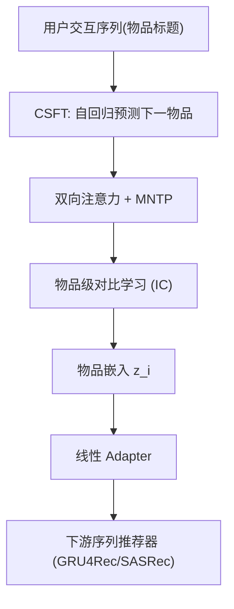
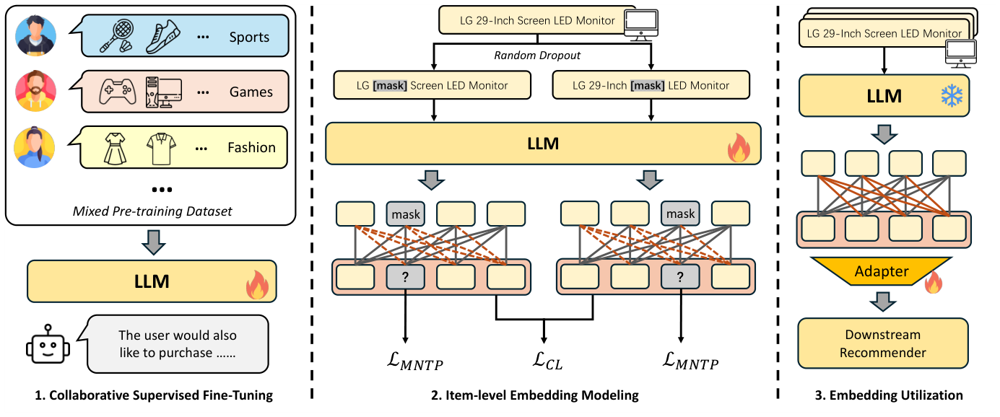

# LLM2Rec: Large Language Models Are Powerful Embedding Models for Sequential Recommendation (大语言模型是强大的序列推荐嵌入模型)

- **会议/期刊**: KDD 2025
- **作者与机构**: Yingzhi He, Xiaohao Liu, An Zhang, Yunshan Ma, Tat-Seng Chua (NUS / USTC / SMU)
- **推荐链路定位**: 召回（物品嵌入预训练，供下游序列推荐器使用）
- **研究方向**: 大语言模型推荐 / 序列推荐
- **论文原文**: [https://arxiv.org/abs/2506.21579v1](https://arxiv.org/abs/2506.21579v1)
- **开源代码**: [https://github.com/HappyPointer/LLM2Rec](https://github.com/HappyPointer/LLM2Rec)

## TL;DR (1分钟核心速览)

ID 嵌入能捕捉协同过滤 (CF) 信号却无法跨域迁移，纯文本嵌入可泛化却丢失 CF 信号，而现有融合方案依赖大 batch 对比预训练且受限于 BERT 级骨干。LLM2Rec 提出两阶段框架：先用协同监督微调 (CSFT) 让 LLM 从交互序列中学会推断物品关系，再通过双向注意力 + MNTP + 物品级对比学习把 decoder-only LLM 改造成物品嵌入模型。在 Amazon 六域预训练、Full-Ranking 评测下，域内 Recall@10 相对提升 6%–23%，跨域 Sports/Baby 提升 7%–29%。

## Background & Motivation (背景与核心矛盾)

- **主流范式**: 序列推荐以 ID 嵌入为主，靠多跳共现建模 CF 信号；近期文本嵌入方法用预训练语言模型编码标题/描述以获得语义泛化性。
- **前人局限**: (1) ID 嵌入完全域依赖，无法处理新物品与新领域；(2) 纯文本嵌入（BERT/GTE/BGE）对行为高度相关但文本不相似的物品（如 Mario Party 与 Animal Crossing）给出低相似度，CF 信号缺失；(3) BLAIR/EasyRec 等融合方案受限于 BERT/RoBERTa 骨干且依赖超大 batch 对比学习，LLMEmb 仅把 LLM 当语义编码器，未显式注入 CF。
- **核心洞察 (Key Insight)**: 高质量物品嵌入必须同时封装语义与 CF；而 LLM 经监督微调本身具备从交互序列推断物品关系的能力，可先"教会"CF 再"改造"为嵌入器。
- **本文切入点**: 用两阶段训练把 CF 感知与嵌入生成解耦——先 CSFT 注入协同知识，再轻量 IEM 完成 token 级到物品级的范式转换。

## Method (核心方法设计)

### 1. 整体框架 (Overall Architecture)

输入为用户历史交互的物品标题序列，第一阶段以自回归方式预测下一物品标题（协同指令微调），使 LLM 隐状态聚类出行为相似物品；第二阶段取消因果掩码改为双向注意力，先以 MNTP 适配新结构，再用物品级对比学习把平均池化后的表示拉成判别性物品嵌入；下游推荐器仅接一个线性 adapter 即可消费该嵌入。整个流程在 6 个 Amazon 域混合数据上一次性预训练，推理时对每个物品标题编码一次并缓存。

<figure class="paper-figure" markdown="span">
  <figcaption>图2：LLM2Rec整体预训练框架示意图，以及生成的嵌入如何用于下游序列推荐器。LLM2Rec采用两阶段训练策略：首先，使LLM能够从先前交互中推断物品关系，即协同指令微调（左）；其次，通过两个训练目标将专用LLM改造为物品级嵌入（中）。通过编码语义和CF信息，生成的嵌入通过轻量级适配器增强现有推荐器（右）。</figcaption>
</figure>

### 2. 关键设计拆解 (Key Designs)

1. **协同监督微调 CSFT（把 CF 信号写进 LLM 参数）**: 纯文本嵌入的痛点是语义相似≠行为相似。本文将用户序列拼成指令、下一物品标题为标签，仅对物品标题 token 计算自回归损失（剔除模板 token 干扰）：
$\mathcal{L}_{\text{CSFT}}=-\sum_{(u,i)\in X}\sum_{s=0}^{\ell_i}\log p(t_{i,s}\mid t_u,t_{i,<s})$
直觉：要准确预测下一物品，模型必须隐式学到"哪些物品常被同一偏好群体共现"，从而在隐空间中把行为相关物品拉近（图 1c）。

2. **Decoder 改造为 Encoder + MNTP（获得双向上下文）**: 因果注意力使 token 表示看不到后文，不适合嵌入。本文移除 causal mask，并以 20% 随机掩码的 MNTP 目标重新适配参数：
$\mathcal{L}_{\text{MNTP}}=-\sum_{i\in I}\sum_{s=0}^{\ell_i}\log p(t_{i,s}\mid t_{i,<s})$
该阶段只关注单物品内部信息，与 CSFT 的跨物品关系建模形成互补。

3. **物品级对比学习与训练/推理开销**: 同一标题经两次独立随机掩码得到两视图，平均池化后做 InfoNCE：
$\mathcal{L}_{\text{IC}}=-\sum_{i\in I}\log\frac{\exp(\mathrm{E}(\tilde{t}_i^1)\mathrm{E}(\tilde{t}_i^2)^\top/\tau)}{\sum_{j\in I}\exp(\mathrm{E}(\tilde{t}_j^1)\mathrm{E}(\tilde{t}_j^2)^\top/\tau)}$总损失为$\mathcal{L}_{\text{CSFT}}+\mathcal{L}_{\text{MNTP}}+\mathcal{L}_{\text{IC}}$顺序训练；对比学习为无监督自视图（免负采样挖掘），batch=256、$\tau=0.2$，MNTP 阶段单卡 A40 不到 2 小时。下游用$\boldsymbol{z}'_i=\mathbf{W}\boldsymbol{z}_i+\mathbf{b}$ 投影到 128 维。

## Experimental Setup & Evaluation Protocol (实验设置与评估协议)

- **数据集与预处理**: 预训练用 6 个 Amazon 域（5-core 过滤，序列截断至 10），下游含 3 个域内 + 3 个域外数据集：

| 数据集 | #Items | #Interactions | 划分 | 场景说明 |
| :--- | :---: | :---: | :---: | :--- |
| Games | 9,517 | 153,221 | 域内 | 预训练含此域 |
| Arts | 12,454 | 132,566 | 域内 | 预训练含此域 |
| Movies | 13,190 | 136,471 | 域内 | 预训练含此域 |
| Sports | 13,952 | 136,740 | 域外 | Amazon 未见类目 |
| Baby | 6,837 | 97,899 | 域外 | Amazon 未见类目 |
| Goodreads | 4,550 | 158,347 | 域外 | 跨平台图书 |

- **数据划分与防穿越**: `Leave-One-Out`，每用户最后两次交互分别作验证/测试，仅训练集参与预训练。
- **排名评测协议**: 无偏 `Full-Ranking`（全库物品为候选），指标 Recall@{10,20}、NDCG@{10,20}，三次随机种子取均值。
- **对比基线与超参设置**: 通用嵌入 BERT/GTE/BGE/LLM2Vec，推荐专用 BLAIR/EasyRec/LLMEmb；下游固定 GRU4Rec 与 SASRec，仅替换嵌入来源，嵌入投影 128 维，SASRec lr=1e-3、GRU4Rec lr=1e-4，weight decay 1e-4、dropout 0.3，早停 20 epoch；骨干默认 Qwen2-0.5B。

## Key Experimental Results (实验关键数据)

### 1. 主实验对比 (Main Results)

SASRec 下游（节选 R@10 / N@10）：

| 数据集 | LLMEmb | LLM2Vec | BGE | **LLM2Rec** | Improv.% (R@10) |
| :--- | :---: | :---: | :---: | :---: | :---: |
| Games (ID) | 0.0813/0.0487 | 0.0740/0.0407 | 0.0733/0.0410 | **0.0865/0.0521** | +6.42% |
| Arts (ID) | 0.0865/0.0601 | 0.0770/0.0506 | 0.0748/0.0475 | **0.0925/0.0637** | +6.95% |
| Movies (ID) | 0.0659/0.0390 | 0.0662/0.0384 | 0.0626/0.0350 | **0.0705/0.0429** | +6.49% |
| Sports (OOD) | 0.1131/0.0936 | 0.1079/0.0854 | 0.0974/0.0736 | **0.1170/0.0976** | +3.51% |
| Baby (OOD) | 0.0659/0.0439 | 0.0561/0.0339 | 0.0428/0.0250 | **0.0708/0.0503** | +7.39% |
| Goodreads (OOD) | 0.1374/0.0778 | 0.1424/0.0790 | 0.1445/0.0813 | **0.1530/0.0897** | +1.45% |

GRU4Rec 下增益更显著：Arts R@10 相对提升 22.83%、NDCG@10 提升 32.32%；Sports NDCG@10 提升 31.18%；Baby R@10 提升 28.55%。

### 2. 消融实验 (Ablation Study)

SASRec 固定，逐阶段累加：

| 配置 | Games R@10 | Sports R@10 | Goodreads R@10 |
| :--- | :---: | :---: | :---: |
| Causal (EOS 池化) | 0.0373 | 0.0167 | 0.0724 |
| Bidirectional (均值池化) | 0.0740 | 0.1079 | 0.1424 |
| + CSFT | 0.0795 | 0.1119 | 0.1513 |
| + MNTP (IEM1) | 0.0801 | 0.1147 | 0.1564 |
| + IC (LLM2Rec) | **0.0865** | **0.1170** | 0.1530 |

### 3. 关键实验发现 (Key Findings)

1. **CSFT 是最大贡献项**：仅加 CSFT 即在 Games 上把 R@10 从 0.0740 提到 0.0795、Goodreads 从 0.1424 提到 0.1513，证明 CF 信号注入是性能主引擎；MNTP 增益小但稳定（+0.0006~+0.0028），负责双向上下文适配。
2. **对比学习域内收益大、域外有限**：IC 在 Games 上再涨 0.0064，但在 Goodreads 上反而从 0.1564 降到 0.1530，说明自视图对比更利于拟合域内分布，跨域时可能轻微过拟合。
3. **混合数据是泛化关键但存在域内权衡**：Mix-6 相比 Single 在 Goodreads 上 R@10 提升 6.20%、Sports 提升 3.68%，但 Games 域内提升从 15.81% 回落到 7.38%，呈现"广度换深度"的清晰 trade-off；Qwen2-0.5B 骨干已能在推理时间与 GTE(7B) 拉开数量级差距的同时取得最优 Recall@10。

## Highlights & Limitations (亮点、对比与审稿批判)

- **与代表作对比 (vs. Prior Work)**: 相比 BLAIR/EasyRec 受限于 BERT 级骨干与超大 batch 对比预训练，LLM2Rec 用监督微调替代对比对齐来注入 CF，成本更低；相比 LLMEmb 仅把 LLM 当语义编码器，本文显式建模跨物品协同关系；相比 LLM2Vec 的通用嵌入，本文增加推荐专用 CSFT 阶段。
- **可迁移亮点**: (1) "先监督微调注入领域信号、再改造为嵌入器"的两阶段范式可迁移到搜索 query/doc 嵌入；(2) 仅对目标字段 token 计损失、剔除模板 token 的做法可广泛用于指令微调去噪。
- **审稿级局限批判**: (1) 骨干最大仅到 3B，且嵌入质量对混合数据构成敏感（域内 vs 域外此消彼长），缺少自动配比策略；(2) 下游仅验证 GRU4Rec/SASRec 两类结构，未覆盖图推荐或生成式推荐器，且未报告物品冷启动分桶结果，泛化结论的边界仍待补强。

## Rating (四维评分)

- **方法创新性 (Novelty)**: ⭐⭐⭐⭐ （将 LLM 嵌入改造与 CF 监督微调串联的两阶段范式清晰有效，但各组件均为已有技术的组合）
- **评估协议与实验扎实度 (Protocol & Experiments)**: ⭐⭐⭐⭐ （Full-Ranking + 域内/域外六数据集 + 双推荐器 + 三种子，消融完整；缺冷启动分桶与更多下游结构）
- **写作与数学规范度 (Clarity & Rigor)**: ⭐⭐⭐⭐ （公式简洁、图 1 的嵌入演化示意极具说服力；MNTP 公式记号略简，缺少复杂度分析）
- **工业落地与复现价值 (Industrial & Practical Value)**: ⭐⭐⭐⭐⭐ （代码开源，0.5B 骨干单卡 2 小时微调、嵌入可离线缓存，adapter 接入成本极低，落地友好）

