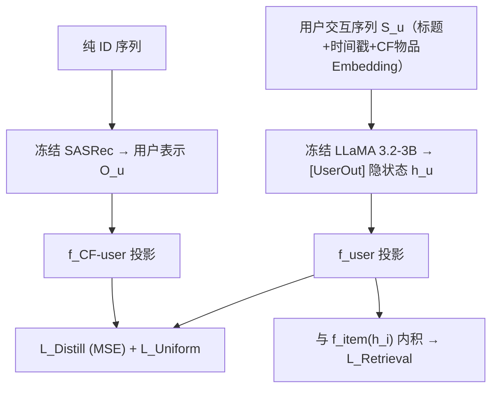

# Lost in Sequence: Do Large Language Models Understand Sequential Recommendation? (迷失在序列中：大语言模型真的理解序列推荐吗？)

- **会议/期刊**: KDD 2025 (Research Track)
- **作者与机构**: Sein Kim, Hongseok Kang, Kibum Kim, Jiwan Kim, Chanyoung Park (KAIST); Donghyun Kim, Minchul Yang, Kwangjin Oh (NAVER); Julian McAuley (UCSD)
- **推荐链路定位**: 召回（Next Item Retrieval）
- **研究方向**: 大语言模型推荐 / 序列推荐
- **论文原文**: [https://arxiv.org/abs/2502.13909v4](https://arxiv.org/abs/2502.13909v4)
- **开源代码**: [https://github.com/Sein-Kim/LLM-SRec](https://github.com/Sein-Kim/LLM-SRec)

## TL;DR (1分钟核心速览)

本文质疑一个被广泛默认的前提：LLM4Rec 模型虽在序列推荐场景下训练评测，却并未真正理解交互序列的顺序信息。作者用「打乱序列」实验证明 TALLRec/LLaRA/CoLLM/A-LLMRec 在训练与推理阶段对序列扰动几乎无感（性能变化常在 ±3% 内），而 SASRec 显著下降 4%–11%。据此提出 LLM-SRec：将冻结 CF-SRec 的用户表示蒸馏进冻结 LLM，仅训练几个 MLP 与两个 token embedding。在 Amazon 四数据集 Leave-Last-Out + 1:99 采样排序协议下，NDCG@10 相对最强基线提升 3.4%–20.9%，且训练/推理时间全面优于所有 LLM4Rec 基线。

## Background & Motivation (背景与核心矛盾)

- **主流范式**: LLM4Rec 分两支——生成式（Next Item Title Generation，直接生成候选标题）与检索式（Next Item Retrieval，用 `[UserOut]`/`[ItemOut]` 隐状态做内积检索）。TALLRec 纯文本 + LoRA 微调；LLaRA/CoLLM/A-LLMRec 引入 CF-SRec 的物品 embedding 或用户表示以补足协同知识。
- **前人局限**: 其一，这些模型把序列「文本化」后塞进 prompt，位置/时间戳仅作为文本线索，模型倾向依赖物品标题的语义共现而非顺序依赖；其二，即便 CoLLM/A-LLMRec 把 CF-SRec 用户表示拼进 prompt，仍只是「输入侧拼接」，LLM 内部表示并未被约束去对齐该序列语义。
- **核心洞察 (Key Insight)**: 打乱序列后，LLM4Rec 的用户表示余弦相似度高达 0.86–0.98（SASRec 仅 0.65–0.75），说明其用户表示对顺序几乎不敏感——序列信息在 LLM 内部「丢失」了。
- **本文切入点**: 不做输入拼接，而是把 CF-SRec 的用户表示作为**蒸馏目标**，用 MSE 直接约束 LLM 侧用户表示，使顺序语义被「压」进 LLM 的隐空间。

## Method (核心方法设计)

### 1. 整体框架 (Overall Architecture)

输入为用户交互序列的文本化 prompt（含交互序号、时间戳、物品标题与 CF 物品 embedding）。冻结的 SASRec 从纯 ID 序列产出用户表示 $\mathbf{O}_u$；冻结的 LLaMA 3.2-3B 从 prompt 产出 `[UserOut]` 隐状态$\mathbf{h}_u^U$。两侧各经一个 2 层 MLP 投影到同一$d'$空间后做 MSE 蒸馏；同时用均匀性损失防止表示坍缩。检索打分由$f_{\text{item}}(\mathbf{h}_i^I)$与$f_{\text{user}}(\mathbf{h}_u^U)$ 内积给出，训练仅更新 4 个 MLP 与 2 个可学习 token，LLM 与 CF-SRec 全程冻结。

### 2. 关键设计拆解 (Key Designs)

1. **序列知识蒸馏损失 $\mathcal{L}_{\text{Distill}}$**：痛点在于「输入侧拼接用户表示」不足以让 LLM 内部表征携带顺序语义。本文改为在表示空间对齐：$\mathcal{L}_{\text{Distill}}=\mathbb{E}_{u}\left[\text{MSE}\left(f_{\text{CF-user}}(\mathbf{O}_u),\, f_{\text{user}}(\mathbf{h}_u^U)\right)\right]$。直觉是 SASRec 的表示完全由 ID 顺序卷积/注意力生成，天然编码转移模式；把它作为回归目标，等价于给 LLM 的用户向量加上「顺序监督」，而无需反向传播进 LLM。

2. **均匀性正则 $\mathcal{L}_{\text{Uniform}}$**：纯 MSE 蒸馏存在平凡解——两侧 MLP 输出常数即可零损失（过平滑）。本文对两侧表示分别施加$\mathcal{L}_{\text{Uniform}}=\mathbb{E}_{u}\mathbb{E}_{u'}\left[e^{-2\|\cdot_u-\cdot_{u'}\|_2^2}\right]$（CF 侧与 LLM 侧各一项），把不同用户表示推散在超球面上，既保留可分性又避免坍缩。这是让蒸馏「有信息量」的关键开关。

3. **训练目标、负采样与推理效率**：总损失 $\mathcal{L}=\mathcal{L}_{\text{Retrieval}}+\mathcal{L}_{\text{Distill}}+\mathcal{L}_{\text{Uniform}}$，其中检索损失为对候选集$\mathcal{C}_u$（1 正 + 99 随机负）的 softmax 交叉熵。为效率只对序列最后一个物品做预测（非自回归）。由于 LLM 与 SASRec 均冻结，训练/推理开销显著低于 LoRA 微调方案。

## Experimental Setup & Evaluation Protocol (实验设置与评估协议)

- **数据集与预处理**: Amazon 四域，均做 `5-core` 过滤：

| 数据集 | 规模说明 | 特征/场景说明 |
| :--- | :---: | :--- |
| Movies | 5-core | 影视，标题语义丰富 |
| Scientific | 5-core | 科研用品，长尾明显 |
| Electronics | 5-core | 用户/物品最多，用于跨域源域 |
| CDs | 5-core | 音乐，序列性强 |

- **数据划分与防穿越 (Splitting Strategy)**: `Leave-Last-Out`——最后一件为测试、倒数第二件为验证、其余训练。
- **排名评测协议 (Ranking Protocol)**: `Sampled Ranking`，测试候选为 1 正 + 99 随机未交互负样本（生成式实验用 1:19）；指标 NDCG@{10,20}、HR@{10,20}。
- **对比基线与超参设置**: 三组基线——CF-SRec（GRU4Rec/BERT4Rec/NextItNet/SASRec）、LM-based（CTRL/RECFORMER）、LLM4Rec（TALLRec/LLaRA/CoLLM/A-LLMRec）。所有 LLM4Rec 统一用 LLaMA 3.2 (3B-Instruct) 骨干、SASRec 作 CF 骨干，保证公平。

## Key Experimental Results (实验关键数据)

### 1. 主实验对比 (Main Results)

NDCG@10（括号内为相对最强 LLM4Rec 基线的提升）：

| 数据集 | SASRec | TALLRec | LLaRA | CoLLM | A-LLMRec | **LLM-SRec** | Improv. |
| :--- | :---: | :---: | :---: | :---: | :---: | :---: | :---: |
| Movies | 0.3459 | 0.1668 | 0.1522 | 0.3223 | 0.3263 | **0.3560** | +9.1% |
| Scientific | 0.2918 | 0.2585 | 0.2844 | 0.3111 | 0.2875 | **0.3388** | +8.9% |
| Electronics | 0.2267 | 0.2249 | 0.2048 | 0.2565 | 0.2791 | **0.3044** | +9.1% |
| CDs | 0.3451 | 0.3100 | 0.2464 | 0.3152 | 0.3119 | **0.3809** | +20.9% |

HR@10 同向：CDs 上 LLM-SRec 0.6085 vs. 最强基线 CoLLM 0.5290（+15.0%）；Electronics 上 0.4885 vs. A-LLMRec 0.4622（+5.7%）。

### 2. 消融实验 (Ablation Study)

NDCG@10，同时报告「原始序列训练」与「打乱序列训练」的差值以检验序列理解力：

| 配置 | Movies 原始 | Movies 打乱 | 变化率 | CDs 原始 | CDs 打乱 | 变化率 |
| :--- | :---: | :---: | :---: | :---: | :---: | :---: |
| (a) w/o $\mathcal{L}_{\text{Distill}},\mathcal{L}_{\text{Uniform}}$ | 0.3204 | 0.3176 | -0.87% | 0.2278 | 0.2224 | -2.37% |
| (b) w/o $\mathcal{L}_{\text{Uniform}}$ | 0.3339 | 0.3089 | -7.49% | 0.3622 | 0.3478 | -3.98% |
| (c) 完整 LLM-SRec | **0.3560** | 0.3263 | **-8.34%** | **0.3809** | 0.3614 | **-5.11%** |

### 3. 关键实验发现 (Key Findings)

1. **序列理解力可由「打乱敏感度」量化**：完整模型打乱后掉 8.34%（Movies），去掉蒸馏损失后仅掉 0.87%——说明性能增益确实来自序列建模能力，而非单纯拟合文本共现。
2. **蒸馏比堆模型规模更划算**：3B 的 LLM-SRec 反超 8B 骨干的所有 LLM4Rec 基线，说明「补序列知识」的边际收益高于「扩 LLM 参数」。
3. **效率与效果双赢**：Electronics 上训练 218.21 min/epoch、推理 27.57 min，均低于 A-LLMRec（235.02 / 28.14）与 CoLLM（251.51 / 32.58）；跨域 Electronics→CDs 的 HR@10 达 0.1369，超 A-LLMRec 的 0.1217（+12.5%），冷启场景同样领先。

## Highlights & Limitations (亮点、对比与审稿批判)

- **与代表作对比 (vs. Prior Work)**: 与 CoLLM/A-LLMRec 的本质区别在于「表示对齐 vs. 输入拼接」——后者把 CF 用户向量写进 prompt，LLM 仍可忽略它；本文用 MSE 强制 LLM 隐状态回归该向量，监督信号不可绕过。与 TALLRec 相比，本文不微调 LLM，成本低一个量级。
- **可迁移亮点**: ①「打乱序列测敏感度」是检验任意序列模型是否真用顺序信息的低成本探针，可直接用于自研模型验收；②冻结双塔 + 仅训投影层的蒸馏范式，适合算力受限的工业召回链路。
- **审稿级局限批判**: ① 评测仅用 1:99 采样排序，未做 Full-Ranking，负样本随机采样可能高估绝对指标；② 蒸馏目标绑定 SASRec 这一特定 CF 骨干，若换更强的序列骨干（如 Mamba4Rec）收益是否保持未验证；③ 序列理解力仍弱于 SASRec 本身（打乱掉幅 8.34% vs. SASRec 的 7.88% 量级接近但绝对表示相似度仍偏高），说明蒸馏只是「部分注入」而非完全对齐。

## Rating (四维评分)

- **方法创新性 (Novelty)**: ⭐⭐⭐⭐ （问题诊断扎实、蒸馏+均匀性组合简洁有效，但蒸馏本身非全新范式）
- **评估协议与实验扎实度 (Protocol & Experiments)**: ⭐⭐⭐⭐ （四数据集 + 跨域 + 冷启 + 效率 + 规模消融齐全，扣分在仅采样排序）
- **写作与数学规范度 (Clarity & Rigor)**: ⭐⭐⭐⭐⭐ （动机实验设计精巧，公式与符号定义干净，逻辑链完整）
- **工业落地与复现价值 (Industrial & Practical Value)**: ⭐⭐⭐⭐⭐ （冻结 LLM 仅训 MLP，代码开源，训练推理均快于基线，落地门槛低）

