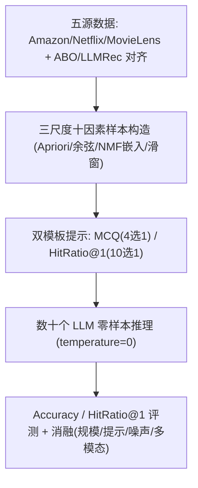

# The Mental World of Large Language Models in Recommendation: A Benchmark on Association, Personalization, and Knowledgeability (大语言模型在推荐系统中的心智世界：关联、个性化与知识性基准评测)

- **会议/期刊**: KDD 2025 (submission)
- **作者与机构**: Guangneng Hu (西安电子科技大学)
- **推荐链路定位**: 端到端生成式 / 零样本排序评测
- **研究方向**: 大语言模型推荐 (LLM4Rec) / 冷启动与长尾推荐
- **论文原文**: [论文原文链接](https://arxiv.org/abs/2512.17389v1)
- **开源代码**: [开源代码仓库链接](https://github.com/ljy0ustc/LLaRA)

## TL;DR (1分钟核心速览)

针对 LLM 与推荐系统之间存在"语言世界知识 vs. 个性化行为世界"巨大语义鸿沟、却缺乏系统评测基准的痛点，本文提出 LRWorld 基准（38K+ 高质量样本、23M tokens），将 LLM 在推荐中的"心智世界"划分为关联、个性化、知识性三大尺度、十个因素、31 项任务。在 Amazon/MovieLens/Netflix 三域上评测数十个 SOTA LLM 发现：LLM 在关联规则挖掘（HitRatio@1 达 75%）与实体关系/属性推理（准确率 78%）上表现优异，但在神经嵌入用户-物品匹配检索上仅 13%，远逊于传统推荐模型。

## Background & Motivation (背景与核心矛盾)

- **主流范式**: 当前 LLM4Rec 研究将 LLM 用作知识增强器或零样本排序器，评测多局限于评分预测与 top-N 推荐（`<user,item,rating>` 与 `<user-history,next-item>` 两类范式）。
- **前人局限**: ① 现有基准（ProLLM4Rec、LLMRec 等）评测因素与数据字段单一，无法刻画 LLM 在推荐中的能力边界；② 缺乏对"关联模式挖掘"与"知识性推理"（知识图谱、层级分类、多模态）的系统评测，导致无法得出可信结论。
- **核心洞察 (Key Insight)**: 人类做推荐决策依赖"心智模型"——既用世界知识（导演、品牌、品类层级）推理，也用协同关联（常一起购买）判断。LLM 是否具备类似的内在表征，需从多尺度探测。
- **本文切入点**: 首次建立"LLM 在推荐中的心智世界"概念，构建三尺度十因素 31 任务的 LRWorld 基准，系统量化 LLM 的能力边界。

## Method (核心方法设计)

### 1. 整体框架 (Overall Architecture)

LRWorld 从五个公开数据源（Amazon Review 2018 5-core、Netflix KDD-Cup 2007、MovieLens 25M，并通过 ASIN/片名年份对齐 Amazon Berkeley Objects 与 LLMRec 获取图像与元数据）构建样本。基准将 LLM 心智世界分为三尺度：**关联**（规则挖掘）、**个性化**（记忆式 item-item/user-user 相似度 + 神经嵌入检索）、**知识性**（KG 实体关系/属性、层级分类、文本 logline、多模态海报/商品图推理）。每因素设计 MCQ（4 选 1）或 HitRatio@1（10 选 1）两类提示模板，正样本由 Apriori、余弦相似度、神经矩阵分解嵌入、leave-one-out 滑窗等构造，负样本随机采样（MCQ 3 负、HitRatio 9 负），并随机打乱正确选项位置以缓解位置偏差。

### 2. 关键设计拆解 (Key Designs)

1. **个性化尺度的浅层 vs. 深层解耦**：前人仅评测 top-N 排序，无法区分 LLM 究竟卡在"记忆式协同"还是"神经嵌入"。本文将个性化拆为记忆式（one-hot 共现余弦）与神经式（NMF 学习嵌入余弦）两组，正样本取 k-means 聚类质心原型以保证代表性。核心度量即嵌入余弦相似度排序：$\text{sim}(\boldsymbol{u}_i,\boldsymbol{v}_j)=\frac{\boldsymbol{u}_i^\top\boldsymbol{v}_j}{\|\boldsymbol{u}_i\|\|\boldsymbol{v}_j\|}$，要求 LLM 从候选池检索 top-1 匹配。直觉：若 LLM 能复现 NMF 的高阶协同几何，才可能替代传统模型。

2. **知识性尺度的层级分类与多模态推理**：前人仅覆盖 `<entity,relation,entity>` 与 `<entity,attribute>`，本文扩展至层级分类（root→intermediate→leaf，Amazon 达 7 层深度）、文本 logline 推理与多模态海报/商品图推理。多模态样本先用 LLaVA-1.6 将图像转为结构化文本描述（summary/logline/attributes），再喂入 LLM，规避多数 LMM 仅支持单图输入的限制。

3. **训练目标、负采样与推理效率**：本文为纯评测基准，无训练损失；负采样采用随机负例（作者发现随机负例对 LLM 已足够困难，未刻意构造 hard negative）；推理为单次前向零样本，temperature=0（OpenAI GPT 设 0.01）保证可复现。

## Experimental Setup & Evaluation Protocol (实验设置与评估协议)

- **数据集与预处理**:

| 数据集 | #Users | #Items | #Interactions | 稀疏度/密度 | 特征/场景说明 |
| :--- | :---: | :---: | :---: | :---: | :--- |
| LRWorld-Amazon | 46,534 | 1,850 | 489,885 | 5-core 过滤 | 商品域，含品牌/颜色/层级/图像 |
| LRWorld-MovieLens | 160,716 | 2,336 | 2,971,703 | 25M 子集 | 电影域，含导演/演员/类型/logline/海报 |
| LRWorld-Netflix | 460,295 | 396 | 12,414,045 | KDD-Cup 2007 | 电影域，与 LLMRec 对齐元数据 |

- **数据划分与防穿越 (Splitting Strategy)**: 知识性因素采用 `Leave-One-Out` 滑窗（历史 $(i_1,...,i_5)$预测$i_6$）；关联/个性化因素按规则挖掘与相似度阈值（min support/confidence=0.01，相似度阈值 0.01）构造正样本。
- **排名评测协议 (Ranking Protocol)**: 关联与个性化因素用 `HitRatio@1`（10 候选，1 正 9 随机负）；知识性因素用 `Accuracy`（MCQ 4 候选，1 正 3 随机负）。属受控候选池排序，非全库 Full-Ranking。
- **对比基线与超参设置**: 评测 Falcon、Vicuna-1.5、FLAN-T5、Llama-3/3.1、Phi-3、Mistral、Qwen-2、LLaVA-1.6、GPT-3.5-Turbo、GPT-4o-mini 等数十个模型；神经嵌入用 NMF，聚类数 10；随机打乱选项顺序 5 次检验位置偏差方差（多数 <0.1）。

## Key Experimental Results (实验关键数据)

### 1. 主实验对比 (Main Results)

LRWorld-Amazon 代表性结果（HitRatio@1 / Accuracy，越高越好）：

| 模型 | Assoc rule | Mem item-item | Mem user-user | Neu item2users | Neu user2items | KG (prod,brand) | Taxo (prod,root) | Multimodal |
| :--- | :---: | :---: | :---: | :---: | :---: | :---: | :---: | :---: |
| RANDOM | 0.1000 | 0.1000 | 0.1000 | 0.1000 | 0.1000 | 0.2500 | 0.2500 | 0.2500 |
| Llama-3.1 | 0.5254 | 0.5442 | 0.1508 | 0.0950 | 0.1090 | 0.7506 | 0.3865 | 0.2897 |
| Mistral | 0.5593 | 0.5180 | 0.1438 | 0.0920 | 0.1140 | 0.7479 | 0.5352 | 0.2897 |
| Phi-3 | 0.5169 | 0.5016 | 0.1505 | 0.0900 | 0.0950 | 0.7271 | 0.3228 | **0.5312** |
| Qwen-2 | 0.4067 | 0.5114 | 0.1404 | 0.1050 | 0.0940 | 0.7383 | 0.3082 | 0.4750 |
| GPT-3.5-Turbo | 0.4491 | 0.4622 | 0.1914 | 0.0970 | 0.0980 | 0.7190 | 0.3489 | 0.2158 |
| **GPT-4o-mini** | **0.7542** | **0.5508** | 0.1720 | **0.1130** | 0.1080 | **0.7803** | 0.4432 | 0.5031 |

MovieLens 上最佳 LLM 在 `<movie,director>` 达 0.7104（LlaVA-1.6）、`<movie,cast>` 0.6565（GPT-4o-mini）、文本知识 0.5117（GPT-4o-mini），但神经嵌入 user2items 仅 0.1300（GPT-3.5-Turbo）。

### 2. 消融实验 (Ablation Study)

| 消融维度 | 设置 | 关键结果 |
| :--- | :--- | :--- |
| 模型规模 | Qwen2-72B / Llama3-70B vs. 7B/8B | 8/11 因素无显著提升，Llama3.1-70B 在神经嵌入检索反降 2.7% |
| 提示策略 | COT / 1–5-shot | COT 对 70B 几乎无效；few-shot 利好 7B/8B，70B 不稳定（Qwen2-72B 峰值 k=3） |
| 噪声鲁棒性 | 替换历史中 1 个物品为假物品 | 多模态因素最敏感：Qwen2-72B 降 21.3%、GPT-4o-mini 降 29.3% |
| 多模态增益 | 仅文本描述 vs. +视觉 | LlaVA-1.6 在 Amazon/MovieLens/Netflix 分别提升 32.98%/19.44%/8.02% |
| 领域微调 | LlaRA vs. 通用 LLM | 微调任务 `<history,next-artist>` 达 0.5081（超 GPT-4o-mini），但未见任务 `<artist,genre>` 仅 0.3560（灾难性遗忘） |

### 3. 关键实验发现 (Key Findings)

1. **"浅层协同强、深层嵌入弱"的断层**：LLM 在记忆式 item-item 相似度上可达 0.5540（Amazon），但神经嵌入 user2items 骤降至 0.13 左右，说明 LLM 无法复现 NMF 学习的高阶协同几何——这是 LLM 替代传统推荐模型的最大障碍。
2. **用户侧比物品侧更难**：三数据集上 item-item 最佳分别为 0.5540/0.3472/0.2114，而 user-user 仅 0.1914/0.2966/0.1994，归因于 LLM 可见的用户上下文有限。
3. **规模与提示并非万能药**：70B 级模型在 8/11 因素上未显著超越小模型，甚至退化；few-shot 仅利好小模型，说明"更大即更好"在推荐任务上不成立，需针对性对齐用户偏好。

## Highlights & Limitations (亮点、对比与审稿批判)

- **与代表作对比 (vs. Prior Work)**: 相比 ProLLM4Rec（聚焦提示工程）与 LLMRec（聚焦评分/序列/解释五任务），LRWorld 首次引入关联与知识性两大新尺度，并将个性化细分为浅层/深层、物品/用户四象限，覆盖 10 因素 31 任务 14 字段，广度显著超越。
- **可迁移亮点**: ① "浅层记忆 vs. 深层嵌入"的解耦评测思路可直接迁移至任意 LLM 推荐能力诊断；② 用 LMM 将图像转结构化文本再喂 LLM 的多模态代理策略，可低成本复用于短视频/图文电商场景。
- **审稿级局限批判**: ① 评测为受控候选池（4/10 选 1）而非全库 Full-Ranking，且负例随机采样，可能高估绝对性能、低估真实排序难度；② 多模态依赖 LLaVA 文本描述作为代理，丢失细粒度视觉信号，且未评测生成式直接推荐；③ 单作者工作，部分结论（如规模无增益）仅在有限模型族上验证，泛化性待考。

## Rating (四维评分)

- **方法创新性 (Novelty)**: ⭐⭐⭐⭐ （首次提出"心智世界"三尺度框架，关联与知识性尺度为基准设计带来实质增量）
- **评估协议与实验扎实度 (Protocol & Experiments)**: ⭐⭐⭐⭐ （三域 38K 样本、数十模型、五类消融齐全，但受控候选池排序弱于全库评测）
- **写作与数学规范度 (Clarity & Rigor)**: ⭐⭐⭐⭐ （因素定义与样本构造清晰，公式较少偏评测型，统计表完备）
- **工业落地与复现价值 (Industrial & Practical Value)**: ⭐⭐⭐⭐ （基准与提示模板开源，揭示 LLM 短板对工业选型有直接指导，但推理成本高）

