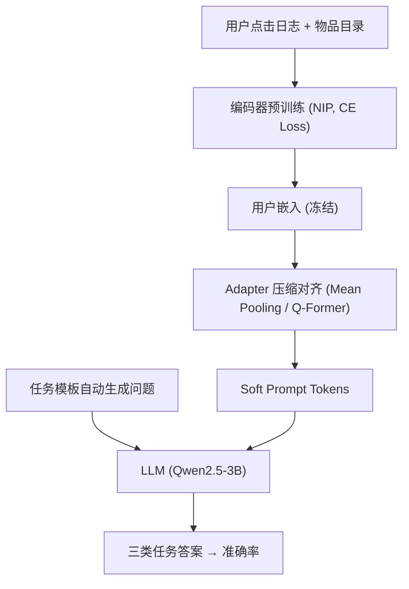
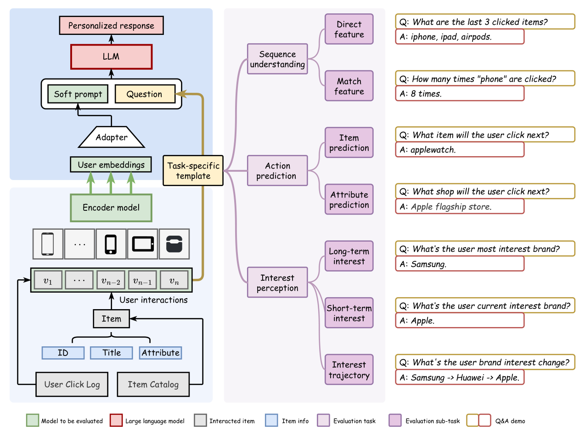
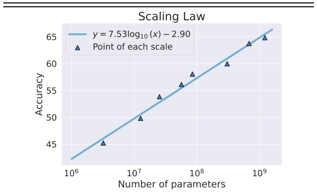

# UQABench: Evaluating User Embedding for Prompting LLMs in Personalized Question Answering (评估用户嵌入作为软提示驱动 LLM 个性化问答的基准)

- **会议/期刊**: KDD 2025
- **作者与机构**: Langming Liu, Shilei Liu, Yujin Yuan 等（阿里巴巴淘天集团）
- **推荐链路定位**: 端到端生成式（用户表征 → 软提示 → LLM 生成）
- **研究方向**: 大语言模型推荐 / 生成式推荐
- **论文原文**: [论文原文链接](https://arxiv.org/abs/2502.19178v2)
- **开源代码**: [开源代码仓库链接](https://github.com/OpenStellarTeam/UQABench)

## TL;DR (1分钟核心速览)

针对"把冗长含噪的用户交互序列压缩成嵌入、作为软提示喂给 LLM"这一高效个性化范式缺乏可信评估的问题，本文构建 UQABench：以淘宝点击日志（1.85 亿用户、3131 万交互）为源，标准化"预训练—微调—评测"三阶段流程，设计序列理解、行为预测、兴趣感知三类共 7 个子任务的个性化问答。实验表明最优嵌入式方法（Trm++）总体 53.88 分，与文本式 Text50（59.32）接近，且在下一物品预测上反超，同时 token 消耗降低 8–19 倍；并首次给出用户编码器规模与序列长度的缩放定律。

## Background & Motivation (背景与核心矛盾)

- **主流范式**: 生成式推荐（GRs）分两支——文本式直接把交互 ID/标题拼进 prompt；嵌入式用 GRU4Rec/SASRec 类编码器把序列压成稠密向量，经 adapter 对齐后作 soft prompt。
- **前人局限**: ① 交互序列动辄上万 token，注意力复杂度随 $N$ 二次增长，既拖慢推理又可能超上下文窗口；② 跨场景重复、误触交互噪声会误导 LLM 对兴趣的判断。而既有评估只看 Recall/NDCG 等传统排序指标，无法回答"嵌入是否真的把信息传给了 LLM"。
- **核心洞察 (Key Insight)**: 嵌入式 GRs 的"效率"已被公认，但其"有效性"从未被系统检验；个性化问答（Q&A）范式与 LLM 的参数化本质天然契合，可作为比 top-k 排序更全面的探针。
- **本文切入点**: 用一套统一预训练任务（NIP）+ 统一骨干 LLM（Qwen2.5-3B）+ 自动生成的大规模 Q&A，把"嵌入质量"转化为可量化、可复现的生成准确率。

## Method (核心方法设计)

### 1. 整体框架 (Overall Architecture)

流程分三阶段闭环：**预训练**阶段在淘宝交互上以 next-item prediction 训练各类编码器（GRU4Rec/SASRec/Mamba4Rec/HSTU/Trm++），统一输入为 item ID + 侧信息、统一损失为 CE；**微调**阶段冻结编码器，用 adapter（Mean Pooling 或 Q-Former 压缩）把用户向量映射到词嵌入维度，形成 1 或 16 个 soft-prompt token，与问题模板拼接后送入 LLM；**评测**阶段由模板自动生成 7,192 条带标准答案的个性化问答，按三类任务打分。关键在于冻结编码器以防 LLM 知识覆盖用户序列信息。

<figure class="paper-figure" markdown="span">
  <figcaption>图2：UQABench上用户嵌入标准化评估流程概览。左下部分展示编码器模型将历史交互编码为用户嵌入，该过程需要预训练。左上部分展示用户嵌入作为LLM的软提示以生成个性化回复，该过程需要微调。右侧展示评估阶段提出的任务及相应的问答示例。</figcaption>
</figure>

### 2. 关键设计拆解 (Key Designs)

1. **三维度七子任务评测体系**：传统指标无法区分"记住了序列"与"理解了兴趣"。本文设 (a) 序列理解：直接特征 DF（复述最近 $k$个点击）与匹配特征 MF（统计某类目历史点击次数，逼近工业特征工程上限）；(b) 行为预测：下一物品 IP 与下一属性 AP；(c) 兴趣感知：长期 LI、短期 SI 与兴趣轨迹 IT。模板化生成保证规模化与客观性，并对 MF 剔除答案为 0 的平凡题、DF 限制$k<4$。

2. **公平性约束下的统一训练协议**：所有编码器参数量控制在约 20M 同量级，统一序列长度 $N=512$、统一 NIP 任务、统一骨干 LLM，避免"某模型因原论文任务不同而占便宜"。消融显示 Full Info + 监督学习（CE）最优，故作为默认配置；微调默认 Mean Pooling + 仅训 Adapter（Q-Former + Full FT 虽达 55.00 但对学习率极敏感、易出 NaN）。

3. **训练目标与推理效率**：预训练损失即标准下一物品交叉熵 $\mathcal{L}_{\text{CE}}=-\sum_{t}\log p(v_{t+1}\mid s_{1:t})$，负样本由全库 softmax 隐式提供（无额外负采样）；微调仅优化 adapter 与 LLM 的生成损失。推理侧用户上下文被压成 1（Mean）或 16（Q-Former）个 token，相较 Text20/Text50 的 1171/2498 token，实现 8–19× 压缩。

## Experimental Setup & Evaluation Protocol (实验设置与评估协议)

- **数据集与预处理**: 源数据为淘宝用户点击日志，用户侧过滤过长/过短序列，物品侧剔除交互少于 3 次的物品（类 3-core）：

| 数据集 | #Users | #Items | #Interactions | 稀疏度/密度 | 特征/场景说明 |
| :--- | :---: | :---: | :---: | :---: | :--- |
| Taobao Click Log | 184,520 | 994,447 | 31,317,087 | 密度约 $1.7\times10^{-4}$ | 含标题/类目/品牌/店铺侧信息；中文电商 |

- **数据划分与防穿越 (Splitting Strategy)**: 交互按 **9:1 随机比例划分**训练/测试；训练集用于预训练与微调，测试集生成 7,192 条 Q&A 用于评测（非 Leave-One-Out，属比例划分）。
- **排名评测协议 (Ranking Protocol)**: 非排序指标，而是**生成式问答准确率**（答案与 ground-truth 匹配率）；对高专业性问题提供候选答案集合，属受限生成评测而非 Full-Ranking。
- **对比基线与超参设置**: 文本式 Text20/Text50 与嵌入式 GRU4Rec、SASRec、Mamba4Rec、HSTU、Trm++；AdamW，lr=1e-4，batch=256，dropout=0.1，预训练/微调最多 10/3 epoch，8×GPU。

## Key Experimental Results (实验关键数据)

### 1. 主实验对比 (Main Results)

| 方法 | 模型 | 序列理解 Avg. | 行为预测 Avg. | 兴趣感知 Avg. | **总体 Avg.** |
| :--- | :--- | :---: | :---: | :---: | :---: |
| Text-based | Text20 | 37.52 | 42.45 | 71.10 | 53.02 |
| Text-based | Text50 | 43.27 | 41.39 | 84.29 | **59.32** |
| Emb-based | GRU4Rec | 32.86 | 32.20 | 43.97 | 37.15 |
| Emb-based | SASRec | 39.14 | 38.47 | 55.72 | 45.66 |
| Emb-based | Mamba4Rec | 29.62 | 30.83 | 36.06 | 32.69 |
| Emb-based | HSTU | 41.86 | 41.31 | 64.45 | 50.88 |
| Emb-based | Trm++ | 45.72 | 42.38 | 68.71 | **53.88** |

（嵌入式最优 Trm++ 较次优 HSTU 提升 **+3.00**；与 Text50 差距 −5.44，但在 IP 子任务 48.67 vs 45.58 上反超。）

### 2. 消融实验 (Ablation Study)

| 阶段 | 配置 | SU | AP | IP | Avg. |
| :--- | :--- | :---: | :---: | :---: | :---: |
| 预训练 | Full Info + SL | 45.72 | 42.38 | 68.71 | **53.88** |
| 预训练 | w/o Text + SL | 42.08 | 39.27 | 66.84 | 51.16 |
| 预训练 | w/o Side + SL | 39.55 | 37.83 | 61.47 | 47.87 |
| 预训练 | Full Info + CL | 42.41 | 39.25 | 62.37 | 49.40 |
| 微调 | Mean Pooling + Adapter | 45.72 | 42.38 | 68.71 | 53.88 |
| 微调 | Q-Former + Full FT | 45.35 | 44.37 | 69.89 | **55.00** |
| 微调 | Q-Former + Adapter | 31.15 | 29.92 | 31.80 | 30.96 |

### 3. 关键实验发现 (Key Findings)

1. **侧信息是嵌入质量的命门**：预训练去掉文本侧信息后 Avg. 从 53.88 跌至 51.16，再去掉全部侧信息跌至 47.87（−6.01），说明纯 ID 序列无法承载 LLM 可读的语义；且监督 CE 显著优于对比学习 InfoNCE（53.88 vs 49.40），与"LLM 需要语义对齐而非仅判别性表征"的直觉一致。
2. **嵌入式在"预测"上强、在"感知"上弱**：Trm++ 的 IP 达 48.67 超过 Text50 的 45.58，但兴趣感知仅 68.71 vs 84.29，暴露压缩过程丢失了长程兴趣轨迹信息——这正是未来 adapter/压缩器设计的改进空间。
3. **缩放定律清晰可外推**：编码器从 3.2M 扩到 1.2B，Avg. 从 45.26 单调升至 64.86，拟合为 $y=7.53\log_{10}(x)-2.90$；序列长度从 32 增至 512 时 Avg. 由 33.38 升至 53.88，但超过 256 后边际收益递减。这意味着可离线放大编码器而不增加在线推理成本。

<figure class="paper-figure" markdown="span">
  <figcaption>图3：关于模型规模的缩放定律。</figcaption>
</figure>

## Highlights & Limitations (亮点、对比与审稿批判)

- **与代表作对比 (vs. Prior Work)**: 相较 SASRec/HSTU 等只以 NDCG 衡量用户表征的工作，本文首次把评估目标换成"LLM 能否用该表征答对个性化问题"；相较文本式 GRs（如 ICL/CoT 提示），本文证明压缩嵌入可在 1/19 token 下逼近其效果，给出效率-效果权衡的定量边界。
- **可迁移亮点**: ① "冻结编码器 + 仅训 adapter"可有效防止 LLM 灾难性覆盖用户序列知识，适用于任何软提示推荐系统；② 模板化自动生成 Q&A 的思路可低成本迁移到其他领域构建个性化评测集。
- **审稿级局限批判**: ① 仅中文电商单域、单一 3B 骨干 LLM，跨语言/跨规模泛化性未验证；② 评测为受限候选生成而非开放生成，且 Q-Former 配置因 NaN 被弃用，实际报告的最优配置并非搜索到的峰值，可能低估嵌入式上限。

## Rating (四维评分)

- **方法创新性 (Novelty)**: ⭐⭐⭐⭐ （首个系统化"用户嵌入→LLM 软提示"评测基准，三维度任务设计有工业洞察，但方法本身偏评测框架而非新模型）
- **评估协议与实验扎实度 (Protocol & Experiments)**: ⭐⭐⭐⭐ （统一 NIP/统一骨干/同量级参数保证公平，含消融、缩放与效率四组实验；但单域单 LLM、比例划分而非时间切分略欠严谨）
- **写作与数学规范度 (Clarity & Rigor)**: ⭐⭐⭐⭐ （三阶段流程与任务定义清晰，缩放定律给出拟合式；数学推导较浅，公式量少）
- **工业落地与复现价值 (Industrial & Practical Value)**: ⭐⭐⭐⭐⭐ （数据与代码全开源，8–19× token 压缩直接对应线上成本，缩放定律为离线扩容提供工程依据）

