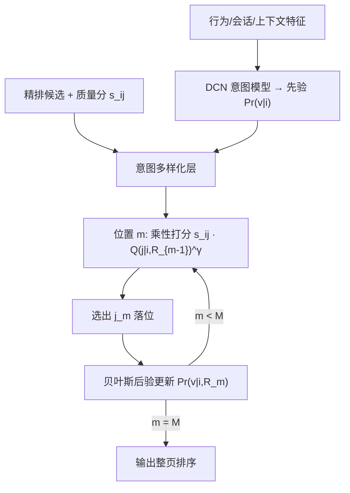

# Beyond Item Dissimilarities: Diversifying by Intent in Recommender Systems (超越物品不相似性：在推荐系统中按意图多样化)

- **会议/期刊**: KDD 2025
- **作者与机构**: Yuyan Wang (Stanford)、Cheenar Banerjee、Samer Chucri、Fabio Soldo、Sriraj Badam (Google)、Ed H. Chi、Minmin Chen (Google DeepMind)
- **推荐链路定位**: 重排（整页优化阶段，位于多任务精排之后）
- **研究方向**: 多任务学习与列表级重排 / 强化学习与动态探索推荐
- **论文原文**: [https://arxiv.org/abs/2405.12327v3](https://arxiv.org/abs/2405.12327v3)
- **开源代码**: 暂未开源

## TL;DR (1分钟核心速览)

现有多样化算法（MMR、DPP）只在**物品相似度**层面做文章，无法刻画"用户为何想看"这一更高阶语义，容易把不同意图的相似物品误判为冗余。本文提出**意图多样化框架**：先用 DCN 实时预测用户在各意图上的先验概率，再在整页重排阶段做贪心序列选择——每放一个物品，就按"用户对该物品不感兴趣"做贝叶斯后验更新，从而保证一页内多个意图都被覆盖。在 YouTube 线上 A/B（探索/熟悉双意图）中，用户享受度 +0.09%、DAU +0.05%，且探索类指标随时间持续走高。

## Background & Motivation (背景与核心矛盾)

- **主流范式**: 工业推荐已从"召回+精排"两段式演进为加入**整页优化/多样化**的三段式，代表方法包括 MMR 贪心边际相关性、DPP 行列式点过程、RNN/Attention 列表级建模与 RL 重排。
- **前人局限**: 其一，所有方法均以**物品级相似度**为多样化信号，两个主题不同但向量相近的物品会被误判为冗余，而两个主题相同但意图不同的物品反而被强行拆开；其二，搜索领域的意图多样化（如 Agrawal 等人的贪心算法）假设相关性是唯一目标且具备概率语义，而推荐系统的 $s_{ij}$ 是多目标融合后的**非概率质量分**，无法直接套用。
- **核心洞察 (Key Insight)**: 用户行为由**跨多次交互持续存在的意图**驱动，且意图既因人而异、也因时段而变（图 7 显示同一用户小时级波动大、日级基线稳定）；因此多样化应作用于"意图分布"而非"物品分布"。
- **本文切入点**: 把搜索中的意图贪心多样化算法迁移到推荐，用**乘性融合**将非概率质量分与意图概率耦合，并用**反事实后验更新**实现序列级意图覆盖。

## Method (核心方法设计)

### 1. 整体框架 (Overall Architecture)

系统在原有三段式（候选生成 → 多任务精排 → 整页优化）的最后一环插入意图多样化层。输入为精排输出的 $M$个候选及其质量分$s_{ij}$、意图预测模型给出的先验$\Pr(v\mid i)$、以及意图条件价值$Q(j\mid i,v)$。框架从位置 1 到$M$逐位贪心：每步在当前意图信念下为每个候选计算期望满足概率，与质量分乘性融合后取最大者落位；落位后按"用户拒绝了该物品"更新后验信念，使后续位置倾向覆盖尚未被代表的意图。意图模型每 6 小时用最新行为重训一次，推理侧仅需一次$O(M^2|\mathcal{V}|)$ 的贪心扫描。

### 2. 关键设计拆解 (Key Designs)

1. **意图条件价值的贝叶斯化简**：直接建模 $Q(j\mid i,v)$代价高，作者用贝叶斯定理展开$Q(j\mid i,v)=Q(j\mid i)\Pr(v\mid i,j)/\Pr(v\mid i)$，并利用"用户不会消费与意图不符的物品"这一意图定义，得到分段形式$Q(j\mid i,v)=Q(j\mid i)$当$v\in\mathcal{V}_j$，否则为 0。这一步把三维价值函数降维成"物品质量 × 意图-物品对齐指示"，是整个框架可落地的前提。

2. **乘性融合的意图多样化打分**：搜索场景下相关性是唯一目标，而推荐的质量分 $s_{ij}$ 无概率语义。作者不做归一化，而是直接乘性耦合：
$$j_m=\arg\max_{j}\Big(s_{ij}\cdot\big(\textstyle\sum_{v}\Pr(v\mid i,R_{m-1})Q(j\mid i,v)\big)^{\gamma}\Big)$$
其中 $\gamma$ 控制多样化强度。乘性而非加性的直觉是：它对"高质量 **且** 高意图匹配"的物品给予超线性加成，避免加性设计下低质但意图新奇的物品被硬塞进页面。

3. **反事实后验更新与训练目标**：第 $m$位之后，假设用户拒绝了前$m-1$ 个物品，按贝叶斯更新意图信念：
$$\Pr(v\mid i,R_m)=\frac{\Pr(v\mid i,R_{m-1})\,(1-Q(j_m\mid i,v))}{1-Q(j_m\mid i)}\ \ (v\in\mathcal{V}_{j_m})$$
否则信念不变。注意概率不会归零——保留了"用户有此意图只是不喜欢这个具体物品"的可能性，这正是与硬性去重（MMR）的本质区别。意图模型本身用交叉熵训练：$\hat{\mathcal{L}}(\theta)=-\sum_{(x,y_v)\in\mathcal{D}}\sum_{v\in\mathcal{V}}y_v\log f(x;\theta)$，标签由页面内是否消费了对齐意图$v$ 的物品定义，无需人工标注；推理阶段免负采样。

## Experimental Setup & Evaluation Protocol (实验设置与评估协议)

- **数据集与场景**: 无公开离线数据集，全部实验在 **YouTube 首页落地页线上 A/B** 完成，服务十亿级用户。意图模型训练数据为平台历史行为日志，特征含用户历史消费、会话级特征（会话长度、平均完播率）与上下文特征（时段、星期）。

| 实验组 | 意图集合 | 意图定义 | 训练/重训频率 |
| :--- | :--- | :--- | :--- |
| 主实验 | 探索 / 熟悉 | 消费未见创作者 / 已见创作者的内容 | 每 6 小时重训 |
| 附录实验 | 创作者级意图、访问时长意图 | 用于验证框架可扩展性 | 同上 |

- **数据划分与防穿越**: 线上实验采用**时间前后对照**（treatment vs. control 同期分流），意图模型用截至当前的历史行为训练、预测当前页面，天然避免未来信息泄漏。
- **排名评测协议**: 非离线 Full-Ranking / Sampled Ranking，而是**线上长期 A/B 指标**：用户享受度（综合时长、问卷、内容质量护栏的复合指标）、DAU、落地页消费量、满意用户数，以及探索类指标（新创作者曝光/消费/CTR、重复探索率、人均唯一主题簇数）。
- **对比基线与超参**: 对照组为**不含意图多样化的生产系统**（已含 DPP 类整页优化），本质是"意图无关多样化 vs. 意图感知多样化"的对照；意图模型 AUC 0.73、预测/标签比 0.97（校准良好）；多样化强度 $\gamma$在$\{0.005,\dots,0.04\}$上扫描，主实验取$\gamma=0.02$。

## Key Experimental Results (实验关键数据)

### 1. 主实验对比 (Main Results)

线上 A/B 结果以相对对照组的百分比变化报告（绝对值因合规省略）：

| 指标类别 | 具体指标 | 相对变化 | 趋势 |
| :--- | :--- | :---: | :--- |
| 长期业务 | 用户享受度 (Overall Enjoyment) | **+0.09%** | 显著 |
| 长期业务 | 日活用户 DAU | **+0.05%** | 显著 |
| 参与度 | 落地页消费量 | 正向 | 随时间上升 |
| 满意度 | 满意用户数 | 正向 | 随时间上升 |
| 探索质量 | 新创作者内容消费 | 显著正向 | 随时间上升 |
| 探索质量 | 重复探索率（高质量探索代理） | 显著正向 | 随时间上升 |
| 消费多样性 | 人均唯一主题簇数 | 显著正向 | 随时间上升 |

### 2. 消融与敏感性分析 (Ablation & Sensitivity)

| 配置 | 多样性 | 新颖性 | 相关性 | DAU |
| :--- | :---: | :---: | :---: | :---: |
| 对照组（无意图多样化） | 基线 | 基线 | 基线 | 基线 |
| $\gamma=0.005$ | ↑ 小 | ↑ 小 | ↓ 小 | ↑ 小 |
| $\gamma=0.02$（线上配置） | ↑ 中 | ↑ 中 | ↓ 中 | **最优** |
| $\gamma=0.04$ | ↑ 大 | ↑ 大 | ↓ 大 | 回落 |

按预测探索意图分位切片（图 5）：在 $p(\text{Exploration})$ 约 80 分位处，曝光新颖内容量与对照持平，但新颖内容消费量 **+4%**，说明框架在"想探索"的页面上更高效地推荐了既新又相关的内容。

### 3. 关键实验发现 (Key Findings)

1. **意图多样化是"精准多样化"而非"无差别多样化"**：分位切片呈单调趋势——高探索意图页面加推新颖内容、低探索意图页面减推，且新颖 CTR 同步提升，证明收益来自个性化对齐而非单纯增加曝光。
2. **$\gamma$存在非单调最优**：多样性/新颖性随$\gamma$单调升、相关性单调降，但 DAU 在$\gamma=0.02$ 处见顶，说明长期收益要求多样性与相关性同时不取极值，纯多样性最大化会损害留存。
3. **收益随时间累积**：探索类三项指标均呈上升趋势，符合"高质量探索 → 长期留存"的因果链假设，也解释了为何 DAU 这类饱和指标仍能取得统计显著的正向移动。

## Highlights & Limitations (亮点、对比与审稿批判)

- **与代表作对比 (vs. Prior Work)**: 相比 MMR/DPP 等物品级方法，本文的多样化信号从"物品两两距离"升级为"意图分布覆盖"，且后验更新是软性的（概率不归零），避免了误杀同意图下的优质备选；相比搜索领域的意图多样化算法，本文解决了质量分非概率化这一关键工程障碍（乘性融合），并首次在十亿级推荐平台上验证。
- **可迁移亮点**: 其一，"用行为定义意图标签 + 交叉熵监督"的弱标注范式可直接迁移到任何缺少意图标注的推荐场景；其二，乘性融合非概率分与概率分的技巧，适用于任何需要把贝叶斯模块嵌入现有打分链路的重排系统。
- **审稿级局限批判**: 其一，**完全缺乏离线可复现实验**，无公开数据集与代码，意图定义、特征列表、实验时长均因合规省略，学术界难以复现或公平比较；其二，贪心算法复杂度 $O(M^2|\mathcal{V}|)$ 且意图模型需 6 小时重训，意图空间扩大（如自动学习意图分类体系）时的工程开销与意图间相关性建模（当前假设意图独立更新）均未讨论。

## Rating (四维评分)

- **方法创新性 (Novelty)**: ⭐⭐⭐⭐ （把搜索意图多样化迁移到推荐并解决非概率分融合问题，思路清晰但算法本身是已有贪心框架的适配）
- **评估协议与实验扎实度 (Protocol & Experiments)**: ⭐⭐⭐ （十亿级线上 A/B 与多意图泛化实验有说服力，但零离线实验、零公开数据，学术可验证性弱）
- **写作与数学规范度 (Clarity & Rigor)**: ⭐⭐⭐⭐ （贝叶斯推导简洁自洽，算法伪代码完整，意图独立假设等简化有明确交代）
- **工业落地与复现价值 (Industrial & Practical Value)**: ⭐⭐⭐⭐ （已在大规模生产系统上线并带来显著业务收益，意图模型轻量、工程成本低，但闭源限制了复现）

