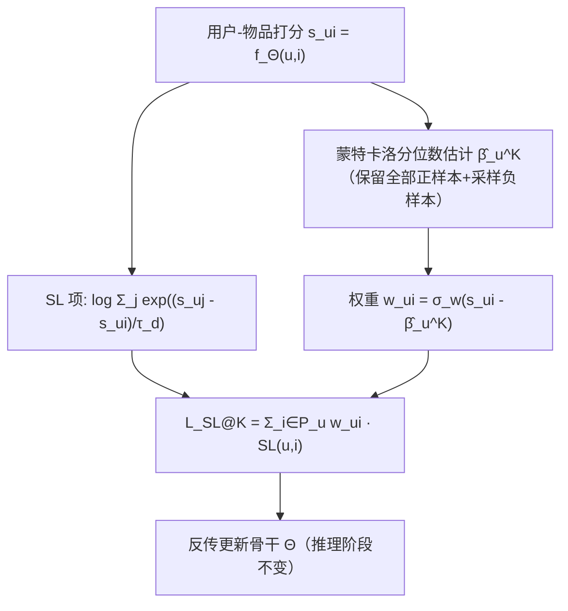

# Breaking the Top-$K$Barrier: Advancing Top-$K$Ranking Metrics Optimization in Recommender Systems (打破 Top-$K$壁垒：推进推荐系统中的 Top-$K$ 排序指标优化)

- **会议/期刊**: KDD 2025 (Proceedings of the 31st ACM SIGKDD Conference, V.2, pp. 3542–3552)
- **作者与机构**: Weiqin Yang, Jiawei Chen, Shengjia Zhang, Yan Feng, Chun Chen, Can Wang (浙江大学)；Peng Wu (北京工商大学)；Yuegang Sun (Intelligence Indeed)
- **推荐链路定位**: 精排（排序损失函数层面，与骨干模型解耦）
- **研究方向**: 多任务学习与列表级重排 / 协同过滤
- **论文原文**: [https://arxiv.org/abs/2508.05673v1](https://arxiv.org/abs/2508.05673v1)
- **开源代码**: [https://github.com/Tiny-Snow/IR-Benchmark](https://github.com/Tiny-Snow/IR-Benchmark)

## TL;DR (1分钟核心速览)

推荐系统线上只展示 Top-$K$个物品，但主流损失 SL 优化的是全排序 NDCG，与 NDCG@$K$存在不一致（图 1a 给出反例：NDCG 更优的列表 NDCG@5 反而更差）。本文提出 SL@$K$：用每个用户的 Top-$K$分位数$\beta_u^K$把截断指示函数$\mathbb{I}(\pi_{ui}\le K)$改写为$\mathbb{I}(s_{ui}\ge\beta_u^K)$，再对$-\log\text{DCG@}K$ 做三步松弛得到平滑上界，最终损失只是在 SL 的每个正样本项上乘一个分位数权重。在 4 个真实数据集、3 个骨干（MF/LightGCN/XSimGCL）上，NDCG@20 相对最优基线平均提升 6.03%，Health 上最高 +10.91%。

## Background & Motivation (背景与核心矛盾)

- **主流范式**: 隐式反馈推荐普遍采用 Softmax Loss (SL) 及其鲁棒变体（AdvInfoNCE / BSL / PSL），它们被证明是 $-\log\text{NDCG}$ 的上界，形式简洁且可用负采样高效估计。
- **前人局限一（忽略截断）**: SL 系列优化全排序 NDCG，而 NDCG@$K$只看前$K$位。图 1a 中 Ranking 1 的 NDCG=0.832 高于 Ranking 2 的 0.785，但 NDCG@5 却是 0.485 < 0.553——优化 NDCG 未必提升 NDCG@$K$，甚至反向。
- **前人局限二（截断方案在 RS 失效）**: LambdaLoss@$K$需对全物品排序算 lambda 权重，Electronic（8K 物品）上执行时间是 SL 的 60 倍；LambdaLoss@$K$与 SONG@$K$ 的梯度呈极端长尾，前 5% 样本贡献超 90% 梯度（图 1c），在物品规模大、交互稀疏的 RS 中训练极不稳定。
- **核心洞察 (Key Insight)**: Top-$K$截断本质是"分数是否超过第$K$名的分数阈值"，无需知道精确排名$\pi_{ui}$；而该阈值（分位数）可以用少量采样以指数收敛精度估出。
- **本文切入点**: 用分位数把截断变成逐样本的软权重，套在已被工业验证的 SL 上，同时拿到 Top-$K$ 对齐性、可采样性与梯度稳定性。

## Method (核心方法设计)

### 1. 整体框架 (Overall Architecture)

SL@$K$是一个与骨干无关的损失插件：骨干$f_\Theta(u,i)$输出打分$s_{ui}$后，分两路并行——一路对每个用户采样$N$个物品估计 Top-$K$分位数$\hat\beta_u^K$（每轮训练更新），另一路计算标准 SL 的 log-sum-exp 项；两路在损失层相乘融合为加权 SL，反传更新骨干。推理阶段完全不变，仍按$s_{ui}$全库排序取 Top-$K$，无任何额外在线开销。

### 2. 关键设计拆解 (Key Designs)

1. **分位数化 Top-$K$截断（Quantile-based Truncation）**：直接算$\pi_{ui}$需$O(|\mathcal{U}||\mathcal{I}|\log|\mathcal{I}|)$全排序，不可行。定义用户$u$的 Top-$K$分位数$\beta_u^K \coloneqq \inf\{s_{ui}:\pi_{ui}\le K\}$，则截断项等价改写为$\mathbb{I}(\pi_{ui}\le K)=\mathbb{I}(s_{ui}\ge\beta_u^K)$。物理直觉：分位数就是"第$K$ 名的分数线"，只需比较分数与阈值，把全局排序问题降维成逐样本的标量比较。

2. **$-\log\text{DCG@}K$的三步松弛上界**：从$-\log\sum_{i\in\mathcal{P}_u}\mathbb{I}(s_{ui}\ge\beta_u^K)\frac{1}{\log_2(\pi_{ui}+1)}$出发，依次用 ①$\log_2(\pi+1)\le\pi$、② Jensen 不等式、③ 丢弃命中数$H_u^K$得到$\sum_{i\in\mathcal{P}_u}\mathbb{I}(s_{ui}\ge\beta_u^K)\log\pi_{ui}$。关键取舍是刻意把$\pi_{ui}$从分母挪走——保留分母会放大估计误差与数值不稳定（SONG@$K$正因此失败）。再用$\sigma_w$（sigmoid）近似截断项、$\sigma_d$（指数）近似排名项，得最终损失：

$$\mathcal{L}_{\text{SL@}K}(u)=\sum_{i\in\mathcal{P}_u}\underbrace{\sigma_w(s_{ui}-\beta_u^K)}_{w_{ui}}\cdot\log\Big(\sum_{j\in\mathcal{I}}\sigma_d(d_{uij})\Big),\quad d_{uij}=s_{uj}-s_{ui}$$

   该配置保证 $\mathcal{L}_{\text{SL@}K}$是$-\log\text{DCG@}K$的紧上界（定理 3.2：$H_u^K>1$时$-\log\text{DCG@}K\le\mathcal{L}_{\text{SL@}K}$）。直觉上$w_{ui}\in(0,1)$随分数单调递增，自动把优化重心压在前$K$ 位的正样本上。

3. **蒙特卡洛分位数估计与训练目标**：每用户采样 $N$个物品排序取第$K$位，复杂度从$O(|\mathcal{U}||\mathcal{I}|\log|\mathcal{I}|)$降到$O(|\mathcal{U}|N\log N)$；定理 3.1 给出误差界$\Pr(|\hat\theta_u^p-\theta_u^p|>\varepsilon)\le 4e^{-2N\delta_\varepsilon^2}$，随$N$指数收敛。实践中保留全部正样本、只采样负样本（因分位数落在正样本分数区间，图 2a），$N=1000$时估计误差仅$0.06\pm0.03$（图 2b）。训练沿用 SL 的负采样策略（uniform / in-batch），温度$\tau_d$ 直接复用 SL 最优值，不引入新超参。

## Experimental Setup & Evaluation Protocol (实验设置与评估协议)

- **数据集与预处理**:

| 数据集 | #Users | #Items | #Interactions | 密度 | 场景说明 |
| :--- | :---: | :---: | :---: | :---: | :--- |
| Health | 1,974 | 1,200 | 48,189 | 0.02034 | Amazon 健康品类 |
| Electronic | 13,455 | 8,360 | 234,521 | 0.00208 | Amazon 电子品类 |
| Gowalla | 29,858 | 40,988 | 1,027,464 | 0.00084 | LBS 签到 |
| Book | 135,109 | 115,172 | 4,042,382 | 0.00026 | Amazon 图书（极稀疏） |

- **数据划分与防穿越**: 沿用 Wu et al. / Yang et al. 的标准设定，采用 `Leave-One-Out` 式每用户留一交互作测试、一交互作验证，其余训练。
- **排名评测协议**: 无偏 `Full-Ranking`（对全部未交互物品排序），报告 Recall@20 与 NDCG@20；变 $K$ 实验报告 NDCG@{5,10,20,50,75,100}。
- **对比基线与超参**: 9 个损失基线——BPR（pairwise）、GuidedRec / SL（NDCG 代理）、LambdaLoss@$K$/ SONG@$K$（NDCG@$K$代理）、LLPAUC（partial AUC）、AdvInfoNCE / BSL / PSL（SL 鲁棒变体）；骨干为 MF、LightGCN、XSimGCL；分位数采样$N=1000$，$\tau_d$ 与 SL 最优值对齐。

## Key Experimental Results (实验关键数据)

### 1. 主实验对比 (Main Results)

NDCG@20（Recall@20 趋势一致，此处取最具代表性的指标；完整表见原文 Table 2）：

| Backbone | Loss | Health | Electronic | Gowalla | Book |
| :--- | :--- | :---: | :---: | :---: | :---: |
| MF | BPR | 0.1234 | 0.0527 | 0.1111 | 0.0453 |
| MF | SONG@20 | 0.0650 | 0.0444 | 0.0970 | 0.0542 |
| MF | SL | 0.1261 | 0.0529 | 0.1624 | 0.1210 |
| MF | PSL (best baseline) | 0.1268 | 0.0541 | 0.1647 | 0.1227 |
| MF | **SL@20 (Ours)** | **0.1390** | **0.0590** | **0.1709** | **0.1269** |
| MF | Improv.% | +9.62% | +9.06% | +3.76% | +3.42% |
| LightGCN | PSL | 0.1270 | 0.0536 | 0.1648 | 0.1233 |
| LightGCN | **SL@20 (Ours)** | **0.1371** | **0.0591** | **0.1729** | **0.1280** |
| LightGCN | Improv.% | +7.95% | +10.26% | +4.92% | +3.81% |
| XSimGCL | PSL | 0.1143 | 0.0507 | 0.1593 | 0.1228 |
| XSimGCL | **SL@20 (Ours)** | **0.1332** | **0.0571** | **0.1717** | **0.1277** |
| XSimGCL | Improv.% | +10.91% | +12.40% | +7.51% | +3.99% |

### 2. 消融与变体实验 (Ablation & Variants)

| 配置 | Health NDCG@20 | Electronic NDCG@20 | 说明 |
| :--- | :---: | :---: | :--- |
| SL (@$\infty$，无截断) | 0.1261 | 0.0529 | 去掉分位数权重，退化为原 SL |
| SL@5 | 0.1379 | 0.0583 | $K=5$ |
| SL@20 | **0.1390** | **0.0590** | $K=20$，与评测$K'$ 对齐时最优 |
| SL@50 | 0.1364 | 0.0587 | $K=50$ |
| SL@100 | 0.1375 | 0.0587 | $K=100$，仍显著优于 SL(@$\infty$) |
| SONG@$K$（对比截断方案） | 0.0650 | 0.0444 | 梯度长尾导致崩溃 |
| LambdaLoss@$K$（对比截断方案） | — | — | NDCG@20 比 SL@$K$ 低 13%+，耗时 60× |

### 3. 关键实验发现 (Key Findings)

1. **截断建模是主要增益来源，而非骨干或正则**：同一骨干下 SL→SL@$K$的 NDCG@20 提升（Health +10.2%、Electronic +11.5%）远大于 SL→PSL 的鲁棒化增益（+0.6%、+2.3%），说明"对齐 NDCG@$K$"比"增强 SL 鲁棒性"更触及瓶颈；且 SL@$K$ 在三个骨干上增益稳定，证明其与架构正交。
2. **$K$越小增益越大，且$K=K'$时自洽最优**：Health 上 NDCG@5 提升 +14.89%、NDCG@100 仅 +5.71%，因$K$增大时 NDCG@$K$退化为全排序 NDCG，截断优势自然衰减；表 4 中 SL@20 恰在 NDCG@20 取最优、SL@50 在 NDCG@50 反超 SL@20，验证了理论上的"目标$K$ 对齐"性质。
3. **分位数权重自带假阳性去噪能力**：注入假阳性噪声比例从 0% 升到 20% 时，SL@$K$相对 SL 的 NDCG@20 优势扩大到最高 24%（图 3）——噪声正样本分数偏低、$w_{ui}$小，被自动降权；同时梯度分布上前 5% 样本贡献 <15%（对比 LambdaLoss@$K$/SONG@$K$ 的 >90%），数据利用更均衡。

## Highlights & Limitations (亮点、对比与审稿批判)

- **与代表作对比 (vs. Prior Work)**: 与 SL/PSL 的本质区别是引入逐样本分位数权重，把"全排序上界"收紧为"Top-$K$上界"；与 LambdaLoss@$K$的区别是彻底绕开精确排名计算（60× 加速）与长尾梯度；与 SONG@$K$ 的区别是放弃双层组合优化，改用带指数收敛保证的蒙特卡洛阈值估计 + 简化松弛，从而在稀疏 RS 上不崩。
- **可迁移亮点**: (i) "分位数替代排名"这一技巧可直接移植到 Recall@$K$、Precision@$K$、partial AUC 等其它 Top-$K$ 指标的代理损失设计；(ii) 保留正样本、只采样负样本估分位数的做法，在正样本分数显著高于负样本的任何召回/精排场景都适用。
- **审稿级局限批判**: (i) 分位数需随训练动态更新，每轮每用户额外 $O(N\log N)$排序开销，虽小但未给出增量式估计方案（作者亦在结论中列为未来工作）；(ii) 理论上界依赖$H_u^K>1$与$\text{DCG@}K>0$ 假设，冷启动或极稀疏用户上该假设可能不成立，论文仅以附录经验验证兜底；(iii) 实验全部为离线 Full-Ranking，缺少线上 A/B 与延迟实测。

## Rating (四维评分)

- **方法创新性 (Novelty)**: ⭐⭐⭐⭐ （分位数化截断 + 三步松弛得到紧上界，思路简洁但理论链条完整，属"小改动大收益"型创新）
- **评估协议与实验扎实度 (Protocol & Experiments)**: ⭐⭐⭐⭐ （4 数据集 × 3 骨干 × 9 基线，含变 $K$、噪声鲁棒与 3 个跨任务验证，唯缺线上实验）
- **写作与数学规范度 (Clarity & Rigor)**: ⭐⭐⭐⭐⭐ （上界推导逐步标注松弛依据，定理 3.1/3.2 与复杂度分析齐备，SL@$K$ 与 SL 的关系一句话讲透）
- **工业落地与复现价值 (Industrial & Practical Value)**: ⭐⭐⭐⭐⭐ （仅加一个权重项即可替换现有 SL，推理零改动、训练开销可忽略，代码已开源）

