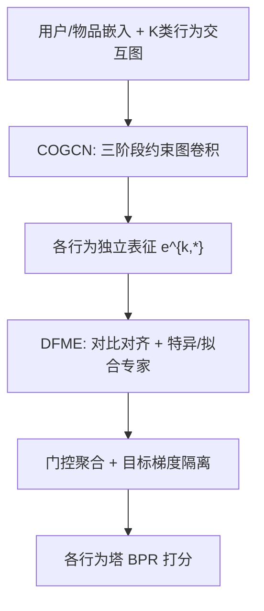
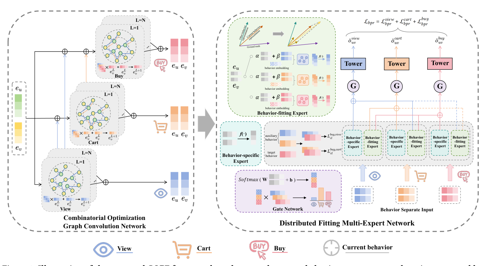

# Combinatorial Optimization Perspective based Framework for Multi-behavior Recommendation (基于组合优化视角的多行为推荐框架)

- **会议/期刊**: KDD 2025 (Research Track)
- **作者与机构**: Chenhao Zhai, Yu Yang, Kexin Zhang, Xiu Li (清华大学深圳国际研究生院)；Chang Meng (快手科技)；Xuhao Zhao (上海交通大学)
- **推荐链路定位**: 精排（多行为融合 + 多任务预测）
- **研究方向**: 多任务学习与列表级重排 / 图神经网络推荐
- **论文原文**: [https://arxiv.org/abs/2502.02232v1](https://arxiv.org/abs/2502.02232v1)
- **开源代码**: [https://github.com/1918190/COPF](https://github.com/1918190/COPF)

## TL;DR (1分钟核心速览)

多行为推荐的主流两段式框架（融合 + 预测）存在两大痛点：融合阶段对用户行为模式约束要么过松（无约束聚合）要么过严（级联范式），预测阶段多任务学习因特征/标签分布差异产生负迁移。本文提出 COPF：将多行为融合建模为组合优化问题，在 pre/in/post-behavior 三阶段施加递进约束（COGCN）以收缩解空间；并用对比对齐 + 行为拟合专家 + 目标梯度隔离（DFME）协调任务关系。在 Beibei/Taobao/Tmall 三数据集上，HR@10 相对最强基线提升 49.91%/12.06%/24.12%。

## Background & Motivation (背景与核心矛盾)

- **主流范式**: GCN 做多行为融合（MBGCN、CIGF、PKEF），MTL 做多行为联合预测（MMOE/PLE/MESI/PME 系列）。
- **前人局限 1（融合）**: 无约束聚合（MBGCN/CIGF）无法刻画行为模式；级联范式（CRGCN/MB-CGCN/PKEF）强制 `view→cart→buy` 严格顺序，约束过严，对"直接购买""反复加购"等真实模式失效。
- **前人局限 2（预测）**: 现有 MTL 只解耦输入（MESI）或做投影聚合（PME），未处理训练中表征空间的动态漂移，也未隔离辅助任务对目标任务的梯度耦合，负迁移仍在。
- **核心洞察 (Key Insight)**: 用户行为模式总数达 $\prod_{i=1}^{K}\frac{K!}{(K-i)!}$，穷举即"组合爆炸"；因此关键不是找精确最优，而是**用恰当强度的约束收缩解空间**——这正是组合优化的核心思想。
- **本文切入点**: 把融合阶段重构为"分阶段约束的组合优化"，把预测阶段重构为"前向分布对齐 + 后向梯度解耦"的双向协调。

## Method (核心方法设计)

### 1. 整体框架 (Overall Architecture)

输入为用户/物品 ID 嵌入与 $K$类行为交互矩阵。COGCN 按行为顺序逐级做图卷积：第$k$个行为的输入由所有上游行为末层输出与初始嵌入聚合而成（pre-behavior 约束），层内只允许聚合$k'\le k$ 的行为邻接矩阵（in-behavior 约束），各行为独立输出（post-behavior 约束）。随后 DFME 先以对比学习对齐目标与辅助行为表征，再为每个行为生成"行为特异专家"与"行为拟合专家"，经门控加权聚合并对目标任务施加 stop-gradient 隔离辅助梯度，最终各行为塔输出 BPR 打分。

<figure class="paper-figure" markdown="span">
  <figcaption>图2：所提出的COPF框架示意图，我们以三种用户行为类型为例：浏览、加购和购买。(⊕)表示逐元素相加操作，𝑓(·)表示生成专家的函数，虚线表示停止梯度。</figcaption>
</figure>

### 2. 关键设计拆解 (Key Designs)

1. **COGCN 三阶段约束（把解空间逐级收缩）**：pre-behavior 约束规定第 $k$行为的输入为上游信息聚合$\mathbf{E}^{k+1,0}=\sum_{k'=1}^{k}\mathbf{E}^{k',L}+\mathbf{E}^{1,0}$；in-behavior 约束把层内传播限制在$\mathbf{E}^{k,l+1}=\sum_{k'=1}^{k}(\mathbf{D}^{-1}\mathbf{A}_{k'}+\mathbf{I})\mathbf{E}^{k,l}$，即当前行为只能"看见"自己和上游，杜绝下游标签泄漏；post-behavior 约束让各行为独立输出、由 MTL 联合优化。直觉：约束强度介于"无约束"与"严格级联"之间，既保留模式多样性又避免过拟合与信息泄漏。

2. **DFME 前向分布对齐（行为拟合专家）**：痛点是无约束聚合会把分布偏移的辅助表征直接注入目标任务。做法是对行为 $k$与$k'$的表征做小系数缩放混合$\mathbf{e}^{k,k'}_{u,in}=(\alpha\mathbf{e}^{k,*}_{u}+\beta\mathbf{e}^{k',*}_{u})/2$，再经$k'$行为邻接图卷积精炼：$\mathbf{E}^{k,k',l+1}=(\mathbf{D}^{-1}\mathbf{A}_{k'}+\mathbf{I})(\mathbf{E}^{k,k',l}\circ\mathbf{R}^{k',l})$。$\alpha,\beta$取小值（实验最优$\alpha=0.1$）实现"微调式"空间校准，既降偏置又保留泛化性；配合目标-辅助行为对比损失$\mathcal{L}^{K,k}_{cl}$ 自适应对齐分布。

3. **DFME 后向梯度解耦与训练目标**：门控 $\mathbf{g}_k=\mathrm{Softmax}(\mathbf{W}_g(\mathbf{e}^{k,*}_u\|\mathbf{e}^{k,*}_v)+\mathbf{b}_g)$聚合专家时，对来自目标行为$K$的专家项施加 stop-gradient：$\mathbf{o}_k(j)=sg(\mathbf{g}_k(j)\cdot\mathbf{e}^{j,k})$（$j\neq k$且$j=K$），使辅助任务无法污染目标任务的梯度更新。总损失$\mathcal{L}=\mathcal{L}_{bpr}+\gamma\sum_{k=1}^{K-1}\mathcal{L}^{K,k}_{cl}+\mu\|\Theta\|_2^2$，BPR 按行为加权$\lambda_k$（和为 1），负采样为标准均匀未交互采样，无额外难负样本挖掘；推理时仅需一次前向图卷积 + 门控加权，开销与 PKEF 同量级。

## Experimental Setup & Evaluation Protocol (实验设置与评估协议)

- **数据集与预处理**（重复交互保留最早一条，沿用 CIGF/PKEF 预处理）：

| 数据集 | #Users | #Items | #Interactions | #Target Interaction | 行为类型 |
| :--- | :---: | :---: | :---: | :---: | :--- |
| Beibei | 21,716 | 7,977 | 3.3×10⁶ | 282,860 | View, Cart, Buy |
| Taobao | 15,449 | 11,953 | 1.2×10⁶ | 92,180 | View, Cart, Buy |
| Tmall | 41,738 | 11,953 | 2.3×10⁶ | 255,586 | View, Collect, Cart, Buy |

- **数据划分与防穿越**: 沿用前作的多行为训练/测试划分（目标行为留出测试，辅助行为全量参与训练），COGCN 的 in-behavior 约束从结构上阻断下游行为信息回流，属显式防穿越设计。
- **排名评测协议**: Top-10 排序，指标 HR@10 与 NDCG@10；负样本来自未交互物品（BPR 均匀采样训练），测试阶段按前作协议对候选集排序。
- **对比基线与超参**: 三类基线共 14 个——单行为（MF-BPR/NeuMF/LightGCN）、多行为无 MTL（RGCN/GNMR/NMTR/MBGCN/S-MBRec/KMCLR/MB-CGCN）、多行为含 MTL（CML/CRGCN/CIGF/PKEF/BCIPM）。嵌入维度 $d=64$，Adam 学习率$10^{-3}$，GCN 层数搜索$\{1,2,3,4\}$，$\gamma=1$、$\mu=0.01$，跑 5 次取均值，显著性$p<0.05$（★）。

## Key Experimental Results (实验关键数据)

### 1. 主实验对比 (Main Results)

| Model | Beibei HR | Beibei NDCG | Taobao HR | Taobao NDCG | Tmall HR | Tmall NDCG |
| :--- | :---: | :---: | :---: | :---: | :---: | :---: |
| LightGCN | 0.0391 | 0.0209 | 0.0411 | 0.0240 | 0.0393 | 0.0209 |
| MBGCN | 0.0470 | 0.0259 | 0.0509 | 0.0294 | 0.0549 | 0.0285 |
| MB-CGCN | 0.0579 | 0.0381 | 0.1233 | 0.0677 | 0.0984 | 0.0558 |
| CIGF | 0.0809 | 0.0400 | 0.0897 | 0.0474 | 0.1150 | 0.0636 |
| PKEF | 0.1130 | 0.0582 | 0.1385 | 0.0785 | 0.1277 | 0.0721 |
| BCIPM | 0.0458 | 0.0221 | 0.1201 | 0.0656 | 0.1414 | 0.0741 |
| **COPF** | **0.1694★** | **0.0903★** | **0.1552★** | **0.0838★** | **0.1755★** | **0.0967★** |
| Improv.% | +49.91% | +55.15% | +12.06% | +6.75% | +24.12% | +30.50% |

### 2. 消融实验 (Ablation Study)

| 变体 | Beibei HR | Taobao HR | Tmall HR | 说明 |
| :--- | :---: | :---: | :---: | :--- |
| w/o COGCN | 0.0601 | 0.0801 | 0.0783 | 退化为多路 LightGCN |
| COPF-P | 0.1282 | 0.1041 | 0.1201 | 去 pre-behavior 约束 |
| COPF-A | 0.1649 | 0.1389 | 0.1592 | 去 in-behavior 约束 |
| COPF-C | 0.1514 | 0.0913 | 0.0785 | 改严格级联范式 |
| COPF-B | 0.1622 | 0.1531 | 0.1714 | 改严格 pre 约束 |
| w/o DFME | 0.0821 | 0.1120 | 0.1146 | 换双线性模块 |
| w/o con. | 0.1154 | 0.1476 | 0.1425 | 去对比对齐 |
| w/o fit. | 0.1182 | 0.0827 | 0.1346 | 去拟合专家 |
| **COPF** | **0.1694** | **0.1552** | **0.1755** | 完整模型 |

### 3. 关键实验发现 (Key Findings)

1. **约束强度是核心变量而非"越严越好"**：严格级联 COPF-C 在 Tmall 上 HR 从 0.1755 暴跌至 0.0785（−55%），而完全去约束的 w/o COGCN 仅 0.0783；本文的"中等强度三阶段约束"同时优于两端，直接验证了组合优化视角下"收缩解空间但不锁死"的论断。
2. **DFME 的收益主要来自前向拟合专家而非对比损失**：Taobao 上去掉拟合专家（w/o fit.）HR 从 0.1552 掉到 0.0827（−47%），而去掉对比学习仅降至 0.1476（−5%）；说明分布校准的"微调式混合 + 图精炼"是抑制负迁移的主力，对比对齐起辅助作用。
3. **DFME 具备即插即用兼容性**：替换 CRGCN/CIGF/PKEF/MB-CGCN/LightGCN$_M$的预测模块后全部正向提升，其中 CRGCN+DFME 在 Beibei 上 HR 从 0.0459 升至 0.1253（+173%），原 MTL 越弱增益越大；同时 GCN 层数超过 3 层后因过平滑性能显著下降，温度$\tau$ 过大则负样本区分度不足。

## Highlights & Limitations (亮点、对比与审稿批判)

- **与代表作对比 (vs. Prior Work)**: 相比 MBGCN/CIGF 的"无约束聚合"，COGCN 引入了可调强度的结构化约束；相比 CRGCN/MB-CGCN/PKEF 的"严格级联"，本文允许上游信息累积注入而非仅取最近一跳，避免了对真实行为模式的过度假设；相比 MESI/PME 仅解耦输入或投影聚合，DFME 同时处理前向分布漂移与后向梯度耦合。
- **可迁移亮点**: (1) "小系数混合 + 图卷积精炼"的拟合专家可作为通用表征空间校准插件，迁移到跨域/多场景 MTL；(2) 对目标任务施加 stop-gradient 的聚合隔离策略，可直接用于任何存在强弱任务标签分布差异的多目标精排。
- **审稿级局限批判**: (1) 三阶段约束的强度（如 $\alpha=0.1$、$\beta=0.001$）需逐数据集调参，且 Taobao 上对$\alpha$ 较敏感，缺乏自适应确定约束强度的机制；(2) 评测仅用 HR/NDCG@10 且沿用前作划分，未报告 Full-Ranking 或采样比说明，也未给出线上时延与吞吐数据，工业部署成本证据不足。

## Rating (四维评分)

- **方法创新性 (Novelty)**: ⭐⭐⭐⭐ （首次将多行为融合形式化为组合优化并给出三阶段约束的算子级实现，视角新颖但单点技术仍属 GCN + MTL 的组合改良）
- **评估协议与实验扎实度 (Protocol & Experiments)**: ⭐⭐⭐⭐ （三数据集 + 14 基线 + 8 组 COGCN 变体 + 6 组 MTL 对比 + 兼容性实验，消融极完整；扣分在于未披露候选集规模与采样协议细节）
- **写作与数学规范度 (Clarity & Rigor)**: ⭐⭐⭐⭐ （约束定义以 Definition 1–5 形式给出、公式链条清晰；但 Eq.5 中 $\mathbf{D}$ 被描述为"对角单位矩阵"存在符号笔误，部分符号复用易混淆）
- **工业落地与复现价值 (Industrial & Practical Value)**: ⭐⭐⭐⭐ （代码已开源、TensorFlow 实现、推理仅一次图卷积前向，工程友好；但多行为图存储与逐行为卷积在超大规模场景下的显存开销需进一步验证）

