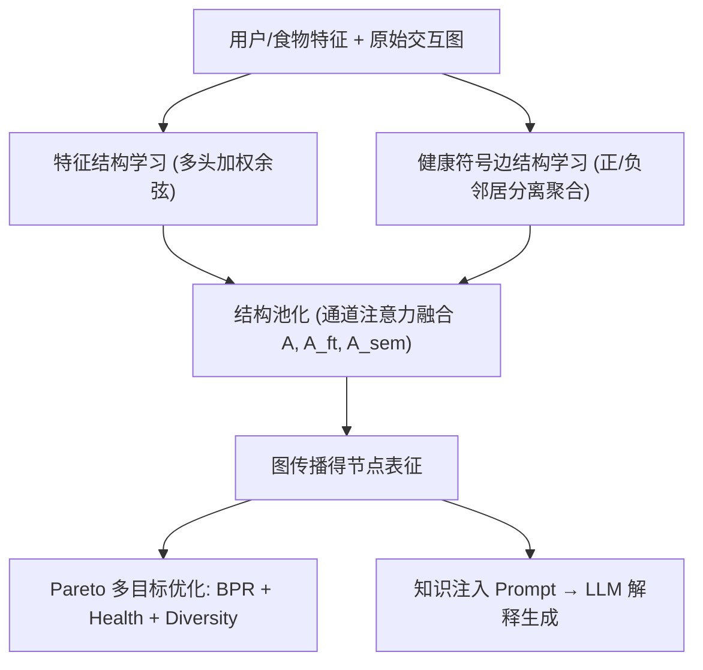

# MOPI-HFRS: A Multi-objective Personalized Health-aware Food Recommendation System with LLM-enhanced Interpretation (多目标个性化可解释健康感知食物推荐系统)

- **会议/期刊**: KDD 2025
- **作者与机构**: Zheyuan Zhang, Zehong Wang, Tianyi Ma 等（University of Notre Dame；Brandeis University；IBM T.J. Watson Research Center；University of Connecticut）
- **推荐链路定位**: 精排（多目标排序）+ 下游解释生成
- **研究方向**: 多任务学习与列表级重排 / 图神经网络与知识图谱推荐
- **论文原文**: [https://arxiv.org/abs/2412.08847v1](https://arxiv.org/abs/2412.08847v1)
- **开源代码**: 暂未开源（论文声明代码与基准"available at here"，但未给出可解析链接）

## TL;DR (1分钟核心速览)

现有健康感知食物推荐存在四大缺口：健康定义不个性化（缺医疗数据）、健康信息仅作硬编码后处理而不参与训练、健康目标与用户口味失衡、几乎无解释性。本文首次基于 NHANES 构建两个大规模个性化健康感知基准，提出 MOPI-HFRS：以"特征结构学习 + 健康符号边结构学习 + 结构池化"精炼图结构，用 Pareto 多目标优化联合优化偏好（BPR）、个性化健康（Jaccard 标签匹配）与营养多样性三目标，再以知识注入 Prompt 驱动 LLM 生成解释。在自建基准上 Recall@20 相对最强基线 SimGCL 提升约 10.1%（12.91 vs 11.73），推荐食物覆盖率从 3.24% 跃升至 10.55%。

## Background & Motivation (背景与核心矛盾)

- **主流范式**: 食物推荐（Recipe1M+、FoodKG）长期以口味偏好为唯一目标；健康感知方向分三类——单一营养指标（卡路里/脂肪）、模拟生成健康数据、套用国际健康标准打综合分。
- **前人局限**: ① 无真实用户医疗数据，"健康"无法按个体病症（高 BMI vs 慢性肾病）个性化定义；② 健康性多作为硬编码后处理，训练阶段不参与，无法捕捉健康与偏好的细粒度交互；③ 加权求和式多目标优化依赖主观权重，易偏向单一目标；④ 解释性缺失，用户无法判断推荐可信度。
- **核心洞察 (Key Insight)**: 用户健康标签与食物营养标签可构成**符号二分图**（健康边/不健康边），依据平衡理论"敌人的敌人是朋友"，健康与不健康食物应以不同方式聚合；同时多目标冲突应通过**梯度下降方向的最小范数凸组合**求 Pareto 稳态，而非人为加权。
- **本文切入点**: 用真实医疗数据打标签构建基准，把健康信号注入图结构学习与训练损失，再用 Pareto 优化调和三目标，最后把推荐模型产出的知识（精炼候选 + 用户关键病症）注入 LLM Prompt 提升解释可靠性。

## Method (核心方法设计)

### 1. 整体框架 (Overall Architecture)

输入为用户/食物节点特征（人口统计学、营养值、文本描述编码）与原始交互二分图。首先由**特征结构学习**（多头加权余弦度量学习）与**健康符号边结构学习**（正/负邻居分离聚合）分别生成两张新邻接图，再经**通道注意力结构池化**与原始图融合为精炼图 $A'$，在其上做 LightGCN 式传播得到节点表征。训练阶段以 Pareto 多目标优化联合驱动 BPR、健康、多样性三个损失；推理阶段将精炼图筛出的候选食物与用户关键健康条件组装为知识注入 Prompt，交由 LLM 输出"是否健康 + 为什么"的解释。

### 2. 关键设计拆解 (Key Designs)

1. **健康符号边结构学习（Signed Aggregation）**：痛点是把健康信息当后处理会丢失训练期信号。本文将边按用户-食物健康标签匹配数标记为正/负，节点表征拆为 $[\mathbf{h}^{+},\mathbf{h}^{-}]$，第$l$ 层正表征聚合"朋友的朋友"与"敌人的敌人"：
$$\mathbf{h}_i^{+(l)}=\sigma\Big(\mathbf{W}^{+(l)}\big[\textstyle\sum_{j\in\mathcal{N}_i^+}\frac{\mathbf{h}_j^{+(l-1)}}{|\mathcal{N}_i^+|},\sum_{k\in\mathcal{N}_i^-}\frac{\mathbf{h}_k^{-(l-1)}}{|\mathcal{N}_i^-|},\mathbf{h}_i^{+(l-1)}\big]\Big)$$
负表征对称地聚合"朋友中的敌人"与"敌人中的朋友"。直觉：对同一用户均不健康的食物嵌入被拉近，健康食物被推远，从而在表征空间显式编码"个性化健康"语义。

2. **Pareto 多目标优化（替代加权求和）**：痛点在于权重主观且易偏置。将三目标梯度做凸组合并最小化其范数：
$$\mathcal{L}_{\text{Pareto}}=\min_{\boldsymbol{\alpha}}\Big\|\sum_{k=1}^{K}\alpha_k\nabla_\theta\mathcal{L}_k(\mathcal{G};\theta)\Big\|_F$$
其中 $\mathcal{L}_{\text{BPR}}$为常规偏好排序损失，$\mathcal{L}_{\text{health}}$用 Jaccard 标签相似度差$\mathcal{J}(t_u,t_i)-\mathcal{J}(t_u,t_j)$调制 BPR 间隔，$\mathcal{L}_{\text{diversity}}$惩罚用户预测食物两两余弦相似度均值。采用 Frank-Wolfe 式迭代：每步先找与当前合成下降方向相关性最小的损失$t=\arg\min_i\hat{\nabla}_\theta\cdot\nabla_\theta\mathcal{L}_i^\top$，再按闭式步长$\eta$更新$\boldsymbol{\alpha}\leftarrow(1-\eta)\boldsymbol{\alpha}+\eta\mathbf{e}_t$。直觉：自动发现"最被忽视"的目标并加大其权重，逼近无目标可再单独下降的 Pareto 前沿。

3. **知识注入 LLM 解释与训练/推理开销**：两个 Prompt 策略——**Refined Food Candidates**（用训练后精炼图筛候选，避免噪声邻居导致矛盾证据）与 **Attention on User Conditions**（显式聚焦与用户病症最相关的营养维度），缓解事实幻觉、非个性化与上下文幻觉。训练为端到端图学习 + 每步一次 Frank-Wolfe 梯度组合（$K=3$，开销近似 3 次反向传播）；推理仅需一次前向传播 + 一次 LLM 调用，图规模为 NHANES 用户-食物二分图，工程上可接受。

## Experimental Setup & Evaluation Protocol (实验设置与评估协议)

- **数据集与预处理**: 基于 NHANES 2003–2020 构建 Health and Nutrition Recommendation Bipartite Graph，按 16 种营养素（7 宏量 + 9 微量）打健康标签，派生两个基准：

| 数据集 | 用户特征 | 食物特征 | 健康标签 | 场景说明 |
| :--- | :---: | :---: | :---: | :--- |
| Nutrition-macro only | 人口统计学 + 医疗检验 | 营养值 + 文本描述 | 7 宏量营养素 | 标签覆盖率高、代谢影响大 |
| Nutrition-all | 同上 | 同上 | 宏量 + 微量共 16 项 | 信息更全面、更细粒度 |

- **数据划分与防穿越 (Splitting Strategy)**: 采用固定随机种子划分训练/测试交互（每模型跑 10 个连续随机种子取均值±标准差），未采用全局时间戳切分（NHANES 为横断面调查数据，无严格时序）。
- **排名评测协议 (Ranking Protocol)**: 采用 `Full-Ranking` 式全库未交互食物排序，报告 Recall@20、NDCG@20；健康性用自研 **H-Score@20**（预测食物与用户健康标签至少共享一个标签的平均比例）；多样性用 **AvgTags@20**（元素级标签覆盖）与 **% Foods@20**（全局级食物覆盖率）。
- **对比基线与超参设置**: 三类基线——经典 GNN（GCN、GraphSAGE、GAT）、SOTA 图推荐（NGCF、LightGCN、SGL、SimGCL、LightGCL）、领域食物推荐（RecipeRec、HFRS-DA）；解释任务对比 XRec、LLM2ER，骨干为 GPT-3.5-turbo、Llama-2-70b、Llama-3-70b，以 BERT Score / BLEU 评估。

## Key Experimental Results (实验关键数据)

### 1. 主实验对比 (Main Results)

Nutrition-macro only 基准（mean±std%，最优加粗）：

| Model | Recall@20 | NDCG@20 | H-Score@20 | AvgTags@20 | % Foods@20 |
| :--- | :---: | :---: | :---: | :---: | :---: |
| GCN | 10.19 | 8.10 | 35.44 | 6.10 | 0.653 |
| NGCF | 11.62 | 9.26 | 36.72 | 6.05 | 0.678 |
| LightGCN | 11.68 | 9.29 | 35.83 | 5.99 | 0.567 |
| SimGCL | 11.73 | 9.45 | 37.59 | 6.04 | 3.243 |
| SGL | 9.97 | 7.67 | 33.30 | 6.01 | 4.459 |
| RecipeRec | 10.03 | 7.99 | 35.94 | 6.08 | 2.070 |
| HFRS-DA | 9.44 | 7.34 | 35.90 | 6.04 | 1.011 |
| **MOPI-HFRS** | **12.91** | **10.34** | **38.13** | **6.17** | **10.550** |
| Improv.% (vs 最强基线) | +10.1% | +9.4% | +1.4% | +2.2% | +136.6% |

Nutrition-all 基准上 MOPI-HFRS 同样全面领先：Recall@20 12.22（vs SimGCL 11.74）、NDCG@20 9.64（vs 9.32）、H-Score@20 63.07（vs 61.88）、% Foods@20 16.51（vs SimGCL 2.89，提升约 4.7 倍）。

### 2. 消融实验 (Ablation Study)

Nutrition-macro only 基准（√ 表示启用该模块）：

| (I) 特征结构 | (II) 健康边结构 | (III) Pareto | Recall@20 | NDCG@20 | H-Score@20 | % Foods@20 |
| :---: | :---: | :---: | :---: | :---: | :---: | :---: |
| √ | − | − | 12.69 | 9.67 | 36.13 | 0.483 |
| − | √ | − | 12.76 | 9.82 | 35.36 | 0.492 |
| − | − | √ | 11.47 | 9.16 | 36.67 | 1.551 |
| √ | √ | − | **13.02** | 10.19 | 37.61 | 0.550 |
| √ | − | √ | 12.85 | 10.28 | 37.35 | 10.920 |
| − | √ | √ | 12.84 | 10.28 | 37.63 | 11.730 |
| √ | √ | √ | 12.91 | **10.34** | **38.13** | 10.550 |

### 3. 关键实验发现 (Key Findings)

1. **Pareto 优化是多样性跃升的主引擎**：仅给原始 LightGCN 加 Pareto 损失（第三行），% Foods@20 从 0.567 升至 1.551，而 Recall 仅从 11.68 微降至 11.47；三模块全开时 % Foods 达 10.55，是 SimGCL 的 3.3 倍，证明"多目标调和"而非"牺牲精度换多样性"。
2. **健康边结构学习是健康指标的直接来源**：单独启用 (II) 使 H-Score 从 35.36 提升至 37.63（配合 Pareto），且 (I)+(II) 组合取得最高 Recall 13.02，说明符号聚合在注入健康语义的同时未损害偏好建模，反而通过去噪精炼了图结构。
3. **传统图推荐存在严重长尾塌缩**：LightGCN/NGCF 的 % Foods@20 仅 0.48–0.68，几乎只推热门食物；而 MOPI-HFRS 在保持 Recall 领先 10% 的同时把覆盖率提升一个数量级，验证了多样性损失与 Pareto 机制对长尾扶持的实效。

## Highlights & Limitations (亮点、对比与审稿批判)

- **与代表作对比 (vs. Prior Work)**: 相比 HFRS-DA 等健康食物推荐（健康性作后处理、无个性化医疗数据），本文首次把真实医疗标签转为符号图边并参与训练；相比 SimGCL/SGL 等通用图对比学习推荐（只优化偏好、多样性靠随机扰动），本文用 Pareto 梯度组合显式建模三目标冲突；相比 XRec/LLM2ER 等 LLM 解释方法（仅注入协同信号），本文额外注入"精炼候选 + 关键病症"两类领域知识，显著降低幻觉。
- **可迁移亮点**: ① "标签匹配 → 符号边 → 正负分离聚合"的范式可直接迁移到电商健康/合规商品推荐、保险风控等带双边属性约束的场景；② Frank-Wolfe 式 Pareto 梯度组合是替代加权求和多目标损失的轻量通用插件，可套在任意 BPR 类骨干上。
- **审稿级局限批判**: ① 基准为 NHANES 横断面数据，交互为食物摄入记录而非真实曝光/点击，Full-Ranking 下缺少负反馈与位置偏差校正，离线指标与线上满意度存在 gap；② Pareto 每步需 $K$次反向传播且$\boldsymbol{\alpha}$ 迭代引入额外超参（步长、收敛判据），LLM 解释环节依赖外部 API，端到端延迟与成本未量化；③ 健康标签基于规则阈值（WHO/FSA/EU/CAC），阈值敏感性未做消融。

## Rating (四维评分)

- **方法创新性 (Novelty)**: ⭐⭐⭐⭐ （符号图正负分离聚合 + Pareto 梯度组合 + 知识注入解释的三段式组合新颖，但各组件单独看均有前人影子，属系统性集成创新）
- **评估协议与实验扎实度 (Protocol & Experiments)**: ⭐⭐⭐⭐ （自建两个大规模基准、10 种子均值±方差、三类基线覆盖全面、消融完整；扣分在于无时间切分与线上验证）
- **写作与数学规范度 (Clarity & Rigor)**: ⭐⭐⭐⭐ （三目标损失与 Pareto 更新公式定义清晰、图示直观；部分符号如 $\mathcal{J}$、$\hat{\nabla}_\theta$ 未在正文统一列表，Frank-Wolfe 收敛性未给证明）
- **工业落地与复现价值 (Industrial & Practical Value)**: ⭐⭐⭐ （Pareto 插件易落地、基准有公共价值；但代码链接缺失、LLM 调用成本与图规模扩展性未评估，复现门槛偏高）

