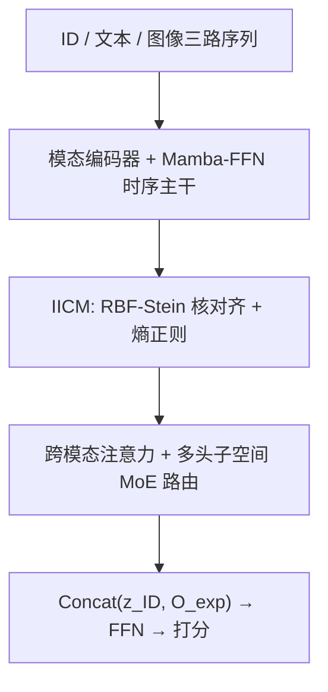
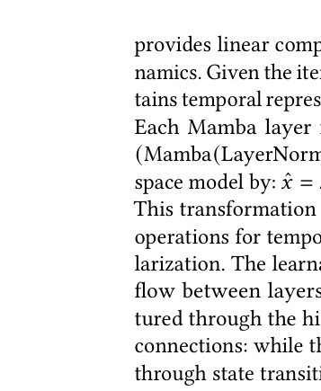

# FindRec: Stein-Guided Entropic Flow for Multi-Modal Sequential Recommendation (Stein 引导熵流的多模态序列推荐)

- **会议/期刊**: KDD 2025
- **作者与机构**: Maolin Wang, Binhao Wang, Wanyu Wang 等（香港城市大学、北航、UTS、昆士兰大学、复旦）
- **推荐链路定位**: 精排（序列级 next-item 打分）
- **研究方向**: 多模态推荐 / 序列推荐
- **论文原文**: [https://arxiv.org/abs/2507.04651v3](https://arxiv.org/abs/2507.04651v3)
- **开源代码**: [https://github.com/Applied-Machine-Learning-Lab/FindRec](https://github.com/Applied-Machine-Learning-Lab/FindRec)

## TL;DR (1分钟核心速览)

多模态序列推荐的两大痛点是：图文特征与 ID 行为流之间存在**分布鸿沟**（直接拼接引入系统性偏差），且商品图文里大量装饰性/营销性噪声会淹没真实兴趣信号。FindRec 提出"信息流—控制—输出"范式：用 **RBF-Stein 核 + 微分熵最大化** 的 IICM 模块做无负样本的分布对齐，用**多头子空间分解 + MoE 路由**按上下文相关性动态筛选跨模态特征，并以线性复杂度 Mamba 层建模长序列。在 MicroLens / ML-100k / Amazon Beauty 三数据集、8:1:1 时序划分下，NDCG@5 相对最强基线 MMMLP 提升 1.40%–3.06%，短序列（5–10）场景提升达 30.9%。

## Background & Motivation (背景与核心矛盾)

- **主流范式**: 多模态序列推荐从早期 MV-RNN 的直接拼接，演进到 NOVA 的图文对比学习、UniSRec 的统一表征、MMMLP 的纯 MLP 混合器，以及 Mamba4Rec 的 SSM 序列建模。
- **前人局限一（分布失配）**: 视觉/文本特征与 ID 交互流来自完全不同的表征空间，静态拼接或注意力加权都会把分布差异当作"信息"注入，产生系统性融合偏差；对比学习类方法（NOVA）依赖负采样质量，易出现表征坍缩或模态主导。
- **前人局限二（噪声与不等贡献）**: 商品图含包装/促销装饰、文本混入通用营销话术，且不同样本中各模态对当前上下文的相关度差异极大，静态融合无法自适应区分。
- **核心洞察 (Key Insight)**: Stein 核可在**不构造负样本**的前提下，用 score 函数 $\nabla_z \log q(z)$ 的核化估计同时完成"分布拉近"与"熵最大化防坍缩"，天然保留各模态几何结构；而路由式 MoE 恰好适合处理"贡献度不等"的异构信号。
- **本文切入点**: 把对齐（IICM）与筛选（跨模态专家路由）解耦为两个可解释模块，串在 Mamba 时序主干之后、预测头之前。

## Method (核心方法设计)

### 1. 整体框架 (Overall Architecture)

输入三条并行序列：ID 序列、RoBERTa 文本序列、BLIP 图像序列，分别投影到 $d$维隐空间。ID 流经 Mamba-FFN 主干得到时序表征$z_{ID}$；图文分支经模态编码器与跨模态注意力后，先由 IICM 做 Stein 核分布对齐，再由路由器 MoE 按上下文筛选组合为$O_{exp}$；最终$z_{final}=\text{Concat}(z_{ID},O_{exp})$ 过 FFN 输出打分。训练时联合优化推荐损失与 IICM 对齐损失。

<figure class="paper-figure" markdown="span">
  <figcaption>图1：FindRec的整体架构。该框架通过包括Mamba-FFN、模态特定编码器、Stein对齐和基于路由器的专家机制在内的多个处理阶段，处理三类输入序列（ID序列、文本序列和图像序列），以生成最终预测概率。底部面板展示了Stein对齐机制（左）和路由器MoE架构（右）的详细设计。</figcaption>
</figure>

### 2. 关键设计拆解 (Key Designs)

1. **IICM：RBF-Stein 核分布对齐（无负样本的跨模态校准）**：针对图文与 ID 流分布失配、对比学习依赖负采样的痛点，取两分支末层表征 $z_{img,last}, z_{txt,last}$，用 RBF 核度量相似度并对齐：
$\mathcal{L}_{IICM}=\mathbb{E}\left[\exp\left(-\frac{\|z_{img,last}-z_{txt,last}\|^2}{2\sigma^2}\right)\right]$其中带宽$\sigma$由 Stein 机制自适应更新。关键在于该核同时给出 score 函数$\nabla_z\log q(z)$ 的无偏估计，用于**最大化嵌入微分熵**——拉近分布的同时防止过度对齐导致的表征坍缩，保留模态判别性。相比对比学习，无需大批次负样本，训练更稳。

2. **跨模态专家路由：多头子空间分解 + MoE 动态筛选**：针对"对齐后各特征贡献度仍不等"的痛点，把对齐表征切成 $H$个子空间（头），每头算跨模态注意力$A_h=\text{Softmax}(z^h_{img}(z^h_{txt})^\top/\sqrt{d_h})$并融合$O_h=z^h_{img}+A_h z^h_{txt}$；随后轻量路由器为每头输出门控权重，聚合$E_h=\sum_{k=1}^{N_e} g^h_k\cdot\text{Expert}_k(O_h)$，再跨头拼接。多头分解的作用是**稳定路由**——单头高维路由易被少数维度主导，子空间切分让门控在低维上更平滑；不同专家分别专精高层语义、细粒度细节与模态特有模式。

3. **训练目标、负采样与推理效率**：总损失 $\mathcal{L}(\phi)=\mathcal{L}_{rec}+\lambda\mathcal{L}_{IICM}$，$\mathcal{L}_{rec}$ 为 BPR 或交叉熵；**不使用显式负采样**（IICM 免负样本，推荐损失按标准序列训练协议）。Mamba 层提供线性复杂度，长序列（ML-100k 平均长度 104.57）下推理开销显著低于 Transformer 类基线。

## Experimental Setup & Evaluation Protocol (实验设置与评估协议)

- **数据集与预处理**（过滤交互数 $<5$ 的用户）：

| 数据集 | #Users | #Items | #Interactions | 稀疏度 | 特征/场景说明 |
| :--- | :---: | :---: | :---: | :---: | :--- |
| MicroLens | 98,130 | 17,229 | 705,174 | 99.96% | 短视频，BLIP 海报 + 128 token 文本，均长 7.19 |
| MovieLens-100k | 944 | 1,334 | 98,609 | 92.17% | 电影海报 + 类型/剧情简介，均长 104.57 |
| Amazon Beauty | 4,323 | 2,424 | 60,276 | 99.42% | 电商商品图 + 256 词描述，均长 13.95 |

- **数据划分与防穿越**: 按用户交互时间戳排序后 **8:1:1 比例划分**（训练/验证/测试），保证时序性；所有基线（含复现的 SASRec）在 RecBole 下使用同一协议。
- **排名评测协议**: 采用 NDCG@{5,10} 与 MRR@{5,10}；原文未明确声明 Full-Ranking 或采样排序细节，属评估透明度上的一个缺口。
- **对比基线与超参**: 三类基线——ID 序列（SASRec/BERTRec/GRU4Rec/SMLP4Rec/Mamba4Rec）、简单多模态（SASRec(MM)/Mamba4Rec(MM)）、先进多模态（NOVA/UniSRec/IISAN/MMMLP）。ID 嵌入维度 128（MicroLens）/64（其余），多模态特征投影至 512；AdamW，lr=0.002，batch=256，2 层 Mamba，10 个随机种子取均值，配对 t 检验 $p<0.05$。

## Key Experimental Results (实验关键数据)

### 1. 主实验对比 (Main Results)

| 方法 | MicroLens NDCG@5 | MicroLens NDCG@10 | ML-100k NDCG@5 | ML-100k NDCG@10 | Beauty NDCG@5 | Beauty NDCG@10 |
| :--- | :---: | :---: | :---: | :---: | :---: | :---: |
| SASRec | 0.0352 | 0.0428 | 0.1835 | 0.2311 | 0.0635 | 0.0796 |
| Mamba4Rec | 0.0415 | 0.0507 | 0.2193 | 0.2723 | 0.0781 | 0.0948 |
| Mamba4Rec (MM) | 0.0402 | 0.0492 | 0.2127 | 0.2641 | 0.0758 | 0.0920 |
| NOVA | 0.0423 | 0.0522 | 0.2288 | 0.2792 | 0.0817 | 0.0995 |
| UniSRec | 0.0420 | 0.0519 | 0.2281 | 0.2795 | 0.0815 | 0.0986 |
| IISAN | 0.0421 | 0.0524 | 0.2285 | 0.2791 | 0.0819 | 0.0998 |
| MMMLP | 0.0425 | 0.0527 | 0.2293 | 0.2801 | 0.0822 | 0.1002 |
| **FindRec** | **0.0438** | **0.0540** | **0.2325** | **0.2830** | **0.0843** | **0.1027** |
| **Improv.** | +3.06% | +2.47% | +1.40% | +1.04% | +2.55% | +2.50% |

### 2. 消融实验 (Ablation Study)

| 变体 | NDCG@5 | NDCG@10 | MRR@5 | MRR@10 |
| :--- | :---: | :---: | :---: | :---: |
| Full Model | **0.0843** | **0.1027** | **0.0722** | **0.0797** |
| w/o Cross-Attn | 0.0806 | 0.1008 | 0.0681 | 0.0767 |
| w/o IICM | 0.0795 | 0.0971 | 0.0639 | 0.0705 |
| w/o MoE | 0.0785 | 0.0956 | 0.0632 | 0.0698 |

### 3. 关键实验发现 (Key Findings)

1. **MoE 是最大贡献源，IICM 次之**：移除 MoE 使 NDCG@5 掉 6.9%、MRR@5 掉 12.5%，移除 IICM 掉 5.7%/11.5%，均大于移除跨模态注意力的 4.4%/5.7%——说明"动态筛选"比"对齐"更贴近性能瓶颈，而 MRR 的跌幅普遍大于 NDCG，暗示两模块主要改善的是**头部排序精度**。
2. **短序列收益远大于长序列**：Beauty 上 5–10 长度组 NDCG@5 相对 SASRec 提升 30.9%（0.0448 vs 0.0342），而 >30 组仅提升约 23%（0.1328 vs 0.1077）；行为信号越稀疏，Stein 对齐带来的图文补偿价值越大，验证了 IICM 的自适应加权假设。
3. **专家数存在明确甜点**：4 专家在所有指标上最优，2 专家容量不足、8/16 专家因路由冗余与专家利用不均衡而退化——MoE 的收益来自"专精分工"而非"参数堆叠"。

## Highlights & Limitations (亮点、对比与审稿批判)

- **与代表作对比 (vs. Prior Work)**: 相比 NOVA 的图文对比学习，FindRec 用 Stein 核替代负采样对比，规避了批次敏感与模态主导；相比 MMMLP 的纯 MLP 静态混合，本文引入上下文相关的路由门控；相比 Mamba4Rec(MM) 的朴素特征注入，IICM 在注入前先做分布校准——三者分别对应"对齐方式""融合方式""注入时机"的改进。
- **可迁移亮点**: (1) RBF-Stein 核 + 熵正则可作为**免负样本的跨模态对齐插件**，直接挂到任意双塔/序列模型上；(2) 多头子空间分解稳定 MoE 路由的技巧，可迁移到多场景/多任务门控网络中以缓解路由震荡。
- **审稿级局限批判**: (1) 主实验相对提升仅 1.0%–3.1%，且未报告 Full-Ranking 协议与方差/置信区间，统计显著性虽标注 $p<0.05$但绝对增益偏薄；(2) IICM 的带宽$\sigma$自适应更新与$\lambda$ 的敏感性分析被推至附录，Stein 梯度估计在 batch=256 下的方差与额外计算开销缺乏量化，工业部署成本不明。

## Rating (四维评分)

- **方法创新性 (Novelty)**: ⭐⭐⭐⭐ （首次将 Stein 核方法引入多模态序列推荐，对齐+熵正则的双目标设计有理论支撑，但组件组合痕迹较重）
- **评估协议与实验扎实度 (Protocol & Experiments)**: ⭐⭐⭐ （三数据集 + 10 种子 + 配对 t 检验较规范，但缺 Full-Ranking 声明、提升幅度小、超参分析大量外置附录）
- **写作与数学规范度 (Clarity & Rigor)**: ⭐⭐⭐ （IICM 公式清晰，但 Mamba 层与路由公式符号略松散，部分关键推导依赖附录）
- **工业落地与复现价值 (Industrial & Practical Value)**: ⭐⭐⭐⭐ （代码已开源，Mamba 线性复杂度利于长序列线上部署，但 Stein 核的额外前向开销需实测）

