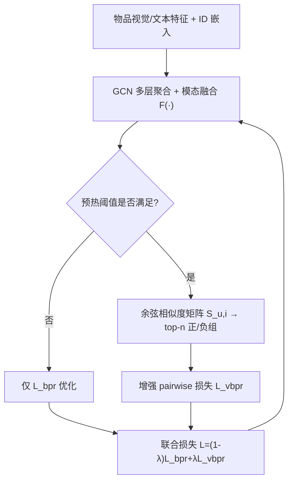
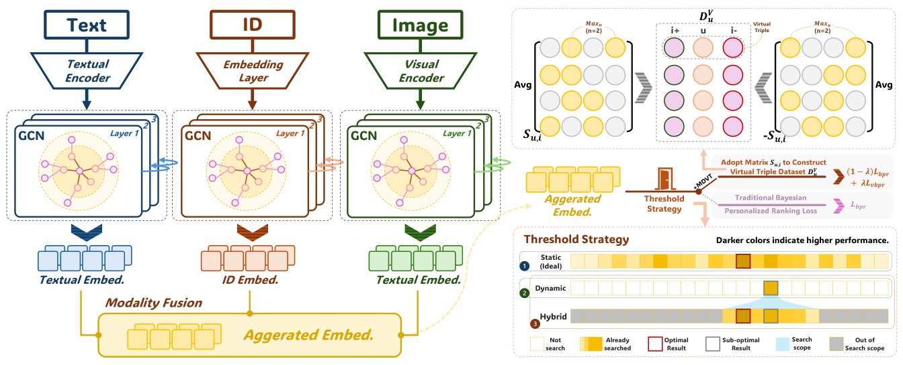

# MDVT: Enhancing Multimodal Recommendation with Model-Agnostic Multimodal-Driven Virtual Triplets (模型无关的多模态驱动虚拟三元组增强多模态推荐)

- **会议/期刊**: KDD 2025
- **作者与机构**: Jinfeng Xu, Zheyu Chen, Jinze Li, Shuo Yang, Hewei Wang, Yijie Li, Mengran Li, Puzhen Wu, Edith C. H. Ngai（香港大学、香港理工大学、CMU、中山大学、Weill Cornell Medicine）
- **推荐链路定位**: 召回（图协同过滤训练阶段增强）
- **研究方向**: 多模态推荐 / 自监督与去噪
- **论文原文**: [https://arxiv.org/abs/2505.16665v1](https://arxiv.org/abs/2505.16665v1)
- **开源代码**: 暂未开源

## TL;DR (1分钟核心速览)

现有多模态推荐把图像/文本仅当作**物品侧辅助信息**，用户表征仍只靠稀疏交互学习，稀疏场景下监督信号严重不足。MDVT 提出模型无关的**多模态驱动虚拟三元组**：用融合表征的余弦相似度为每个用户动态挑选 top-$n$ 最相似/最不相似物品，构造虚拟正负样本，并以增强 pairwise 损失联合优化；为避免用户表征未收敛时产生噪声监督，设计静态/动态/混合三种预热阈值策略。在 Baby/Sports/Clothing/TikTok 四个数据集、6 个主流基线上，混合策略带来 Recall@10 最高 **17.28%**、NDCG@10 最高 **18.02%** 的相对提升，且稀疏用户组（1–5 交互）增益最显著。

## Background & Motivation (背景与核心矛盾)

- **主流范式**: MMGCN、LATTICE、FREEDOM、LGMRec 等以 GCN 为骨干，将物品的视觉/文本特征注入消息传递或构造 item-item 语义图，本质是"用多模态**改进物品表征**"。
- **前人局限**: ① 多模态信息只作为 side information，**用户表征仍完全由稀疏交互驱动**，稀疏用户几乎学不到有效偏好；② 已有虚拟样本方法（如基于物品原始特征相似度构造）与推荐任务目标错位，且未考虑用户表征的**学习时序**，早期构造的样本质量极差。
- **核心洞察 (Key Insight)**: 用户虽无原生模态特征，但其**随机初始化、经模型优化后的模态表征**与物品模态表征之间的相似度，本身即可作为超越显式交互的监督信号；关键在于"何时"启用——必须等用户表征被充分预热。
- **本文切入点**: 把"虚拟三元组构造"与"预热阈值判定"解耦，做成可插拔的训练期增强模块，不改动任何基线的推理结构。

## Method (核心方法设计)

### 1. 整体框架 (Overall Architecture)

模型完全复用基线（如 FREEDOM/LGMRec）的 GCN 编码与模态融合算子 $\mathcal{F}(\cdot)$，得到融合表征$\bar{\boldsymbol{e}}_u,\bar{\boldsymbol{e}}_i$。训练分两阶段：**预热期**仅用原始 BPR 损失优化，让用户表征从随机初始化收敛；**阈值触发后**，每轮用当前融合表征计算用户-物品余弦相似度矩阵$\boldsymbol{S}_{u,i}$，为每个用户取 top-$n$最相似与最不相似物品构成虚拟正/负组，与真实三元组联合优化。虚拟集随模型优化**动态刷新**，形成"表征变好$\to$虚拟样本变准$\to$ 表征更好"的正反馈。

<figure class="paper-figure" markdown="span">
  <figcaption>图1：我们提出的MDVT的整体架构。</figcaption>
</figure>

### 2. 关键设计拆解 (Key Designs)

1. **多模态驱动虚拟三元组构造（Model-Agnostic Virtual Triplets）**：痛点在于真实交互三元组数量受稀疏性硬约束。本文不改网络，只改**训练数据供给**：对融合表征做余弦相似度检索，$\boldsymbol{S}_{u,i}=\bar{\boldsymbol{e}}_u^{\top}\bar{\boldsymbol{e}}_i/(\|\bar{\boldsymbol{e}}_u\|\|\bar{\boldsymbol{e}}_i\|)$，再取$\mathcal{D}^V_{u,i^+}=\mathrm{Max}_n(\boldsymbol{S}_{u,i^*})$、$\mathcal{D}^V_{u,i^-}=\mathrm{Max}_n(-\boldsymbol{S}_{u,i^*})$。直觉：融合表征已编码 ID 协同信号 + 视觉/文本语义，其近邻即"语义上该用户会喜欢但尚未交互"的候选，等价于在表征空间做**软标签挖掘**，天然覆盖冷门物品。

2. **三种预热阈值策略（Static / Dynamic / Hybrid）**：痛点在于用户模态表征是随机初始化、逐步学习的，预热不足时相似度矩阵近乎噪声，直接注入会造成梯度偏斜。**Static** 在阈值集 $\{0,5,10,20,40,80\}$上穷举最优轮数$T_S$，效果最好但调参昂贵；**Dynamic** 监测损失下降率，当$|\mathcal{L}_t-\mathcal{L}_{t-1}|/\mathcal{L}_{t-1}<g$时判定收敛并触发，零调参但可能错过最优点；**Hybrid** 先用 Dynamic 得到近似阈值$T_{cur}$，再在窄窗口$[T_{cur}-s,T_{cur}+s]$ 内做 Static 精搜，以可接受开销逼近全局最优。

3. **增强 Pairwise 损失与梯度对齐**：若直接把 $n$条虚拟三元组与 1 条真实三元组并列求和，损失量级失衡会引发梯度偏斜（类似多任务学习的尺度冲突）。本文先对虚拟正/负组做**组内表征平均**$\hat{\boldsymbol{e}}_{u,i^+}=\frac{1}{n}\sum_{i^+}\bar{\boldsymbol{e}}_{i^+}$（负组同理），使每条虚拟三元组与真实三元组**结构对称**，再用$\mathcal{L}=(1-\lambda)\mathcal{L}_{bpr}+\lambda\mathcal{L}_{vbpr}$缩放对齐，其中$\mathcal{L}_{vbpr}=\sum-\log\sigma(\bar{\boldsymbol{e}}_u^{\top}\hat{\boldsymbol{e}}_{u,i^+}-\bar{\boldsymbol{e}}_u^{\top}\hat{\boldsymbol{e}}_{u,i^-})$。负样本全部来自**表征空间最不相似物品**（hard negative），无需额外均匀采样；推理阶段零开销，虚拟三元组仅在训练期存在。

## Experimental Setup & Evaluation Protocol (实验设置与评估协议)

- **数据集与预处理**: 均按 MMRec 库标准 `5-core` 过滤：

| 数据集 | #Users | #Items | #Interactions | 稀疏度 | 模态 |
| :--- | :---: | :---: | :---: | :---: | :--- |
| Baby | 19,445 | 7,050 | 160,792 | 99.88% | V+T |
| Sports | 35,598 | 18,357 | 296,337 | 99.95% | V+T |
| Clothing | 39,387 | 23,033 | 278,677 | 99.97% | V+T |
| TikTok | 9,319 | 6,710 | 59,541 | 99.90% | V+T+A |

- **数据划分与防穿越**: 随机 `8:1:1` 比例划分（train/val/test），沿用 FREEDOM、LGMRec 的通用设定。
- **排名评测协议**: 采用 `Full-Ranking` 全库未交互物品排序，报告 Recall@{5,10} 与 NDCG@{5,10}，对全体测试用户取平均。
- **对比基线与超参**: 基线覆盖 MMGCN、SLMRec、FREEDOM、DRAGON、LGMRec、MMSSL 六类 SOTA；batch size 固定 2048，$\lambda\in\{0.1,\dots,0.5\}$、$n\in\{1,2,4,8\}$网格搜索，$g\in\{0.1,\dots,0.4\}$、$s\in\{1,\dots,5\}$；提升均通过$p<0.01$ 显著性检验（表中 `*` 标注）。

## Key Experimental Results (实验关键数据)

### 1. 主实验对比 (Main Results)

以最具代表性的 Baby / Clothing 两数据集、Hybrid 策略为例（R@10 / N@10）：

| 模型 | Baby R@10 | Improv. | Baby N@10 | Improv. | Clothing R@10 | Improv. | Clothing N@10 | Improv. |
| :--- | :---: | :---: | :---: | :---: | :---: | :---: | :---: | :---: |
| MMGCN | 0.0378 | — | 0.0200 | — | 0.0218 | — | 0.0110 | — |
| +MDVT (H) | **0.0420** | +11.11% | **0.0224** | +12.00% | **0.0244** | +11.93% | **0.0126** | +14.55% |
| SLMRec | 0.0529 | — | 0.0290 | — | 0.0452 | — | 0.0247 | — |
| +MDVT (H) | **0.0563** | +6.43% | **0.0323** | +11.38% | **0.0497** | +9.96% | **0.0270** | +9.31% |
| FREEDOM | 0.0627 | — | 0.0330 | — | 0.0629 | — | 0.0341 | — |
| +MDVT (H) | **0.0662** | +5.58% | **0.0357** | +8.18% | **0.0665** | +5.72% | **0.0364** | +6.74% |
| DRAGON | 0.0662 | — | 0.0345 | — | 0.0671 | — | 0.0365 | — |
| +MDVT (H) | **0.0692** | +4.53% | **0.0364** | +5.51% | **0.0713** | +6.26% | **0.0387** | +6.03% |
| LGMRec | 0.0626 | — | 0.0333 | — | 0.0555 | — | 0.0302 | — |
| +MDVT (H) | **0.0660** | +5.43% | **0.0360** | +8.11% | **0.0622** | +12.07% | **0.0337** | +11.92% |
| MMSSL | 0.0613 | — | 0.0326 | — | 0.0619 | — | 0.0335 | — |
| +MDVT (H) | **0.0667** | +8.81% | **0.0354** | +8.59% | **0.0657** | +6.14% | **0.0356** | +6.27% |

TikTok 上增益最大：MMGCN +MDVT(H) 的 R@10 从 0.0463 升至 **0.0543**（+17.28%），N@10 从 0.0231 升至 **0.0272**（+17.75%）。

### 2. 消融实验 (Ablation Study)

Baby 数据集 R@10，Hybrid 策略：

| 配置 | MMGCN | SLMRec | FREEDOM | DRAGON | LGMRec |
| :--- | :---: | :---: | :---: | :---: | :---: |
| Original | 0.0378 | 0.0529 | 0.0627 | 0.0662 | 0.0626 |
| w/o-Aggr（去掉组内平均） | 0.0360 | 0.0508 | 0.0603 | 0.0644 | 0.0602 |
| w/o-Scale（去掉 $\lambda$ 缩放） | 0.0370 | 0.0519 | 0.0617 | 0.0653 | 0.0615 |
| MDVT$_{ID}$（仅 ID 模态） | 0.0381 | 0.0533 | 0.0631 | 0.0666 | 0.0633 |
| MDVT$_{V}$/ MDVT$_{T}$（仅单模态） | 0.0360 / 0.0370 | 0.0508 / 0.0519 | 0.0603 / 0.0617 | 0.0644 / 0.0653 | 0.0602 / 0.0615 |
| MDVT$_{ID-T}$ | 0.0412 | 0.0552 | 0.0649 | 0.0682 | 0.0652 |
| MDVT$_{F1}$（按交互频次构造） | 0.0354 | 0.0493 | 0.0589 | 0.0627 | 0.0522 |
| **MDVT（全融合）** | **0.0420** | **0.0563** | **0.0662** | **0.0692** | **0.0660** |

### 3. 关键实验发现 (Key Findings)

1. **预热是虚拟三元组的生命线**：去掉组内平均（w/o-Aggr）或去掉 $\lambda$ 缩放（w/o-Scale）后，所有模型均**低于原始基线**（如 FREEDOM 从 0.0627 掉到 0.0603/0.0617），说明虚拟损失与真实损失的尺度失衡会直接引发梯度偏斜，训练曲线在 20 轮预热后损失骤升、NDCG 骤降——这验证了"结构对称 + 损失缩放"不是工程细节而是必要条件。
2. **模态互补而非替代**：仅用视觉或文本构造虚拟三元组反而**劣于原始模型**（MMGCN 0.0360/0.0370 vs 0.0378），因为脱离 ID 协同信号后虚拟样本偏离推荐目标；仅 ID 已能小幅提升（0.0381），ID+文本融合最优（0.0412），说明多模态的价值在于**为 ID 协同信号补充语义近邻**。
3. **稀疏度越高收益越大**：按训练集交互数分桶后，1–5 交互用户组的 NDCG@10 提升幅度显著高于 21–25 组；同时 MDVT 使 MMGCN/FREEDOM/DRAGON 的收敛轮数明显缩短（图 5），即虚拟三元组既补监督又加速收敛。此外，MDVT 与 AMR 对抗训练、GPT-4o 数据增强**正交可叠加**（LGMRec 在 Baby 上 0.0417 → +A 0.0420 → +G 0.0427 → +A+G **0.0431**）。

## Highlights & Limitations (亮点、对比与审稿批判)

- **与代表作对比 (vs. Prior Work)**: 与 FREEDOM/LATTICE 等"改图结构、改聚合算子"的多模态推荐不同，MDVT **完全不改网络**，只改训练信号供给，因此可叠加在任意基线之上（本文验证了 6 个模型）；与基于物品原始特征相似度构造虚拟样本的早期工作相比，本文用**动态学习后的融合表征**构造样本，并通过预热阈值保证时序正确性，这是性能差距的核心来源。
- **可迁移亮点**: ① "预热阈值 + 动态刷新虚拟样本"这一范式可直接迁移到序列推荐、跨域推荐等任何存在"表征冷启动"的自监督增强场景；② 组内平均 + $\lambda$ 缩放的**损失尺度对齐技巧**，对任何要往 BPR 上叠加辅助损失的训练框架都适用。
- **审稿级局限批判**: ① 虚拟三元组每轮需重算全量用户-物品相似度矩阵，$O(|\mathcal{U}||\mathcal{I}|d)$的开销在千万级物品的工业场景不可行，论文未给出采样近似或 ANN 加速方案；② 预热阈值$g$、$s$虽声称"低调参成本"，但仍在 4 个数据集上做了网格搜索，且最优$n$随基线强弱变化（弱基线需$n=4$），跨模型零调参的鲁棒性证据不足；③ 仅在 Amazon 与 TikTok 的 `5-core` 子集上验证，未涉及真实冷启动划分或线上 A/B。

## Rating (四维评分)

- **方法创新性 (Novelty)**: ⭐⭐⭐⭐ （"多模态表征相似度即监督信号"的视角清晰，预热阈值策略有实际洞察，但虚拟样本/自监督增强的整体思路并非全新）
- **评估协议与实验扎实度 (Protocol & Experiments)**: ⭐⭐⭐⭐ （4 数据集 × 6 基线 × 3 策略的矩阵式验证充分，含稀疏分桶、收敛曲线、兼容性实验与 $p<0.01$ 检验；缺冷启动划分与线上验证）
- **写作与数学规范度 (Clarity & Rigor)**: ⭐⭐⭐⭐ （公式简洁、模块边界清楚，三种阈值策略的优劣分析到位；但相似度矩阵计算复杂度与虚拟集刷新频率未做理论分析）
- **工业落地与复现价值 (Industrial & Practical Value)**: ⭐⭐⭐ （推理零开销、即插即用是最大卖点，但训练期全量相似度计算与未开源代码削弱了直接落地性）

