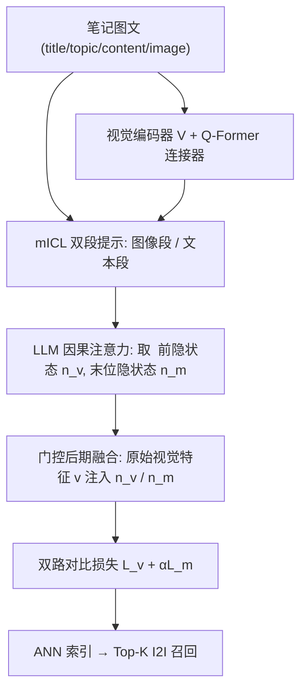

# NoteLLM-2: Multimodal Large Representation Models for Recommendation (面向推荐的多模态大表征模型)

- **会议/期刊**: KDD 2025 (ADS Track)
- **作者与机构**: Chao Zhang, Haoxin Zhang, Shiwei Wu, Di Wu, Tong Xu, Xiangyu Zhao, Yan Gao, Yao Hu, Enhong Chen (USTC / 小红书 / CityU HK)
- **推荐链路定位**: 召回 (I2I 向量召回)
- **研究方向**: 多模态推荐 / 大语言模型推荐
- **论文原文**: [https://arxiv.org/abs/2405.16789v2](https://arxiv.org/abs/2405.16789v2)
- **开源代码**: [https://github.com/Applied-Machine-Learning-Lab/NoteLLM](https://github.com/Applied-Machine-Learning-Lab/NoteLLM)

## TL;DR (1分钟核心速览)

针对 I2I 多模态召回中"现成 MLLM 发布滞后且推理低效、而端到端微调 LLM+视觉编码器又会忽视图像"的核心痛点，本文提出 NoteLLM-2：用 mICL 将图文拆成两段压缩提示分别做对比学习，再用门控后期融合把原始视觉特征注入最终表征。在真实小红书笔记数据（148 万训练笔记）上以全库排序 Recall@100/1k/10k 评估，MTomato-Base 上 R@100 从 71.94% 提升至 74.62%，线上首千次曝光点击 +6.35%。

## Background & Motivation (背景与核心矛盾)

- **主流范式**: 多模态 I2I 召回依赖 CLIP/METER 类视觉-语言模型产出稠密向量，再经 ANN 检索相似笔记；文本分支因缺乏纯文本预训练而理解能力偏弱。
- **前人局限**: ① 直接迁移开源 MLLM（BLIP-2、Qwen-VL-Chat）做表征，零样本性能甚至不如 BM25（Qwen-VL-Chat 多模态 R@100 仅 40.94% vs BM25 55.22%），且 256 个视觉 token 使训练成本高达 432.6 GPU-h、推理仅 11.5 条/秒；② 端到端微调未对齐的 LLM+视觉编码器时，模型严重偏向文本、几乎不表征图像（MTomato-Base 纯图像输入 R@100 仅 0.60%）。
- **核心洞察 (Key Insight)**: 作者用显著性分数 $S_v,S_t,S_o$追踪注意力信息流，发现端到端 MLRM 在浅层$S_v$极低而$S_o$ 很高——图像只是"放大关键元素"的辅助信号，并未被直接聚合进压缩表征；深层才通过文本上下文间接吸收视觉信息。
- **本文切入点**: 不改预训练范式，仅从"提示构造"与"融合位置"两个角度，让视觉信息流直接汇入最终表征。

## Method (核心方法设计)

### 1. 整体框架 (Overall Architecture)

输入笔记 $n_i=(t_i,tp_i,ct_i,v_i)$，视觉编码器$V_\theta$（冻结）提取图像特征$Z_v$，经 Q-Former 连接器$C_\pi$映射为$L_c=16$个视觉词嵌入，替换提示中 `` 占位符后送入 LLM。基础版把图文压成单个词做对比学习；NoteLLM-2 改为 mICL 双段提示产出视觉表征$\boldsymbol{n}^v_i$与多模态表征$\boldsymbol{n}^m_i$，再分别经门控后期融合得到$\hat{\boldsymbol{n}}^v_i,\hat{\boldsymbol{n}}^m_i$，双路对比损失加权求和训练；推理时仅用$\hat{\boldsymbol{n}}^m_i$ 建 ANN 索引。

### 2. 关键设计拆解 (Key Designs)

1. **多模态上下文学习 mICL（提示层面对齐视觉注意力）**：单段提示下 LLM 把图像当"配角"，视觉信息只流向中间 token。mICL 将笔记拆为 `{'image': }` 与 `{'title','topic','content'}` 两段，各自以相同句式 "Compress this note into one word" 压缩；利用因果注意力，取 `<IMG_EMB>` 前一隐状态作为纯视觉表征 $\boldsymbol{n}^v_i$，末位隐状态作为多模态表征$\boldsymbol{n}^m_i$。直觉是让模型从"图像段也遵循同一压缩模式"中学会 ICL 式的任务归纳，从而提升$S_v$、压低浅层$S_o$，使视觉信息被直接聚合。

2. **门控后期融合（架构层面保留原始视觉信息）**：早期融合把视觉映射进文本空间后易在 LLM 交互中丢失纯视觉细节。本文保留视觉编码器的 [CLS] 特征经线性层得 $\boldsymbol{v}\in\mathbb{R}^{h_t}$，与 LLM 侧表征做门控：

$$\boldsymbol{z}=\sigma(\boldsymbol{W}[\boldsymbol{v},\boldsymbol{n}^v_i]+\boldsymbol{b}),\quad \hat{\boldsymbol{n}}^v_i=\boldsymbol{z}\odot\boldsymbol{v}+(1-\boldsymbol{z})\odot\boldsymbol{n}^v_i$$

多模态路同理得 $\hat{\boldsymbol{n}}^m_i$。门控按样本自适应决定"原始视觉 vs LLM 语义"的配比，等价于给视觉信息开一条绕过 LLM 的直连通道。

3. **训练目标、负采样与推理效率**：批内 $B$对相关笔记共$2B$ 条，采用 in-batch 对比（批内其余样本即负样本，无额外负采样）：

$$\mathcal{L}_f=\frac{\mathcal{L}_v+\alpha\mathcal{L}_m}{1+\alpha},\quad \mathcal{L}=-\frac{1}{2B}\sum_{i=1}^{2B}\log\frac{e^{\text{sim}(\hat{\boldsymbol{n}}_i,\hat{\boldsymbol{n}}^+_i)/\tau}}{\sum_{j\neq i}e^{\text{sim}(\hat{\boldsymbol{n}}_i,\hat{\boldsymbol{n}}_j)/\tau}}$$

仅更新连接器与 LLM，视觉编码器冻结以支撑大 batch（全局 128，8×A100）。推理时视觉 token 仅 16 个，MTomato-Base+NoteLLM-2 推理 48.2 条/秒，远快于 Qwen-VL-Chat 的 11.5 条/秒。

## Experimental Setup & Evaluation Protocol (实验设置与评估协议)

- **数据集与预处理**: 小红书真实多模态 I2I 数据，通过用户"浏览 A 后点击 B"的共现分数 $s_{n_A\to n_B}=\sum_{u}1/N_u$ 构造相关对，剔除分数高于 30 / 低于 0.01 的离群值后取 Top-3：

| 数据集 | #Notes | #Note Pairs | 平均标题词数 | 平均正文词数 | 场景说明 |
| :--- | :---: | :---: | :---: | :---: | :--- |
| 训练集 | 1,487,613 | 1,130,906 | 12.38 | 133.20 | 两周行为数据，1/10 作验证 |
| 测试集 | 534,144 | 21,262 | 11.68 | 116.00 | 次周笔记池，与训练无重叠 |

- **数据划分与防穿越**: 按周切分（训练两周 / 测试次周），测试池与训练集去重，属时间切分防泄漏；另构造短查询对 5,620、短目标对 5,582（token < 50，约占 10%）专测多模态能力。
- **排名评测协议**: 无偏 **Full-Ranking**——对测试池全部剩余笔记按查询笔记表征相似度排序，报告 Recall@100/1k/10k，随机种子 {42,43,44} 三次取均值。
- **对比基线与超参设置**: 单模态 CLIP ViT-B / BM25 / RoBERTa-wwm-ext / Tomato / NoteLLM / Qwen-Chat；多模态 METER Merge-attn、METER Co-attn、BLIP-2、Qwen-VL-Chat 及三个自建 MLRM（MTomato-Base、MQwen-Base、MQwen-bigG）。表征统一线性投影至 $d=64$，初始温度$\tau=3$，$\alpha=9$，显著性检验为双侧 t-test$p<0.05$。

## Key Experimental Results (实验关键数据)

### 1. 主实验对比 (Main Results)

All Pair 全库排序 Recall（%）：

| 方法 | 输入 | R@100 | R@1k | R@10k |
| :--- | :---: | :---: | :---: | :---: |
| BM25 | Text | 55.22 | 72.64 | 82.82 |
| RoBERTa-wwm-ext | Text | 67.59 | 85.06 | 93.86 |
| NoteLLM (Tomato) | Text | 71.42 | 87.78 | 95.57 |
| METER Co-attn | Multimodal | 70.90 | 89.75 | 97.88 |
| BLIP-2 | Multimodal | 68.38 | 88.22 | 97.44 |
| MQwen-bigG | Multimodal | 77.63 | 92.89 | 98.91 |
| Qwen-VL-Chat | Multimodal | **78.53\*** | **93.76\*** | **99.03\*** |
| MTomato-Base + NoteLLM-2 | Multimodal | 74.62\* | 91.50\* | 98.47 |
| MQwen-Base + NoteLLM-2 | Multimodal | 76.49\* | 92.18\* | 98.57 |

短查询对 R@100 上，MTomato-Base 由 44.77% → 54.87%（+10.10），MQwen-Base 由 48.15% → 55.73%（+7.58），提升幅度远大于全量对。

### 2. 消融实验 (Ablation Study)

MTomato-Base 为底座（%）：

| 变体 | All R@100 | Short Query R@100 | Short Target R@100 |
| :--- | :---: | :---: | :---: |
| basic method | 71.94 | 44.77 | 45.83 |
| + mICL | 74.15 | 51.56 | 52.74 |
| + late fusion | 74.51 | 54.19 | 54.00 |
| **NoteLLM-2 (两者)** | **74.62** | **54.87** | **54.51** |
| only late fusion（不输入图像嵌入） | 74.23 | 53.20 | 53.65 |
| Omni-Retrieval | 71.73 | 44.98 | 45.18 |

### 3. 关键实验发现 (Key Findings)

1. **视觉忽视是端到端微调的结构性缺陷而非训练不足**：纯图像输入下 MTomato-Base/MQwen-Base 的 R@100 仅 0.60%/1.92%，而 BLIP-2 为 24.72%；显著性分析显示浅层 $S_v$低、$S_o$高，说明图像信息被"借道"文本间接吸收，NoteLLM-2 后$\hat{S}_v$上升、$\hat{S}_o$下降而$S_t$ 几乎不变，验证了机制归因。
2. **视觉编码器越弱，后期融合收益越大；越强则 mICL 更稳**：ViT-B 底座上 late fusion 单独即带来 +2.57/+9.42（All/Short Query R@100），但 ViT-bigG 上 late fusion 反使 All R@100 从 77.63 降至 77.43，作者归因为过度强调图像损害文本理解，此时 mICL 单独更优（77.96）。
3. **效率与效果可同时占优**：NoteLLM-2 仅用 16 个视觉 token，训练 110.7 GPU-h、推理 48.2 条/秒，而 Qwen-VL-Chat 需 432.6 GPU-h、11.5 条/秒；8 个视觉 token 的 NoteLLM-2（74.17）仍超过 16 token 的 basic method（71.94），说明增益来自注意力模式改造而非扩大图像 token 空间。线上 10% 流量 A/B：首千次曝光点击 +6.35%，发布 24h 内互动数 +8.08%，24h 内百次曝光即产生首次互动的笔记 +9.83%。

## Highlights & Limitations (亮点、对比与审稿批判)

- **与代表作对比 (vs. Prior Work)**: 相比 NoteLLM（纯文本 LLM 表征 + 主题生成），本文把 LLM 表征扩展到多模态并揭示视觉忽视问题；相比 BLIP-2/Qwen-VL-Chat 这类"生成导向" MLLM，本文走端到端定制路线，无需多模态预训练数据、参数量与推理成本低一个量级；相比 Omni-Retrieval 的多路跨模态对比，本文不改损失结构而是改提示与融合位置，避免辅助损失干扰主表征。
- **可迁移亮点**: ① "同句式双段压缩提示 + 取特殊 token 前隐状态"可在任意 LLM 表征任务中低成本分离模态信号；② 门控后期融合是通用插件，凡"编码器特征在 LLM 交互中被稀释"的场景（视频、音频）均可复用。
- **审稿级局限批判**: ① 仅在单一平台中文笔记数据上验证，且相关对由共现启发式构造，存在曝光偏差与假阳性，缺少公开多模态 I2I 基准的复现；② 后期融合在强视觉编码器上反而掉点，门控缺乏模态平衡约束，$\alpha$ 与视觉 token 数的权衡仍靠人工网格搜索；③ 与 Qwen-VL-Chat 的差距被归因于视觉 token 长度（16 vs 256），但未给出等 token 预算下的受控对比。

## Rating (四维评分)

- **方法创新性 (Novelty)**: ⭐⭐⭐⭐ （首次系统刻画端到端 MLRM 的视觉忽视现象，并用显著性信息流给出可解释归因，mICL 与后期融合均为轻量但切中要害的改造）
- **评估协议与实验扎实度 (Protocol & Experiments)**: ⭐⭐⭐⭐ （全库 Full-Ranking + 短/长对分桶 + 三种底座消融 + 线上 A/B 完整，但缺公开基准与等 token 受控实验）
- **写作与数学规范度 (Clarity & Rigor)**: ⭐⭐⭐⭐ （信息流显著性公式与门控融合定义清晰，符号统一；部分超参敏感性分析仅单底座验证）
- **工业落地与复现价值 (Industrial & Practical Value)**: ⭐⭐⭐⭐⭐ （已替换线上 I2I 召回通道，代码开源，16 token 推理 48 条/秒，工程性价比突出）

