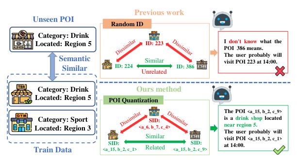
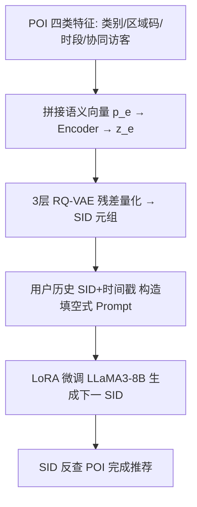
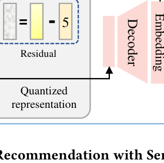

# Generative Next POI Recommendation with Semantic ID (基于语义ID的生成式下一POI推荐)

- **会议/期刊**: KDD 2025
- **作者与机构**: Dongsheng Wang, Yuxi Huang, Shen Gao, Yifan Wang, Chengrui Huang, Shuo Shang（电子科技大学）
- **推荐链路定位**: 端到端生成式（召回+排序一体）
- **研究方向**: 时空轨迹与POI本地生活推荐 / 生成式推荐与离散语义ID
- **论文原文**: [https://arxiv.org/abs/2506.01375v2](https://arxiv.org/abs/2506.01375v2)
- **开源代码**: [https://github.com/wds1996/GNPR-SID](https://github.com/wds1996/GNPR-SID)

## TL;DR (1分钟核心速览)

现有 LLM 生成式 POI 推荐（如 LLM4POI）把每个 POI 当作随机数字 ID（RID），LLM 无法从 `386` 这类编号中读出任何语义，导致相似 POI 无法共享知识、新 POI 泛化差、且需在 prompt 中塞入大量 POI 描述文本。本文提出 GNPR-SID：先用类别/区域/时段/协同四类特征构造 POI 语义向量，经 RQ-VAE 三层残差量化得到层级语义 ID（SID，如 `<a_15><b_2><c_9>`），再微调 LLaMA3-8B 以"填空"方式自回归生成下一 POI 的 SID。在 NYC/TKY/CA 三数据集上 Acc@1 达 0.3618/0.3062/0.2403，较 LLM4POI 最高提升 16%，token 用量降 54.78%。

## Background & Motivation (背景与核心矛盾)

- **主流范式**: 下一 POI 推荐已从 RNN/Transformer/GCN 序列建模（STAN、GETNext、STHGCN、ROTAN）演进到 LLM 生成式范式（LLM4POI），后者把 POI 编号直接作为 token 让 LLM 自回归生成。
- **前人局限**: ① RID 是随机唯一数字，不含任何语义，LLM 无法建模"咖啡店与奶茶店相邻相似"这类关联，只能死记硬编码到 ID 的映射；② 遇到训练集外的新 POI，RID 完全失效，跨域泛化差；③ 为弥补语义缺失，LLM4POI 需在 prompt 中拼接 POI 描述文本与相似用户序列，token 开销巨大。
- **核心洞察 (Key Insight)**: 若让相似 POI 共享 ID 前缀（如 `<a_15><b_2><c_9>` 与 `<a_15><b_2><c_1>`），则 LLM 的 next-token 预测天然具备"由粗到细"的语义泛化能力——新开的奶茶店可被赋予 `<a_15><b_2><c_x>` 而无需重新学习。
- **本文切入点**: 把 POI 语义 ID 构造与 LLM 推荐解耦为两个模块，用 RQ-VAE 在离散语义空间中做层级量化，并新增多样性损失防止码本坍缩。

<figure class="paper-figure" markdown="span">
  <figcaption>图1：随机ID与语义ID的比较：语义ID能够捕捉相似POI之间的语义关联，从而有助于LLM建模用户偏好。</figcaption>
</figure>

## Method (核心方法设计)

### 1. 整体框架 (Overall Architecture)

GNPR-SID 分两阶段。**阶段一（SID 构造）**：对每个 POI 抽取四类 one-hot 特征并拼接为语义向量 $p_e=\text{concat}(c,r,t,c_u)$，其中$c$为类别、$r$为 Google Plus Codes 区域码（保证邻近 POI 同码）、$t$为访问频次 Top-10 时段、$c_u$为 Top-10 高频访客协同信号；经全连接编码器得$z_e$，再由 3 层 RQ-VAE 残差量化输出码字索引元组作为 SID。**阶段二（生成式推荐）**：将用户历史签到序列转为 SID+时间戳的 prompt，微调 LLaMA3-8B（LoRA, rank 16）以填空形式生成下一 POI 的 SID。两阶段串行但 SID 构造与 LLM 无关，可离线预计算。

<figure class="paper-figure" markdown="span">
  <figcaption>图2：基于语义ID的生成式下一POI推荐（GNPR-SID）概览。它由两个模块组成：（1）语义POI ID构建模块通过码本量化将POI映射为语义ID（SID）；（2）生成式POI推荐模块微调LLM，以历史POI SID序列为输入并生成下一个POI SID。</figcaption>
</figure>

### 2. 关键设计拆解 (Key Designs)

1. **层级残差量化 SID 构造（让相似 POI 共享前缀）**：痛点是用单一码本量化会语义混淆且 ID 冲突。RQ-VAE 逐层量化残差：第 $l$层码字$e_k^{(l)}=\arg\min_{e\in B^{(l)}}\|r^{(l)}-e\|$，残差递推$r^{(l)}=r^{(l-1)}-e_k^{(l-1)}$，最终$\hat{z}_e=\sum_{l=1}^{L}e_k^{(l)}$，SID 取各层码字索引$[\text{index}(e^{(1)}),\dots,\text{index}(e^{(L)})]$。由粗到细的层级结构使语义相近 POI 自然共享长前缀，LLM 的逐 token 生成即对应语义粒度逐级细化。对仍冲突的 SID 追加第 4 维唯一标识兜底。

2. **多样性损失（防码本坍缩与语义碰撞）**：仅用重构损失会让大量 POI 挤入少数码字，SID 冲突率高。本文加双约束：利用率项 $\mathcal{L}_{utilize}=\frac{1}{N}\sum_{i=1}^{K}\|\text{count}_i-\frac{N}{K}\|$迫使样本均匀分配到各码字；紧凑项$\mathcal{L}_{compactness}=\frac{1}{k(k-1)}\sum_{i\neq j}\|e_i-e_j\|^2$ 防止为均衡而把语义无关 POI 硬塞同簇。二者互补，兼顾码本利用率与语义一致性。

3. **训练目标、负采样与推理效率**：总损失 $\mathcal{L}_{total}=\mathcal{L}_{recon}+\mu\mathcal{L}_{quant}+\lambda\mathcal{L}_{div}$，其中$\mathcal{L}_{quant}$含 stop-gradient 的量化项与 commitment 项（$\beta$控制），$\mu=1.0,\lambda=0.25$。LLM 侧为监督微调（teacher forcing 于真实下一 SID），**无需负采样**——生成式范式把全库排序隐式转化为词表上的 next-token 概率。因语义已压缩进 SID，prompt 无需 POI 描述文本，token 量较 LLM4POI 降 54.78%，测试时间降 51.98%。

## Experimental Setup & Evaluation Protocol (实验设置与评估协议)

- **数据集与预处理**: 过滤交互数 <10 的 POI 与签到数 <10 的用户，按时间排序后 8:1:1 划分；测试集中剔除未在训练集出现的用户与 POI。

| 数据集 | #Users | #POIs | #Categories | 平均签到数 | 场景说明 |
| :--- | :---: | :---: | :---: | :---: | :--- |
| Foursquare-NYC | 1,083 | 5,135 | 209 | 136 | 纽约城市签到 |
| Foursquare-TKY | 2,293 | 7,873 | 190 | 195 | 东京，长序列 |
| Gowalla-CA | 6,592 | 14,027 | 301 | 53 | 加州，短序列稀疏 |

- **数据划分与防穿越 (Splitting Strategy)**: 全局时间排序后 `比例划分`（80/10/10）；评估时每用户最后一次签到为 ground truth，之前记录为输入，训练集历史与测试输入拼接至固定长度 50，严格按时间先后防穿越。
- **排名评测协议 (Ranking Protocol)**: 采用 `Acc@1`（top-1 精确命中率），即 $\text{Acc@1}=\frac{1}{m}\sum_{i=1}^{m}\mathbb{I}(y_i=\hat{y}_i)$。生成式模型直接在 SID 词表上解码，属隐式全库候选，未做负采样排序。
- **对比基线与超参设置**: 基线覆盖传统（PRME/LSTM/PLSPL）、Transformer（STAN/GETNext）、GCN（STHGCN）、时间感知（TPG/ROTAN）、LLM（LLM4POI）五类。RQ-VAE 为 3 层码本、每层 32（NYC）或 64（TKY/CA）码字、维度 64，k-means 初始化；LLM 用 LLaMA3-8B + LoRA（rank 16, dropout 0.1），学习率 1e-5，4×L40 GPU。

## Key Experimental Results (实验关键数据)

### 1. 主实验对比 (Main Results)

| Model | POI 表示 | 时间 | NYC | TKY | CA |
| :--- | :---: | :---: | :---: | :---: | :---: |
| STHGCN | RID | × | 0.2734 | 0.2950 | 0.1730 |
| TPG | RID | ✓ | 0.2555 | 0.1420 | 0.1749 |
| ROTAN | RID | ✓ | 0.3106 | 0.2458 | 0.2199 |
| LLM4POI | RID | ✓ | 0.3372 | 0.3035 | 0.2065 |
| Llama3-8B (zero-shot) | SID | ✓ | 0.2885 | 0.2282 | 0.1254 |
| **GNPR-SID** | **SID** | ✓ | **0.3618** | **0.3062** | **0.2403** |
| Improv. vs LLM4POI | | | +7.3% | +0.9% | **+16.4%** |
| Improv. vs ROTAN | | | +16.5% | +24.6% | +9.3% |

### 2. 消融实验 (Ablation Study)

| 变体 | NYC | TKY | CA |
| :--- | :---: | :---: | :---: |
| GNPR-SID | 0.3618 | 0.3062 | 0.2403 |
| w/o SID（退回 RID） | 0.3356 (↓7.24%) | 0.2812 (↓8.18%) | 0.2296 (↓4.45%) |
| w/o Time（去时间戳） | 0.2924 (↓19.18%) | 0.2568 (↓16.13%) | 0.1971 (↓17.80%) |
| w/o $\mathcal{L}_{div}$ | 0.3528 (↓2.48%) | 0.2923 (↓4.54%) | 0.2313 (↓3.72%) |
| w/o $\mathcal{L}_{quant}$ | 0.3429 (↓5.23%) | 0.2900 (↓5.29%) | 0.2279 (↓5.14%) |
| w/o $\mathcal{L}_{recon}$ | 不收敛 | 不收敛 | 不收敛 |

### 3. 关键实验发现 (Key Findings)

1. **SID 是主要增益来源，但时间戳是"隐形命脉"**：去掉 SID 退回 RID 掉 4.45%–8.18%，而去掉时间戳掉 16%–19%，说明 POI 语义 ID 提供的是"空间-类别"先验，而个性化时序行为才是下一 POI 预测的决定性信号，二者缺一不可。
2. **多样性损失存在最优权重，过犹不及**：$\lambda=0$时 NYC 仅 2,916 个唯一 SID、711 次碰撞，Acc@1=0.3528；$\lambda=0.25$时唯一 SID 升至 3,259、碰撞降至 590，Acc@1 达峰值 0.3618；但$\lambda=0.75$ 时碰撞虽降至 554，Acc@1 反跌至 0.3368——过度强制均匀分布会把语义相近 POI 拆散到不同簇，破坏前缀相似性。
3. **语义 ID 带来显著跨域泛化与效率红利**：跨域实验中（如 CA 训练→TKY 测试）GNPR-SID 得 0.2342，LLM4POI 仅 0.1960；且因无需拼接 POI 描述与相似用户序列，训练时间降 58.48%、测试时间降 51.98%、总 token 降 54.78%，语义压缩同时换来精度与效率双赢。

## Highlights & Limitations (亮点、对比与审稿批判)

- **与代表作对比 (vs. Prior Work)**: 与 LLM4POI 的本质区别在于 ID 语义化——后者用 RID + 文本描述补语义，本文用 RQ-VAE 把语义直接编码进 ID 结构，省去描述文本且天然支持前缀泛化；与 TIGER 类生成式召回相比，本文针对 POI 特有的空间（Plus Codes 区域码）、时间（时段分布）、协同（高频访客）三源异构特征做了定制化语义向量设计，而非直接用内容 embedding。
- **可迁移亮点**: ① "Plus Codes 区域码替代原始经纬度"可迁移到任何 LBS 场景的离散化空间特征工程；② 多样性损失中"利用率 + 紧凑度"双约束组合，可直接复用于任何 RQ-VAE/VQ 码本训练以缓解坍缩。
- **审稿级局限批判**: ① 仅报告 Acc@1，缺少 NDCG@K / Hit@K 等排名指标，且生成式解码未与全库 Full-Ranking 严格对齐，评估维度偏窄；② SID 构造依赖离线 RQ-VAE，新 POI 上线需重新量化或按最近码字近似分配，论文未讨论增量更新与码本漂移问题；③ 多样性损失权重 $\lambda$ 在 0.25 处最优但 0.5 即明显下滑，超参敏感度较高，跨数据集需重调。

## Rating (四维评分)

- **方法创新性 (Novelty)**: ⭐⭐⭐⭐ （首次将 RQ-VAE 层级语义 ID 系统引入 POI 推荐，四源特征语义向量与多样性损失设计有针对性，但 RQ-VAE+SID 范式在推荐领域已有 TIGER 等先例，属迁移创新）
- **评估协议与实验扎实度 (Protocol & Experiments)**: ⭐⭐⭐ （三数据集 + 五类基线 + 消融 + 跨域 + 效率分析较完整，但仅 Acc@1 单指标、缺排名指标与显著性检验，评估偏薄）
- **写作与数学规范度 (Clarity & Rigor)**: ⭐⭐⭐⭐ （RQ-VAE 量化与三重损失公式推导清晰、符号一致，框架图与 SID 语义可视化直观，复杂度分析略欠）
- **工业落地与复现价值 (Industrial & Practical Value)**: ⭐⭐⭐⭐⭐ （代码开源，SID 可离线预计算、token 降 55%、测试时间减半，对线上 LLM 推荐部署有直接降本价值）

