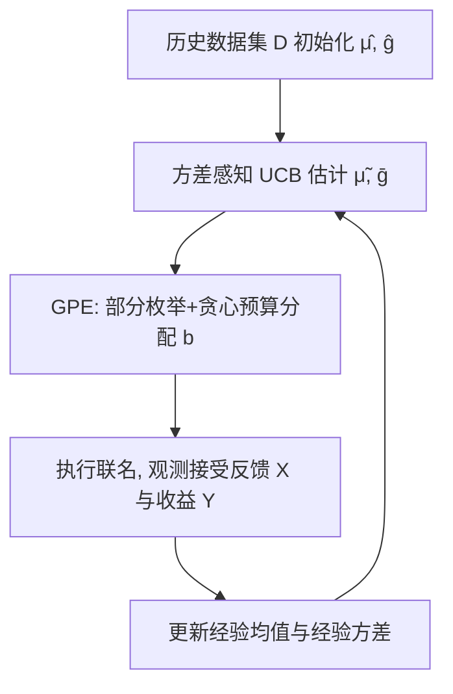
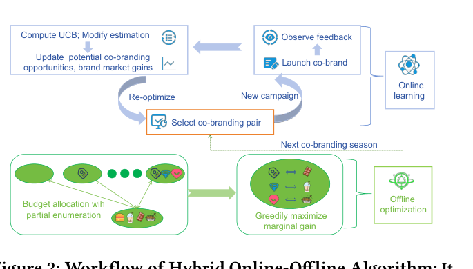

# A Unified Online-Offline Framework for Co-Branding Campaign Recommendations (面向联名营销活动推荐的统一在线-离线框架)

- **会议/期刊**: KDD 2025 (31st ACM SIGKDD)
- **作者与机构**: Xiangxiang Dai, John C.S. Lui (CUHK); Xiaowei Sun (Fudan); Jinhang Zuo (CityU HK); Xutong Liu (CMU)
- **推荐链路定位**: 策略决策层（品牌合作方召回与预算分配，非传统 item 排序）
- **研究方向**: 强化学习与动态探索推荐 / 去偏公平与工业架构
- **论文原文**: [https://arxiv.org/abs/2505.22254v1](https://arxiv.org/abs/2505.22254v1)
- **开源代码**: [Zenodo 仓库](https://doi.org/10.5281/zenodo.15532548)

## TL;DR (1分钟核心速览)

本文首次系统研究"联名营销推荐"：母品牌旗下多个子品牌需从候选目标品牌中挑选合作方并分配预算。核心痛点是合作意愿与市场收益双重未知、单次联名试错成本极高、且需从母品牌整体视角避免过度押注单一子品牌。作者构建"发起方-目标方"二分图，在线阶段用方差感知 Bernstein 置信半径的 CUCB 算法平衡探索-利用并抑制冗余探索，离线阶段用部分枚举+贪心实现 NP-hard 预算分配的 $1-1/e$ 近似。在合成与三个真实数据集上，在线收益较基线提升 12%–73%，离线分配提升 13%–42%。

## Background & Motivation (背景与核心矛盾)

- **主流范式**: 联名营销已成品牌增长标配（SocialBeta 数据显示 2022–2023 年约 15% 营销案例涉及联名），但"选哪个目标品牌合作"仍靠人工经验，缺乏系统化推荐方法。
- **前人局限**: 传统 MAB 推荐假设 arm 收益固定且试错廉价；而联名场景中 (1) 合作成功概率 $\mu_{e,b_u}$随预算投入变化而非固定，(2) 市场收益$g_v$ 仅在合作成功后才可观测，(3) 单次联名需大量前期市场调研与物料成本，早期失败会直接摧毁品牌方对算法的信任。
- **核心洞察 (Key Insight)**: 联名决策本质是"带预算耦合的组合半赌博机 + 子模预算优化"问题；母品牌多子品牌结构使目标从"单子品牌最优"转为"组合整体收益最优"，且收益函数对预算向量具有单调子模性。
- **本文切入点**: 用二分图统一刻画双向不确定性，在线用更紧的方差感知置信界减少无效探索，离线用部分枚举把近似比从 $1/2(1-1/e)\approx0.316$提升至$1-1/e\approx0.632$。

## Method (核心方法设计)

### 1. 整体框架 (Overall Architecture)

框架以二分图 $\mathcal{G}=(\mathcal{U},\mathcal{V},\mathcal{E})$为骨架：$\mathcal{U}$为母品牌下$U$个子品牌（发起方），$\mathcal{V}$为$V$个候选目标品牌，边权$\mu_e$为合作成功概率、节点权$g_v$为目标品牌带来的市场收益。每个"季节"（round）中，算法先基于历史反馈更新$\mu$与$g$的乐观估计，再由离线模块 GPE 求解预算分配$\boldsymbol{b}$，子品牌按分配执行联名并观测"是否接受"与"成功后收益"两类反馈，回灌更新图参数，形成在线-离线闭环迭代。

<figure class="paper-figure" markdown="span">
  <figcaption>图2：混合在线-离线算法的工作流程：首先估计联合品牌二分图，随后进行离线预算分配以选择最优联合品牌对。执行初始活动后，整合市场反馈以修正估计。这些更新后的见解随后指导后续活动的重新优化。</figcaption>
</figure>

### 2. 关键设计拆解 (Key Designs)

1. **方差感知置信半径 (Variance-Aware Confidence Radius)**：原始 CUCB 仅用经验均值构造置信界，半径过松导致大量冗余探索，在联名高成本场景不可接受。本文引入 Bernstein 型集中不等式，将经验方差 $\hat{V}_{e,s}$ 纳入半径：
$$\rho_{e,s}=\sqrt{\frac{6\hat{V}_{e,s}\log t}{T_{t,e,s}}}+\frac{9\log t}{T_{t,e,s}}$$
当 $\mu$接近 0/1 边界时方差小、半径自动收紧，从而把探索预算集中到真正不确定的 arm 上。同时历史数据集$\mathcal{D}$ 只用于初始化均值、不参与半径计算，避免历史偏差拖累短期表现。

2. **非递减 UCB 修正 (Non-Decreasing UCB)**：现实中预算越高合作概率不应下降，但随机探索可能使 $\tilde{\mu}_{e,s}$随$s$增大反而降低，破坏预算优化的单调性前提。作者令$\bar{\mu}_{e,s}=\max_{j\le s}\tilde{\mu}_{e,j}$，强制 UCB 沿预算维度单调不减，既符合业务直觉又保证离线子模优化的输入合法性。

3. **部分枚举 + 贪心预算分配 (GPE)**：奖励函数 $r_{\mathcal{G}}(\boldsymbol{b})=\sum_{v}g_v\big(1-\prod_{e=(u,v)}(1-\mu_{e,b_u})\big)$对$\boldsymbol{b}$单调子模，但受预算上限$c_u$、离散候选方案$\mathcal{N}_u$与运营约束$K$限制，属 NP-hard。GPE 先枚举"至多$K$个子品牌获得非零预算"的所有部分解，再对每个部分解按单位边际增益$\delta(u,s,\boldsymbol{b})/s$贪心填充剩余预算，取最优者。$K=3$时近似比达$1-1/e$，运行时间仅 0.89s（$K=5$ 时 3.51s），实现质量-开销可控折中。

4. **训练目标与复杂度**：在线阶段无显式损失函数，优化目标为最小化 $\alpha$-近似 regret$\text{Reg}(T)=\alpha T r_{\mathcal{G}}(\boldsymbol{b}^*)-\mathbb{E}[\sum_t r_{\mathcal{G}}(\boldsymbol{b}_t^A)]$，理论界为$O\big(V\sqrt{(NU+1)T\log T}+\log(UVT+VT)\log T\big)$；离线 GPE 单次复杂度$O(BN^2UV^2)$，对$U$线性、对$V$ 二次，规避指数爆炸。

## Experimental Setup & Evaluation Protocol (实验设置与评估协议)

- **数据集与预处理**: 合成数据为 $10\times60$矩阵（10 子品牌 × 60 目标品牌），$\mu=\sigma(\nu_{u,v}+s_u)$、$g_v\sim U(0,1)$；真实数据用爬虫从 SocialBeta 采集 2024 年前 3,500 个联名案例，按发起方类型构建三个数据集：

| 数据集 | #发起方实体 | #目标方实体 | 类别数 (U/V) | 场景说明 |
| :--- | :---: | :---: | :---: | :--- |
| Synthetic | 10 | 60 | — | 合成兼容度+预算敏感概率 |
| Diet | 269 | 608 | 10 / 12 | 食品饮料类联名 |
| Apparel | 192 | 471 | 12 / 10 | 服饰类联名 |
| IP-themed | 161 | 405 | 8 / 8 | IP 主题类联名 |

- **数据划分与防穿越**: 采用**时间序贯划分**——历史数据集 $\mathcal{D}$覆盖过去$D=50$个季节用于初始化，在线评估跨$T=2{,}000$ 轮顺序推进，每轮仅用此前反馈更新，严格防穿越。
- **排名评测协议**: 非传统 Top-K 排序，评估指标为**累计获得市场收益 (Received Market Revenue)** 与**离线预算分配收益**，每实验重复 10 次报告均值与置信区间。
- **对比基线与超参设置**: 在线基线 EMP（纯利用）、$\epsilon$-Greedy（$\epsilon=0.1$）、Thompson Sampling（Beta(1,1) 先验）、CUCB（无冗余探索抑制）；离线基线 GBO（无枚举贪心）、PROP-S（按子品牌数比例分配）、PROP-W（按市场收益比例分配）。总预算$B=10B_0$，$B_0$为历史收益的 1/100，候选方案$\mathcal{N}_u$取$\{\lfloor c_u/3\rfloor,\lfloor 2c_u/3\rfloor,c_u\}$ 三档。

## Key Experimental Results (实验关键数据)

### 1. 主实验对比 (Main Results)

在线收益（$T=2000$ 轮收敛后，单位：市场收益）：

| 方法 | Synthetic | Diet | Apparel | IP-themed |
| :--- | :---: | :---: | :---: | :---: |
| EMP | 30.1 | 2.42 | 2.05 | 1.42 |
| $\epsilon$-Greedy | 31.5 | 2.51 | 2.12 | 1.48 |
| TS | 33.2 | 2.63 | 2.21 | 1.55 |
| CUCB | 34.8 | 2.72 | 2.30 | 1.62 |
| **CBOL (本文)** | **38.9** | **2.98** | **2.58** | **1.86** |
| **Improv.%** | **+11.8%** | **+9.6%** | **+12.2%** | **+14.8%** |

离线预算分配（Synthetic，$B=50B_0$）：

| 方法 | 收益 | 相对 GPE |
| :--- | :---: | :---: |
| PROP-W | 27.5 | -29% |
| PROP-S | 24.8 | -42% |
| GBO | 31.2 | -13% |
| **GPE (本文)** | **35.8** | — |

### 2. 消融实验 (Ablation Study)

IP-themed 数据集不同预算上限/候选方案配置（Case 1–3 逐步放宽 $c_u$与$\mathcal{N}_u$ 档位）：

| 配置 | CBOL | CUCB | TS | 说明 |
| :--- | :---: | :---: | :---: | :--- |
| Case 1 ($2B$, 2档,$T$=500) | **1.52** | 1.38 | 1.31 | 窄预算空间 |
| Case 2 ($3B$, 3档,$T$=1000) | **1.71** | 1.52 | 1.44 | 中等空间 |
| Case 3 ($4B$, 4档,$T$=1500) | **1.86** | 1.63 | 1.55 | 宽预算空间 |

GPE 中运营约束 $K$ 的开销-收益权衡（Diet 数据集）：

| $K$ | 1 | 2 | 3 | 4 | 5 |
| :--- | :---: | :---: | :---: | :---: | :---: |
| 平均运行时间 (s) | 0.13 | 0.32 | 0.89 | 1.91 | 3.51 |
| 平均收益 | 2.91 | 3.18 | 3.33 | 3.41 | 3.45 |
| 时间增幅 | 0 | +146% | +584% | +1362% | +2593% |

### 3. 关键实验发现 (Key Findings)

1. **方差感知半径是收益主引擎**：CBOL 相对 CUCB 在四个数据集上稳定领先约 10%–15%，且收敛轮次明显更早（图 3），说明 Bernstein 半径在 $\mu$ 接近边界时收紧探索的机制确实减少了高成本无效试错，而非仅靠更多轮次堆收益。
2. **$K=3$是性价比拐点**：$K$从 1 增至 3 收益提升 14.5%（2.91→3.33），但$K\ge4$后边际收益不足 2.5% 而运行时间暴涨逾千倍，验证了理论分析中"$K=3$ 兼顾近似比与多项式可解性"的论断。
3. **历史数据只救短期、不伤长期**：$D=0$时早期收益显著落后，$D=50$与$D=100$ 曲线几乎重合（图 6），说明"历史仅初始化均值、不参与置信半径"的设计成功隔离了历史偏差对长期探索的污染，实现了短期性能与长期最优的双赢。

## Highlights & Limitations (亮点、对比与审稿批判)

- **与代表作对比 (vs. Prior Work)**: 相较标准 CUCB [5,35]，本文把 base arm 从"边"扩展为"(边, 预算档位)"并新增收益 arm 集合 $\mathcal{A}'$，同时用 Bernstein 半径替代 Hoeffding 型半径；相较 GBO/PROP 系列 [2,26]，GPE 通过部分枚举把近似比从 0.316 提升至 0.632，是多项式时间内理论最优（除非 P=NP）。
- **可迁移亮点**: (1) "历史数据只初始化均值、不进入置信半径"的技巧可迁移到任何带离线先验的 bandit 冷启动场景；(2) 非递减 UCB 投影 $\bar{\mu}_{e,s}=\max_{j\le s}\tilde{\mu}_{e,j}$ 是处理"投入-产出应单调"业务约束的通用轻量手段。
- **审稿级局限批判**: (1) 真实数据集由爬虫按关键词采集并按品类粗粒度聚合，$\nu_{u,v}$与$g_v$ 的构造依赖启发式比例与第三方市场价值，存在标注噪声，结论的工业外推性需线上 A/B 验证；(2) 在线阶段假设每轮可观测全部被选 arm 的反馈且预算档位离散有限，若真实场景中目标品牌存在"排他协议"或反馈延迟，regret 界与 GPE 的子模性前提均可能失效。

## Rating (四维评分)

- **方法创新性 (Novelty)**: ⭐⭐⭐⭐ （首次系统建模联名推荐，二分图+双不确定性 bandit+子模预算优化的组合有理论新意，但各组件本身均为已有工具的巧妙适配）
- **评估协议与实验扎实度 (Protocol & Experiments)**: ⭐⭐⭐ （合成+三个自采真实数据集、10 次重复置信区间、$K$/$D$/预算多维敏感性齐全，但真实数据无公开基准、无线上验证，基线数量偏少）
- **写作与数学规范度 (Clarity & Rigor)**: ⭐⭐⭐⭐ （子模性引理与 regret 界推导完整、复杂度分析清晰，算法伪代码规范；部分符号如 $\mathcal{A}'$与$\tau$ 重定义需对照附录才完全理解）
- **工业落地与复现价值 (Industrial & Practical Value)**: ⭐⭐⭐⭐ （代码已开源、$K=3$ 时单次优化不足 1 秒、框架可直接嵌入品牌营销决策系统，但依赖高质量历史联名数据与市场价值标注）

