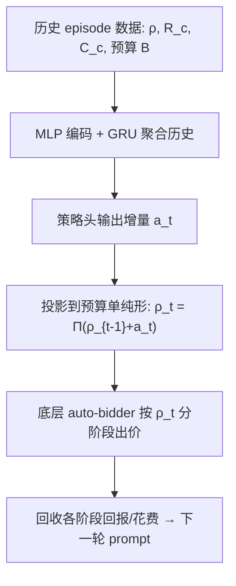
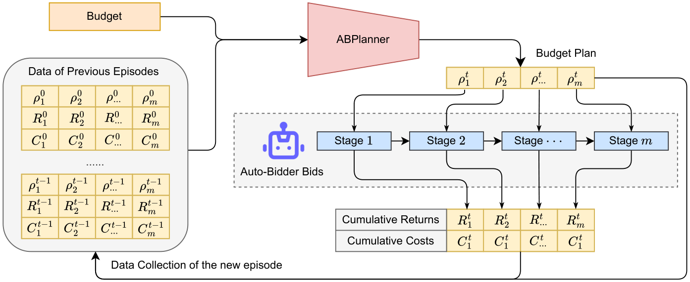

# An Adaptable Budget Planner for Enhancing Budget-Constrained Auto-Bidding in Online Advertising (面向预算受限自动出价的可适配预算规划器)

- **会议/期刊**: KDD 2025 (ADS Track)
- **作者与机构**: Zhijian Duan 等，北京大学 / 阿里巴巴集团
- **推荐链路定位**: 粗排（出价与预算控制层，位于精排 CTR 预估之上）
- **研究方向**: 强化学习与动态探索推荐 / CTR 预估与特征交叉
- **论文原文**: [arXiv:2502.05187v1](https://arxiv.org/abs/2502.05187v1)
- **开源代码**: [zjduan/ABPlanner](https://github.com/zjduan/ABPlanner)

## TL;DR (1分钟核心速览)

预算受限自动出价本质是**在线随机背包问题**：单次曝光价值/价格随机性极大、周期内曝光数上万导致长时程决策难，且不同广告主环境差异大、新广告主历史日志稀缺。本文提出 ABPlanner，把竞价周期切成 $m$个阶段，用高层规划器输出预算分配方案$\rho$，底层 auto-bidder 在$\rho$ 下出价；规划器建模为 MDP，以历史 episode 数据为 prompt 逐日调整分配，实现 few-shot 适配。纯仿真 PID 底座上累计回报提升约 13%，半仿真 LP 底座上稳定领先，线上 A/B 六天内转化数持续正向。

## Background & Motivation (背景与核心矛盾)

- **主流范式**: 自动出价分两派——控制类（PID、反馈调节）与 RL 类（USCB 等直接在曝光级做序贯决策），另有"出价+预测"路线（预估胜出价格分布、建模环境转移）。
- **前人局限**: ① 曝光级价值/价格方差极大，单点 CPR（性价比 $v_i/p_i$）几乎不可预测；② 一个 episode 内曝光数达数千至数万，属长时程序贯决策，RL 信用分配困难；③ 多通道出价虽有"高层分配+底层出价"分层，但只解**单个即将到来的 episode**，不跨 episode 自适应。
- **核心洞察 (Key Insight)**: 单条曝光随机，但**一个阶段内的聚合统计量（平均 CPR）随机性显著更低**，且跨广告主呈现相似的时间规律（如白天 CPR 高于凌晨）。因此把"预测单点"换成"预测阶段级预算回报"，决策环境更平稳、更易学。
- **本文切入点**: 用分层框架把长时程问题降维成"阶段级预算分配"，再用 in-context RL 让规划器在连续 episode 间自我修正，绕开为每个广告主拟合 budget-return 函数的样本效率瓶颈。

## Method (核心方法设计)

### 1. 整体框架 (Overall Architecture)

每个竞价 episode 开始前，ABPlanner 读取该广告主上一轮（及更早）的预算方案 $\rho_{0:t-1}$、各阶段累计回报$R_c^{0:t-1}$与花费$C_c^{0:t-1}$，经 MLP+GRU 编码为历史隐状态$h_t$，输出一个**分配增量**$a_t$，投影回预算单纯形得到新方案$\rho_t$；底层 auto-bidder（PID / USCB / LP 均可，不作限制）在$\rho_t$ 的参考消耗率下逐曝光出价；episode 结束后回收各阶段真实回报与花费，构成下一轮 prompt。训练用 PPO-clip，在随机采样的广告主上收集轨迹，测试时直接 zero-shot 迁移到未见广告主。

<figure class="paper-figure" markdown="span">
  <figcaption>图1：ABPlanner的整体流程。在广告主每个竞价周期开始时，ABPlanner根据先前竞价周期的数据分配预算。随后，底层自动竞价器按照分配方案进行竞价，ABPlanner收集信息以供该广告主未来的周期使用。</figcaption>
</figure>

### 2. 关键设计拆解 (Key Designs)

1. **分层预算分解（Hierarchical Decomposition）**：痛点是把整段长时程直接交给底层出价器，信用分配与探索都极难。本文把 episode 切成 $m$ 段，规划器解
$$\max_{\rho}\ \sum_{i=1}^{m} R_{c,i}(\rho),\quad \text{s.t.}\ \sum_{i=1}^{m}\rho_i \le B,$$
注意传给底层的是**完整方案 $\rho$而非单阶段$\rho_i$**，底层可把整条预算曲线当 side information 使用。有效性直觉：阶段级聚合 CPR 方差小，规划器只需学会"把预算挪向高 CPR 阶段"这一低维策略。

2. **In-Context 序贯决策建模（MDP + Prompt）**：状态 $s_t=(B,\rho_{0:t-1},R_c^{0:t-1},C_c^{0:t-1})$，动作$a_t\in\mathbb{R}^m$为**更新方向**而非绝对分配，经$\rho_t=\Pi_{\Delta_B}(\rho_{t-1}+a_t)$投影保证预算约束恒成立；奖励取增量$r_t=\sum_i R_{c,i}^{t}-\sum_i R_{c,i}^{t-1}$。策略为对角高斯$\pi_\theta(s_t)\sim\mathcal{N}(\mu,\sigma I)$，$\mu=\mathrm{MLP}_m(h_t,B)$。这样"历史即 prompt"，新广告主只需几轮交互即可收敛，无需为其单独拟合回报函数。

3. **训练目标、负采样与推理效率**：PPO-clip 优化 $\mathcal{L}^{\text{CLIP}}(\theta)+\mathcal{L}^{\text{TD}}(\phi)$，价值网络与策略网络**共享 GRU 历史编码器**；无负采样概念（非检索任务），轨迹来自随机采样广告主的在线交互。推理仅在每 episode 起始做一次决策，复杂度$O(mH)$，远低于逐曝光出价的底层 bidder，线上开销可忽略。

## Experimental Setup & Evaluation Protocol (实验设置与评估协议)

- **数据集与环境**: 无传统推荐数据集，构建两套仿真环境 + 线上 A/B：

| 环境 | 广告主规模 | Episode 定义 | 阶段数 $m$ | 底层 bidder | 价值定义 |
| :--- | :---: | :---: | :---: | :---: | :--- |
| 纯仿真 | 训练 $10^6$/ 测试$10^3$ 合成广告主 | 8 episodes，每 episode 6000 曝光 | 6 | PID / USCB | 合成 Pareto CPR 分布 |
| 半仿真 | $2\times10^4$ 真实广告主（9:1 划分） | 1 天 = 1 episode | 24（每小时） | LP（前一日 hindsight 最优） | 预估转化率 pCVR |
| 线上 A/B | 1000 广告主 | 1 天 = 1 episode | 24 | 线上 LP 变体 | pCVR |

- **数据划分与防穿越**: 按**广告主维度**划分训练/测试（90%/10%），测试广告主完全未见，属严格 zero-shot 冷启动划分；半仿真中 LP bidder 只用**前一日**日志求对偶最优出价系数 $\lambda_i^{t-1}$，避免同日信息泄漏。
- **评估协议**: 指标为**累计回报（cumulative value）相对 vanilla auto-bidder 的提升百分比**，5 次独立运行取均值并报 95% 置信区间；线上指标为转化数、交易额、ROI、总花费。
- **对比基线与超参**: Q-MCKP（预算离散 40 bins + 多选背包）、HiBid′（去掉底层联合学习的简化分层 RL）、vanilla auto-bidder。ABPlanner 隐层 64、GRU 128、学习率 $3\times10^{-4}$、clip$\epsilon=0.2$。

## Key Experimental Results (实验关键数据)

### 1. 主实验对比 (Main Results)

原文主结果为逐 episode 曲线（图 2），下表取**收敛后（末轮 episode）**相对 vanilla 的提升幅度：

| 环境 / 底座 | Vanilla | Q-MCKP | HiBid′ | **ABPlanner** | Improv. (vs. 最佳基线) |
| :--- | :---: | :---: | :---: | :---: | :---: |
| 纯仿真 (PID) | 0.0% | ~4% | ~5% | **~13%** | +8 pt |
| 纯仿真 (USCB) | 0.0% | ~4% | ~6% | **~12%** | +6 pt |
| 半仿真 (LP) | 0.0% | ~2% | ~4% | **~6%** | +2 pt |

线上 A/B（6 天，1000 广告主）：转化数、交易额、ROI、总花费在多数日期均为正提升，第 4 天起转化数提升**持续为正且逐日扩大**，末两日优势最明显。

### 2. 消融实验 (Ablation Study)

| 配置 | 纯仿真 (PID) | 半仿真 (LP) | 说明 |
| :--- | :---: | :---: | :--- |
| **ABPlanner 完整版** | **~13%** | **~6%** | 跨 episode 自适应 |
| w/o 跨 episode 历史（≈HiBid′） | ~5% | ~4% | 仅用当前 episode 状态 |
| w/o 分层（vanilla） | 0.0% | 0.0% | 无预算规划 |
| $m=3$/$m=12$（纯仿真） | 低于$m\in\{4,5,6\}$ | — | 阶段过粗/过细均退化 |
| $m=6$/$m=24$（半仿真） | — |$m\in\{9,12\}$ 最优 | 粒度与可管理性权衡 |

### 3. 关键实验发现 (Key Findings)

1. **分层本身即有效，但增益主要来自跨 episode 自适应**：所有 planner 都超过 vanilla（验证分层框架），但 Q-MCKP/HiBid′ 在第 3 轮后即平台化，ABPlanner 持续爬升并在第 3 轮后反超，说明"历史即 prompt"的 in-context 机制是拉开差距的关键，而非单纯的分层结构。
2. **学到的分配方案与真实 CPR 时间规律吻合**：纯仿真中阶段 3/4/5 预算占比从初始各 17% 演化到 24%/28%/22%，而阶段 1/2/6 收缩至 7%/10%/9%；半仿真中 6:00–21:59 预算显著高于 2:00–5:59，与"白天 CPR 更高"的领域先验一致——这解释了为何能 zero-shot 迁移到未见广告主：**高 CPR 时段的跨广告主共性**被策略捕获。
3. **阶段数存在最优区间，且与数据粒度匹配**：纯仿真最优 $m\in\{4,5,6\}$、半仿真最优$m\in\{9,12\}$，过大$m$ 使每阶段样本过少、聚合降噪失效，过小则丧失时间分辨率，印证"阶段级聚合降方差"的设计前提。

## Highlights & Limitations (亮点、对比与审稿批判)

- **与代表作对比 (vs. Prior Work)**: 相比 Q-MCKP 需离散化预算空间并为每阶段独立学 Q 值（样本效率差），ABPlanner 用神经网络直接输出连续分配且跨 episode 复用历史；相比 HiBid′ 每 episode 独立分配，本文引入 in-context 历史 prompt 实现逐日自我修正；相比多通道出价的分层工作（Nuara、Wang 等）只解单个 episode，本文明确面向**连续 episode 的适配**。
- **可迁移亮点**: ① "动作=增量+单纯形投影"是处理带约束资源分配 RL 的通用干净技巧，可直接搬到流量调控、预算 pacing；② 用阶段级聚合统计替代单点预测来降噪，可迁移到任何高方差序贯决策场景（如出价、库存补货）。
- **审稿级局限批判**: ① 规划器与底层 bidder **解耦训练**，底层策略变化时规划器需重训，缺乏联合优化保证；② 线上部署需额外加"调整幅度约束 + 低预算广告主保守化 + 领域规则约束"三道补丁，说明仿真到真实的 gap 仍靠人工兜底，且 A/B 提升幅度（转化 ~1–2%）相对仿真（~13%）明显缩水，泛化性证据偏弱。

## Rating (四维评分)

- **方法创新性 (Novelty)**: ⭐⭐⭐⭐ （分层+in-context RL 的组合不算全新，但"阶段级聚合降方差"的动机与增量动作投影设计干净且有说服力）
- **评估协议与实验扎实度 (Protocol & Experiments)**: ⭐⭐⭐⭐ （纯仿真/半仿真/线上三层验证 + 未见广告主 zero-shot 划分较严谨，但缺显著性检验、主结果以曲线呈现不便横向比较）
- **写作与数学规范度 (Clarity & Rigor)**: ⭐⭐⭐⭐ （MDP 五元组、投影算子、PPO 训练流程定义清晰，复杂度分析到位；budget-return 函数性质缺少理论刻画）
- **工业落地与复现价值 (Industrial & Practical Value)**: ⭐⭐⭐⭐⭐ （已开源、推理仅 $O(mH)$、不限制底层 bidder 可直接插拔，且有真实电商平台 A/B 背书，工程价值高）

