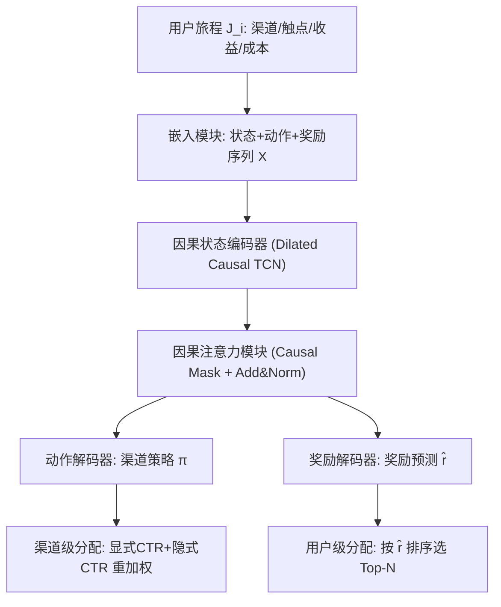
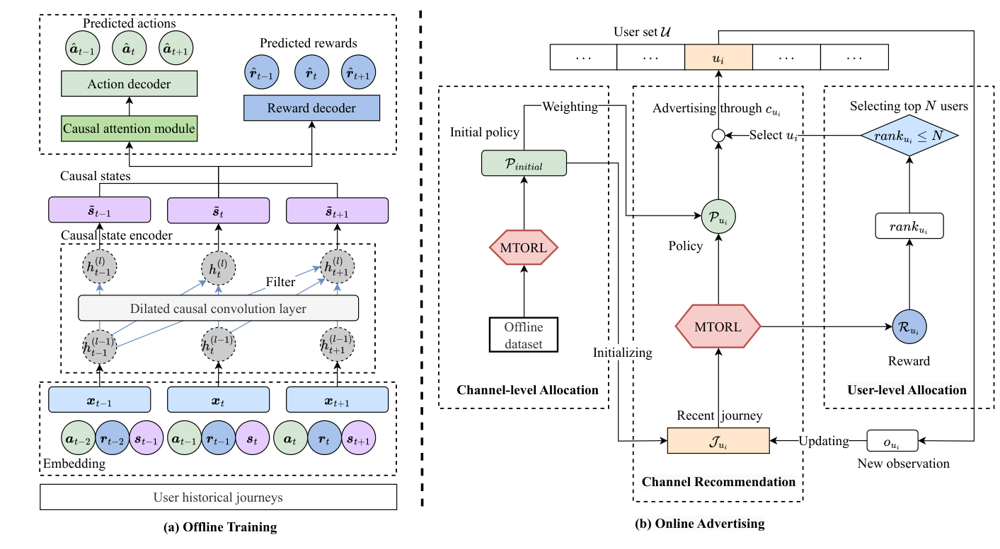

# Multi-task Offline Reinforcement Learning for Online Advertising in Recommender Systems (面向推荐系统在线广告的多任务离线强化学习)

- **会议/期刊**: KDD 2025
- **作者与机构**: Langming Liu, Wanyu Wang, Chi Zhang, Bo Li, Hongzhi Yin, Xuetao Wei, Wenbo Su, Bo Zheng, Xiangyu Zhao（香港城市大学、南方科技大学、昆士兰大学、阿里巴巴淘天集团）
- **推荐链路定位**: 重排 / 广告曝光策略（渠道推荐 + 预算分配）
- **研究方向**: 强化学习与动态探索推荐 / 多任务学习与列表级重排
- **论文原文**: [https://arxiv.org/abs/2506.23090v2](https://arxiv.org/abs/2506.23090v2)
- **开源代码**: [https://github.com/Applied-Machine-Learning-Lab/MTORL](https://github.com/Applied-Machine-Learning-Lab/MTORL)

## TL;DR (1分钟核心速览)

在线广告的渠道推荐与预算分配长期割裂：值函数型离线 RL 在广告这种**奖励极稀疏**场景下严重高估且受分布偏移困扰，而 Decision Transformer 类序列方法又违背马尔可夫性、难以刻画短程时序依赖；MTA/约束 RL 则只做静态归因或忽略"动态挑选高转化用户"这一广告本质。MTORL 把动作与奖励当作序列标签做条件序列建模，用**膨胀因果卷积 + 因果注意力**编码因果状态，并以多任务头同时解码渠道动作与奖励，配合 DPO 损失缓解奖励稀疏。在 KuaiRand-Pure / Criteo 全库行为策略预测上 F1 达 0.6793 / 0.5002（较最强基线 DT 相对提升 7.9% / 16.2%），淘宝线上 A/B 取得 CTR +0.08、RPM +0.23%。

## Background & Motivation (背景与核心矛盾)

- **主流范式**: 广告侧分两条线——渠道推荐用 DL/DRL 做动态决策，预算分配用 MTA 归因或约束 RL（CMDP + 拉格朗日松弛）做静态/软约束分配。
- **前人局限一（稀疏奖励下的值函数失效）**: CQL/IQL/R-BCQ/AG 等值函数型离线 RL 依赖对 $Q$ 的保守估计来抑制高估，但广告奖励（点击/转化）远比通用 RL 稀疏，值估计无法有效回传，Criteo 上 R-BCQ/AG 甚至不如简单 BC。
- **前人局限二（序列模型违背马尔可夫性）**: DT/ODT 把状态当特征、动作当标签，训练高效，但标准 Transformer 不满足马尔可夫性，对广告短程时序依赖刻画不足；且奖励解码若走"先预测动作 $\hat{a}_t$ 再预测奖励"的两跳路径，注意力非 Lipschitz 连续会放大噪声、累积误差。
- **前人局限三（预算分配忽略用户维度）**: MTA 只做静态归因、无动态决策；约束 RL 只把预算当全局约束，忽略"少数高转化倾向用户 > 大量低倾向用户"这一广告核心特征，且用户转化倾向随时间漂移。
- **核心洞察 (Key Insight)**: 广告的回报由当前曝光与其前序曝光序列的**因果关联**决定；若把因果状态（而非预测动作）直接送入奖励头，可借注意力作为"信息过滤器"抑制噪声模式导致的高估。
- **本文切入点**: 用 CMDP 统一建模渠道推荐与预算分配，以因果 TCN + 因果注意力构造因果状态，多任务解码动作/奖励，并用 DPO 直接优化长期回报偏好。

## Method (核心方法设计)

### 1. 整体框架 (Overall Architecture)

输入用户静态特征 $\boldsymbol{f}$与历史曝光旅程$\mathcal{J}_i=\{c_t,\boldsymbol{q}_t,g_t,w_t\}$，先经嵌入模块把状态/动作/奖励映射为序列$\boldsymbol{X}=\{\boldsymbol{W}_e\cdot\text{Concat}(\boldsymbol{a}_{t-1},\boldsymbol{r}_{t-1},\boldsymbol{s}_t)\}$；因果状态编码器（膨胀因果 TCN）输出因果状态序列$\tilde{\boldsymbol{S}}$，再经因果注意力（带 causal mask 的自注意力 + Add&Norm）得到行为感知表示；随后双分支多任务头分别解码渠道动作分布与奖励值。训练侧联合策略 CE 损失、奖励 BCE 损失与 DPO 偏好损失；在线侧用动作头生成渠道策略、奖励头排序筛选目标用户，并叠加渠道级/用户级预算分配。

<figure class="paper-figure" markdown="span">
  <figcaption>图 1：MTORL 概览。部分 (a) 展示了网络架构，输入历史行程并输出预测的动作和奖励。部分 (b) 展示了在在线广告中使用 MTORL 的工作流程，其中渠道推荐模块生成广告曝光策略。渠道级和用户级分配模块分别通过重加权策略和选择目标用户来控制广告曝光。</figcaption>
</figure>

### 2. 关键设计拆解 (Key Designs)

1. **因果状态编码器（Causal State Encoder）**：针对 Transformer 不满足马尔可夫性、短程依赖刻画弱的问题，用膨胀因果卷积保证 $t$时刻隐状态只依赖$\le t$的过去：$\boldsymbol{h}_t^{(l)}=\sum_{i=0}^{k_c-1}f(i)\cdot\boldsymbol{h}_{t-d_c\cdot i}^{(l-1)}$，再经线性+LeakyReLU 得$\tilde{\boldsymbol{S}}$。物理直觉：膨胀卷积以$O(\log n)$ 感受野覆盖长历史，同时严格因果，天然适配"当前转化由前序曝光链决定"的广告语义。

2. **因果注意力 + 奖励头走因果状态（而非预测动作）**：因果注意力用 causal mask 切断未来信息，$\boldsymbol{A}=\text{CausalAttn}(\tilde{\boldsymbol{S}}^\top\boldsymbol{W}_Q,\tilde{\boldsymbol{S}}^\top\boldsymbol{W}_K,\tilde{\boldsymbol{S}}^\top\boldsymbol{W}_V)$，把偶然曝光/重复模式降权。关键改动是奖励解码器直接以$\tilde{\boldsymbol{s}}_t$为输入而非$\hat{\boldsymbol{a}}_t$：因注意力非 Lipschitz 连续，两跳路径会累积误差；而因果状态处于更浅层，既隐式携带动作先验又避免高估。

3. **多任务目标 + DPO 与推理开销**：总损失 $\mathcal{L}=\mathcal{L}_{\text{Policy}}+\mu\mathcal{L}_{\text{Reward}}+\lambda\mathcal{L}_{\text{DPO}}$，其中$\mathcal{L}_{\text{DPO}}=-\mathbb{E}\log\sigma\big(\beta\log\pi(a_t^w|\boldsymbol{x}_t^w)-\beta\log\pi(a_t^l|\boldsymbol{x}_t^l)\big)$，用总回报更高的序列对$\{x^w,x^l\}$ 直接拉高长期回报偏好，缓解奖励稀疏。训练为纯监督式序列建模（无需负采样、无需 Q 值自举）；在线推理仅取最后一步动作，配合增量训练按小时/天更新，避免全量重训。

## Experimental Setup & Evaluation Protocol (实验设置与评估协议)

- **数据集与预处理**: 抽取最短长度 10 的用户曝光序列，将视频类型（KuaiRand）/ campaign 类别（Criteo）视为"渠道"以模拟多渠道广告：

| 数据集 | #Users | #Items(渠道) | #Interactions | 稀疏度/密度 | 特征/场景说明 |
| :--- | :---: | :---: | :---: | :---: | :--- |
| KuaiRand-Pure | 27,285 | 视频类型 | 1,436,609 | 稀疏 | 无偏随机曝光旅程数据 |
| Criteo | 6,142,256 | campaign 类别 | 16,468,027 | 极稀疏 | 真实流量曝光，奖励更稀疏 |

- **数据划分与防穿越 (Splitting Strategy)**: 按用户旅程**时间顺序**构造序列，截断/填充至定长 $n=20$，训练/测试按序列样本划分（非 Leave-One-Out），因果 mask 保证无未来信息泄漏。
- **排名评测协议 (Ranking Protocol)**: 行为策略预测任务，报告 F1 / Precision / Recall（10 次运行平均），非全库排序；奖励对比在**等预算**约束下比较平均奖励。
- **对比基线与超参设置**: 基线含 DL 广告（W&D、DIN、STAR、MIREC）、约束/值函数 RL（R-BCQ、AG、CQL、IQL）、序列模型（BC、DT、ODT）；嵌入/隐藏维度 512，层数 $L_1=L_2=2,L_3=3$，Adam lr=0.001、batch=512，$\mu=0.08/0.04$、$\lambda=1.4$、$\beta=0.1$，双侧 t 检验$p<0.05$。

## Key Experimental Results (实验关键数据)

### 1. 主实验对比 (Main Results)

| 数据集 | 指标 | DT | IQL | CQL | R-BCQ | MIREC | MTORL | Improv.(vs DT) |
| :--- | :--- | :---: | :---: | :---: | :---: | :---: | :---: | :---: |
| KuaiRand-Pure | F1 | 0.6296 | 0.6203 | 0.5970 | 0.6148 | 0.5723 | **0.6793** | +7.9% |
| KuaiRand-Pure | Precision | 0.6327 | 0.6251 | 0.5980 | 0.6154 | 0.5735 | **0.6811** | +7.6% |
| KuaiRand-Pure | Recall | 0.6308 | 0.6203 | 0.5972 | 0.6150 | 0.5727 | **0.6798** | +7.8% |
| Criteo | F1 | 0.4303 | 0.3834 | 0.3395 | 0.3440 | 0.3034 | **0.5002** | +16.2% |
| Criteo | Precision | 0.4922 | 0.4230 | 0.3906 | 0.3854 | 0.3170 | **0.5424** | +10.2% |
| Criteo | Recall | 0.4101 | 0.3655 | 0.3173 | 0.3326 | 0.2991 | **0.4893** | +19.3% |

平均奖励（等预算）：KuaiRand-Pure 上 MTORL **0.2591** vs DT 0.2306 / AG 0.2086；Criteo 上 **0.3203** vs DT 0.3083 / R-BCQ 0.2996。

### 2. 消融实验 (Ablation Study)

| 变体 | KuaiRand Recall(相对%) | Criteo Recall(相对%) | 平均奖励 |
| :--- | :---: | :---: | :---: |
| Full MTORL | 100 | 100 | 0.2591 |
| w/o CausalState | 显著下降（最大） | 显著下降（最大） | — |
| w/o CausalAttn | 下降 | 下降 | — |
| w/o Add&Norm | 小幅下降 | 小幅下降 | — |
| w/o DPO | 下降 | 下降 | — |
| w/o Channel-level Alloc | — | — | 0.2487 |
| w/o User-level Alloc | — | — | 0.2353 |

### 3. 关键实验发现 (Key Findings)

1. **稀疏度决定方法排序**：KuaiRand 上值函数型（CQL/IQL）尚能靠约束策略贴近行为分布取胜，但 Criteo 奖励更稀疏时 R-BCQ/AG/CQL/IQL 全面崩塌（F1 仅 0.34 左右），而 MTORL 反升至 0.5002，说明序列标签化建模对稀疏奖励的鲁棒性远优于 Q 值自举。
2. **因果状态编码器是性能主引擎**：消融中移除 CausalState 的 Recall 相对跌幅最大，印证"膨胀因果卷积提供时序依赖 + 局部特征"是主要增益来源；因果注意力（全局特征）与 DPO（偏好优化）为次级增益，Add&Norm 提供稳定训练。
3. **用户级分配比渠道级更值钱**：去掉用户级分配平均奖励降至 0.2353（-9.2%），跌幅大于去掉渠道级分配的 0.2487（-4.0%），定量验证"筛掉低转化用户、把钱花在高倾向用户上"是预算约束下的最大杠杆。

## Highlights & Limitations (亮点、对比与审稿批判)

- **与代表作对比 (vs. Prior Work)**: 相比 DT/ODT，本文用因果 TCN 补上马尔可夫性、用因果状态替代两跳奖励预测；相比 CQL/IQL/R-BCQ，本文完全绕开 Q 值高估问题，把离线 RL 退化为带偏好的条件序列监督；相比 MTA/约束 RL，本文把预算分配拆成渠道级重加权 + 用户级排序，显式建模用户维度。
- **可迁移亮点**: ①"奖励头接浅层因果状态而非预测动作"可迁移到任何序列决策+辅助奖励预测的架构，规避注意力噪声累积；②显式 CTR 与隐式（预测奖励阈值过滤）CTR 加权融合 $\mathcal{P}_{\text{Initial}}=(1-\alpha)\mathcal{P}+\alpha\hat{\mathcal{P}}$ 是抑制流行度偏置的轻量技巧。
- **审稿级局限批判**: ①评测以行为策略预测（F1/Precision/Recall）为主，缺少 off-policy evaluation（如 IPS/DR）来真正衡量策略价值，平均奖励对比的说服力有限；②因果 TCN + 因果注意力 + 双解码器在百万级用户、小时级增量更新下的推理延迟与显存开销未给出量化分析；③DPO 需构造高/低回报序列对，序列对采样策略与 $\beta$ 敏感性仅给单点最优值，稳健性证据偏薄。

## Rating (四维评分)

- **方法创新性 (Novelty)**: ⭐⭐⭐⭐ （因果 TCN + 因果注意力 + 因果状态直连奖励头的组合有明确动机与理论直觉，但各组件本身均为已有模块的工程化重组）
- **评估协议与实验扎实度 (Protocol & Experiments)**: ⭐⭐⭐⭐ （两公开数据集 + 淘宝线上 A/B + 完整消融与超参分析，但缺 OPE 与全库排序协议，行为策略预测指标偏弱）
- **写作与数学规范度 (Clarity & Rigor)**: ⭐⭐⭐⭐ （CMDP 形式化与损失定义清晰，公式完整；部分符号如 $\boldsymbol{B}_s\in\mathbb{R}^{d\times n}$ 维度约定略松，附录承担了较多实现细节）
- **工业落地与复现价值 (Industrial & Practical Value)**: ⭐⭐⭐⭐⭐ （代码开源、给出完整在线广告 Algorithm 1 与增量训练方案，淘宝线上 CTR +0.08/RPM +0.23% 的实证落地价值突出）

