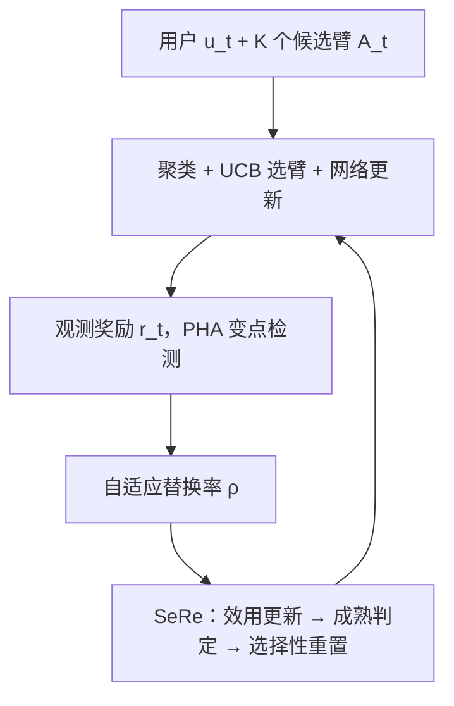
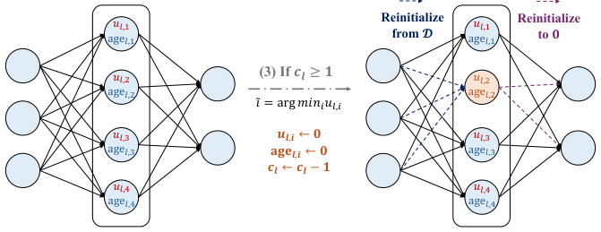

# Revisiting Clustering of Neural Bandits: Selective Reinitialization for Mitigating Loss of Plasticity (重访神经聚类 Bandit：以选择性重初始化缓解可塑性丧失)

- **会议/期刊**: KDD 2025
- **作者与机构**: Zhiyuan Su, Sunhao Dai, Xiao Zhang（中国人民大学高瓴人工智能学院）
- **推荐链路定位**: 召回（在线流式推荐的 Bandit 臂选择）
- **研究方向**: 强化学习与动态探索推荐 / 序列与会话推荐
- **论文原文**: [https://arxiv.org/abs/2506.12389v3](https://arxiv.org/abs/2506.12389v3)
- **开源代码**: [https://github.com/zhiyuansu0326/SeRe](https://github.com/zhiyuansu0326/SeRe)

## TL;DR (1分钟核心速览)

聚类 Bandit（CB）扩展到神经版本（CNB）后，在非平稳流式推荐中会遭遇**可塑性丧失**：网络参数逐渐僵化、死单元增多，累积遗憾从次线性退化为近似线性。本文提出 **SeRe**——用「贡献效用」在线量化每个隐单元的重要性，仅对低效用且已成熟的单元做选择性重初始化，并用 Page-Hinkley-Absolute 变点检测自适应调节重置频率。理论上证明分段平稳下可达 $\tilde{O}(\sqrt{TS})$ 遗憾界；在 6 个真实推荐数据集、4 个 SOTA CNB 基线上，10000 轮累积动态遗憾最多降低 **12.82%**，每轮仅增加 2–3 ms 开销。

## Background & Motivation (背景与核心矛盾)

- **主流范式**: 聚类 Bandit（CLUB/SCLUB/LOCB）按用户偏好相似度动态分簇、簇内共享奖励函数，以缓解单奖励函数在异构用户上的探索-利用失衡；近年 M-CNB 用元网络 + 神经奖励估计把 CB 推向非线性表达。
- **前人局限**: ① 绝大多数 CB 仍是**线性奖励假设**（CLB），无法刻画复杂非线性偏好；② 直接神经化后，多网络在线持续训练导致**可塑性丧失**——死 ReLU 增多、权重幅值膨胀、有效秩下降，参数对新增数据几乎不再响应。
- **核心洞察 (Key Insight)**: 作者在 MovieLens 上每 200 轮注入高斯扰动模拟偏好漂移，发现 CNB 遗憾曲线由次线性**退化为近似线性**；同时最后一层参数每 25 轮的 $\ell_2$ 变化量在有/无扰动两组间中位数几乎无差异（最大差仅约 0.03），即网络"感知不到"环境变化——这直接证明僵化而非数据不足是瓶颈。
- **本文切入点**: 不做全量重训（流式场景算力不可行），而是**只重置低贡献单元**：丢弃无用信息、保留有用知识，并用变点检测让重置频率随非平稳程度自适应。

## Method (核心方法设计)

### 1. 整体框架 (Overall Architecture)

SeRe 是一个**模型无关的插件式框架**，嵌入标准 CNB 每轮流程之后：接收目标用户与 $K$个候选臂$\to$按$(\epsilon_1,\epsilon_2)$-用户簇定义聚类$\to$更新用户级/簇级网络并用 UCB 选臂$\to$观测真实奖励$\to$**PHA 变点检测**更新替换率$\rho$ $\to$ 对所有本轮更新过的网络逐层执行 **SeRe**（更新贡献效用与年龄、累积计数器、触发时重置最低效用单元）。训练与推理同轮完成，无离线阶段。

<figure class="paper-figure" markdown="span">
  <figcaption>图3：第𝑙层的SeRe工作流程：(1) 更新贡献效用𝑢𝑙,𝑖和年龄age𝑙,𝑖。(2) 根据成熟单元𝑠𝑚递增计数器𝑐𝑙。(3) 若𝑐𝑙≥1，则重新初始化效用最低的单元及其相关权重，并更新度量。</figcaption>
</figure>

### 2. 关键设计拆解 (Key Designs)

1. **贡献效用 + 选择性重初始化（SeRe 核心）**：随机重置或全量重置会破坏已学知识，且 CNB 网络数量多、环境变化温和，粗暴重置代价过高。SeRe 对第 $l$层第$i$ 个隐单元维护带衰减的运行平均效用，同时考虑激活强度与输出权重幅值：
$$u_{l,i}\leftarrow\eta\cdot u_{l,i}+(1-\eta)\cdot|h_{l,i}|\cdot\sum_{j=1}^{n_{l+1}}|w_{l,i,j}|$$
仅当单元年龄 $\text{age}_{l,i}>m$（成熟）且层计数器$c_l\ge 1$时，才重置**成熟单元中效用最低者**：输入权重从 Kaiming Uniform$\mathcal{D}=\mathcal{U}(-\sqrt{6/n_{\text{in}}},\sqrt{6/n_{\text{in}}})$ 重采样以引入多样性，输出权重置零以避免继承偏置与突变干扰。直觉：低效用单元对输出几乎无贡献，重置它"损失小、收益大"，而输出置零保证重置瞬间预测不跳变。

2. **PHA 自适应变点检测**：固定重置节奏无法适配不同场景的漂移速率。作者改造 Page-Hinkley 为**绝对值版本**，累积预测误差的绝对偏差以同时捕捉高估与低估：
$$\text{PHA}_t=\text{PHA}_{t-1}+\big(|r_t-\hat{r}_t|-\delta\big)$$
当 $\text{PHA}_t-\text{PHA}_{\min}>\lambda_{\text{PHA}}$判定漂移，$\rho$直接跳到$\rho_{\max}$；否则$\rho=\rho_{\min}+\alpha(\text{PHA}_t-\text{PHA}_{\min})$线性缓增。约束$\alpha\cdot\lambda_{\text{PHA}}\le\rho_{\max}-\rho_{\min}$ 保证线性段不越界。这样平稳期几乎不重置，漂移期快速恢复可塑性。

3. **训练目标、负采样与推理效率**：无显式损失函数，优化目标即最小化累积动态遗憾 $\mathcal{R}_T=\sum_{t=1}^{T}[g_{u_t,t}(\boldsymbol{a}_t^*)-g_{u_t,t}(\boldsymbol{a}_t^{I_t})]$；每轮从 1 正 9 负构成的 10 臂候选中选臂，属**在线 Bandit 反馈**而非采样负训练。理论证明：分段平稳$S$段下$\mathcal{R}_T=\tilde{O}(\sqrt{TS})$，只要$S=o(T)$ 即保持次线性。开销上每轮仅增 2.38–3.36 ms（表 2），实测重置间隔 26–47 轮、仅 2.6%–7.2% 的轮次发生重置。

## Experimental Setup & Evaluation Protocol (实验设置与评估协议)

- **数据集与预处理**: 取原始评论评分，选评分最多的 top 10000 用户与物品构建评分矩阵，SVD 得用户/物品特征并归一化；评分 >4 记奖励 1，否则 0；K-means 将用户分为 50 簇。

| 数据集 | #Users | #Items | #Interactions | 特征/场景说明 |
| :--- | :---: | :---: | :---: | :--- |
| KuaiRec | 7,176 | 10,728 | 1.2×10⁷ | 短视频强时变 |
| Yelp | 1.6×10⁵ | 1.5×10⁵ | ~7×10⁶ reviews | 本地生活 |
| MovieLens | 1.6×10⁵ | 6.2×10⁴ | 2.5×10⁷ ratings | 电影评分 |
| Facebook | 88,234 links | — | 社交快照 | 社交网络 |
| Amazon-Video Games | 2.8×10⁶ | 1.4×10⁵ | 4.6×10⁶ reviews | 电商 |
| Amazon-Digital Music | 1×10⁵ | 7×10⁴ | 1.3×10⁵ reviews | 电商 |

- **数据划分与防穿越 (Splitting Strategy)**: 非静态划分，而是**在线流式模拟**——每轮从某簇随机采样一个用户，构造 1 正 9 负共 10 个候选臂，共跑 10000 轮，评估累积动态遗憾。
- **排名评测协议 (Ranking Protocol)**: 采用 **Sampled Ranking（1:9 采样候选）** 的 Bandit 遗憾评估，非全库 Full-Ranking；指标为每轮平均遗憾（越小越好），5 次重复取均值 ± 标准差。
- **对比基线与超参设置**: 基线含 3 个 CLB（CLUB/SCLUB/LOCB）及其神经版 CLUB-N/SCLUB-N/LOCB-N，加 SOTA 的 M-CNB；显著性检验 $p<0.05$。关键超参$\eta$网格搜索（0.1–0.9），最优$\eta=0.9$。

## Key Experimental Results (实验关键数据)

### 1. 主实验对比 (Main Results)

每轮平均遗憾（越小越好），加粗为 SeRe 增强后显著更优（$p<0.05$）：

| 算法 | KuaiRec | Yelp | MovieLens | Facebook | Amazon-VG | Amazon-DM |
| :--- | :---: | :---: | :---: | :---: | :---: | :---: |
| CLUB-N | 0.7999 | 0.8113 | 0.4935 | 0.5846 | 0.7188 | 0.6659 |
| **CLUB-N + SeRe** | **0.7807** | **0.7927** | **0.4370** | **0.5229** | **0.6712** | **0.6231** |
| SCLUB-N | 0.7754 | 0.7921 | 0.5502 | 0.5593 | 0.6829 | 0.5916 |
| **SCLUB-N + SeRe** | **0.7603** | **0.7760** | **0.4872** | **0.5179** | **0.6481** | **0.5505** |
| LOCB-N | 0.7754 | 0.7708 | 0.5188 | 0.5388 | 0.6475 | 0.7067 |
| **LOCB-N + SeRe** | **0.7576** | **0.7549** | **0.4770** | **0.4872** | **0.5831** | **0.6763** |
| M-CNB | 0.7146 | 0.7547 | 0.4450 | 0.3080 | 0.6357 | 0.5367 |
| **M-CNB + SeRe** | **0.6929** | **0.7349** | **0.4056** | **0.2686** | **0.5607** | **0.4811** |
| Improv.（M-CNB 组） | 3.04% | 2.62% | 8.85% | **12.82%** | 11.80% | 10.36% |

### 2. 消融实验 (Ablation Study)

原文以"是否接入 SeRe"作为核心消融（SeRe 为插件，无内部模块可拆），并辅以超参敏感性与可塑性度量：

| 配置 | 关键观测 | 说明 |
| :--- | :--- | :--- |
| M-CNB（w/o SeRe） | Facebook 0.3080 | 基线，遗憾近似线性累积 |
| M-CNB + SeRe | Facebook 0.2686 | 显著下降 12.82% |
| $\eta=0.9$/$0.7$/$0.1$| 遗憾最低 / 次之 / 劣于基线 | 小$\eta$ 使效用抖动、重置失稳 |
| 末层参数 $\ell_2$ 变化（KuaiRec） | SeRe 后中位数与最大值显著提升 | 直接证据：可塑性恢复 |

### 3. 关键实验发现 (Key Findings)

1. **可塑性丧失是 CNB 退化的主因而非数据不足**：MovieLens 上注入扰动后遗憾由次线性转为近似线性，且末层参数变化量在有/无扰动间几乎无差（最大差约 0.03），说明网络对漂移"无感"；接入 SeRe 后 KuaiRec 上该 $\ell_2$ 范数中位数与最大值显著抬升，机制与现象形成闭环。
2. **增益在强时变数据上最大**：Amazon-Digital Music 上 SCLUB-N 曲线几乎退化为线性，而 SCLUB-N + SeRe 恢复明显次线性；Facebook 上 M-CNB 组取得 12.82% 的最大降幅，说明漂移越剧烈、SeRe 收益越高。
3. **重置高度稀疏、代价可忽略**：KuaiRec 上重置间隔 26–47 轮、仅 2.6%–7.2% 轮次触发重置，每轮额外开销 2.38–3.36 ms，以极小算力换取两位数遗憾下降，工程上可接受。

## Highlights & Limitations (亮点、对比与审稿批判)

- **与代表作对比 (vs. Prior Work)**: 相比 CLUB/SCLUB/LOCB 的线性奖励假设，本文在神经化后直面其固有缺陷；相比 M-CNB 只做元聚类、未显式处理可塑性，SeRe 首次把"选择性重初始化"引入 CNB；相比 Continual Backprop 类工作，本文额外引入 PHA 变点检测使重置频率随非平稳度自适应，并给出分段平稳遗憾界。
- **可迁移亮点**: ①「贡献效用 + 成熟阈值 + 输出置零」的重置三件套可直接迁移到任何在线持续训练的推荐双塔/序列模型；② PHA 绝对值变点检测可作为通用漂移监控信号，驱动学习率、正则或模型热更新的自适应调度。
- **审稿级局限批判**: ① 评估为 1:9 采样候选的 Bandit 遗憾，未做全库 Full-Ranking，且候选构造与 50 簇 K-means 预处理较强，离真实线上分布仍有距离；② 超参（$\eta,m,\rho_{\min},\rho_{\max},\delta,\lambda_{\text{PHA}},\alpha$）较多，虽称网格搜索但仅展示$\eta$敏感性，跨数据集鲁棒性与调参成本存疑；③ 理论界依赖分段平稳假设，真实偏好连续漂移时$S$ 的界定与界紧性未充分讨论。

## Rating (四维评分)

- **方法创新性 (Novelty)**: ⭐⭐⭐⭐ （把持续学习中的选择性重初始化首次系统引入 CNB，并以 PHA 变点检测驱动频率自适应，机制简洁且有理论支撑）
- **评估协议与实验扎实度 (Protocol & Experiments)**: ⭐⭐⭐⭐ （6 数据集 × 4 SOTA 基线 × 5 次重复 + 显著性检验 + 运行时与可塑性度量齐全，但为采样候选而非全库排序）
- **写作与数学规范度 (Clarity & Rigor)**: ⭐⭐⭐⭐ （算法伪代码与图示清晰，$\tilde{O}(\sqrt{TS})$ 界推导完整，但部分超参取值范围置于附录、正文交代略简）
- **工业落地与复现价值 (Industrial & Practical Value)**: ⭐⭐⭐⭐⭐ （模型无关插件、每轮仅增数毫秒、代码已开源，对在线流式推荐的持续学习极具落地价值）

