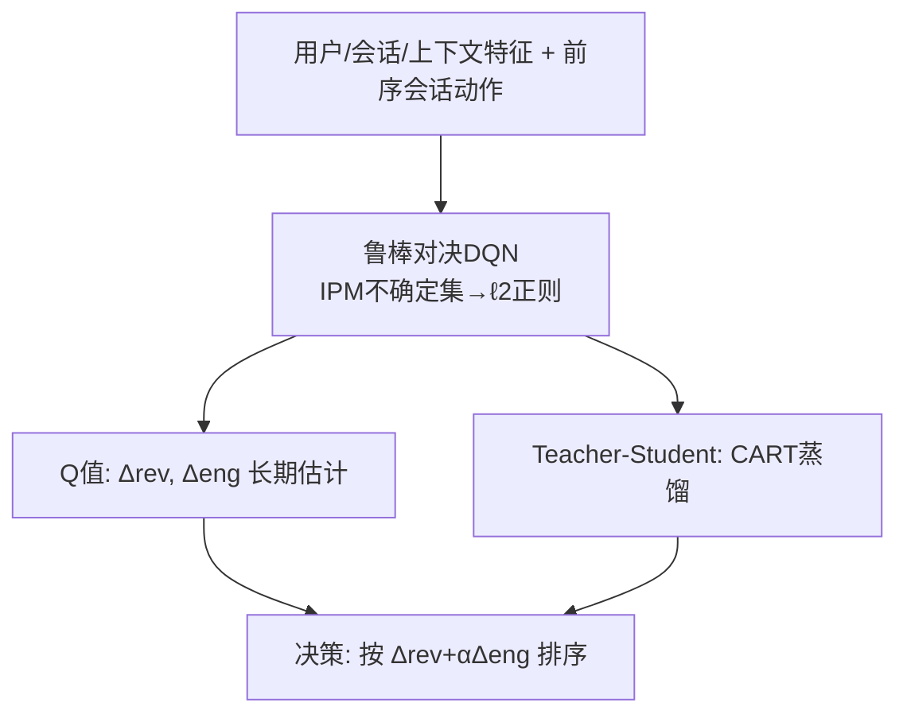
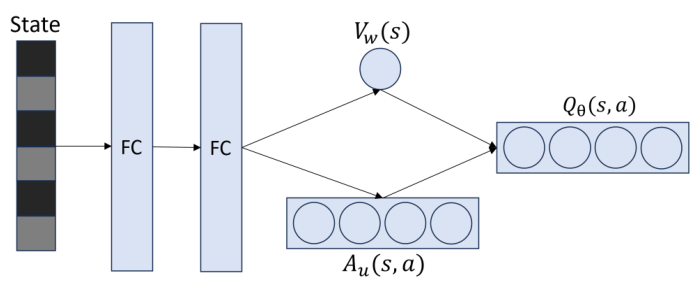

# Session-Level Dynamic Ad Load Optimization using Offline Robust Reinforcement Learning (基于离线鲁棒强化学习的会话级动态广告加载优化)

- **会议/期刊**: KDD 2025
- **作者与机构**: Tao Liu, Qi Xu, Wei Shi, Zhigang Hua, Shuang Yang (Meta)
- **推荐链路定位**: 重排 / 会话级实时决策（广告加载策略）
- **研究方向**: 强化学习与动态探索推荐 / 去偏公平与工业架构
- **论文原文**: [论文原文链接](https://arxiv.org/abs/2501.05591v1)
- **开源代码**: 暂未开源

## TL;DR (1分钟核心速览)

会话级动态广告加载需在单次会话内实时平衡广告收入与用户参与度，传统因果学习（meta-learner）受**序列混杂偏差**与**时间维分布漂移**双重困扰。本文将其建模为鲁棒MDP：先用离线DQN把历史动作并入状态以缓解混杂，再提出基于IPM不确定集的**鲁棒对决DQN**，将鲁棒性转化为对最后一层非偏置权重的 $\ell_2$ 正则，几乎零额外开销。在真实生产数据上离线AUCC较T-learner提升80%+，鲁棒版再增5%；线上A/B在参与度-广告分权衡效率上取得双位数提升。

## Background & Motivation (背景与核心矛盾)

- **主流范式**: 广告加载优化分"静态"（全轨迹固定配置）与"动态"（会话内实时调整）两类，工业界主流用meta-learner（T-learner等）估计处理效应 $\Delta rev$、$\Delta eng$后按$\Delta rev+\alpha\Delta eng$ 排序决策。
- **前人局限**: 其一，**混杂偏差**——前序会话的广告加载会间接影响当前会话的特征、处理与结果，构成隐藏混杂，meta-learner无法控制；其二，**分布漂移**——用户行为随时间变化带来显著 $Y|X$ 条件漂移，模型需频繁重训。
- **核心洞察 (Key Insight)**: 作者在生产数据上实证了两类偏移（图3）：高广告加载后用户有机消费下降、距上次交互间隔拉长（$X|T$偏移）；同一触发原因下上午与下午的会话时长均值明显漂移（$Y|X$ 偏移）。而将**历史动作纳入状态**可隐式吸收序列混杂。
- **本文切入点**: 用RL的MDP建模天然容纳序列依赖来治混杂，再用鲁棒MDP的IPM不确定集治漂移，且该不确定集可闭式化为正则项，适配大规模连续状态。

## Method (核心方法设计)

### 1. 整体框架 (Overall Architecture)

系统分预测与决策两模块：预测模块以用户级、会话级特征及**前序会话动作**为状态输入，经鲁棒对决DQN输出状态-动作值（即对 $\Delta rev$、$\Delta eng$的长期估计）；决策模块按$\Delta rev+\alpha\Delta eng$ 对会话排序，选出应调高/调低广告加载的个体。训练用离线数据集预填replay buffer，以经验鲁棒Bellman算子构造TD损失；线上部署时采用teacher-student蒸馏，将RL的Q值作为软标签训练CART回归树以换取可解释性与服务效率。

<figure class="paper-figure" markdown="span">
  <figcaption>图2：鲁棒对决DQN的结构。通过经验鲁棒贝尔曼算子（公式(9)和(11)）引入鲁棒性。</figcaption>
</figure>

### 2. 关键设计拆解 (Key Designs)

1. **历史动作入状态治混杂**：痛点在于前序处理构成隐藏混杂，meta-learner无法显式控制。本文将上一会话的广告加载决策拼入当前状态 $s$，使MDP的转移显式条件于历史动作，从而把序列混杂"外化"为可观测状态的一部分。实验证明该设计对性能有正向贡献，间接验证了混杂的存在与缓解。

2. **IPM不确定集导出免开销鲁棒算子**：痛点在于R-contamination、$l_p$-norm等不确定集需在全状态空间求值函数极值，计算不可行；Wasserstein/$f$-divergence虽可行但缺理论保证或训练不稳。本文采用IPM不确定集$\mathcal{P}_{s,a}=\{q:d_{\mathcal{F}}(q,P^0_{s,a})\le\delta\}$，在线性函数近似下证得闭式：
$$\inf_{P\in\mathcal{P}_{s,a}}P^\top V_w=(P^0_{s,a})^\top V_w-\delta\|w_{2:d}\|$$
即鲁棒性等价于**对去掉偏置项后的权重做 $\ell_2$正则**，几乎不增加计算量。配合无激活的对决结构$Q_\theta(s,a)=V_w(s)+A_u(s,a)-\max_b A_u(s,b)$，保证$\max Q$与$Q$同属线性函数类，且当$\delta<\lambda_{\min}(\Phi^\top\mathrm{diag}(\nu)\Phi)\frac{1-\gamma}{\gamma}$ 时鲁棒Bellman算子仍为压缩映射。

3. **训练目标、负采样与推理效率**：总损失为
$$\mathcal{L}_2=\frac{1}{|B|}\sum_{i}\big(r_i+\gamma V_{w^{target}}(s'_i)-\gamma\delta\|w^{target}_{2:d}\|-Q_\theta(s_i,a_i)\big)^2$$
离线RL无需负采样；正则项有两种取法——仅正则最后一层线性权重（适合在线RL）或基于泰勒展开用初始梯度作固定特征矩阵正则全部非偏置参数（适合离线RL，因学到的特征矩阵可能有偏）。推理时DQN与鲁棒版训练耗时几乎相同，而SOTA鲁棒方法约慢50倍。

## Experimental Setup & Evaluation Protocol (实验设置与评估协议)

- **数据集与预处理**: 生产数据由均匀随机策略与规则策略混合采集，并用Cookie-Cookie-Day框架每日打乱用户以规避反馈回路特征偏置；公开数据为CartPole-v1与LunarLander-v2（连续状态、离散动作，与业务同构）。

| 数据集 | 规模/说明 | 特征/场景说明 |
| :--- | :---: | :--- |
| 生产数据(同分布) | 70%训练/30%测试随机划分 | 新闻流会话级广告加载，平均轨迹长约5 |
| 生产数据(漂移) | 1天数据按12:00时间戳切分 | 上午训练、下午测试，模拟 $Y|X$ 漂移 |
| CartPole-v1 | $10^5$离线样本，$\epsilon$-greedy PPO($\epsilon$=0.3)采集 | 扰动 force_mag / length / 动作噪声 |
| LunarLander-v2 | 同上 | 扰动随机动作概率 |

- **数据划分与防穿越 (Splitting Strategy)**: 同分布实验用**比例划分**（70/30）；漂移实验用**全局时间戳切分**（12:00为界），严格防穿越。
- **排名评测协议 (Ranking Protocol)**: 采用工业界ROI指标**AUCC**（AUUC的二维变体），x轴为归一化参与度损失、y轴为归一化收入增益；所有算法统一按combined summation $\Delta rev+\alpha\Delta eng$ 排序以保证公平。公开数据用累积奖励评估。
- **对比基线与超参设置**: 基线含T-learner（XGBRegressor为基学习器）、离线DQN（$\gamma=0.8$与$\gamma=0$）、对决DQN、BCQ、CQL；$\alpha=1$，鲁棒半径$\delta=1\text{e-}4$，$\gamma=0.8$，网络两层宽256，学习率1e-4衰减。

## Key Experimental Results (实验关键数据)

### 1. 主实验对比 (Main Results)

同分布生产数据（表1）与漂移生产数据（表2）对比如下：

| 方法 | 同分布 Train AUCC | 同分布 Test AUCC | 漂移 Test AUCC |
| :--- | :---: | :---: | :---: |
| T-learner | 0.6214 | 0.6049 | 0.5750 |
| 离线DQN ($\gamma$=0) | 1.0529 | 0.9570 | — |
| 离线DQN ($\gamma$=0.8) | 1.2431 | **1.1426** | — |
| BCQ | — | — | 0.6692 |
| CQL | — | — | 0.6601 |
| 对决DQN | 0.7853 | — | 0.6962 |
| **鲁棒对决DQN** | 0.7771 | — | **0.7290** |

鲁棒对决DQN较对决DQN提升 **+5%**，较T-learner提升 **+25%**（漂移场景）；同分布下离线DQN较T-learner提升 **+80%以上**。

### 2. 消融实验 (Ablation Study)

Teacher-student蒸馏消融（表3）：

| 模型类型 | Test AUCC |
| :--- | :---: |
| Teacher（鲁棒RL） | 0.729 |
| Student w/ teacher | 0.705 |
| Student w/o teacher | 0.601 |

### 3. 关键实验发现 (Key Findings)

1. **RL治混杂的收益是量级性的**：同分布下离线DQN（1.1426）较T-learner（0.6049）提升80%+，且 $\gamma=0.8$优于$\gamma=0$（1.1426 vs 0.9570），说明引入正折扣因子捕捉跨会话长期效应确有价值，而非仅靠bandit式即时估计。
2. **鲁棒正则的收益集中在漂移场景**：同分布下鲁棒版（0.7771）略低于非鲁棒版（0.7853），但在时间切分的漂移测试集上反超（0.7290 vs 0.6962），印证 $\ell_2$ 正则以牺牲少量同分布拟合换取跨分布泛化，符合鲁棒MDP的worst-case优化直觉。
3. **悲观型离线RL不适配AUCC评估**：BCQ（0.6692）与CQL（0.6601）均不及对决DQN，因其悲观设计限制了对OOD会话的泛化，而AUCC需要Q值对未见会话仍有区分度——这揭示了"策略评估指标"与"经典离线RL保守性"之间的目标错配。

## Highlights & Limitations (亮点、对比与审稿批判)

- **与代表作对比 (vs. Prior Work)**: 相较Yan等[48]的静态约束优化与固定规则，本文首次将广告加载做成会话级动态RL决策并显式建模carry-over效应；相较BCQ/CQL等悲观离线RL，本文用IPM不确定集实现"鲁棒而非保守"，在AUCC指标下泛化更好；相较Zhou等[50]的在线RMDP，本文将IPM不确定集迁移到离线设定并给出线性近似下的闭式正则。
- **可迁移亮点**: ①"历史动作入状态"是缓解序列混杂的零成本技巧，可迁移至任意多轮决策推荐；②IPM不确定集→最后一层 $\ell_2$ 正则的闭式化，为大规模连续状态下的鲁棒训练提供了即插即用的正则项。
- **审稿级局限批判**: ①动作空间仅二值（高/低加载），连续动作需扩展至DDPG/SAC且鲁棒损失尚待验证；②AUCC为短期离线指标，缺乏off-policy evaluation等长期评估，且线上仅报告三周backtest，长期留存影响未量化；③鲁棒半径 $\delta$ 为固定超参，对漂移强度的自适应能力未讨论。

## Rating (四维评分)

- **方法创新性 (Novelty)**: ⭐⭐⭐⭐ （首次将广告加载建模为鲁棒MDP，IPM不确定集闭式化为正则项兼具理论保证与工程简洁性）
- **评估协议与实验扎实度 (Protocol & Experiments)**: ⭐⭐⭐⭐ （生产数据+两个Gym环境+线上A/B三层验证完整，但动作空间单一、缺长期OPE）
- **写作与数学规范度 (Clarity & Rigor)**: ⭐⭐⭐⭐ （命题1/2给出压缩性与闭式解，符号清晰；部分推导引用[50]略简）
- **工业落地与复现价值 (Industrial & Practical Value)**: ⭐⭐⭐⭐⭐ （多系统部署、teacher-student蒸馏兼顾效率与可解释、线上双位数增益，落地价值极高；可惜未开源）

