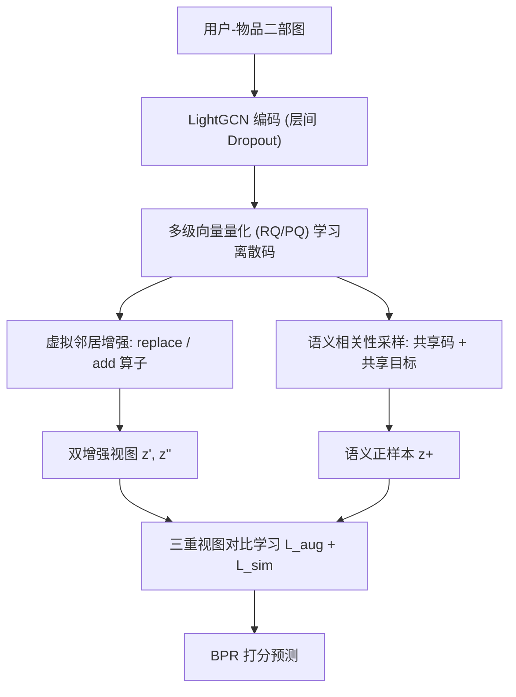

# Enhancing Graph Contrastive Learning with Reliable and Informative Augmentation for Recommendation (以可靠且信息丰富的增强提升推荐图对比学习)

- **会议/期刊**: KDD 2025
- **作者与机构**: Bowen Zheng, Junjie Zhang, Hongyu Lu, Yu Chen, Ming Chen, Wayne Xin Zhao, Ji-Rong Wen（中国人民大学、腾讯微信）
- **推荐链路定位**: 召回（图协同过滤表征学习）
- **研究方向**: 自监督对比学习与交互去噪 / 图神经网络推荐
- **论文原文**: [论文原文链接](https://arxiv.org/abs/2409.05633v2)
- **开源代码**: [开源代码仓库链接](https://github.com/RUCAIBox/CoGCL)

## TL;DR (1分钟核心速览)

现有图对比学习推荐（SGL/SimGCL/LightGCL）靠随机边丢弃、噪声扰动或 SVD 重构生成对比视图，在稀疏交互下会**破坏协同信息**，导致正样本对齐失效。本文提出 CoGCL：用端到端多级向量量化把用户/物品映射为富含协同语义的离散码，再以「虚拟邻居增强」扩展邻域结构、以「共享码/共享交互目标」采样语义正样本，构建三重对比视图。在 4 个公开数据集、Full-Ranking 协议下，NDCG@10 相对最强基线提升 3.7%–17.5%。

## Background & Motivation (背景与核心矛盾)

- **主流范式**: LightGCN 类图协同过滤 + InfoNCE 对比学习，视图生成分两派——结构扰动（SGL 随机丢边/点、LightGCL 用 SVD 重构邻接）与表征扰动（SimGCL 加随机噪声、HCCF 超图视图）。
- **前人局限**: ① 稀疏用户的关键交互在随机丢弃中直接丢失，结构扰动"不可靠"；② 噪声注入干扰表征中隐含的协同语义，正样本对齐"无信息量"。
- **核心洞察 (Key Insight)**: 作者用梯度截断拆解 InfoNCE 的 alignment/uniformity 两项做实证（图 2）：**去掉 uniformity 后性能几乎不涨甚至下降，去掉 alignment 反而略有提升**——说明现有扰动视图间的正样本对齐基本无效，模型收益主要来自 uniformity。
- **本文切入点**: 既然扰动视图不可信，就用**离散码**这一"有据可依"的中间语义单元来构造既可靠（严格基于观测交互）又信息丰富（扩展邻域、缓解稀疏）的对比视图。

<figure class="paper-figure" markdown="span">
  ![图 1：当前基于图对比学习的方法（如 SGL \[51\]、SimGCL \[60\]）在对比视图中破坏协同信息，与本文提出的增强协同信息方法的比较。](../../../../assets/papers/2409.05633v2/figure_1.png)<figcaption>图 1：当前基于图对比学习的方法（如 SGL [51]、SimGCL [60]）在对比视图中破坏协同信息，与本文提出的增强协同信息方法的比较。</figcaption>
</figure>

## Method (核心方法设计)

### 1. 整体框架 (Overall Architecture)

输入用户-物品二部图，LightGCN 编码得到节点表征（层间对输入表征做 dropout 而非边丢弃）；同时接入多级向量量化器，将表征逐级量化为离散码元组。基于离散码做两路视图生成：虚拟邻居增强产出两个结构增强图，语义相关性采样产出语义正样本；三路视图共享同一 GNN 编码器，联合 BPR、码学习 CE 损失与两组对比损失端到端优化。

### 2. 关键设计拆解 (Key Designs)

1. **端到端多级离散码学习（可靠语义载体）**：痛点是用 Faiss 离线聚类得到的码不可学习、与推荐目标脱节。本文在每级 $h$维护码本$\mathbf{C}^h=\{\mathbf{e}^h_k\}_{k=1}^K$，用**余弦相似度**（而非 VQ 惯用的欧氏距离）计算软分配，以与对比学习的相似度度量对齐：
$P(k|\mathbf{z}^h_u)=\frac{e^{s(\mathbf{z}^h_u,\mathbf{e}^h_k)/\tau}}{\sum_{j=1}^{K}e^{s(\mathbf{z}^h_u,\mathbf{e}^h_j)/\tau}},\quad c^h_u=\arg\max_k P(k|\mathbf{z}^h_u)$默认采用残差量化 RQ（$\mathbf{z}^{h+1}_u=\mathbf{z}^h_u-\mathbf{e}^h_{c^h}$），使各级码之间存在条件概率依赖而非 PQ 的独立子空间，利于多粒度语义建模；损失为逐级交叉熵$\mathcal{L}_{code}=-\frac{1}{H}\sum_h \log P(c^h_u|\mathbf{z}^h_u)$。

2. **虚拟邻居增强 + 语义相关性采样（可靠且信息丰富的视图）**：前者把观测边 $(u,i)$扩展为$(u,c^h_i)$的码边，提供 "replace"（替换原邻居）与 "add"（追加虚拟邻居）两种算子，两轮随机采样得到两个增强图$\mathcal{G}_1,\mathcal{G}_2$，既严格依赖真实交互保证可靠性，又通过码节点扩充邻域缓解稀疏；后者将**共享至少$H-1$个码**或**共享同一交互目标**的用户/物品判为语义正样本$u^+$，实现细粒度（优于 NCL 的 EM 聚类中心锚点）的正向对齐。

3. **三重视图对比与训练目标**：总损失
$\mathcal{L}=\mathcal{L}_{bpr}+\lambda\mathcal{L}_{code}+\mu\mathcal{L}_{aug}+\eta\mathcal{L}_{sim}$其中$\mathcal{L}_{aug}$双向对齐两个增强视图，$\mathcal{L}_{sim}$对齐增强视图与语义正样本；负样本采用 in-batch 负采样（免额外负采样器），温度$\tau=0.2$，码本每 epoch 随增强图更新一次，推理阶段仅用 ID 嵌入走标准 LightGCN 前向，无额外在线开销。

## Experimental Setup & Evaluation Protocol (实验设置与评估协议)

- **数据集与预处理**:

| 数据集 | #Users | #Items | #Interactions | 稀疏度 | 特征/场景说明 |
| :--- | :---: | :---: | :---: | :---: | :--- |
| Instrument | 48,453 | 21,413 | 427,674 | 99.959% | Amazon2023，5-core 过滤 |
| Office | 181,878 | 67,409 | 1,477,820 | 99.988% | Amazon2023，5-core 过滤 |
| Gowalla | 29,858 | 40,988 | 1,027,464 | 99.916% | LBS 签到，10-core 过滤 |
| iFashion | 300,000 | 81,614 | 1,607,813 | 99.993% | 阿里时尚，随机采样 300k 用户 |

- **数据划分与防穿越**: 按 **8:1:1 比例划分**训练/验证/测试，未采用时间戳切分。
- **排名评测协议**: 无偏 **Full-Ranking**（全物品库排序），指标 Recall@{5,10,20} 与 NDCG@{5,10,20}。
- **对比基线与超参**: 13 个基线，含 BPR/GCMC/NGCF/DGCF/LightGCN/SimpleX 与 SLRec/SGL/NCL/HCCF/GFormer/SimGCL/LightGCL；统一 $d=64$、batch 4096、GNN 3 层；码级数$H=4$，码本$K=256$（Instrument/Gowalla）或$512$（Office/iFashion），网格搜索调$\lambda,\mu,\eta$。

## Key Experimental Results (实验关键数据)

### 1. 主实验对比 (Main Results)

| 数据集 | 指标 | LightGCN | SGL | SimGCL | LightGCL | 最强基线 | **CoGCL** | Improv. |
| :--- | :--- | :---: | :---: | :---: | :---: | :---: | :---: | :---: |
| Instrument | R@10 | 0.0660 | 0.0692 | 0.0717 | 0.0715 | 0.0717 | **0.0788** | +9.90% |
| Instrument | N@10 | 0.0361 | 0.0380 | 0.0395 | 0.0391 | 0.0395 | **0.0435** | +10.13% |
| Office | R@10 | 0.0417 | 0.0493 | 0.0494 | 0.0490 | 0.0494 | **0.0582** | +17.81% |
| Office | N@10 | 0.0231 | 0.0289 | 0.0289 | 0.0280 | 0.0292 | **0.0343** | +17.47% |
| Gowalla | R@10 | 0.1383 | 0.1520 | 0.1525 | 0.1377 | 0.1525 | **0.1592** | +4.39% |
| Gowalla | N@10 | 0.0985 | 0.1092 | 0.1100 | 0.0988 | 0.1100 | **0.1145** | +4.09% |
| iFashion | R@10 | 0.0481 | 0.0574 | 0.0608 | 0.0641 | 0.0641 | **0.0696** | +8.58% |
| iFashion | N@10 | 0.0260 | 0.0315 | 0.0334 | 0.0354 | 0.0354 | **0.0386** | +9.04% |

### 2. 消融实验 (Ablation Study)

| 变体 | Instrument R@10 | Instrument N@10 | Office R@10 | Office N@10 |
| :--- | :---: | :---: | :---: | :---: |
| LightGCN | 0.0660 | 0.0361 | 0.0417 | 0.0231 |
| **CoGCL** | **0.0788** | **0.0435** | **0.0582** | **0.0343** |
| w/o A（去 alignment） | 0.0726 | 0.0401 | 0.0490 | 0.0280 |
| w/o U（去 uniformity） | 0.0703 | 0.0384 | 0.0465 | 0.0267 |
| w/o AA（仅 $\mathcal{L}_{aug}$ 去对齐） | 0.0741 | 0.0411 | 0.0536 | 0.0315 |
| w/o SA（仅 $\mathcal{L}_{sim}$ 去对齐） | 0.0767 | 0.0422 | 0.0554 | 0.0329 |
| w/o Replace / w/o Add | 均下降 | 均下降 | 均下降 | 均下降 |
| w/o Shared-C / w/o Shared-T | 均下降 | 均下降 | 均下降 | 均下降 |

### 3. 关键实验发现 (Key Findings)

1. **对齐项终于"有用"了**：在 CoGCL 中移除 alignment（w/o A）使 Office N@10 从 0.0343 掉到 0.0280（-18.4%），与第 2.2 节中基线"去对齐反而略涨"形成鲜明反差，证明离散码视图的正样本对齐确实注入了协同信息，而非仅靠 uniformity 撑场面。
2. **稀疏场景收益最大**：Office（稀疏度 99.988%）与 iFashion（99.993%）上 N@10 提升 17.5%/9.0%，显著高于 Gowalla 的 4.1%；图 6 的分桶实验进一步显示交互最少的用户组提升幅度最大，验证虚拟邻居对稀疏邻域的直接补强作用。
3. **码学习方式敏感**：离线不可学习码（Faiss）性能最差且不稳定，欧氏距离码与 PQ 码均逊于本文的余弦 RQ 码，说明"码与对比度量对齐 + 级间条件依赖"是收益的关键来源，而非离散化本身。

## Highlights & Limitations (亮点、对比与审稿批判)

- **与代表作对比 (vs. Prior Work)**: 与 SGL/SimGCL 的本质区别在于视图生成从"破坏式扰动"转为"增强式构造"——前者丢信息、后者加信息；与 NCL 相比，正样本判定从粗粒度 EM 聚类中心细化为共享码/共享目标的实例级匹配；与 TIGER 类离散码工作相比，本文不把码用于生成式检索，而是作为图对比学习的结构增强单元。
- **可迁移亮点**: ① "用可学习离散码作为虚拟邻居扩展稀疏图"可直接迁移到冷启动或长尾物品召回；② 用梯度截断拆解 InfoNCE 两项来诊断对比学习是否真正生效，是一套低成本、高说服力的实验方法论。
- **审稿级局限批判**: ① 每 epoch 需重跑量化与两轮图增强，训练开销高于 SimGCL 类纯表征扰动方法，论文未给出训练时长对比；② 语义正样本依赖"共享交互目标"这一监督标签，在严格冷启动或全隐式无标签场景下该分支退化，且 8:1:1 随机划分而非时间切分，离线指标可能偏乐观。

## Rating (四维评分)

- **方法创新性 (Novelty)**: ⭐⭐⭐⭐ （把离散码从"生成式检索的 ID"改造为"对比视图的结构增强单元"，配合 alignment/uniformity 拆解实证，动机链条完整）
- **评估协议与实验扎实度 (Protocol & Experiments)**: ⭐⭐⭐⭐ （4 数据集 + Full-Ranking + 13 基线 + 消融/稀疏分桶/码方法对比齐全，但缺时间切分与显著性检验）
- **写作与数学规范度 (Clarity & Rigor)**: ⭐⭐⭐⭐ （公式紧凑、符号统一，RQ/PQ 与余弦分配的取舍有明确解释，复杂度分析略欠）
- **工业落地与复现价值 (Industrial & Practical Value)**: ⭐⭐⭐⭐ （推理阶段零额外开销、代码已开源，训练期量化与增强的工程成本是主要落地门槛）

